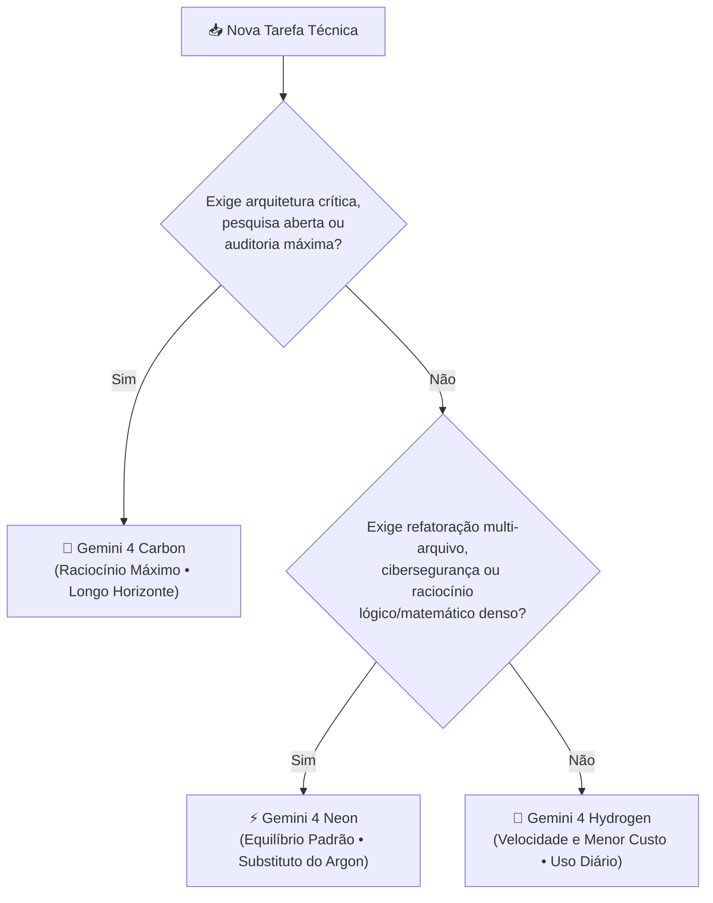

# 🧠 Família Gemini 4: Guia Prático de Escolha de Modelos e Eficiência de Tokens

> [!TIP]
> **Princípio Central:**
> Para extrair máxima eficiência técnica e financeira ao trabalhar com **estruturas densas de texto** (YAML, Gherkin, Mermaid, PlantUML), **engenharia de software** e **raciocínio lógico/matemático**, combine a escolha correta do modelo (**Hydrogen**, **Neon** ou **Carbon**) com a calibragem do **nível de pensamento (*Thinking Level*)** e do **Context Caching**.

---

## 📋 Índice

1. [Visão Geral da Família Gemini 4](#-1-visão-geral-da-família-gemini-4)
2. [Perfil Detalhado de Cada Modelo](#-2-perfil-detalhado-de-cada-modelo)
3. [Matriz de Eficiência: Qual Modelo Usar em Cada Tarefa?](#-3-matriz-de-eficiência-qual-modelo-usar-em-cada-tarefa)
4. [Estratégias Práticas para Economizar Tokens](#-4-estratégias-práticas-para-economizar-tokens)
5. [Nota sobre Modelos Legados e Rumores ("Xenon" / "Gemini 5")](#-5-nota-sobre-modelos-legados-e-rumores-xenon--gemini-5)

---

## 🧭 1. Visão Geral da Família Gemini 4

A geração **Gemini 4** organiza seus modelos em três faixas principais de custo, velocidade e profundidade de raciocínio, com **Gemini 4 Neon** assumindo o papel intermediário de alto desempenho que substituiu o **Gemini 4 Argon** no seletor padrão de assinantes (Google AI Pro/Ultra) e em ambientes como o **Google Antigravity**.



### Comparativo Técnico e de Preços (API / Google AI Studio)

Todos os modelos da linha compartilham **janela de contexto unificada de 1 milhão de tokens** (suportando entrada multimodal com texto, código, imagem, áudio e vídeo) e limite padrão de **64K tokens de saída** (expansível até **1M** via *long decode* / continuação em segundo plano).

| Modelo | Posicionamento | Contexto / Saída | Entrada (1M tokens) | Saída (1M tokens) | Cache Read (1M) | Níveis de Pensamento |
| :--- | :--- | :--- | :--- | :--- | :--- | :--- |
| **Gemini 4 Hydrogen** (`gemini-4-hydrogen`) | Alta velocidade e menor custo para código cotidiano e ferramentas | 1M / 64K (até 1M) | US\$ 1,50 | US\$ 7,50 | ~US\$ 0,075 | `low`, `medium`, `high` (padrão), `xhigh` |
| **Gemini 4 Neon** (`gemini-4-neon`) | Equilíbrio entre raciocínio de ponta, precisão em código e custo | 1M / 64K (até 1M) | US\$ 3,00 | US\$ 15,00 | US\$ 0,15 | `low`, `medium`, `high` (padrão), `xhigh` |
| **Gemini 4 Carbon** (`gemini-4-carbon`) | Fronteira máxima de raciocínio, arquitetura profunda e defesa cibernética | 1M / 64K (até 1M) | US\$ 4,00 *(US\$ 2,00 intro)* | US\$ 20,00 *(US\$ 10,00 intro)* | Até 95% de desconto | Alto consumo nativo de tokens de pensamento |

> [!NOTE]
> **Por que o custo real do Carbon é bem maior que o do Neon?**
> Além do preço unitário mais alto por token, o **Carbon** consome muito mais *thinking tokens* internos para explorar hipóteses e verificar etapas complexas. Em tarefas de engenharia e segurança em que o **Neon** atinge precisão equivalente, o custo total por tarefa tende a ser significativamente menor no Neon.

---

## 🔍 2. Perfil Detalhado de Cada Modelo

### 2.1. Gemini 4 Hydrogen (`gemini-4-hydrogen`)

* **Papel na família:** Modelo ágil de uso diário para desenvolvimento cotidiano, automações leves, chamadas de ferramentas (*tool use*) e validação rápida de formatos estruturados.
* **Por que usar aqui:** Linguagens e notações como **YAML**, **Gherkin** e diagramas (**PlantUML** / **Mermaid**) possuem sintaxe altamente padronizada e previsível. O **Hydrogen** (assim como a antiga linha Flash para tarefas simples) lida com essas conversões com baixa latência e metade do custo de entrada/saída do Neon.
* **Aplicações práticas:**
  * Converter histórias de usuário em cenários **Gherkin** (`Dado / Quando / Então`).
  * Gerar a estrutura inicial de arquivos **YAML** para pipelines de CI/CD, Docker Compose ou manifestos Kubernetes.
  * Corrigir pequenos erros de sintaxe e renderização em blocos **Mermaid** ou **PlantUML**.
  * Executar tarefas rápidas de triagem, *autocomplete* e subagentes de alto volume.

### 2.2. Gemini 4 Neon (`gemini-4-neon`)

* **Papel na família:** Modelo intermediário principal da linha Gemini 4, posicionado entre o ágil **Hydrogen** e o pesado **Carbon**, que substituiu o **Gemini 4 Argon** no seletor padrão de modelos para fluxos profissionais.
* **Principais diferenciais:**
  * **Níveis de pensamento ajustáveis (*Thinking Levels*):** Permite calibrar profundidade e gasto de tokens entre `low`, `medium`, `high` (padrão) e `xhigh` (para problemas extremos de engenharia e ciência).
  * **Edições cirúrgicas de código e baixa alucinação:** Otimizado para depuração e refatoração em múltiplos arquivos sem reescrever trechos desnecessários, mantendo alta aderência às instruções e baixa taxa de fabricação de dados.
  * **Foco em cibersegurança (DevSecOps):** Excelente desempenho em detecção, validação de exploração e correção de vulnerabilidades (como *SEC-bench Pro* e *CWE-bench v2*), consumindo menos tokens que o Carbon nessas tarefas.
* **Aplicações práticas:**
  * Sessões ativas de desenvolvimento e refatoração em repositórios grandes no **Google Antigravity**, **Android Studio** ou pipelines de CI/CD.
  * Ler um arquivo **YAML** complexo de infraestrutura e gerar o diagrama **PlantUML/Mermaid** correspondente com toda a topologia de rede.
  * Resolver problemas matemáticos ou financeiros com múltiplas etapas de dedução lógica (elevando o raciocínio para `xhigh` apenas quando necessário) e documentar o comportamento em **Gherkin**.
  * Operar fluxos agênticos de longa duração ou enxames de agentes (`/swarm`) sem perder o fio da meada.

### 2.3. Gemini 4 Carbon (`gemini-4-carbon`)

* **Papel na família:** Modelo de fronteira máxima, reservado para problemas em que a profundidade de raciocínio importa muito mais do que velocidade ou economia imediata.
* **Por que usar aqui:** Possui maior custo por token e gasta mais tempo/tokens pensando antes de responder. Usá-lo para gerar YAML básico, Gherkin simples ou diagramas triviais é desperdício de orçamento.
* **Aplicações práticas:**
  * Auditoria de segurança estrita em infraestrutura crítica (ex.: módulos complexos de **Terraform**, políticas de **Kubernetes/OPA**, superfícies de ataque e validação profunda de *exploits* antes de produção).
  * Depuração arquitetural de longo horizonte envolvendo múltiplos serviços, *race conditions* sutis ou migrações de alto risco.
  * Pesquisa aberta, provas matemáticas avançadas e decisões de design onde uma falha custa caro.

---

## 📊 3. Matriz de Eficiência: Qual Modelo Usar em Cada Tarefa?

| Tarefa do Desenvolvedor | Modelo Recomendado | Estratégia de Economia de Tokens |
| :--- | :--- | :--- |
| Criar cenários Gherkin e validar sintaxe YAML | **Gemini 4 Hydrogen** | Use para o fluxo diário com `low`/`medium` thinking (baixo custo e latência). |
| Gerar ou corrigir diagramas Mermaid / PlantUML simples | **Gemini 4 Hydrogen** | Mantenha o escopo local e peça apenas o bloco de código. |
| Desenvolvimento contínuo e refatoração multi-arquivo | **Gemini 4 Neon** | Aproveite edições cirúrgicas sem reescrever arquivos inteiros (`high` thinking). |
| Ingerir documentação massiva + Matemática densa | **Gemini 4 Neon** (`xhigh`) | Concentre tudo em um único prompt estruturado usando a janela de 1M, evitando chats fragmentados que repetem histórico. |
| Mapear código/infra densa para arquitetura visual | **Gemini 4 Neon** | Exija saída estritamente em blocos Markdown para evitar explicações textuais longas. |
| Auditoria de segurança em pipelines DevSecOps | **Gemini 4 Neon** / **Carbon** | Use **Neon** para varredura e correção rotineira; reserve **Carbon** para infraestrutura crítica e casos complexos. |
| Subagentes e paralelização (`/swarm`) | **Neon** (coordenação) + **Hydrogen** (execução) | Use o modelo mais inteligente para planejar/revisar e o mais rápido para tarefas repetitivas em paralelo. |

---

## 💡 4. Estratégias Práticas para Economizar Tokens

### 4.1. Evite texto de preenchimento (*Zero Fluff*) em saídas densas

Linguagens como **PlantUML**, **Mermaid**, **YAML** e **Gherkin** já carregam alta densidade informacional. Cada parágrafo de introdução ou despedida gerado antes/depois do código consome tokens de saída (que custam **5x mais** que tokens de entrada).

Adicione uma diretriz objetiva ao seu *System Prompt*:

```text
Responda exclusivamente com o bloco de código solicitado, válido e pronto para uso.
Não inclua saudações, introduções, explicações longas ou comentários fora do bloco de código,
a menos que haja uma ambiguidade crítica que impeça a geração correta.
```

### 4.2. Concentre contexto grande + use *Context Caching*

* **Evite fragmentar um sistema em 15 chats curtos:** Cada nova conversa reenvia instruções de sistema e contexto repetido. Com **1 milhão de tokens** de contexto unificado, vale mais enviar a especificação completa de uma só vez.
* **Ative o *Context Caching* em prompts repetitivos:** Se você consulta repetidamente a mesma base de código, schema de banco de dados ou conjunto de ADRs, a leitura em cache reduz drasticamente o custo dos tokens de entrada (chegando a US\$ 0,075–0,15 por 1M no Hydrogen/Neon e até 95% de desconto no Carbon).

### 4.3. Calibre o *Thinking Level* conforme a etapa

* Use **`low` / `medium`** no Hydrogen ou Neon para formatação, tradução entre formatos (ex.: JSON → YAML) e criação de testes simples.
* Mantenha **`high` (padrão)** para programação diária, revisão de PRs e depuração.
* Escale para **`xhigh`** apenas em gargalos reais (cálculos complexos, análise de vulnerabilidades sutis ou arquitetura crítica).

---

## ⚠️ 5. Nota sobre Modelos Legados e Rumores ("Xenon" / "Gemini 5")

* **Substituição do Gemini 4 Argon e Legacy Flash (`1.5` / `2.0`):**
  * Fluxos antigos documentados para **Gemini 1.5/2.0 Flash** devem migrar para o **Gemini 4 Hydrogen**, que assume o papel de alta velocidade e baixo custo na geração atual.
  * O **Gemini 4 Argon** foi substituído pelo **Gemini 4 Neon** no seletor padrão de modelos (como no Google Antigravity e planos AI Pro/Ultra), entregando melhor custo-benefício com pensamento ajustável.
* **Status do "Xenon" / "Gemini 5":**
  * Referências encontradas na comunidade a um suposto **"Gemini 5 Xenon"** (incluindo rumores sobre "janela de 100 bilhões de tokens", "Gemini 5 Flash/Pro/Ultra/Carbon" ou preços específicos não publicados pela Google) **não correspondem a modelos oficialmente lançados ou documentados pela Google DeepMind** até o momento.
  * Para planejamento de arquitetura, orçamento de API e escolha de ferramentas em produção, utilize apenas os modelos oficiais ativos da família **Gemini 4** (**Hydrogen**, **Neon** e **Carbon**).
