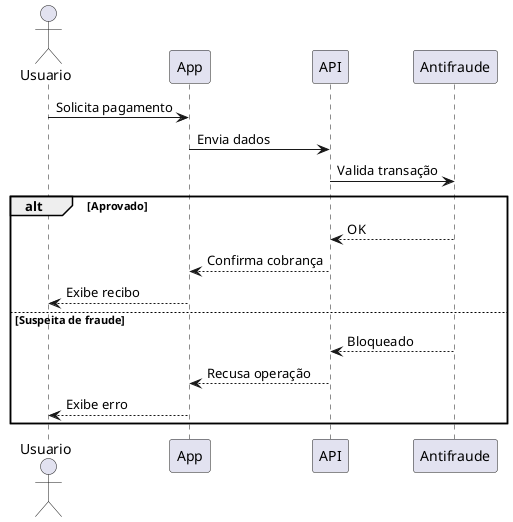
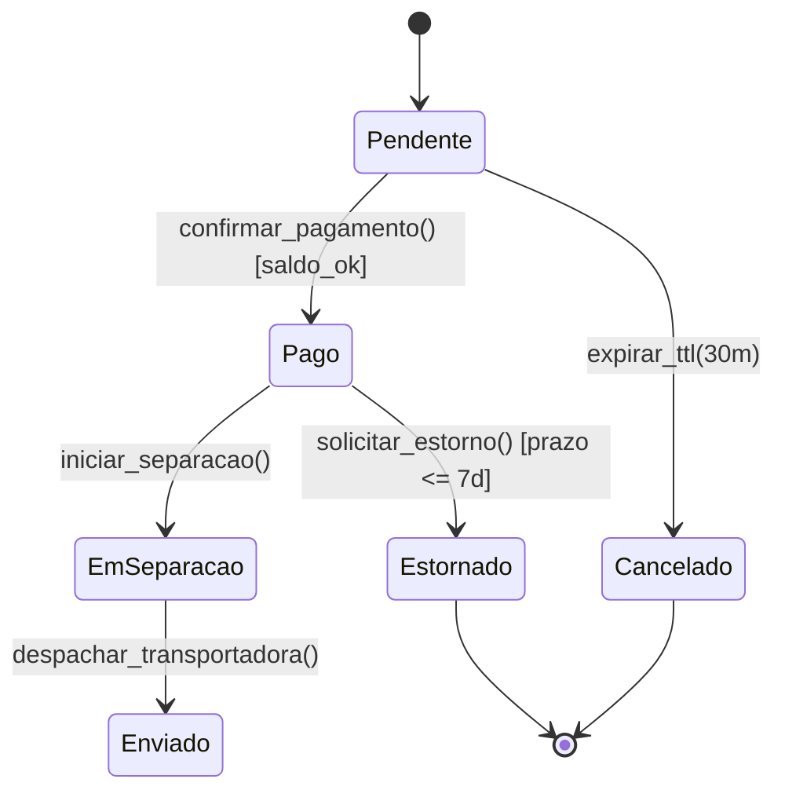
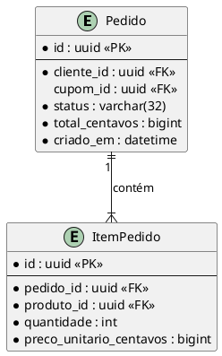

# 🎯 Engenharia de Contexto com Linguagens Densas: Como Economizar Tokens e Maximizar a Precisão da IA

> [!TIP]
> **Público-alvo:** Estudantes de Computação, Engenharia de Software e Análise de Sistemas que já conhecem diagramas (UML, EER, Sequência, Estados) e artefatos formais de projeto.  
> **Objetivo:** Demonstrar como substituir prompts prolixos em linguagem natural por **notações formais de alta densidade semântica** (MDCE, *Model-Driven Context Engineering*) e **ciclos de verificação em malha fechada**, reduzindo drasticamente o consumo de tokens e eliminando alucinações ao transformar requisitos de negócio em código de produção.

---

## 📋 Índice

1. [Por que a Prosa Descritiva Falha com LLMs](#1-por-que-a-prosa-descritiva-falha-com-llms)
2. [O Conceito-Chave: Linguagens Densas e Razão Sinal-Ruído (SNR)](#2-o-conceito-chave-linguagens-densas-e-razão-sinal-ruído-snr)
3. [O Arsenal de Linguagens Densas na Prática](#3-o-arsenal-de-linguagens-densas-na-prática)
   - [3.1. Diagramas de Sequência (PlantUML / Mermaid)](#31-diagramas-de-sequência-plantuml--mermaid)
   - [3.2. Máquinas de Estados Finitos (FSM)](#32-máquinas-de-estados-finitos-fsm)
   - [3.3. Modelagem Estrutural e de Dados (EER & Classes)](#33-modelagem-estrutural-e-de-dados-eer--classes)
   - [3.4. Comportamento e Invariantes (BDD com Gherkin)](#34-comportamento-e-invariantes-bdd-com-gherkin)
   - [3.5. Requisitos Estruturados e Contratos (YAML & OpenAPI)](#35-requisitos-estruturados-e-contratos-yaml--openapi)
   - [3.6. Restrições de Arquitetura (ADRs)](#36-restrições-de-arquitetura-adrs)
4. [Do Sonho do Negócio à Realidade: Montando um Pacote de Contexto Mínimo](#4-do-sonho-do-negócio-à-realidade-montando-um-pacote-de-contexto-mínimo)
5. [Nunca Deixe a IA Trabalhar "Às Cegas": Malha Aberta vs. Malha Fechada](#5-nunca-deixe-a-ia-trabalhar-às-cegas-malha-aberta-vs-malha-fechada)
6. [Orquestração de Modelos e Economia Financeira (Família Gemini 4)](#6-orquestração-de-modelos-e-economia-financeira-família-gemini-4)
7. [Armadilhas Comuns, Comparativo Técnico e Checklist Prático](#7-armadilhas-comuns-comparativo-técnico-e-checklist-prático)

---

## 1. Por que a Prosa Descritiva Falha com LLMs

Na faculdade, muitos estudantes tratam diagramas UML, modelos EER, especificações em YAML e cenários Gherkin como "burocracia acadêmica" para entregar na disciplina de Engenharia de Software, e na hora de programar abrem a IA e escrevem três parágrafos de texto corrido pedindo: *"Crie o módulo de pagamentos e estoque do meu sistema"*.

O resultado quase sempre segue o mesmo roteiro: a IA gera código com regras de negócio inventadas, nomes de campos inconsistentes ou bugs sutis; você tenta corrigir enviando mais 10 mensagens no chat; a janela de contexto infla, os limites de uso estouram e a sensação é de que "a IA não entende projetos reais".

Na Ciência da Computação, o problema não é falta de inteligência do modelo. Um *Large Language Model* (LLM) é um **motor preditivo estocástico baseado em mecanismos de atenção (*Transformers*)**. Quando você o alimenta com prosa extensa em português ou inglês, esbarra em três gargalos técnicos objetivos:

### 1.1. Ambiguidade e Precedência Lógica da Linguagem Natural
A linguagem humana é inerentemente polissêmica. Observe esta frase típica de requisito informal:
> *"O usuário só pode finalizar a compra se estiver ativo e com saldo positivo ou limite aprovado."*

Essa sentença admite duas árvores de precedência booleana completamente distintas:
* Interpretação A: `ativo && (saldo_positivo || limite_aprovado)`
* Interpretação B: `(ativo && saldo_positivo) || limite_aprovado`

Sem operadores formais, parênteses ou tabelas de decisão, o modelo precisa **adivinhar** a intenção probabilística, e adivinhação em modelos estocásticos produz bugs silenciosos.

### 1.2. O Fenômeno *Lost in the Middle* (Liu et al., 2024)
Pesquisadores de Stanford e UC Berkeley demonstraram empiricamente que a atenção dos *Transformers* não é uniforme ao longo do prompt. Quando você despeja blocos enormes de texto corrido, explicações redundantes e arquivos inteiros sem estrutura, o modelo apresenta uma curva de atenção em formato de "U":
1. Retém muito bem o **início** do prompt (*System Prompt* e primeiras instruções).
2. Retém bem o **final** do prompt (última pergunta).
3. **Degrada severamente a atenção no terço central.**

```text
Atenção do Modelo (Curva em U)
  ▲
1.0│  ████ (Início: Instruções Iniciais)        ████ (Fim: Último Comando)
   │  ████                                      ████
0.5│  ████   ░░░░░░░░░░░░░░░░░░░░░░░░░░░░░░░░   ████
   │  ████   ░░░░ Regras Críticas Perdidas ░░   ████
0.0└──┴──────┴──────────────────────────────────┴──────►
              Centro do Contexto (Prosa e Ruído)
```

Se uma regra crítica do domínio (ex.: *"não estornar pedido já faturado"*) ficar enterrada no meio de parágrafos prolixos, ela tem alta probabilidade de ser ignorada.

### 1.3. A Matemática Desfavorável dos Tokens (Especialmente na Saída e no Re-prompt)
Em qualquer API ou assinatura moderna (como detalhado em [Família Gemini 4](./Gemini-family.md)), **tokens de saída custam significativamente mais que tokens de entrada** (por exemplo, **5x mais** na linha Gemini 4), e **chats fragmentados multiplicam o custo de entrada**, porque a cada nova mensagem o histórico inteiro precisa ser reenviado ao modelo.

Um erro de especificação no Turno 1 gera 6 turnos de correção manual, e o que custaria 300 tokens bem modelados acaba consumindo 15.000+ tokens acumulados.

---

## 2. O Conceito-Chave: Linguagens Densas e Razão Sinal-Ruído (SNR)

Uma **linguagem densa** (ou notação formal de alta densidade semântica) é qualquer formato estruturado que maximiza a **Razão Sinal-Ruído (*Signal-to-Noise Ratio*, SNR)** por token consumido:

$$\text{SNR do Prompt} = \frac{\text{Informação Determinística (Entidades, Contratos, Invariantes, Fluxo)}}{\text{Total de Tokens (Conectivos, Preposições, Ambiguidade, Saudações)}}$$

Para um estudante de computação, a grande virada de chave é perceber que **os artefatos clássicos da Engenharia de Software funcionam como uma Representação Intermediária (IR) para LLMs**:

* **Zero palavras vazias:** Eliminam artigos, preposições repetitivas e verbos auxiliares (*"o sistema deverá então encaminhar para..."* vira `API -> Antifraude: validar()`).
* **Leitura quase em AST:** Sintaxes como PlantUML, Mermaid, YAML, Gherkin e OpenAPI possuem gramática regular e previsível, permitindo que o modelo mapeie cada linha diretamente para estruturas de dados, métodos e asserções de teste.
* **Rastreabilidade direta ao código:** Como exploramos nos módulos de [Engenharia de Requisitos](../001_engenharia_de_requisitos.md), [Casos de Uso](../004_diagramas_de_casos_de_uso.md) e [Modelagem EER](../005_modelagem_de_dados_e_eer.md), cada símbolo do diagrama corresponde a um artefato físico no projeto.

---

## 3. O Arsenal de Linguagens Densas na Prática

A seguir, você verá os **6 artefatos de maior retorno** para transformar o "sonho do negócio" em código funcional gastando uma fração dos tokens.

---

### 3.1. Diagramas de Sequência (PlantUML / Mermaid)

O **Diagrama de Sequência** é uma das provas mais imediatas da superioridade de notações densas sobre a prosa. Ele substitui parágrafos longos de *"quem chama quem"* e ramificações condicionais por setas curtas (`->`, `-->`) e blocos estruturais (`alt`, `else`, `loop`, `opt`).

#### Exemplo Prático: Fluxo de Pagamento com Antifraude

**Abordagem 1: Linguagem Natural (~115 tokens estimados)**

> *"O usuário envia uma solicitação de pagamento para o aplicativo. O aplicativo, por sua vez, encaminha os dados do cartão para a API de Pagamentos. A API de Pagamentos consulta o Serviço Antifraude para validar a transação. Se a transação for aprovada, o Serviço Antifraude retorna um sinal positivo para a API, que processa a cobrança e confirma o pagamento ao aplicativo, que então exibe o recibo ao usuário. Caso contrário, se houver suspeita de fraude, o serviço retorna um bloqueio, a API recusa a operação e o aplicativo exibe uma mensagem de erro."*

**Abordagem 2: PlantUML (~55 tokens estimados)**



*(Dica: Em **Mermaid** com `sequenceDiagram`, a densidade é equivalente e ainda dispensa a instalação local do Java/Graphviz em editores compatíveis com GitHub/Markdown).*

#### Comparativo de Eficiência

| Métrica | Linguagem Natural | PlantUML / Mermaid |
| :--- | :--- | :--- |
| **Consumo estimado** | ~115 tokens | ~55 tokens |
| **Economia direta** | Referência (0%) | **~52% menos tokens** |
| **Risco de ambiguidade** | Alto (exige inferir sujeitos, ordem síncrona/assíncrona e escopo do `else`) | **Mínimo** (participantes, ordem temporal e desvios explícitos) |
| **Escalabilidade** | O texto cresce de forma desordenada a cada novo desvio condicional | Cada nova chamada ou ramo custa apenas **1 linha curta** |

---

### 3.2. Máquinas de Estados Finitos (FSM)

Grande parte dos bugs graves em projetos acadêmicos e sistemas comerciais vem de **transições de estado inválidas** (ex.: um pedido `Cancelado` sendo marcado como `Pago`, ou uma reserva `Expirada` sendo confirmada).

Em vez de escrever duas páginas explicando o ciclo de vida de uma entidade, use um **Diagrama de Estados**:



Em **8 linhas**, a IA recebe:
1. Todos os estados válidos (que viram um `enum StatusPedido` fechado).
2. Os métodos exatos de domínio (Linguagem Ubíqua do DDD).
3. As **condições de guarda** (`[saldo_ok]`, `[prazo <= 7d]`).
4. Os **estados terminais** (`[*]`), impedindo que ela gere código permitindo cancelar um pedido já `Enviado`.

---

### 3.3. Modelagem Estrutural e de Dados (EER & Classes)

Como detalhado em [Modelagem de Dados e o Diagrama EER](../005_modelagem_de_dados_e_eer.md), um arquivo `.puml` atua como **Fonte Única da Verdade (SSoT)** para persistência e entidades de domínio.

Com menos de 20 linhas, você entrega à IA tipos exatos, nulabilidade (`*` = `NOT NULL`), chaves (`<<PK>>`, `<<FK>>`), cardinalidades (*Crow's Foot*) e métodos de domínio:



Repare no ganho de precisão:
* Ao declarar `total_centavos : bigint` em vez de falar *"guarde o valor do pedido"*, você **impede** que a IA alucine `FLOAT`/`DOUBLE` para dinheiro (evitando erros de ponto flutuante).
* Ao omitir `*` em `cupom_id`, você declara explicitamente que a FK é anulável (`NULL`).
* Um único bloco desse gera simultaneamente a **Migration SQL**, a **Entidade/Struct de Domínio** e o **Data Mapper**, sem que a IA invente colunas inexistentes.

---

### 3.4. Comportamento e Invariantes (BDD com Gherkin)

Diagramas EER e de Classes descrevem **estrutura (estado)**, mas não descrevem **regras de negócio dinâmicas**. Para isso, a notação mais densa e livre de ambiguidades é o **Gherkin (`Dado / Quando / Então`)**.

Em vez de escrever: *"Quero que valide o estoque e também veja se o cupom não venceu antes de cobrar o cliente"*, entregue:

```gherkin
Funcionalidade: Fechamento de Pedido no Checkout

  Cenário: Rejeição por estoque insuficiente antes da reserva financeira
    Dado que o cliente autenticado possui limite de crédito de R$ 500,00
    E o produto "Notebook Alpha" possui saldo em estoque igual a 0 unidades
    Quando o cliente requisitar o fechamento do pedido para 1 unidade
    Então o sistema deve rejeitar a transação com o erro "ESTOQUE_INSUFICIENTE"
    E nenhuma cobrança ou reserva deve ser enviada ao gateway de pagamento

  Esquema do Cenário: Validação de desconto por cupom percentual
    Dado um pedido com subtotal de R$ <subtotal>
    E um cupom válido com <desconto>% de desconto e teto de R$ 50,00
    Quando o cupom for aplicado ao pedido
    Então o desconto concedido deve ser R$ <esperado>

    Exemplos:
      | subtotal | desconto | esperado |
      | 200,00   | 10       | 20,00    |
      | 1000,00  | 10       | 50,00    |
```

Por que o Gherkin é ouro para economizar tokens?
* **Cada linha mapeia 1:1 para código de teste:** `Dado` → *Arrange* (fixture/setup), `Quando` → *Act* (chamada do Caso de Uso), `Então` → *Assert* (asserções).
* **Tabelas `Exemplos:` substituem dezenas de frases repetidas:** você testa casos normais e casos de borda (como o teto de R$ 50,00) em 4 linhas tabulares.

---

### 3.5. Requisitos Estruturados e Contratos (YAML & OpenAPI)

Quando o assunto é catálogo de requisitos (`RF`, `RNF`, `RN`) ou contratos de API HTTP, **YAML** e **OpenAPI/JSON Schema** comprimem especificações inteiras sem prosa:

```yaml
# Trecho de especificação de requisito e contrato (Alta Densidade)
caso_de_uso: UC_CHECKOUT_001
rastreabilidade: [RF006, RN012, RNF004]
endpoint:
  metodo: POST
  rota: /api/v1/pedidos/{pedido_id}/fechar
  idempotencia: header X-Idempotency-Key (UUIDv4 obrigatório)
  respostas:
    200: { schema: PedidoConfirmadoDTO }
    409: { codigo: ESTOQUE_INSUFICIENTE | CUPOM_EXPIRADO }
    422: { codigo: PAYLOAD_INVALIDO }
invariantes:
  - "Baixa de estoque e gravação do pedido na mesma transação ACID"
  - "Publicar evento PedidoPago via Transactional Outbox"
```

Compare isso com explicar idempotência, códigos HTTP, transações ACID e *Transactional Outbox* em texto corrido: além de gastar menos da metade dos tokens, cada campo funciona como uma âncora de verificação para o modelo.

---

### 3.6. Restrições de Arquitetura (ADRs)

Sem restrições arquiteturais explícitas, a IA recorre à "média estatística" da internet, que costuma ser código acoplado (SQL dentro de *controller*, entidades anêmicas, bibliotecas aleatórias).

Uma **ADR (*Architecture Decision Record*)** resumida poda o espaço de busca do modelo em poucas linhas, conforme o padrão do módulo [Decisões Arquiteturais e ADRs](../002_decisoes_arquiteturais_e_adrs.md):

```markdown
## ADR-004: Arquitetura Limpa, Domínio Puro e Transactional Outbox
- **Restrição Estrita:** O núcleo `src/Domain/` não pode importar ORM, SDK HTTP ou driver SQL.
- **Persistência:** Portas (`RepositoryInterface`) no Domínio; Adaptadores na Infraestrutura.
- **Resiliência (Graceful Degradation):** Cache deve suportar fallback Redis -> APCu/Arquivo sem lançar exceção fatal.
- **Mensageria:** Nunca publicar no broker antes do commit; gravar na tabela `outbox` na mesma transação.
```

> [!NOTE]
> **Onde organizar esses artefatos no repositório?**  
> Mantenha todas essas especificações versionadas em `docs/` seguindo o modelo **Docs-as-Code** descrito em [Organização de Pastas para Documentação](../artefatos-software/docs-guide.md). Assim, tanto você quanto um agente de IA (como no Google Antigravity ou CLI) podem ler apenas os arquivos relevantes sob demanda.

---

## 4. Do Sonho do Negócio à Realidade: Montando um Pacote de Contexto Mínimo

Veja como o método completo funciona ao sair de um pedido vago de cliente (*"sonho do negócio"*) para código aderente à arquitetura, **em um único prompt cirúrgico**.

### O "Sonho do Negócio" (Input Bruto do Cliente)
> *"Preciso que o cliente possa fechar o pedido usando um cupom de desconto, mas não pode vender produto sem estoque e se o pagamento der problema não pode cobrar."*

### O Pacote de Contexto Mínimo (O que o Engenheiro Envia à IA)

Em vez de colar a frase do cliente ou despejar 15 arquivos do projeto, você monta um prompt composto apenas pelos artefatos densos necessários para aquela **Fatia Vertical** ([Guia de Práticas Consagradas de Modelagem](../boas-praticas/established-modeling-practices.md)):

`````markdown
### Papel e Formato de Saída (Zero Fluff)
Atue como Engenheiro de Software Sênior. Implemente apenas os arquivos solicitados
em blocos de código separados por caminho de arquivo. Sem saudações ou explicações
fora dos comentários essenciais de código.

### 1. Restrições Arquiteturais (ADRs)
- Stack: PHP 8.4 (declare(strict_types=1)), PHPStan nível max, Pest PHP.
- Arquitetura: Clean Architecture + VSA. `Domain/` 100% puro (sem PDO/frameworks).
- Valores monetários sempre em `int` (centavos).

### 2. Modelo Estrutural (EER / Entidades)
```plantuml
entity Pedido { * id: uuid <<PK>>, * status: varchar(20), * total_centavos: bigint }
entity Cupom { * codigo: varchar(20) <<PK>>, * percentual: int, * teto_centavos: bigint, * valido_ate: datetime }
```

### 3. Fluxo de Execução (Sequência)
```plantuml
UseCase -> EstoqueRepo: reservar(itens)
alt Estoque insuficiente
    UseCase --> Caller: Err(ESTOQUE_INSUFICIENTE)
else Estoque reservado
    UseCase -> Cupom: calcularDesconto(subtotal)
    UseCase -> Gateway: autorizar(totalFinal)
    alt Pagamento recusado
        UseCase -> EstoqueRepo: liberar(itens)
        UseCase --> Caller: Err(PAGAMENTO_RECUSADO)
    end
end
```

### 4. Critérios de Aceite (Gherkin)
```gherkin
Cenário: Rollback de reserva de estoque quando gateway recusa pagamento
  Dado um produto com estoque 5 e pedido de 2 unidades
  Quando o gateway retornar recusa na autorização
  Então o estoque deve permanecer em 5 unidades
  E o caso de uso deve retornar erro "PAGAMENTO_RECUSADO"
```

### Tarefa
Gere:
1. `src/Domain/Entity/Pedido.php` e `src/Domain/ValueObject/Cupom.php`
2. `src/Application/UseCase/FecharPedido/FecharPedidoUseCase.php`
3. `tests/Unit/FecharPedidoUseCaseTest.php` cobrindo todos os ramos `alt` e o cenário Gherkin.
`````

Observe o que acabou de acontecer:
* **Tamanho total do prompt:** ~300 tokens.
* **Espaço de ambiguidade:** próximo de zero. Tipos (`int` em centavos), nomes de arquivos, restrições de pureza de domínio, tratamento de erro com compensação (`liberar(itens)`) e casos de teste estão todos formalizados antes de a IA gerar a primeira linha de código.

---

## 5. Nunca Deixe a IA Trabalhar "Às Cegas": Malha Aberta vs. Malha Fechada

Mesmo com especificações densas, um erro comum de quem usa IA apenas na janela do navegador é operar em **Malha Aberta (*Open-Loop*)**:

1. Você envia o prompt.
2. Copia o código gerado para a IDE.
3. Roda e vê um erro de tipo ou teste falhando.
4. Volta ao chat, cola o erro inteiro (e às vezes o arquivo inteiro de novo), e pergunta: *"Deu esse erro, conserta?"*.

Esse ciclo humano de "copia-e-cola" é o maior ralo de tokens que existe, pois **você atua como o compilador humano da IA** e reenvia contexto repetido a cada rodada.

### A Virada Agêntica: Síntese em Malha Fechada (*Closed-Loop Feedback*)

Em ambientes agênticos (como IDE com agentes, CLI ou pipelines automatizados), você acopla **oráculos de verificação executáveis** diretamente ao fluxo do agente:

```text
[ Especificação Densa ] ──► [ Agente LLM ] ──► [ Código + Testes ]
     (EER/Gherkin/ADR)             ▲                     │
                                   │                     ▼
                     [ Diagnóstico Estruturado ] ◄── [ Oráculo de Máquina ]
                                              (Compilador / Linter / Suíte de Testes)
```

O agente escreve o código, executa o oráculo no terminal, lê a saída determinística da máquina e corrige apenas o delta quebrado antes de entregar a solução final:

| Ecossistema | Oráculos Recomendados no Loop do Agente | Por que Economiza Tokens e Aumenta o Acerto |
| :--- | :--- | :--- |
| **PHP Moderno** | `phpstan analyse --level=max --error-format=json`, `pest` / `phpunit`, `behat` | Detecta nulos implícitos, quebras de contrato e falhas no Gherkin sem você precisar explicar o bug ao chat. |
| **Rust** | `cargo check --message-format=json`, `cargo clippy`, `cargo test` | O *borrow checker* e o sistema de tipos atuam como um provador formal; diagnósticos em JSON indicam linha, código (`E0382`) e correção exata. |
| **TypeScript / Web** | `tsc --noEmit`, `eslint`, `vitest` / `playwright` | Valida contratos entre backend/DTOs e captura erros reais de execução no navegador. |
| **Python** | `mypy --strict` / `pyright`, `ruff`, `pytest` | Garante tipagem estrita e valida cenários de borda rapidamente. |

> [!IMPORTANT]
> **Regra prática para trabalhos em equipe na faculdade:**  
> Antes de pedir à IA para "implementar a feature X", configure o linter estrito e o runner de testes no repositório. Um comando como `composer test` ou `cargo test` no loop do agente economiza dezenas de mensagens manuais e evita que código que "parece certo" quebre na apresentação.

---

## 6. Orquestração de Modelos e Economia Financeira (Família Gemini 4)

Linguagens densas ficam ainda mais eficientes quando combinadas com a escolha certa de modelo e parâmetros de execução (consulte o guia completo em [Família Gemini 4](./Gemini-family.md)):

1. **Roteie a complexidade para o modelo adequado:**
   * **Gemini 4 Hydrogen** (`low`/`medium` thinking): Ideal para **gerar ou converter formatos densos**, transformar histórias de usuário em **Gherkin**, estruturar **YAML** de requisitos, corrigir sintaxe **Mermaid/PlantUML** ou gerar scaffolding repetitivo com metade do custo por token.
   * **Gemini 4 Neon** (`high` ou `xhigh` thinking): Ideal para **ingerir o pacote completo de especificações (EER + Sequência + Gherkin + ADR)** e realizar edições cirúrgicas multi-arquivo com baixíssima alucinação, além de auditoria DevSecOps.
   * **Gemini 4 Carbon**: Reserve para **gargalos críticos** (auditoria profunda de segurança em infra, *race conditions* distribuídas ou decisões arquiteturais de alto impacto), pois consome mais *thinking tokens* internos.
2. **Exija saída *Zero Fluff*:** Como tokens de saída custam muito mais que entrada, instrua o agente a responder **apenas com o código ou artefato estruturado**, sem introduções (*"Claro! Aqui está o seu diagrama..."*) nem resumos longos repetindo o que você já pediu.
3. **Use *Context Caching* e evite chats fragmentados:** Em vez de abrir 12 abas diferentes colando as mesmas entidades e ADRs, concentre a especificação na pasta `docs/` e aproveite a janela unificada de **1 milhão de tokens** com *Context Caching* quando consultar repetidamente a mesma base de código e schemas.

---

## 7. Armadilhas Comuns, Comparativo Técnico e Checklist Prático

### 7.1. Anti-Patterns ao Usar Linguagens Densas com IA

| Anti-Pattern | O que acontece na prática | Como corrigir |
| :--- | :--- | :--- |
| **"Diagrama Deus" de 800 linhas** | Você joga o EER inteiro do sistema (40 tabelas) para implementar 1 caso de uso simples; o ruído reativa o *Lost in the Middle*. | Recorte apenas o subconjunto de entidades e diagramas pertencentes à **Fatia Vertical** atual (3 a 6 entidades). |
| **Prosa disfarçada dentro do PlantUML/YAML** | Escrever parágrafos gigantes dentro de notas (`note right`) ou descrições YAML, anulando a densidade. | Use identificadores curtos, tipos explícitos, guardas `[condição]` e frases atômicas. |
| **Ignorar estados de falha** | Modelar só o "caminho feliz" no diagrama de sequência e esperar que a IA adivinhe os rollbacks e códigos HTTP de erro. | Inclua sempre blocos `alt`/`else` para falhas críticas e ao menos 2 cenários negativos em Gherkin. |
| **Pedir "código + aula explicativa" no mesmo prompt** | Você paga tokens de saída caros por textos didáticos que já conhece da faculdade. | Separe o fluxo: peça **apenas código/diff** na implementação, e peça explicações apenas quando precisar estudar um trecho específico. |

### 7.2. Comparativo Técnico Consolidado

| Dimensão | Uso Amador (Prosa + Malha Aberta) | Engenharia com Linguagens Densas (MDCE + Malha Fechada) |
| :--- | :--- | :--- |
| **Formato de Entrada** | Parágrafos genéricos e despejo desordenado de arquivos | PlantUML/Mermaid, Gherkin, YAML/OpenAPI e ADRs enxutas |
| **Razão Sinal-Ruído** | Baixa (conectivos, repetições, ambiguidade lógica) | Máxima (tipos, cardinalidades, invariantes e fluxos explícitos) |
| **Consumo de Tokens** | Explosivo (múltiplos turnos de correção reenviando histórico) | Cirúrgico (especificação compacta + saída *Zero Fluff*) |
| **Detecção de Erros** | Manual (o desenvolvedor copia erros do terminal para o chat) | Automatizada (oráculos: compilador, linter estático e testes) |
| **Fidelidade ao Negócio** | Alta taxa de alucinação e código acoplado | Rastreável (`RF` → `Caso de Uso` → `Diagrama` → `Código` → `Teste`) |

### 7.3. Checklist de 5 Passos para o Seu Próximo Projeto

Antes de pedir à IA para gerar código de uma nova funcionalidade (no TCC, projeto de extensão ou estágio):

- [ ] **1. Estruture os Requisitos:** Liste os `RF`/`RN` afetados em formato enxuto (YAML) conforme [Engenharia de Requisitos](../001_engenharia_de_requisitos.md).
- [ ] **2. Fixe os Limites Arquiteturais:** Anexe ou referencie a ADR aplicável ([ADRs e Resiliência](../002_decisoes_arquiteturais_e_adrs.md) / [Arquitetura de Referência](../003_arquitetura_de_referencia.md)) para impedir acoplamento indevido.
- [ ] **3. Recorte a Estrutura e o Fluxo:** Passe apenas o trecho pertinente do [Diagrama EER](../005_modelagem_de_dados_e_eer.md) e um Diagrama de Sequência ou Estados (`.puml`/`.mmd`) cobrindo sucesso e erro.
- [ ] **4. Especifique Invariantes em Gherkin:** Escreva 2 a 4 cenários (`Dado / Quando / Então`) que serão convertidos diretamente em testes automatizados.
- [ ] **5. Feche o Ciclo com Oráculos:** Garanta que o agente rode linter estrito e testes unitários/integração após gerar o código, convergindo antes da revisão humana final.

---

> [!TIP]
> **Próximos passos recomendados neste Guia:**
> * Aprenda a escolher o modelo e o *Thinking Level* ideais em [Família Gemini 4](./Gemini-family.md).
> * Veja como estruturar os diretórios de especificação em [Organização de Pastas para Documentação (*Docs-as-Code*)](../artefatos-software/docs-guide.md).
> * Aprofunde como unir **DDD, VSA, Clean Architecture e CQRS** na modelagem em [Práticas Consagradas de Modelagem](../boas-praticas/established-modeling-practices.md).
