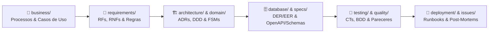

# 📚 Organização de Pastas para Documentação de Software (*Docs-as-Code*)

> [!TIP]
> **Regra Central:** Não existe uma norma internacional obrigatória que imponha nomes exatos de pastas para documentação de software. A organização de diretórios (como `docs/architecture/` ou `docs/domain/`) é uma **convenção da comunidade global de engenharia de software**, e não uma regra rígida por país ou região.

---

## 📋 Índice

1. [O que é Padronizado vs. O que é Convenção](#-1-o-que-é-padronizado-vs-o-que-é-convenção)
2. [Modelos de Referência Mais Adotados no Mundo](#-2-modelos-de-referência-mais-adotados-no-mundo)
3. [Conexão e Rastreabilidade Entre Pastas](#-3-conexão-e-rastreabilidade-entre-pastas)
4. [Árvore Canônica de Referência (`docs/`)](#-4-árvore-canônica-de-referência-docs)
5. [Guia Rápido: Onde Salvar Cada Artefato?](#-5-guia-rápido-onde-salvar-cada-artefato)
6. [Boas Práticas de Nomenclatura e Consistência](#-6-boas-práticas-de-nomenclatura-e-consistência)
7. [Adaptação: Produção Comercial vs. Trabalho Acadêmico (TCC / Banca)](#-7-adaptação-produção-comercial-vs-trabalho-acadêmico)

---

## ⚖️ 1. O que é Padronizado vs. O que é Convenção

Para entender onde existem regras formais e onde há liberdade de escolha, vale dividir o tema em três níveis:

* **O conteúdo dos documentos é padronizado globalmente:** normas internacionais como a **ISO/IEC/IEEE 29148** (Engenharia de Requisitos) e a **ISO/IEC/IEEE 42010** (Descrição de Arquitetura) definem *o que* deve constar dentro dos artefatos, independentemente do país. Porém, essas normas **não ditam** o nome da pasta onde o arquivo será salvo.
* **A estrutura de pastas segue convenções globais de mercado:** impulsionado por plataformas como GitHub, GitLab e ecossistemas modernos, o mercado internacional converge para termos curtos em inglês dentro de `docs/` (como `adr/`, `api/`, `diagrams/`, `runbooks/`).
* **Variações regionais aparecem apenas no idioma e nas leis:** a diferença prática por país está no idioma adotado pela equipe (órgãos públicos ou projetos acadêmicos no Brasil muitas vezes preferem `requisitos/` e `arquitetura/`) e em pastas dedicadas à conformidade legal local (como **LGPD** no Brasil, **GDPR** na Europa ou **HIPAA** nos Estados Unidos).

---

## 🌍 2. Modelos de Referência Mais Adotados no Mundo

Em vez de normas por país, a indústria adota modelos consagrados por metodologias e frameworks de arquitetura:

* **Docs-as-Code (Open Source / GitHub / GitLab):** mantém toda a documentação em texto puro (`Markdown`, `PlantUML`, `Mermaid`) dentro de `docs/` na raiz do repositório, versionada e revisada via *Pull Request* junto ao código-fonte.
* **Arc42 (muito forte na Europa):** template aberto de arquitetura que organiza a documentação em 12 seções numeradas (como `01_introduction`, `05_building_block_view`, `09_architecture_decisions`).
* **C4 Model (Reino Unido / uso global):** padroniza diagramas em 4 níveis de abstração (**Contexto**, **Contêineres**, **Componentes** e **Código**), influenciando diretamente a organização de `diagrams/`.
* **RUP / OpenUP (corporativo e governo):** estrutura artefatos por disciplinas de engenharia (Negócios, Requisitos, Análise e Design, Implementação, Testes e Implantação).

---

## 🔗 3. Conexão e Rastreabilidade Entre Pastas

O fator mais importante para qualquer equipe, auditoria ou banca examinadora não é o nome isolado de cada diretório, mas sim **consistência interna** e **rastreabilidade** ponta a ponta:



---

## 🌳 4. Árvore Canônica de Referência (`docs/`)

Esta estrutura combina **Docs-as-Code**, **DDD**, **C4 Model**, **ISO 29148** e governança operacional de produção:

```text
.
└── docs                                      # 📚 Central Unificada de Documentação do Projeto
    ├── architecture                          # 🏗️ Visão arquitetural, ADRs e diagramas técnicos
    │   ├── adr                               # ⚖️ Architecture Decision Records (ADRs)
    │   ├── agents                            # 🤖 Visão Geral de Agentes, IA e Automações
    │   ├── api                               # 📝 Especificações de APIs, OpenAPI e Endpoints
    │   └── deployment                        # 🚀 Manuais de implantação e notas de release
    │       ├── change_management             # 🔄 Controle de Mudanças (RFCs), Rollbacks e Janelas
    │       └── runbooks                      # 🔧 Procedimentos operacionais de resposta (Runbooks)
    ├── business                              # 🏢 Modelagem de Negócios e Processos
    │   ├── glossary                          # 📖 Glossário e Linguagem Ubíqua (DDD)
    │   ├── processes                         # 🔄 Processos de Negócio (BPMN e Fluxos Operacionais)
    │   └── use-cases                         # 🎯 Casos de Uso e Histórias de Usuário
    ├── database                              # 🗄️ Modelagem de Dados, DER/EER e Dicionário de Dados
    │   ├── migrations                        # 🧬 Histórico de evoluções de schema e scripts DDL
    │   └── seeds                             # 🌱 Massas de dados iniciais e cargas de teste
    ├── design                                # 🎨 Identidade Visual, Design System e UI/UX
    │   └── mockups                           # 🖼️ Protótipos de telas, wireframes e fluxos navegáveis
    ├── diagrams                              # 📊 Diagramas Visuais Gerais (.puml, .mmd, .svg)
    │   ├── c4_model                          # 🏛️ Diagramas de Contexto, Contêineres e Componentes
    │   └── state_machines                    # 🚦 Diagramas de Máquinas de Estados Finitos (FSM)
    ├── DoD                                   # ✅ Definition of Done (Critérios de Pronto e Aceite)
    ├── domain                                # 🧠 Núcleo do Domínio, Entidades e Agregados (DDD)
    │   ├── events                            # ⚡ Eventos de Domínio e Mensageria Assíncrona
    │   ├── roles                             # 🔐 Papéis, Perfis de Acesso (RBAC) e Permissões
    │   └── state_machines                    # ⚙️ Especificação lógica de transições de estados
    ├── issues                                # 🐛 Registro de Problemas, Bugs Conhecidos e Post-Mortems
    ├── kb                                    # 💡 Base de Conhecimento Interna e Políticas da Operação
    │   └── LGPD                              # 🛡️ Conformidade, Privacidade e Dados Pessoais
    ├── legal                                 # ⚖️ Documentação Jurídica, Termos de Uso e Contratos
    │   └── labor-opinions                    # 📋 Pareceres Trabalhistas, Regulatórios e Compliance
    ├── milestones                            # 🏁 Marcos do Projeto, Roadmap e Entregas por Sprint
    ├── quality_and_testing                   # 🛡️ Governança de Qualidade, Homologação e Pareceres
    │   ├── payment-gateway                   # 💳 Cenários e homologação de pagamentos e antifraude
    │   └── Ratification_and_Opinions         # ✍️ Pareceres Técnicos de Homologação e Aceite
    │       ├── Interface_and_Usability       # 👁️ Avaliações de UI/UX, Acessibilidade e Usabilidade
    │       └── security                      # 🔒 Auditorias de Segurança, Pentests e Vulnerabilidades
    ├── requirements                          # 🎯 Engenharia de Requisitos
    │   ├── business_rules                    # 📜 Regras de Negócio (RNs) e Restrições do Sistema
    │   ├── functional                        # ⚙️ Requisitos Funcionais (RFs)
    │   └── non_functional                    # ⚡ Requisitos Não-Funcionais (RNFs: SLA, Segurança)
    ├── specs                                 # 📐 Especificações Técnicas Detalhadas e Padrões
    │   └── schemas                           # 🧩 Schemas JSON, Payloads de Eventos e Validações
    ├── testing                               # 🧪 Planos de Testes, Suítes e Massa de Dados
    │   ├── diagnostics                       # 🔍 Logs de Depuração, Benchmarks e Análise de Falhas
    │   └── test_cases                        # 📋 Casos de Teste Estruturados (CTs, Gherkin/BDD)
    ├── tutorials                             # 🎓 Guias de Onboarding, Setup de Ambiente e Como Fazer
    └── workflows                             # 🔀 Fluxos de Execução Técnica e Integrações
        ├── activity_diagrams                 # 📈 Diagramas de Atividades
        └── sequence_diagrams                 # ⏱️ Diagramas de Sequência (Interação entre Serviços)
```

---

## 🧭 5. Guia Rápido: Onde Salvar Cada Artefato?

| O que você acabou de criar? | Onde salvar? | Exemplo de arquivo |
| :--- | :--- | :--- |
| Decisão técnica com prós, contras e contexto | `docs/architecture/adr/` | `0012-escolha-banco-cqrs.md` |
| Requisito funcional, regra de negócio ou RNF | `docs/requirements/` | `functional/rf-014-checkout.md` |
| Termo oficial do negócio (Linguagem Ubíqua) | `docs/business/glossary/` | `glossario-dominio.md` |
| Fluxo entre serviços ou telas (sequência/C4) | `docs/workflows/` ou `docs/diagrams/` | `sequence_diagrams/checkout-pix.puml` |
| Modelo entidade-relacionamento ou dicionário | `docs/database/` | `eer-diagram.puml` |
| Procedimento para incidente em produção | `docs/architecture/deployment/runbooks/` | `runbook-redis-oom.md` |
| Incidente ocorrido e lições aprendidas | `docs/issues/` | `post-mortem-2026-10-15.md` |
| Guia de instalação local para novo dev | `docs/tutorials/` | `setup-ambiente-local.md` |

---

## 📏 6. Boas Práticas de Nomenclatura e Consistência

* **Escolha um único idioma para os nomes das pastas:** evite misturar `docs/requirements/` com `docs/relatorios/`. Manter pastas em inglês (ou todas em português) evita duplicidade.
* **Padronize o estilo de caixa dos nomes (*casing*):** em projetos novos, prefira **`kebab-case`** (`use-cases/`, `business-rules/`) ou **`snake_case`** (`business_rules/`, `test_cases/`) de forma uniforme, evitando misturar `PascalCase` e `snake_case` na mesma árvore, pois sistemas Linux são *case-sensitive*.
* **Numeração sequencial em artefatos cronológicos:** use prefixos como `0001-`, `0002-` em `adr/`, `deployment/` e `migrations/` para preservar a ordem histórica no terminal e no Git.
* **Crie pastas sob demanda (*YAGNI*):** não gere 40 diretórios vazios no primeiro dia de um projeto pequeno. Comece com o núcleo (`requirements/`, `architecture/`, `database/`, `testing/`, `tutorials/`) e expanda conforme o sistema amadurecer.
* **Mantenha um `README.md` índice:** um arquivo central na raiz de `docs/` (e um checkpoint vivo como `PROJECT_STATUS.md` quando houver operação contínua) evita que documentos valiosos fiquem esquecidos em subpastas.

---

## 🎓 7. Adaptação: Produção Comercial vs. Trabalho Acadêmico

| Aspecto | Projeto Comercial / Produção | Projeto Acadêmico (TCC / Monografia / Banca) |
| :--- | :--- | :--- |
| **Foco principal** | Velocidade de onboarding, operação SRE, ADRs, runbooks e compliance (LGPD). | Rastreabilidade formal (`RF` → `UC` → `Diagrama` → `Código` → `Teste`) e fundamentação teórica. |
| **Pastas essenciais** | `architecture/`, `requirements/`, `database/`, `deployment/`, `issues/`, `kb/`. | `business/`, `requirements/`, `diagrams/`, `database/`, `testing/`, `design/`. |
| **Diferencial de entrega** | `runbooks/`, `change_management/` e `DoD/`. | Matriz de rastreabilidade explícita e `presentation/` com roteiro de defesa em banca. |

> [!NOTE]
> Se o mesmo projeto servir simultaneamente para **operação real** e **apresentação acadêmica**, mantenha a árvore comercial em `docs/` e concentre o roteiro didático de defesa em uma pasta dedicada (ex.: `presentation/` na raiz), apontando por links para os artefatos oficiais de `docs/` sem duplicar arquivos.
