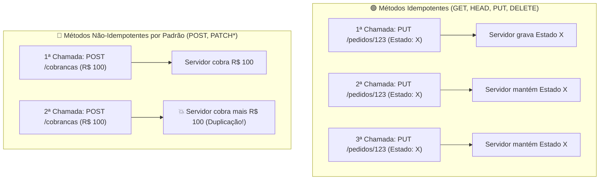
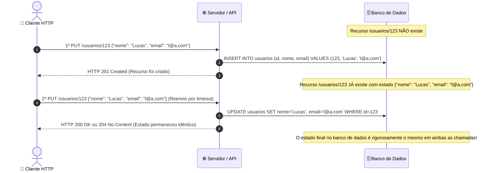
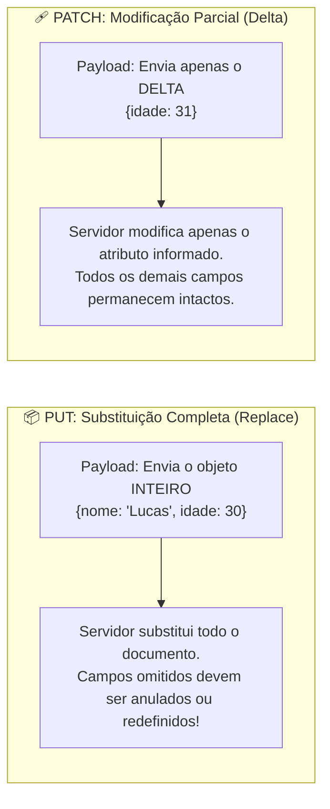
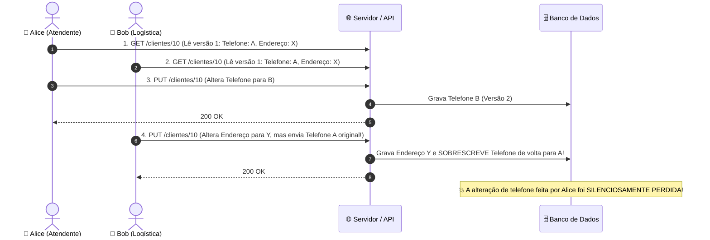
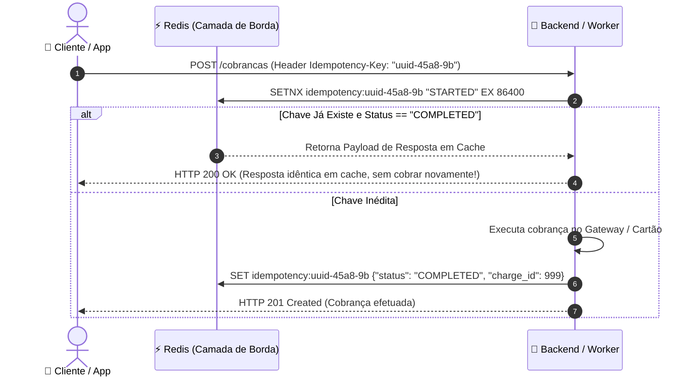

# PUT vs PATCH e a Engenharia de Idempotência em APIs REST

> O design de APIs RESTful frequentemente enfrenta dilemas entre **pureza semântica**, **eficiência de rede (largura de banda)**, **desempenho no banco de dados** e **resiliência contra falhas de rede**. Compreender as distinções profundas entre `PUT`, `PATCH` e `POST`, bem como dominar o conceito de **Idempotência**, é indispensável para construir contratos previsíveis e arquiteturas corporativas à prova de falhas.

Este guia disseca a semântica das RFCs do protocolo HTTP (RFC 9110, RFC 5789 e RFC 7396), desmistifica o comportamento do `PUT` que retorna `201 Created`, analisa os riscos de concorrência (*Lost Update*), ensina a implementar chaves de idempotência na borda e orienta quando utilizar verbos parciais versus comandos de domínio orientados a ação.

---

## 1. O Que É Idempotência no Protocolo HTTP?

Na matemática e na ciência da computação, uma operação é dita **idempotente** se a sua aplicação repetida produz exatamente o mesmo resultado que uma aplicação única:

$$\forall x, \quad f(f(x)) = f(x)$$

No contexto de redes e do protocolo HTTP (definido formalmente na **RFC 9110, Seção 9.2.2**):

> [!NOTE]
> Um método de requisição é **idempotente** se o efeito colateral (*side-effect*) pretendido no servidor para múltiplas requisições idênticas for exatamente o mesmo que para uma única requisição.



### Por que a Idempotência é Vital na Prática?
Em sistemas distribuídos, redes sofrem falhas temporárias (*transient faults*). Se um cliente móvel ou gateway enviar uma requisição, o servidor processar a alteração, mas a conexão TCP cair **antes da resposta HTTP retornar ao cliente**, o cliente ficará sem saber o que ocorreu.
* Em métodos **idempotentes**, o cliente ou proxy reverso pode **repetir a requisição com segurança (*safe retry*)**, sem risco de duplicar cobranças, registros ou estados.
* Em métodos **não-idempotentes**, um reenvio cego pode gerar cobranças duplicadas ou corrupção de inventário.

---

## 2. PUT é Idempotente Mesmo Quando Retorna `201 Created`?

**Sim, o PUT continua rigorosamente idempotente mesmo quando responde com `201 Created` na primeira chamada.**

Muitos desenvolvedores confundem *código de status HTTP idêntico* com *efeito colateral de estado idêntico*. A especificação HTTP exige que o **estado final do recurso no servidor seja idêntico**, e não que os códigos de status retornados em cada etapa da jornada sejam os mesmos.



### Anatomia da Execução:
1. **1ª Requisição (`PUT /usuarios/123`):** O identificador `123` ainda não existia. O servidor provisiona o novo recurso na URI informada e responde `201 Created`.
2. **2ª Requisição (idêntica `PUT /usuarios/123`):** O identificador `123` já existe. O servidor sobrescreve os dados com exatamente o mesmo payload e responde `200 OK` (ou `204 No Content`).
3. **Resultado:** O estado final do registro no banco é rigorosamente idêntico após 1, 2 ou 100 execuções. A invariante de idempotência foi 100% respeitada.

---

## 3. PUT vs PATCH: As Diferenças Semânticas Fundamentais

Embora ambos sejam utilizados para alterar recursos existentes, suas intenções arquiteturais e impactos de infraestrutura são totalmente distintos:



| Critério | `PUT` (RFC 9110) | `PATCH` (RFC 5789) |
| :--- | :--- | :--- |
| **Intenção Semântica** | **Substituição Completa** do recurso de destino | **Modificação Parcial** (aplicação de um delta) |
| **Tratamento de Campos Omitidos** | Campos não informados devem ser **apagados / redefinidos para null/default** | Campos não informados permanecem **inalterados** |
| **Idempotência Nativa** | 🟢 **Garantida por especificação** | 🟡 **Não garantida por padrão** (depende da operação) |
| **Consumo de Banda** | Alto (trafega o documento inteiro) | Mínimo (trafega apenas os campos alterados) |
| **Custo de Banco de Dados** | Alto (exige ler e regravar todas as colunas) | Baixo (`UPDATE tabela SET campo = ? WHERE id = ?`) |
| **Content-Type Típico** | `application/json` | `application/merge-patch+json` ou `application/json-patch+json` |

---

## 4. O Cuidado com o PATCH: Por que Ele Não é Inerentemente Idempotente?

Diferente do `PUT`, a **RFC 5789** esclarece explicitamente que o método `PATCH` **não é obrigado a ser idempotente**. A idempotência depende exclusivamente da natureza da mutação descrita no payload:

### Exemplo 1: PATCH Idempotente (Substituição de Atributo)
```http
PATCH /usuarios/123 HTTP/1.1
Content-Type: application/merge-patch+json

{
  "telefone": "+55 11 99999-8888"
}
```
*Se você executar essa requisição 10 vezes consecutivas, o telefone do usuário terminará com o mesmo valor exato. Esta operação é idempotente.*

### Exemplo 2: PATCH Não-Idempotente (Operação Cumulativa / Append)
Imagine um patch que instrui uma adição ou incremento:
```http
PATCH /contas/123 HTTP/1.1
Content-Type: application/json-patch+json

[
  { "op": "add", "path": "/tags/-", "value": "vip" },
  { "op": "increment", "path": "/saldo", "value": 50.00 }
]
```
*Se a requisição for repetida três vezes após falhas de rede transitórias, a tag `"vip"` poderá ser adicionada 3 vezes ao array e o saldo será incrementado em R\$ 150,00! Portanto, o PATCH em sua essência não pode ser assumido como idempotente pela camada de rede.*

---

## 5. Os Dois Padrões Formais de PATCH (RFC 7396 vs RFC 6902)

O mercado adota duas especificações formais para serializar modificações parciais em JSON:

### 1. JSON Merge Patch (RFC 7396) — O Mais Popular
Utiliza o cabeçalho `Content-Type: application/merge-patch+json`. O payload reflete a estrutura do documento original contendo apenas o que mudou. Para remover um campo existente, envia-se o valor `null`:

```json
// PATCH /produtos/4501
{
  "preco": 89.90,
  "descricao_secundaria": null // Instrução explícita para apagar este campo
}
```

### 2. JSON Patch (RFC 6902) — O Mais Rigoroso
Utiliza o cabeçalho `Content-Type: application/json-patch+json`. O payload é um array de operações atômicas (`add`, `remove`, `replace`, `move`, `copy`, `test`):

```json
// PATCH /pedidos/789
[
  { "op": "test", "path": "/status", "value": "PENDENTE" },
  { "op": "replace", "path": "/status", "value": "APROVADO" },
  { "op": "remove", "path": "/cupom_desconto" }
]
```

---

## 6. O Problema do *Lost Update* e Concorrência Otimista (ETag / If-Match)

Quando múltiplos clientes tentam atualizar o mesmo recurso de forma concorrente sem controle transacional, ocorre o grave problema da **Perda de Atualização (*Lost Update*)**:



### A Solução Padronizada: Bloqueio Otimista com `ETag` e `If-Match`
O protocolo HTTP resolve o *Lost Update* nativamente através de condicionais de cabeçalho (**RFC 9110, Seção 13.1.1**):

1. Quando o cliente consulta o recurso via `GET`, o servidor inclui um cabeçalho `ETag` (um hash do conteúdo ou versão de controle):
   ```http
   HTTP/1.1 200 OK
   ETag: "v1-a8f3b4c1"
   ```
2. Quando o cliente envia um `PUT` ou `PATCH`, ele é obrigado a incluir o cabeçalho condicional `If-Match`:
   ```http
   PATCH /clientes/10 HTTP/1.1
   If-Match: "v1-a8f3b4c1"
   Content-Type: application/merge-patch+json

   {"endereco": "Avenida Paulista, 1000"}
   ```
3. Se outro usuário tiver atualizado o cliente no intervalo (alterando o hash para `"v2-c9d2e5f0"`), o servidor rejeita imediatamente a alteração concorrente com o status:
   ```http
   HTTP/1.1 412 Precondition Failed
   ```
O cliente de Bob recebe o erro 412, recarrega o dado mais recente e reaplica a alteração sem sobrescrever o telefone de Alice.

---

## 7. A Ascensão do POST com Chaves de Idempotência (*Idempotency-Key*)

Na prática da engenharia de software moderna (gateways de pagamento como Stripe, PayPal, Mercado Pago e grandes e-commerces), o uso do `POST` para operações de criação ou modificação tornou-se predominante.

### Por que o POST Ganhou Espaço sobre o PUT?
1. **Identificadores Gerados no Servidor:** O `PUT /recursos/{id}` exige que o cliente conheça o identificador do recurso com antecedência. No entanto, quase todas as aplicações utilizam chaves primárias sequenciais (*auto-increment*) ou UUIDs gerados no banco de dados.
2. **APIs Orientadas a Ação / Domínio Rico:** Conforme visto no estudo sobre [Classes Anêmicas e Modelo Rico em Rust](file:///var/www/html/Guia_desenvolvimento_software/boas-praticas/Rust/classes-anemicas.md), a mutação de uma entidade deve refletir intenções de negócio, e não meras atribuições de gaveta de dados:
   * ❌ `PATCH /pedidos/123 {"status": "CANCELADO"}` (Estilo Anêmico/CRUD)
   * ✅ `POST /pedidos/123/cancelar {"motivo": "Fraude detectada"}` (Comando de Domínio Explícito)

### O Padrão `Idempotency-Key` com Redis
Para conferir a segurança de idempotência a métodos `POST`, a indústria adotou o cabeçalho padronizado `Idempotency-Key`:



---

## 8. Implementação Prática em Rust (Axum + ETag Otimista + PATCH)

O código abaixo demonstra um endpoint em Rust com o framework **Axum** gerenciando uma atualização parcial via `PATCH`, com suporte a concorrência otimista via `If-Match`:

```rust
use axum::{
    extract::{Path, State},
    http::{HeaderMap, StatusCode},
    response::IntoResponse,
    routing::patch,
    Json, Router,
};
use serde::{Deserialize, Serialize};
use std::sync::Arc;

#[derive(Debug, Deserialize)]
pub struct PatchProdutoDto {
    pub preco: Option<f64>,
    pub estoque: Option<i32>,
}

#[derive(Debug, Serialize, Clone)]
pub struct Produto {
    pub id: i64,
    pub nome: String,
    pub preco: f64,
    pub estoque: i32,
    pub versao: i64, // Incrementado a cada mutação para gerar o ETag
}

pub struct AppState {
    pub db: sqlx::MySqlPool,
}

pub fn rotas_produtos(estado: Arc<AppState>) -> Router {
    Router::new()
        .route("/produtos/:id", patch(atualizar_produto_patch))
        .with_state(estado)
}

pub async fn atualizar_produto_patch(
    Path(id): Path<i64>,
    State(state): State<Arc<AppState>>,
    headers: HeaderMap,
    Json(dto): Json<PatchProdutoDto>,
) -> Result<impl IntoResponse, (StatusCode, &'static str)> {
    // 1. Extração da condicional If-Match para evitar Lost Update
    let etag_esperado = headers
        .get("if-match")
        .and_then(|v| v.to_str().ok())
        .ok_or((StatusCode::BAD_REQUEST, "O cabeçalho If-Match é obrigatório."))?;

    // 2. Executa a mutação direta no banco (Sem Read-Before-Write desnecessário!)
    // Atualiza apenas as colunas informadas e valida a versão atomicamente
    let resultado = sqlx::query!(
        r#"
        UPDATE produtos 
        SET 
            preco = COALESCE(?, preco),
            estoque = COALESCE(?, estoque),
            versao = versao + 1
        WHERE id = ? AND CONCAT('"', versao, '"') = ?
        "#,
        dto.preco,
        dto.estoque,
        id,
        etag_esperado
    )
    .execute(&state.db)
    .await
    .map_err(|_| (StatusCode::INTERNAL_SERVER_ERROR, "Falha de persistência."))?;

    // 3. Se nenhuma linha foi afetada, houve colisão de versão concorrente!
    if resultado.rows_affected() == 0 {
        return Err((
            StatusCode::PRECONDITION_FAILED,
            "Conflito de concorrência: O recurso foi modificado por outro processo (ETag mismatch).",
        ));
    }

    Ok((StatusCode::NO_CONTENT, ()))
}
```

---

## 9. Matriz Comparativa Definitiva: Qual Abordagem Escolher?

| Cenário de Negócio | Verbo Recomendado | Idempotente? | O que Trafegar no Body? | Tratamento no Banco de Dados |
| :--- | :---: | :---: | :--- | :--- |
| **Upload ou Substituição de Arquivo Inteiro** (ex: Documento / S3) | `PUT /arquivos/{id}` | 🟢 Sim | O binário ou objeto completo | `INSERT ... ON DUPLICATE KEY UPDATE` |
| **Atualização de Atributos Específicos** (ex: E-mail, Telefone, Descrição) | `PATCH /clientes/{id}` | 🟡 Sim (se Merge Patch) | Apenas as chaves alteradas | `UPDATE tabela SET col = ? WHERE id = ?` |
| **Criação de Recurso com ID no Banco** (ex: Novo Pedido de Compra) | `POST /pedidos` | 🔴 Não | Objeto a ser cadastrado | `INSERT INTO pedidos ...` |
| **Comando de Domínio ou Transição de Estado** (ex: Cancelar, Estornar) | `POST /pedidos/{id}/cancelar` | 🔴 Não | Parâmetros da ação (ex: motivo) | Execução de método de entidade rica + Evento |
| **Operações Financeiras Críticas** (ex: Transações PIX, Cartão de Crédito) | `POST /cobrancas` + `Idempotency-Key` | 🟢 Sim (via Key) | Dados da transação | Verificação no Redis + Lock Distribuído |

---

## 10. Resumo e Regras de Ouro

1. **Idempotência é sobre o Estado do Servidor:** O `PUT` é idempotente mesmo retornando `201 Created` na primeira chamada e `200/204` nas seguintes, pois o estado final do dado persistido permanece rigorosamente o mesmo.
2. **Abandone o "Read-Before-Write" no Banco:** Para atualizações parciais com `PATCH`, evite executar um `SELECT` prévio do objeto inteiro para dar `UPDATE` em todas as colunas. Atualize diretamente os campos alterados via `UPDATE ... SET campo = ? WHERE id = ?`.
3. **Proteja Atualizações Concorrentes com `If-Match`:** Em recursos acessados por múltiplos operadores, exija o cabeçalho `If-Match` com o `ETag` da versão para evitar o problema catastrófico de *Lost Update*.
4. **Use `Idempotency-Key` em POSTs Críticos:** Quando a criação subordinada depender do método `POST` e envolver transações financeiras ou efeitos colaterais caros, exija um UUID único de idempotência gerenciado com trava atômica no Redis.
5. **Prefira Ações de Domínio a PATCHs Anêmicos:** Quando a mutação representar uma regra de negócio complexa (como cancelar uma compra, aprovar um crédito ou despachar uma entrega), modele a rota como um comando explícito (`POST /pedidos/123/cancelar`) com sua respectiva validação de invariantes.

---

### Leituras Complementares no Guia:
* [O Anti-Pattern das Classes Anêmicas e o Modelo Rico em Rust](file:///var/www/html/Guia_desenvolvimento_software/boas-praticas/Rust/classes-anemicas.md)
* [Validação de Strings, Limite de Tamanho e Newtypes em Rust](file:///var/www/html/Guia_desenvolvimento_software/boas-praticas/Rust/validacao-string.md)
* [Segurança Proativa: Monitoramento e Resposta a Payloads Anômalos em Rust](file:///var/www/html/Guia_desenvolvimento_software/seguranca/reagir-payloads-grandes.md)
* [Prevenção Contra Roubo de Sessão e Gestão de Tokens](file:///var/www/html/Guia_desenvolvimento_software/boas-praticas/security/session-security-manager.md)
