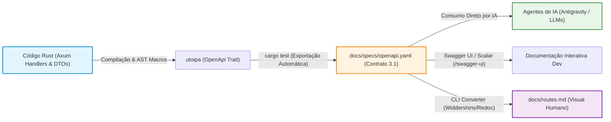

# Gerenciamento e Geração Automatizada de Artefatos de Rotas em Rust (OpenAPI & Markdown)

> **Regra de Ouro da Documentação Viva:** O código-fonte Rust é a **única fonte da verdade** (*Single Source of Truth - SSOT*). Qualquer documentação de rotas mantida manualmente está condenada à divergência (*code rot*), obsolescência técnica e indução de alucinações em agentes de inteligência artificial. A melhor prática de engenharia de software consiste em extrair as especificações de contrato estruturadas (OpenAPI 3.1 YAML) diretamente das structs e handlers do Rust em tempo de compilação/teste e, a partir delas, derivar automaticamente a documentação legível para humanos em Markdown.

---

## 1. A Visão Arquitetural: Single Source of Truth (SSOT)

Manter especificações manuais de rotas é um dos maiores gargalos de manutenibilidade em arquiteturas distribuídas e APIs RESTful. Quando um desenvolvedor adiciona um campo obrigatório a um DTO ou altera um código HTTP de `200 OK` para `201 Created`, a probabilidade de esquecer de atualizar um arquivo `.md` ou `.yaml` solto é altíssima.

A abordagem moderna em Rust resolve isso invertendo o fluxo de dependência:



### O Triângulo de Consumo:
1. **Máquinas & Ferramentas:** Consomem `docs/specs/openapi.yaml` para gerar SDKs, mocks e coleções de teste (Postman/Insomnia).
2. **Agentes de IA:** Consomem `docs/specs/openapi.yaml` para obter precisão cirúrgica de tipos, constraints de payload e parâmetros de rota com custo mínimo de tokens de contexto.
3. **Desenvolvedores Humanos:** Consomem a UI interativa no navegador (`/swagger-ui`) e o catálogo consolidado em Markdown (`docs/routes.md`) para navegação rápida no repositório.

---

## 2. Por que Manter a Dupla `.yaml` (OpenAPI) e `.md` (Markdown)?

Muitos times questionam se devem manter apenas o `.yaml` ou apenas o `.md`. A resposta correta em projetos de ponta é: **mantenha ambos, mas edite apenas o código Rust**.

### Tabela Comparativa: OpenAPI vs. Markdown

| Aspecto | `docs/specs/openapi.yaml` (OpenAPI 3.1) | `docs/routes.md` (Markdown Humano) |
| :--- | :--- | :--- |
| **Público-Alvo Primário** | Agentes de IA, Swagger UI, geradores de SDK, linters. | Desenvolvedores humanos, Code Reviewers, stakeholders. |
| **Origem do Arquivo** | Gerado programmaticamente via `utoipa` a partir da AST do Rust. | Compilado automaticamente a partir do `openapi.yaml`. |
| **Estrutura de Dados** | Padronizada pela *OpenAPI Initiative* (JSON Schema / YAML). | Texto formatado com tabelas, alertas e seções livres. |
| **Eficiência para IA** | **Máxima.** Alta densidade semântica por token, sem ruído visual. | Menor densidade (contém prosa, markdown overhead, pipes). |
| **Garantia de Tipagem** | Estrita (`uuid`, `int64`, regex patterns, enums de status). | Descritiva (depende de convenção de quem escreveu). |
| **Visualização** | Swagger UI, Redoc, Postman, Scalar, IDE Plugins. | Renderizador Markdown do GitHub, GitLab ou VS Code. |

### Por que Agentes de IA Preferem OpenAPI YAML?
* **Economia Extrema de Contexto:** Um arquivo OpenAPI compactado consome entre 40% e 60% menos tokens do que sua representação equivalente em tabelas Markdown explicativas.
* **Grounding e Eliminação de Alucinações:** Modelos de linguagem conseguem mapear os schemas do OpenAPI diretamente para tipagens em TypeScript, Rust, Python ou JSON com zero ambiguidade de nomes (`customer_id` vs `customerId`).
* **Validação Prévia de Payloads:** Agentes autônomos que escrevem testes E2E (Playwright/Cucumber) leem os schemas de request e montam mocks 100% aderentes às regras da API de primeira.

---

## 3. Implementação Prática com Axum 0.8 e Tokio

No ecossistema Rust, a biblioteca canônica e mais robusta para geração de contratos OpenAPI é o [`utoipa`](https://crates.io/crates/utoipa), acompanhada do [`utoipa-swagger-ui`](https://crates.io/crates/utoipa-swagger-ui) para renderização interativa no Axum.

### Passo 1: Configurar Dependências (`apps/api/Cargo.toml`)

No `Cargo.toml` do binário HTTP da API (`apps/api`):

```toml
[dependencies]
# Framework Web & Async Runtime
axum = { version = "0.8", features = ["macros"] }
tokio = { workspace = true }

# OpenAPI 3.1 Generator
utoipa = { version = "5.3", features = [
    "axum_extras",
    "chrono",
    "uuid",
    "rust_decimal"
] }
utoipa-swagger-ui = { version = "9.0", features = ["axum"] }

# Validação e Serialização
serde = { workspace = true }
serde_json = { workspace = true }
validator = { workspace = true }
```

> [!TIP]
> A ativação das features `chrono`, `uuid` e `rust_decimal` permite que o `utoipa` mapeie tipos como `chrono::DateTime<Utc>`, `uuid::Uuid` e `rust_decimal::Decimal` automaticamente para formatos nativos do OpenAPI (`format: date-time`, `format: uuid` e `type: number`).

---

### Passo 2: Anotar os DTOs com `#[derive(ToSchema)]`

As structs de entrada (Request Body) e saída (Responses) recebem a macro `ToSchema`:

```rust
// crates/application/src/pos/dtos/pre_sale_dtos.rs
use rust_decimal::Decimal;
use serde::{Deserialize, Serialize};
use utoipa::ToSchema;
use validator::Validate;

#[derive(Debug, Clone, Serialize, Deserialize, ToSchema, Validate)]
pub struct CreatePreSaleDto {
    #[schema(example = 1373, description = "ID do cliente vinculado (opcional no balcão)")]
    pub customer_id: Option<u64>,

    #[validate(length(min = 1, message = "O carrinho precisa ter ao menos um item"))]
    #[schema(description = "Lista de itens a serem incluídos no ticket de pré-venda")]
    pub items: Vec<PreSaleItemDto>,

    #[schema(example = "PDV-BALCAO-01", description = "Identificador do terminal emissor")]
    pub terminal_id: String,
}

#[derive(Debug, Clone, Serialize, Deserialize, ToSchema, Validate)]
pub struct PreSaleItemDto {
    #[schema(example = 42)]
    pub product_id: u64,

    #[schema(example = 2.5)]
    pub quantity: Decimal,

    #[schema(example = 49.90)]
    pub unit_price: Decimal,
}

#[derive(Debug, Clone, Serialize, Deserialize, ToSchema)]
pub struct PreSaleResponseDto {
    #[schema(example = "TKT-2026-99881")]
    pub ticket_code: String,

    #[schema(example = 124.75)]
    pub total_amount: Decimal,

    #[schema(example = "data:image/svg+xml;base64,...", description = "QR Code SVG para leitura no caixa")]
    pub qrcode_svg: String,
}
```

---

### Passo 3: Anotar os Handlers Axum com `#[utoipa::path(...)]`

Nos controladores/handlers da camada web (`apps/api/src/routes/`):

```rust
// apps/api/src/routes/pos/handlers.rs
use axum::{extract::State, http::StatusCode, response::IntoResponse, Json};
use std::sync::Arc;
use crate::state::AppState;
use application::pos::dtos::{CreatePreSaleDto, PreSaleResponseDto};
use domain::errors::DomainError;

/// Cria um novo ticket de pré-venda no Ponto de Venda (PDV)
#[utoipa::path(
    post,
    path = "/api/v1/pos/pre-sale",
    tag = "POS - Ponto de Venda",
    request_body = CreatePreSaleDto,
    responses(
        (status = 201, description = "Ticket de pré-venda emitido com sucesso", body = PreSaleResponseDto),
        (status = 400, description = "Payload inválido ou falha de validação semântica"),
        (status = 401, description = "Operador não autenticado no terminal"),
        (status = 422, description = "Erro de negócio (ex: estoque insuficiente)")
    ),
    security(
        ("bearer_jwt" = [])
    )
)]
pub async fn create_pre_sale_handler(
    State(state): State<Arc<AppState>>,
    Json(payload): Json<CreatePreSaleDto>,
) -> Result<impl IntoResponse, DomainError> {
    // 1. Validação semântica dos dados
    payload.validate().map_err(|e| DomainError::ValidationError(e.to_string()))?;

    // 2. Execução do caso de uso
    let response = state.pos_use_case.create_ticket(payload).await?;

    Ok((StatusCode::CREATED, Json(response)))
}
```

---

### Passo 4: Agregação da API Central (`ApiDoc`)

Centralize o registro de todas as rotas e esquemas em um único ponto agregador:

```rust
// apps/api/src/routes/openapi_doc.rs
use utoipa::OpenApi;
use application::pos::dtos::{CreatePreSaleDto, PreSaleItemDto, PreSaleResponseDto};

#[derive(OpenApi)]
#[openapi(
    paths(
        crate::routes::pos::create_pre_sale_handler,
        crate::routes::health::health_handler,
    ),
    components(
        schemas(
            CreatePreSaleDto,
            PreSaleItemDto,
            PreSaleResponseDto
        )
    ),
    tags(
        (name = "POS - Ponto de Venda", description = "Endpoints de Frente de Caixa e Balcão"),
        (name = "Health", description = "Probes de Liveness, Readiness e Métricas SRE")
    ),
    modifiers(&SecurityAddon)
)]
pub struct ApiDoc;

struct SecurityAddon;

impl utoipa::Modify for SecurityAddon {
    fn modify(&self, openapi: &mut utoipa::openapi::OpenApi) {
        if let Some(components) = openapi.components.as_mut() {
            components.add_security_scheme(
                "bearer_jwt",
                utoipa::openapi::security::SecurityScheme::Http(
                    utoipa::openapi::security::HttpBuilder::new()
                        .scheme(utoipa::openapi::security::HttpAuthScheme::Bearer)
                        .bearer_format("JWT")
                        .description(Some("Token JWT assinado emitido no login"))
                        .build(),
                ),
            );
        }
    }
}
```

---

### Passo 5: Integrar Swagger UI no Servidor Axum

No arquivo de rotas principal (`apps/api/src/routes/mod.rs`):

```rust
use axum::Router;
use utoipa::OpenApi;
use utoipa_swagger_ui::SwaggerUi;
use crate::state::AppState;
use crate::routes::openapi_doc::ApiDoc;

pub fn app_router() -> Router<AppState> {
    Router::new()
        // Expõe a documentação interativa Swagger UI em http://localhost:3001/swagger-ui
        .merge(SwaggerUi::new("/swagger-ui").url("/api-docs/openapi.json", ApiDoc::openapi()))
        // ... demais rotas do sistema
}
```

---

## 4. Exportação Automatizada via Teste (`cargo test`)

Em vez de subir o servidor localmente para baixar o OpenAPI via `curl`, a melhor prática arquitetural consiste em criar um **teste unitário automatizado**. Sempre que `cargo test --workspace` for executado, o arquivo `docs/specs/openapi.yaml` é atualizado no disco de forma determinística:

```rust
// apps/api/src/routes/openapi_export_test.rs
#[cfg(test)]
mod tests {
    use super::*;
    use std::fs;
    use std::path::Path;
    use utoipa::OpenApi;

    #[test]
    fn exportar_openapi_specification_para_disco() {
        let mut openapi = ApiDoc::openapi();
        
        // Metadados dinâmicos baseados no Cargo.toml
        openapi.info.title = "Alpha Engine - RESTful API".to_string();
        openapi.info.version = env!("CARGO_PKG_VERSION").to_string();
        openapi.info.description = Some(
            "Especificação técnica canônica dos contratos RESTful da Alpha Engine.".to_string(),
        );

        let yaml_content = openapi
            .to_yaml()
            .expect("Erro ao serializar especificação OpenAPI para formato YAML");

        let target_path = Path::new("../../docs/specs/openapi.yaml");

        // Garante que o diretório pai existe
        if let Some(parent) = target_path.parent() {
            fs::create_dir_all(parent).expect("Falha ao criar pasta docs/specs/");
        }

        fs::write(target_path, yaml_content)
            .expect("Falha ao gravar arquivo docs/specs/openapi.yaml");
            
        println!("✅ docs/specs/openapi.yaml gerado com sucesso via cargo test!");
    }
}
```

> [!IMPORTANT]
> **Vantagem de Governança:** Se um desenvolvedor alterar um tipo de dado ou remover uma rota sem atualizar a anotação do `utoipa`, o teste falha ou a alteração fica explicitamente visível no `git diff` do arquivo `docs/specs/openapi.yaml` durante o Code Review.

---

## 5. Pipeline de Sincronização para Markdown (`docs/routes.md`)

Uma vez que o arquivo `docs/specs/openapi.yaml` é mantido atualizado pelo código Rust, a conversão para Markdown humano (`docs/routes.md`) deve ser delegada a ferramentas consagradas de CLI.

### Ferramentas Recomendadas:
1. **Widdershins:** Ferramenta Node.js extremamente madura que transforma OpenAPI em Markdown estruturado com suporte a syntax highlighting.
2. **Redocly CLI:** Validador e gerador estático de documentação com linters e regras customizadas.

### Script de Automação do Projeto: `scripts/dev/generate-route-docs.sh`

Crie um script de conveniência em [`scripts/dev/generate-route-docs.sh`](file:///var/www/html/Rust-e-commerce-Alpha/scripts/dev/generate-route-docs.sh):

```bash
#!/usr/bin/env bash
# ==============================================================================
# Alpha Engine — Gerador Automatizado de Documentação de Rotas
# ==============================================================================
set -euo pipefail

echo "🦀 [1/3] Compilando e exportando OpenAPI 3.1 a partir do Rust..."
cargo test --package api exportar_openapi_specification_para_disco -- --nocapture

echo "📝 [2/3] Convertendo docs/specs/openapi.yaml para docs/routes.md..."
if command -v npx &> /dev/null; then
    npx -y widdershins \
        --search false \
        --language_tabs 'shell:cURL' 'javascript:NodeJS' 'rust:Rust' \
        --summary docs/specs/openapi.yaml \
        -o docs/routes.md
    echo "✅ docs/routes.md atualizado com sucesso!"
else
    echo "⚠️ npx não encontrado. Instale o Node.js para converter YAML em Markdown."
fi

echo "🔍 [3/3] Validando conformidade com Redocly/Spectral..."
if command -v npx &> /dev/null; then
    npx -y @redocly/cli lint docs/specs/openapi.yaml || true
fi

echo "🎉 Ciclo de documentação concluído com sucesso!"
```

Atribua permissão de execução:
```bash
chmod +x scripts/dev/generate-route-docs.sh
```

---

## 6. Onde Salvar os Artefatos no Alpha Engine?

Para manter o repositório organizado e alinhado com a árvore canônica do [`docs/architecture/Directory-Structure.md`](file:///var/www/html/Rust-e-commerce-Alpha/docs/architecture/Directory-Structure.md), adote a seguinte convenção:

```
docs/
├── specs/
│   ├── openapi.yaml               # 📐 Especificação técnica canônica de máquina (OpenAPI 3.1)
│   └── schemas/                   # 📐 Schemas JSON granulares adicionais
├── routes.md                      # 📋 Catálogo consolidado de rotas para consulta humana
└── architecture/
    └── api/
        └── rfq_portal_openapi.yaml # 🗺️ Especificações segmentadas por bounded context
```

### Mapeamento por Diretório:

| Diretório / Arquivo | Tipo de Artefato | Finalidade |
| :--- | :--- | :--- |
| **`docs/specs/openapi.yaml`** | OpenAPI 3.1 YAML | **Artefato Central.** Lido por agentes de IA, Swagger UI e ferramentas de integração. |
| **`docs/routes.md`** | Markdown GFM | **Visualização Humana.** Leitura rápida no GitHub, documentando endpoints, permissões e status. |
| **`docs/architecture/api/`** | OpenAPI Subdomínios | Contratos específicos de portais autônomos (ex: Portal de Prestadores RFQ). |
| **`public/`** | Assets Estáticos | Caso o Swagger UI precise rodar com assets estáticos desacoplados ou offline. |

---

## 7. Diretrizes para Agentes de IA (`AGENTS.md`)

Para garantir que os agentes de IA (Antigravity, Gemini, Cursor, Claude Code) aproveitem ao máximo essa infraestrutura sem alucinar contratos, adicione a seguinte diretriz ao [`AGENTS.md`](file:///var/www/html/Rust-e-commerce-Alpha/AGENTS.md):

```markdown
### 📡 Resolução de Contratos e Rotas da API:
* **Consulte Sempre a Fonte Estruturada:** Antes de propor novos endpoints, criar clientes HTTP, gerar testes E2E no Playwright ou criar cenários BDD, consulte preferencialmente:
  👉 [`docs/specs/openapi.yaml`](/docs/specs/openapi.yaml)
* **Consulta Rápida para Humanos:** Para entender a árvore e os middlewares associados aos escopos `/admin`, `/storefront` e `/pos`, consulte:
  👉 [`docs/routes.md`](/docs/routes.md)
* **Nunca altere manualmente `docs/specs/openapi.yaml`:** Sempre atualize os DTOs e handlers correspondentes em Rust e execute o script de sincronização.
```

Com esta esteira implementada, o projeto ganha **rastreabilidade 100% automatizada**, eliminação total de retrabalho manual e sinergia perfeita entre engenharia humana e assistência autônoma por IA.
