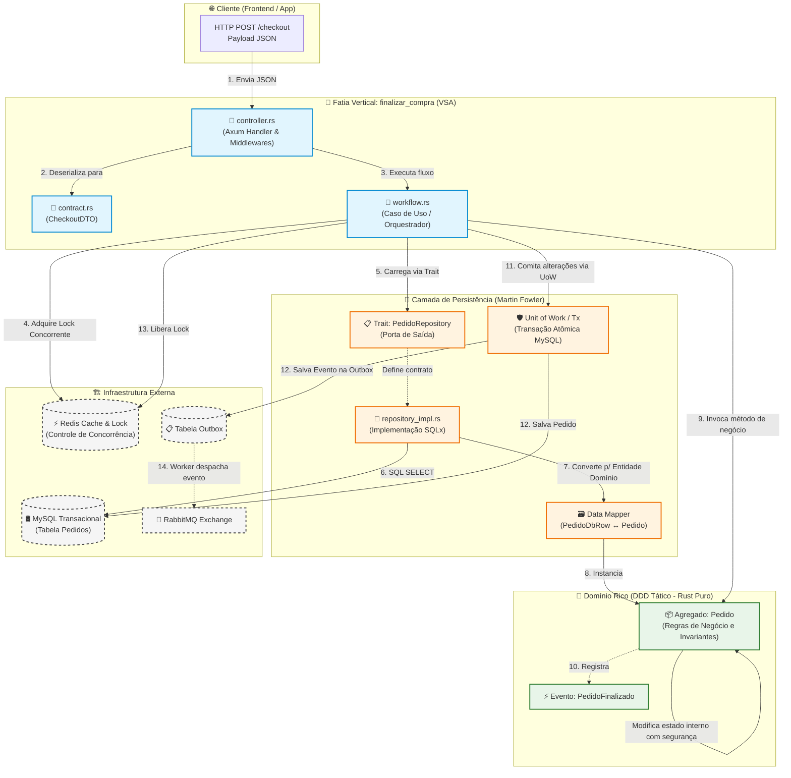

# Modelagem Avançada de Software em Rust: DDD, VSA, Clean e Padrões de Fowler
### *Do Axum ao SQLx, RabbitMQ, Redis e ScyllaDB: Construindo Sistemas Concorrentes, Seguros e de Alta Performance*

> **Público-alvo:** Desenvolvedores Rust, arquitetos de software, engenheiros backend e entusiastas de sistemas distribuídos e alta concorrência.  
> **Objetivo:** Estabelecer um guia prático definitivo de como combinar Domain-Driven Design (DDD), Vertical Slice Architecture (VSA), Clean Architecture e os Padrões de Persistência de Martin Fowler em Rust, aproveitando o poder do sistema de tipos para tornar estados inválidos impossíveis de compilar.

---

## 🧭 Sumário

1. [A Fundação: DDD Estratégico e Bounded Contexts em Rust](#1-a-fundação-ddd-estratégico-e-bounded-contexts-em-rust)
2. [Vertical Slice Architecture (VSA) no Ecossistema Rust](#2-vertical-slice-architecture-vsa-no-ecossistema-rust)
3. [O Type System de Rust a Serviço do DDD Tático](#3-o-type-system-de-rust-a-serviço-do-ddd-tático)
4. [A Camada de Entrada: Axum, Middlewares e Handlers (VSA + Clean)](#4-a-camada-de-entrada-axum-middlewares-e-handlers-vsa--clean)
5. [Persistência Desacoplada: Padrões de Martin Fowler com SQLx](#5-persistência-desacoplada-padrões-de-martin-fowler-com-sqlx)
6. [Infraestrutura de Apoio: Redis (Locks Distribuídos) e RabbitMQ (Domain Events)](#6-infraestrutura-de-apoio-redis-locks-distribuídos-e-rabbitmq-domain-events)
7. [Anatomia Completa de uma Fatia Vertical em Rust](#7-anatomia-completa-de-uma-fatia-vertical-em-rust)
8. [Diagrama Arquitetural de Fluxo Ponta a Ponta](#8-diagrama-arquitetural-de-fluxo-ponta-a-ponta)
9. [Anti-Patterns Comuns em Rust e Como Evitá-los](#9-anti-patterns-comuns-em-rust-e-como-evitá-los)
10. [Checklist do Desenvolvedor Rust para Arquiteturas Limpas](#10-checklist-do-desenvolvedor-rust-para-arquiteturas-limpas)

---

## 1. A Fundação: DDD Estratégico e Bounded Contexts em Rust

A fundação de um sistema de alto desempenho em Rust começa pelo **DDD Estratégico (Bounded Contexts)**. Tentar empilhar todas as regras, modelos e tabelas de um e-commerce em um único crate ou em uma hierarquia global de pastas gera código caótico, tempos lentos de compilação e alto acoplamento.

Primeiro, decompomos o negócio em contextos independentes. Cada contexto pode adotar uma pilha técnica e padrões de modelagem específicos para sua demanda:

```
┌─────────────────────────────────────────────────────────────────────────────┐
│                           BOUNDED CONTEXTS (DDD)                            │
├──────────────────────────┬──────────────────────────────────────────────────┤
│ Contexto                 │ Perfil de Carga & Stack Tecnológica Ideal em Rust│
├──────────────────────────┼──────────────────────────────────────────────────┤
│ 1. Catálogo de Produtos  │ • Leitura Massiva / Cache Agressivo              │
│                          │ • Axum + Redis Cache + ScyllaDB / MongoDB        │
├──────────────────────────┼──────────────────────────────────────────────────┤
│ 2. Vendas & Checkout     │ • Alta Consistência Transacional (ACID)          │
│                          │ • Axum + MySQL/PostgreSQL (SQLx) + RabbitMQ      │
├──────────────────────────┼──────────────────────────────────────────────────┤
│ 3. Recomendação & Busca  │ • Análise Colunar / Séries Temporais             │
│                          │ • Axum + ScyllaDB / Meilisearch                  │
└──────────────────────────┴──────────────────────────────────────────────────┘
```

### Isolamento Físico com Cargo Workspaces

No ecossistema Rust, a melhor forma de garantir o isolamento dos Bounded Contexts é utilizando **Cargo Workspaces**. Cada contexto reside em um crate próprio, permitindo compilações paralelas e controle estrito de dependências:

```toml
# Cargo.toml (Raiz do Workspace)
[workspace]
members = [
    "crates/catalogo",
    "crates/vendas",
    "crates/recomendacao",
    "crates/shared_kernel",
]
resolver = "2"
```

---

## 2. Vertical Slice Architecture (VSA) no Ecossistema Rust

Em vez de criar pastas globais como `src/controllers`, `src/services` e `src/models` que misturam o domínio inteiro em camadas horizontais, organizamos o código dentro de cada contexto utilizando a **Vertical Slice Architecture (VSA)**.

Cada intenção do usuário (Caso de Uso) é uma fatia vertical autônoma. Se a regra de *"Adicionar Cupom"* for atualizada, o desenvolvedor modifica apenas os arquivos dentro da pasta `features/adicionar_cupom/`, sem risco de quebrar o fluxo de *"Cancelar Pedido"*.

### Como Fatias Verticais se Mapeiam para Módulos Rust (`mod.rs`)

Em Rust, cada fatia vertical é simplesmente um módulo:

```text
crates/vendas/src/
┣━ domain/                         <-- DDD Tático: Zero dependências externas
┃   ┣━ mod.rs
┃   ┣━ pedido.rs                   <-- Agregado Raiz e Métodos de Negócio
┃   ┣━ itens.rs                    <-- Entidade Interna
┃   ┣━ value_objects.rs            <-- Cpf, Dinheiro, Cupom
┃   ┗━ events.rs                   <-- Eventos de Domínio
┣━ features/                       <-- VSA: Fatias Verticais de Casos de Uso
┃   ┣━ mod.rs
┃   ┣━ finalizar_compra/           <-- Fatia do Caso de Uso
┃   ┃   ┣━ mod.rs
┃   ┃   ┣━ controller.rs           <-- Axum Handler e Extração de Request
┃   ┃   ┣━ contract.rs             <-- DTOs de Entrada e Saída (Serde)
┃   ┃   ┣━ workflow.rs             <-- Orquestração do Caso de Uso
┃   ┃   ┣━ repository_impl.rs      <-- Implementação de Persistência SQLx
┃   ┃   ┗━ publisher.rs            <-- Publicador RabbitMQ
┃   ┗━ aplicar_cupom/
┃       ┣━ mod.rs
┃       ┗━ ...
┗━ infra/                          <-- Conexões de DB, Pools e Middlewares
    ┣━ mod.rs
    ┣━ db.rs
    ┗━ rabbit.rs
```

---

## 3. O Type System de Rust a Serviço do DDD Tático

Rust é uma das linguagens mais bem equipadas para implementar o conceito de *"Tornar Estados Inválidos Impossíveis de Representar"* (*Parse, Don't Validate*).

### 1. Value Objects com o Newtype Pattern

Value Objects são imutáveis e auto-validáveis. Em Rust, expressamos isso encapsulando tipos primitivos em structs de uma única tupla (*Newtype Pattern*), com construtores que retornam `Result`:

```rust
// crates/vendas/src/domain/value_objects.rs

#[derive(Debug, Clone, PartialEq, Eq)]
pub struct Cpf(String);

#[derive(Debug, thiserror::Error)]
pub enum ErroDominio {
    #[error("CPF inválido: formato ou dígito verificador incorreto")]
    CpfInvalido,
    #[error("Valor monetário não pode ser negativo")]
    ValorInvalido,
    #[error("Transição de estado inválida para o pedido")]
    TransicaoInvalida,
}

impl Cpf {
    pub fn parse(valor: String) -> Result<Self, ErroDominio> {
        let limpo: String = valor.chars().filter(|c| c.is_ascii_digit()).collect();
        if limpo.len() != 11 || limpo.chars().all(|c| c == limpo.chars().next().unwrap()) {
            return Err(ErroDominio::CpfInvalido);
        }
        // Validação completa dos dígitos verificadores...
        Ok(Self(limpo))
    }

    pub fn valor(&self) -> &str {
        &self.0
    }
}
```

### 2. Máquina de Estados com Enums Ricos (Type-State Pattern)

Em vez de usar strings mágicas ou inteiros para o status de um pedido, utilizamos `enums` com dados associados. Assim, o compilador impede que alguém acesse uma `chave_pix` se o pedido não estiver pago:

```rust
// crates/vendas/src/domain/pedido.rs

use chrono::{DateTime, Utc};
use crate::domain::value_objects::{Cpf, ErroDominio};

#[derive(Debug, Clone, PartialEq)]
pub enum StatusPedido {
    Aberto,
    AguardandoPagamento { expira_em: DateTime<Utc> },
    Pago { transacao_id: String, pago_em: DateTime<Utc> },
    Cancelado { motivo: String, cancelado_em: DateTime<Utc> },
}

pub struct Pedido {
    id: String,
    cliente_cpf: Cpf,
    total_centavos: i64,
    status: StatusPedido,
}

impl Pedido {
    pub fn novo(id: String, cliente_cpf: Cpf, total_centavos: i64) -> Result<Self, ErroDominio> {
        if total_centavos <= 0 {
            return Err(ErroDominio::ValorInvalido);
        }
        Ok(Self {
            id,
            cliente_cpf,
            total_centavos,
            status: StatusPedido::Aberto,
        })
    }

    /// Invariante de Domínio: Apenas pedidos abertos ou aguardando podem ser marcados como pagos.
    pub fn marcar_como_pago(&mut self, transacao_id: String) -> Result<(), ErroDominio> {
        match &self.status {
            StatusPedido::Aberto | StatusPedido::AguardandoPagamento { .. } => {
                self.status = StatusPedido::Pago {
                    transacao_id,
                    pago_em: Utc::now(),
                };
                Ok(())
            }
            StatusPedido::Pago { .. } => Ok(()), // Idempotente
            StatusPedido::Cancelado { .. } => Err(ErroDominio::TransicaoInvalida),
        }
    }

    pub fn id(&self) -> &str { &self.id }
    pub fn status(&self) -> &StatusPedido { &self.status }
    pub fn total_centavos(&self) -> i64 { self.total_centavos }
    pub fn cpf(&self) -> &Cpf { &self.cliente_cpf }
}
```

---

## 4. A Camada de Entrada: Axum, Middlewares e Handlers (VSA + Clean)

O framework web **Axum** serve exclusivamente como a interface externa (Interface Adapter da Clean Architecture) no topo da fatia vertical:

* **Middlewares do Axum:** Responsáveis apenas por aspectos transversais de infraestrutura (autenticação JWT, extração do `X-Correlation-ID`, rate limiting e tracing com `tracing`). Não possuem regras de negócio.
* **Controller / Handler:** Extrai o DTO validado via `Json<T>`, acessa o estado compartilhado (`State<Arc<AppState>>`) e delega a orquestração para o `workflow.rs`.

```rust
// crates/vendas/src/features/finalizar_compra/controller.rs

use axum::{extract::State, http::StatusCode, response::IntoResponse, Json};
use std::sync::Arc;
use crate::features::finalizar_compra::{contract::CheckoutRequestDto, workflow};
use crate::infra::state::AppState;

pub async fn finalizar_compra_endpoint(
    State(state): State<Arc<AppState>>,
    Json(payload): Json<CheckoutRequestDto>,
) -> Result<impl IntoResponse, (StatusCode, String)> {
    match workflow::executar_checkout(state, payload).await {
        Ok(resposta) => Ok((StatusCode::CREATED, Json(resposta))),
        Err(erro) => Err((StatusCode::UNPROCESSABLE_ENTITY, erro.to_string())),
    }
}
```

---

## 5. Persistência Desacoplada: Padrões de Martin Fowler com SQLx

Para persistir os dados no MySQL/PostgreSQL sem vazar dialetos SQL ou anotações ORM para dentro do Agregado, aplicamos os padrões do livro *Patterns of Enterprise Application Architecture* de Martin Fowler:

### 1. Repository Pattern como Rust Trait (Porta de Saída)

O caso de uso interage apenas com a `trait`. A implementação real usa SQLx:

```rust
// crates/vendas/src/domain/ports.rs
use async_trait::async_trait;
use crate::domain::pedido::Pedido;
use crate::domain::value_objects::ErroDominio;

#[async_trait]
pub trait PedidoRepository: Send + Sync {
    async fn buscar_por_id(&self, id: &str) -> Result<Option<Pedido>, ErroDominio>;
    async fn salvar(&self, pedido: &Pedido) -> Result<(), ErroDominio>;
}
```

### 2. Data Mapper Pattern (`TryFrom` / `FromRow`)

Separamos a struct que reflete a tabela do banco (`PedidoDbRow`) do Agregado rico (`Pedido`):

```rust
// crates/vendas/src/features/finalizar_compra/repository_impl.rs

use sqlx::FromRow;
use crate::domain::pedido::{Pedido, StatusPedido};
use crate::domain::value_objects::{Cpf, ErroDominio};

#[derive(FromRow)]
pub struct PedidoDbRow {
    pub id: String,
    pub cliente_cpf: String,
    pub total_centavos: i64,
    pub status: String,
}

impl TryFrom<PedidoDbRow> for Pedido {
    type Error = ErroDominio;

    fn try_from(row: PedidoDbRow) -> Result<Self, Self::Error> {
        let cpf = Cpf::parse(row.cliente_cpf)?;
        let mut pedido = Pedido::novo(row.id, cpf, row.total_centavos)?;
        
        if row.status == "PAGO" {
            pedido.marcar_como_pago("LEGACY_SYNC".to_string())?;
        }
        Ok(pedido)
    }
}
```

### 3. Unit of Work (UoW) com Transações Assíncronas

Em Rust com SQLx, o padrão **Unit of Work** é representado por uma `sqlx::Transaction`. Ele garante que todas as operações no MySQL (atualizar saldo, salvar pedido e gravar o evento na tabela outbox) sejam atômicas:

```rust
// Executando dentro de uma transação atômica (UoW)
let mut tx = state.db_pool.begin().await.map_err(|_| ErroDominio::TransicaoInvalida)?;

sqlx::query!(
    "INSERT INTO pedidos (id, cliente_cpf, total_centavos, status) VALUES (?, ?, ?, ?)",
    pedido.id(),
    pedido.cpf().valor(),
    pedido.total_centavos(),
    "ABERTO"
)
.execute(&mut *tx)
.await
.map_err(|_| ErroDominio::TransicaoInvalida)?;

// Grava na tabela de Outbox na mesma transação atômica!
sqlx::query!(
    "INSERT INTO outbox_events (event_id, event_type, payload) VALUES (?, ?, ?)",
    uuid::Uuid::new_v4().to_string(),
    "PedidoCriado",
    serde_json::to_string(&pedido.id()).unwrap()
)
.execute(&mut *tx)
.await
.map_err(|_| ErroDominio::TransicaoInvalida)?;

// Commit de todas as operações juntas
tx.commit().await.map_err(|_| ErroDominio::TransicaoInvalida)?;
```

---

## 6. Infraestrutura de Apoio: Redis (Locks Distribuídos) e RabbitMQ (Domain Events)

### Trava Distribuída no Redis (Anti-Race Condition)
Para evitar que dois clientes comprem o último item do estoque simultaneamente, a fatia adquire uma trava temporária (*Distributed Lock* via Redis `SET NX EX`) antes de carregar o Agregado:

```rust
// crates/vendas/src/infra/lock.rs
use redis::AsyncCommands;

pub async fn adquirir_lock(redis: &mut redis::aio::Connection, chave: &str, ttl_segundos: u64) -> bool {
    let resultado: Option<String> = redis::cmd("SET")
        .arg(chave)
        .arg("locked")
        .arg("NX")
        .arg("EX")
        .arg(ttl_segundos)
        .query_async(redis)
        .await
        .unwrap_or(None);

    resultado.is_some()
}
```

### Mensageria com RabbitMQ (`lapin`)
Após o commit atômico no MySQL, o publicador da fatia (ou um worker assíncrono de CDC/Outbox) despacha o evento para a exchange do RabbitMQ:

```rust
// crates/vendas/src/features/finalizar_compra/publisher.rs
use lapin::{options::BasicPublishOptions, BasicProperties, Channel};

pub async fn publicar_evento_pedido_pago(channel: &Channel, pedido_id: &str) -> Result<(), lapin::Error> {
    let payload = serde_json::json!({
        "event": "PedidoPago",
        "pedido_id": pedido_id,
        "timestamp": chrono::Utc::now().to_rfc3339()
    });

    channel
        .basic_publish(
            "vendas.events",
            "pedido.pago",
            BasicPublishOptions::default(),
            &serde_json::to_vec(&payload).unwrap(),
            BasicProperties::default(),
        )
        .await?;

    Ok(())
}
```

---

## 7. Anatomia Completa de uma Fatia Vertical em Rust

Veja como os arquivos de uma fatia vertical colaboram de forma enxuta e coesa:

```
crates/vendas/src/features/finalizar_compra/
├── mod.rs                  <-- Exporta a rota e os tipos públicos da feature
├── controller.rs           <-- Axum Handler (recebe HTTP, devolve JSON)
├── contract.rs             <-- DTOs de Entrada e Saída (Request / Response)
├── workflow.rs             <-- Caso de Uso (Orquestra Lock, Domínio, DB e Outbox)
├── repository_impl.rs      <-- Implementação do PedidoRepository via SQLx
└── publisher.rs            <-- Publicação do evento no RabbitMQ
```

> [!TIP]
> **Benefício da Manutenibilidade:**  
> Se amanhã o MySQL for substituído pelo ScyllaDB ou DynamoDB, **apenas** o arquivo `repository_impl.rs` desta funcionalidade precisa ser alterado. O núcleo de regras (`domain/pedido.rs`) e o fluxo de orquestração (`workflow.rs`) permanecem 100% intocados.

---

## 8. Diagrama Arquitetural de Fluxo Ponta a Ponta

Este diagrama demonstra a colaboração desacoplada entre a fatia Axum (VSA), o Agregado puro (DDD Tático), os padrões de Fowler (Data Mapper / Unit of Work) e a infraestrutura externa:



---

## 9. Anti-Patterns Comuns em Rust e Como Evitá-los

### 1. Poluir o Domínio com Macros de Bibliotecas Externas
- **O Erro:** Adicionar `#[derive(sqlx::FromRow)]` ou atributos de ORM diretamente nas structs de domínio.
- **A Solução:** Mantenha o crate `domain` 100% livre de dependências de I/O. Use DTOs/Rows na camada de persistência e implemente `TryFrom` ou `From`.

### 2. Abuso do `.clone()` para Evitar o Borrow Checker
- **O Erro:** Clonar estruturas inteiras para silenciar o compilador ao passar dados entre middlewares e handlers.
- **A Solução:** Use `Arc<T>` para estados compartilhados imutáveis e estruture o fluxo para mover a propriedade (*move semantics*) de forma limpa.

### 3. Handlers Monolíticos sem Delegação
- **O Erro:** Escrever 300 linhas de código procedural dentro da função assíncrona do Axum, misturando deserialização, queries SQL e validações.
- **A Solução:** Respeite a divisão da VSA: o `controller.rs` apenas extrai os dados; o `workflow.rs` orquestra; e o `domain` decide as regras.

### 4. Ignorar a Atomicidade de Mensagens (Dual Write Problem)
- **O Erro:** Publicar diretamente no RabbitMQ antes ou depois do commit no MySQL sem proteção transacional.
- **A Solução:** Use a tabela Outbox na mesma transação SQL para garantir entrega confiável (*at-least-once delivery*).

---

## 10. Checklist do Desenvolvedor Rust para Arquiteturas Limpas

Use este checklist para auditar seus módulos antes de enviar para produção:

- [ ] **Compilação Isolada do Domínio:** O crate/módulo `domain` compila sem nenhuma dependência de rede, HTTP (Axum) ou banco de dados (SQLx)?
- [ ] **Tipagem Defensiva:** Valores como CPF, E-mail, Dinheiro e IDs utilizam o *Newtype Pattern* com validação no momento do parse?
- [ ] **Máquina de Estados Segura:** Os estados dos agregados utilizam `enums` com dados encapsulados, impedindo chamadas inválidas?
- [ ] **Fatias Coesas:** Cada caso de uso possui seus próprios DTOs e orquestrador em uma pasta vertical isolada?
- [ ] **Persistência Desacoplada:** As consultas ao banco ocorrem atrás de uma `trait` e utilizam o padrão *Data Mapper* para tradução de registros?
- [ ] **Transacionalidade Garantida:** Operações críticas de escrita utilizam `sqlx::Transaction` para commit atômico com a tabela de outbox?
- [ ] **Testes de Unidade Puros:** As regras de negócio do Agregado possuem testes unitários que rodam sem mock de banco de dados ou contêineres Docker?
