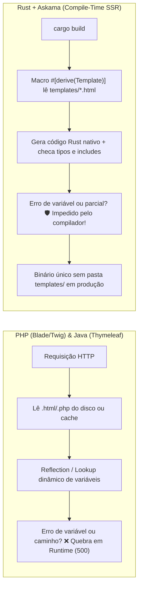

# Renderização SSR, Composição de Páginas HTML e Atomic Design com Askama em Rust

> **Guia de Transição para Devs PHP (Twig/Blade) e Java (JSP/Thymeleaf):**  
> Se você vem do ecossistema PHP ou Java, está acostumado a motores de template que **leem arquivos `.html`, `.blade.php` ou `.jsp` do disco e os interpretam em tempo de execução**. Em Rust, o motor **Askama** adota uma filosofia radicalmente superior: ele mantém toda a modularidade visual (*Atomic Design*, parciais, macros e herança de layouts) durante o desenvolvimento, mas **compila todos os templates diretamente para código de máquina Rust nativo durante o `cargo build`**, garantindo velocidade extrema e segurança de tipos antes mesmo do servidor subir.

---

## 1. A Mudança de Paradigma: PHP & Java vs. Rust (Askama)

Em arquiteturas tradicionais de *Server-Side Rendering* (SSR), o HTML é montado no servidor por reflexão, interpretação de strings ou compilação *just-in-time* (JIT). No Rust com **Askama**, a verificação acontece inteiramente em **tempo de compilação (*Ahead-of-Time*)**.



### Tabela Comparativa de Ecossistemas

| Característica | PHP (`include`, Twig, Blade) | Java (JSP, Thymeleaf, Freemarker) | Rust (**Askama** + Axum) |
| :--- | :--- | :--- | :--- |
| **Processamento do Template** | Interpretado ou compilado em cache PHP no servidor. | Parseado via AST + Reflection em memória (JVM) ou Servlet JIT. | **Macro Procedural (`#[derive(Template)]`)** gera código Rust estático no `cargo build`. |
| **Erros de Tipagem / Propriedade** | Em runtime (`Undefined array key` / `null`). | Em runtime (`SpelEvaluationException` / `NullPointerException`). | **Em tempo de compilação:** o projeto não compila se um campo não existir na `struct`. |
| **Acesso a Disco em Produção** | Requer leitura de arquivos/cache no filesystem. | Requer `resources/templates/` empacotado no `.jar`/`.war`. | **Zero I/O de disco.** O template já está embutido no binário executável. |
| **Proteção XSS Automática** | Blade (`{{ }}`) e Twig escapam; `echo` cru é vulnerável. | `th:text` escapa; `th:utext` ou `<%= %>` exigem cuidado. | **Auto-escaping obrigatório** para HTML/XML por padrão (opt-out explícito via `\|safe`). |
| **Lógica Pesada / Banco no HTML** | Comum vazar queries ou serviços (especialmente em PHP/JSP antigos). | Possível chamar beans Spring no Thymeleaf. | **Desincentivado fisicamente:** `.render()` é síncrono e puro — dados chegam prontos na `struct`. |

---

## 2. O Paralelo entre SCSS Monolítico e Templates HTML no Rust

Quem trabalha com **SCSS/SASS** já conhece o fluxo de dividir estilos em dezenas de arquivos parciais (`_variables.scss`, `_buttons.scss`, `_header.scss`) e compilar tudo com `sass --watch` em um único `style.css` otimizado para produção.

Com o **Askama no Rust**, a lógica arquitetural é exatamente a mesma, mas com uma vantagem decisiva na rede:

1. **Fragmentação no Desenvolvimento:** Você separa seu HTML em pequenos componentes reutilizáveis usando ``, herança com `` e funções visuais com ``.
2. **Consolidação na Compilação:** Quando você executa `cargo build`, o Askama resolve todas as heranças, macros e inclusões, transformando a árvore inteira em funções Rust otimizadas de escrita em buffer (*zero-copy / fast formatting*) dentro do executável final.
3. **Diferença Crucial na Rede (*Monolito no Servidor vs. Monolito no Cliente*):**
   * No **SCSS/CSS**, o arquivo monolítico compilado precisa ser baixado inteiro pelo navegador do usuário.
   * No **Askama**, o "monolito compilado" fica apenas na memória do servidor. **O usuário final recebe exclusivamente o HTML específico da rota requisitada**, montado em microssegundos.

> [!NOTE]
> **O mito do "HTML Grande" no SSR:**  
> Mesmo frameworks SPA modernos (React, Vue, Angular) convertem átomos, moléculas e organismos em um único DOM gigante dentro do navegador do usuário. A diferença é que, no **Rust SSR**:
> * **Zero carregamento em cascata:** O navegador recebe o HTML pronto na primeira resposta HTTP (TTFB imediato), sem esperar baixar megabytes de JavaScript para depois fazer requisições JSON e desenhar a tela.
> * **Compressão Gzip/Brotli de até 80%:** Como componentes baseados em Atomic Design repetem padrões de tags e classes CSS (ex: 24 cards de produto idênticos na grade), o algoritmo Brotli/Gzip do Nginx ou do middleware Tower reduz drasticamente o tamanho trafegado na rede.

---

## 3. Como o Atomic Design Funciona no Askama

Você pode aplicar os 5 níveis do **Atomic Design (Brad Frost)** sem perder a rigidez do compilador Rust:

| Nível Atomic Design | Equivalente PHP / Java | Implementação Canônica no Rust + Askama |
| :--- | :--- | :--- |
| **1. Átomos** (Botões, Badges, Preços) | Blade `<x-badge>` / Thymeleaf `th:fragment` | **Macros Askama (``)** ou pequenos parciais sem estado em `templates/atoms/`. |
| **2. Moléculas** (Input + Label + Erro, Card simples) | Partial Blade / JSP Tag File | **Macros compostas** ou sub-parciais recebendo variáveis tipadas do contexto pai. |
| **3. Organismos** (Header, ProductCard, Megamenu, Modais) | ViewComponent (Laravel) / Fragmento Spring | **Structs Rust dedicadas** implementando `Template` (ex: `ProductCardTemplate`) + parciais em `templates/partials/` ou `templates/views/`. |
| **4. Templates (Layouts)** | `layout.blade.php` / Twig `base.html.twig` | Arquivos em `templates/layouts/base.html` com `` e ``. |
| **5. Páginas** (Home, PDP, Checkout, PDV) | Controller retornando `view(...)` | Handler Axum retornando `HtmlTemplate(HomePageTemplate { ... })`. |

### Exemplo de Organização de Pastas Recomendada

```text
templates/
├── layouts/
│   └── base.html                 # Esqueleto HTML5, <head>, CSS global e blocos 
├── atoms/
│   └── ui_macros.html            # , 
├── storefront/
│   ├── partials/
│   │   ├── topbar.html           # Barra institucional superior
│   │   ├── header.html           # Barra de busca e ações do usuário
│   │   ├── megamenu.html         # Árvore de departamentos ativos
│   │   └── footer.html           # Rodapé com links e redes sociais
│   ├── home.html                 #  + inclusão dos organismos
│   └── product.html              # Página de Detalhes do Produto (PDP)
└── pos/
    ├── index.html                # Workspace principal do PDV
    ├── views/                    # Organismos: header.html, cart_table.html, checkout_panel.html
    └── modals/                   # Modais isolados: calc_m2.html, shift.html, product_search.html
```

---

## 4. Passo a Passo Prático: Da Struct Rust ao HTML Compilado

### Passo 1: Dependências no `Cargo.toml`

```toml
[dependencies]
axum = "0.8"
askama = "0.12" # Motor de templates compilados (estilo Jinja2/Twig com type-safety)
```

### Passo 2: O Adaptador `HtmlTemplate<T>` para o Axum

Em PHP/Java você retorna `return view('home', $data)` ou `return "home";`. No Axum com Askama, criamos um *wrapper* reutilizável de 12 linhas que converte qualquer struct que implementa `askama::Template` em uma resposta HTTP `200 OK` com `Content-Type: text/html; charset=utf-8`:

```rust
use askama::Template;
use axum::http::StatusCode;
use axum::response::{Html, IntoResponse, Response};

/// Wrapper universal para devolver templates Askama nos handlers Axum
pub struct HtmlTemplate<T>(pub T);

impl<T> IntoResponse for HtmlTemplate<T>
where
    T: Template,
{
    fn into_response(self) -> Response {
        match self.0.render() {
            Ok(html) => Html(html).into_response(),
            Err(err) => (
                StatusCode::INTERNAL_SERVER_ERROR,
                format!("Erro ao renderizar template Askama: {err}"),
            )
                .into_response(),
        }
    }
}
```

### Passo 3: Definindo Organismos e Página em Rust (`#[derive(Template)]`)

Observe como não passamos "arrays associativos mágicos" (como no PHP `['produtos' => $lista]`) nem atributos dinâmicos no `Model` (como no Java `model.addAttribute("produtos", lista)`). Passamos uma **struct fortemente tipada**:

```rust
use askama::Template;
use axum::extract::State;
use axum::response::IntoResponse;

/// Organismo: Dados estritamente tipados para o Card de Produto
#[derive(Clone)]
pub struct ProductCardTemplate {
    pub id: i64,
    pub name: String,
    pub price_display: String,
    pub badge: Option<String>, // Option obriga o template a tratar o caso nulo!
    pub in_stock: bool,
}

/// Página: Contrato completo entre o Handler Rust e o arquivo HTML
#[derive(Template)]
#[template(path = "storefront/home.html")]
pub struct HomePageTemplate {
    pub title: String,
    pub store_name: String,
    pub featured_products: Vec<ProductCardTemplate>,
}

/// Handler Axum (Thin Controller)
pub async fn render_home_page(State(state): State<AppState>) -> impl IntoResponse {
    let products = state.catalog_service.list_featured().await;

    let template = HomePageTemplate {
        title: "Loja Alpha | Materiais de Construção".to_string(),
        store_name: "Alpha Construção".to_string(),
        featured_products: products,
    };

    HtmlTemplate(template)
}
```

### Passo 4: Layout Base, Macros Atômicas e Herança HTML

#### 4.1 Layout Base (`templates/layouts/base.html`)

```html
<!DOCTYPE html>
<html lang="pt-BR">
<head>
  <meta charset="UTF-8">
  <title>{{ store_name }}</title>
  <link rel="stylesheet" href="/assets/style.css">
</head>
<body>
  <!-- Inclusão de Organismos Estruturais -->
  

  <main>
    
  </main>

  
  
</body>
</html>
```

#### 4.2 Átomos Reutilizáveis via Macro (`templates/atoms/ui_macros.html`)

```html

  
    <span class="badge badge-success">{{ label }}</span>
  
    <span class="badge badge-warning">Sob Encomenda</span>
  

```

#### 4.3 Página Final (`templates/storefront/home.html`)

Repare no uso de `` (ou ``) para lidar com `Option<String>` sem nenhum risco de *NullPointerException*:

```html



{{ title }}


  <section class="product-grid">
    
      <article class="product-card">
        <h3>{{ product.name }}</h3>

        {# Tratamento seguro de Option<T> imposto pelo compilador Rust #}
        
          
            
          
            <span class="badge badge-neutral">Catálogo</span>
        

        <p class="price">{{ product.price_display }}</p>
        <a href="/produto/{{ product.id }}">Ver detalhes</a>
      </article>
    
  </section>

```

---

## 5. Superpoderes do Askama para Quem Vem do PHP e Java

### 1. Segurança Anti-XSS por Padrão (*Auto-Escaping*)
No Askama, toda expressão `{{ variavel }}` é escapada automaticamente para contexto HTML. Se um usuário cadastrar o nome `<script>alert(1)</script>`, o HTML enviado será `&lt;script&gt;alert(1)&lt;/script&gt;`.  
Você só desabilita o escape com o filtro `{{ html_confiavel|safe }}` quando o conteúdo já passou por sanitização confiável (como Markdown compilado no backend ou um SVG gerado internamente).

### 2. Adeus `NullPointerException` e `Undefined Array Key`
Em Java Thymeleaf, escrever `${product.badge.toUpperCase()}` quando `badge` é `null` explode em produção. No PHP, acessar `$user['phone']` gera um warning/erro se a chave faltar.  
No Askama, se o campo na struct é `Option<String>`, **o compilador impede você de acessá-lo diretamente como string** até que você escreva `` ou ``.

### 3. Filtros Customizados em Rust Puro
Evite colocar lógica de formatação complexa dentro do HTML. Crie um módulo `mod filters` no mesmo arquivo da struct (convenção nativa do Askama):

```rust
mod filters {
    /// Uso no HTML: {{ preco_centavos|brl }}
    pub fn brl(cents: &i64) -> askama::Result<String> {
        let reais = *cents / 100;
        let resto = (*cents % 100).abs();
        Ok(format!("R$ {reais},{resto:02}"))
    }
}
```

> **Melhor ainda em Arquitetura Limpa:** Formate valores monetários no Domínio/Aplicação usando um *Value Object* dedicado (ex: `Money::format_pt_br()`) antes mesmo de montar a `struct` do template, mantendo a camada de apresentação completamente livre de regras de negócio.

---

## 6. Quando Dividir a Entrega no Navegador (HTMX & Ilhas Sob Demanda)

Embora o Rust renderize páginas inteiras em menos de `1 ms`, há cenários em que enviar **tudo** na primeira carga HTTP prejudica a experiência (por exemplo: 10 modais administrativos complexos, abas de relatórios pesados ou listagens com scroll infinito).

Para esses casos, você mantém **100% da filosofia Atomic Design no Askama**, mas entrega fragmentos sob demanda:

1. **Fragmentos Hipermídia (HTMX / `fetch`):**  
   Exponha uma rota no Axum que retorna **apenas um Organismo ou Molécula** (sem ``):
   * `GET /` $\to$ Retorna a página completa (`HomePageTemplate`).
   * `GET /partials/cart-drawer` $\to$ Retorna apenas o HTML atualizado do carrinho lateral (`CartDrawerTemplate`), injetado diretamente no DOM sem serialização JSON nem frameworks JS pesados.
2. **Ilhas de Interatividade Progressiva:**  
   Entregue o esqueleto da página em Askama SSR (para SEO perfeito e abertura instantânea) e hidrate apenas componentes altamente interativos (como um canvas de assinatura ou calculadora em tempo real) com JavaScript modular enxuto.

---

## 7. Armadilhas Comuns na Migração PHP/Java $\to$ Rust (Checklist)

* **❌ Armadilha 1: Editar `.html` e dar F5 no navegador esperando atualização instantânea.**  
  Como os templates são embutidos no binário Rust durante a compilação, você precisa recompilar o servidor ao alterar arquivos `.html`.  
  **✅ Solução em Dev:** Use `cargo watch -w src -w templates -x run` para recompilação automática ao salvar qualquer template.
* **❌ Armadilha 2: Passar `HashMap<String, Value>` ou JSON genérico para o template.**  
  Isso replica a fragilidade dinâmica do PHP/JSP e anula o maior trunfo do Askama: a checagem de tipos em compilação.  
  **✅ Solução:** Crie structs pequenas, claras e dedicadas para cada página e organismo.
* **❌ Armadilha 3: Tentar chamar código `async` ou queries SQL de dentro do HTML.**  
  No Twig/Blade/JSP às vezes há extensões que disparam queries dentro de loops (gerando o infame problema *N+1 queries*). No Askama, o `.render()` é síncrono e puro.  
  **✅ Solução:** Busque e agregue todos os dados no Handler / Use Case (camada assíncrona) antes de instanciar a `struct` do template.
* **❌ Armadilha 4: Confundir o caminho raiz dos templates.**  
  Por padrão, o Askama procura todos os caminhos relativos à pasta `templates/` na raiz da crate (onde está o `Cargo.toml`). Portanto, `` resolve para `<crate_root>/templates/storefront/partials/header.html`.

