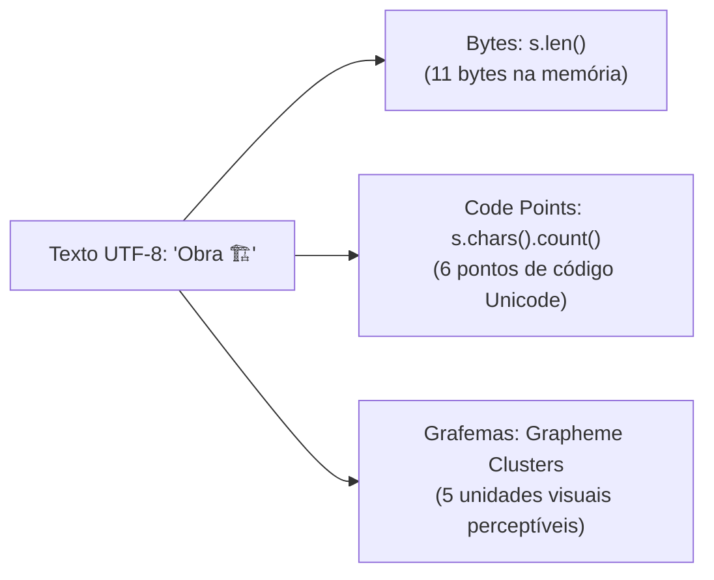
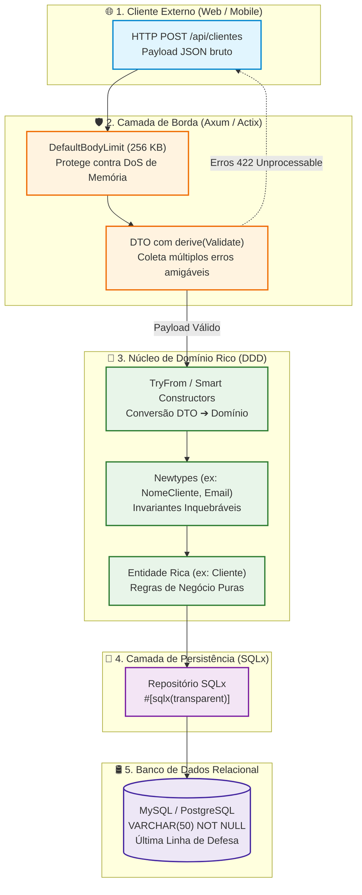

# Validação de Strings, Limite de Tamanho e o Padrão Newtype em Rust

> Diferente de linguagens de consulta e bancos de dados relacionais (que possuem tipos nativos restritos como `VARCHAR(50)` ou `CHAR(10)`), o Rust não possui restrições de comprimento de texto embutidas diretamente na tipagem primitiva. Os tipos fundamentais da linguagem (`String` e `&str`) são dinâmicos e desenhados para gerenciar sequências contíguas de bytes UTF-8 válidos com alocação na Heap ou por meio de referências emprestadas.

No entanto, em aplicações corporativas, microsserviços de missão crítica e APIs públicas, validar o conteúdo e impor limites estritos de texto é vital para a **integridade de domínio**, **segurança contra Negação de Serviço (DoS)** e **compatibilidade com esquemas relacionais**.

O ecossistema Rust oferece soluções sofisticadas e idiomáticas para esse desafio, transitando desde a **segurança de domínio com o padrão Newtype**, passando por **validação declarativa na borda HTTP com DTOs**, até **estruturas com zero alocação na Heap (Stack Strings)** para cenários de alta frequência e baixa latência.

---

## 1. O Anti-Pattern: Obsessão por Tipos Primitivos (*Primitive Obsession*)

Em código iniciante ou vindo de paradigmas dinâmicos, é comum observar structs de negócio onde todo atributo textual é representado simplesmente por `String`:

```rust
// ❌ OBSESSÃO POR PRIMITIVOS: Nenhuma garantia estrutural ou semântica
pub struct Cliente {
    pub id: String,
    pub nome: String,
    pub email: String,
    pub cpf: String,
    pub cep: String,
}
```

Essa abordagem acarreta falhas estruturais graves:

1. **Troca acidental de parâmetros:** Uma assinatura como `fn registrar(nome: String, email: String, cpf: String)` compila perfeitamente se você inverter a ordem dos argumentos na chamada: `registrar(cpf, email, nome)`. O compilador é incapaz de detectar o erro lógico.
2. **Dispersão e duplicação de validações:** Cada rota, *use case*, *service* ou *repository* precisa verificar repetidamente se `nome.chars().count() <= 50`, se `email` possui `@` ou se `cpf` tem 11 dígitos.
3. **Impossibilidade de garantir invariantes:** Qualquer módulo com acesso ao campo pode atribuir uma string vazia ou um texto de 10 megabytes ao campo `cep`, corrompendo o estado da entidade.

> [!NOTE]
> O princípio fundamental do Design Orientado a Domínio (DDD) e dos sistemas de tipos estáticos avançados é: **"Torne estados ilegais irrepresentáveis em tempo de compilação"** (*Make illegal states unrepresentable*).

---

## 2. A Armadilha do `len()` em Rust: Bytes vs. Caracteres vs. Grafemas

Antes de impor limites como `VARCHAR(N)`, é indispensável entender como o Rust gerencia strings em memória. Em Rust, toda string é garantida como uma sequência válida de bytes codificados em **UTF-8**.

> [!WARNING]
> Em Rust, **`s.len()` mede a quantidade de BYTES, e NÃO a quantidade de caracteres visuais!**

Uma string em UTF-8 pode ser analisada sob três perspectivas distintas:



### 1. Bytes (`s.len()`)
Representa o espaço físico exato alocado na memória RAM.
* Caracteres ASCII comuns (`a-z`, `0-9`) ocupam 1 byte.
* Caracteres latinos acentuados (`ç`, `ã`, `é`) ocupam 2 bytes.
* Caracteres cirílicos, hebraicos e árabes ocupam 2 a 3 bytes.
* Emojis e símbolos raros ocupam 4 bytes cada.

### 2. Caracteres / Pontos de Código Unicode (`s.chars().count()`)
Representa os *Unicode Scalar Values* (pontos de código entre `U+0000` e `U+D7FF` ou `U+E000` e `U+10FFFF`).
* É a métrica utilizada pela maioria dos bancos de dados relacionais modernos quando configurados com `VARCHAR(50)` e *encoding* `utf8mb4` (MySQL) ou `UTF8` (PostgreSQL).
* Requer iterar linearmente sobre os bytes da string ($O(N)$), pois os caracteres possuem tamanho variável em UTF-8.

### 3. Clusters de Grafemas (*Extended Grapheme Clusters*)
Representa o que um ser humano visualmente considera como "uma única letra" ou "um único caractere na tela".
* Determinados emojis e letras combinadas são formados por múltiplos *code points* Unicode conectados por sequências invisíveis (*Zero-Width Joiners* - ZWJ ou seletores de variação).

### Comparação Prática no Terminal:

```rust
use unicode_segmentation::UnicodeSegmentation; // Requer: cargo add unicode-segmentation

fn main() {
    // 1. ASCII puro
    let ascii = "Lucas";
    println!("ASCII -> Bytes: {} | Chars: {} | Grafemas: {}",
        ascii.len(), ascii.chars().count(), ascii.graphemes(true).count());
    // Saída: Bytes: 5 | Chars: 5 | Grafemas: 5

    // 2. Acentuação em Português
    let acento = "Ação";
    println!("Acentuado -> Bytes: {} | Chars: {} | Grafemas: {}",
        acento.len(), acento.chars().count(), acento.graphemes(true).count());
    // Saída: Bytes: 6 | Chars: 4 | Grafemas: 4 ('ç' e 'ã' têm 2 bytes cada)

    // 3. Emoji com Seletor de Variação
    let obra = "Obra 🏗️";
    println!("Emoji simples -> Bytes: {} | Chars: {} | Grafemas: {}",
        obra.len(), obra.chars().count(), obra.graphemes(true).count());
    // Saída: Bytes: 11 | Chars: 6 | Grafemas: 5 (O emoji 🏗️ é U+1F3D7 + U+FE0F)

    // 4. Emoji Composto Complexo (Família)
    let familia = "👨‍👩‍👧‍👦";
    println!("Família -> Bytes: {} | Chars: {} | Grafemas: {}",
        familia.len(), familia.chars().count(), familia.graphemes(true).count());
    // Saída: Bytes: 25 | Chars: 7 | Grafemas: 1 (Humano vê 1 caractere; banco vê 7; memória ocupa 25 bytes!)
}
```

### O Perigo do Fatiamento Ingênuo (*Direct Slicing Panic*)

Tentar truncar uma string pegando uma fatia de bytes direta (`&texto[0..50]`) provocará um **pânico fatal em tempo de execução** se o índice cair no meio dos bytes de um caractere multi-byte:

```rust
let texto = "Ação";
// O caractere 'ç' ocupa os bytes 1 e 2.
// Fatiar exatamente no byte 2 causará um pânico imediato:
// thread 'main' panicked at 'byte index 2 is not a char boundary; it is inside 'ç' (bytes 1..3)'
let fatia = &texto[0..2]; // 💥 PANIC!
```

### Como Fazer Truncamento Seguro (*Safe Truncate*):

Para truncar texto com segurança sem pânico, deve-se respeitar os limites de caracteres (*char boundaries*):

```rust
/// Trunca uma string de forma segura até um limite de caracteres Unicode
pub fn truncar_caracteres(texto: &str, max_chars: usize) -> &str {
    match texto.char_indices().nth(max_chars) {
        Some((byte_idx, _)) => &texto[..byte_idx],
        None => texto, // Possui menos ou exatamente a quantidade de caracteres permitida
    }
}

/// Trunca garantindo um limite de BYTES sem quebrar caracteres multi-byte
pub fn truncar_bytes_seguro(texto: &str, max_bytes: usize) -> &str {
    if max_bytes >= texto.len() {
        return texto;
    }
    // floor_char_boundary encontra o maior índice <= max_bytes que é início de um caractere
    let limite_seguro = texto.floor_char_boundary(max_bytes);
    &texto[..limite_seguro]
}
```

---

## 3. Segurança Defensiva: Prevenção de DoS, ReDoS e Exaustão de Recursos

Limitar o tamanho de strings na camada de entrada não é apenas uma conveniência estética ou semântica — é um **requisito essencial de cibersegurança**:

### 1. Ataque de DoS por Algoritmos de Hash de Senha (Argon2 / BCrypt)
Funções de derivação de chave e hashing criptográfico (Argon2id, bcrypt, PBKDF2) são intencionalmente desenhadas para serem lentas e pesadas para a CPU, visando dificultar ataques de força bruta.
* Se um atacante enviar um payload HTTP com uma string de senha de 50 megabytes, o cálculo do hash fará o processo Rust travar a CPU em 100% por vários minutos.
* Poucas requisições simultâneas deste tipo derrubam completamente a API por exaustão de threads (*Denial of Service*).
* **Mitigação:** Valide um limite máximo estrito antes de repassar a string para o algoritmo (ex: senhas devem ter entre 8 e 128 caracteres).

### 2. Esgotamento de Memória na Borda (OOM - Out of Memory)
Em frameworks assíncronos como Axum ou Actix-web, permitir o consumo irrestrito de buffers JSON pode induzir o processo a alocar gigabytes até ser morto pelo *OOM Killer* do Linux.
* **Mitigação:** Configure sempre limites no extrator de corpo da requisição (*body limit*):

```rust
use axum::{Router, routing::post, extract::DefaultBodyLimit};

pub fn app_router() -> Router {
    Router::new()
        .route("/api/clientes", post(criar_cliente_handler))
        // Limita o tamanho total de qualquer requisição HTTP a 256 KB
        .layer(DefaultBodyLimit::max(256 * 1024))
}
```

### 3. ReDoS (Regular Expression Denial of Service)
Diferente de engines baseadas em retrocesso (*backtracking*) de linguagens como Node.js ou Python, a biblioteca oficial [`regex`](https://crates.io/crates/regex) do Rust utiliza Autômatos Finitos (construção de Thompson), garantindo execução em tempo linear $O(N)$ em relação ao tamanho da string.
* Mesmo imune ao retrocesso catastrófico, processar expressões regulares sobre strings gigantescas ainda gera consumo indesejado de CPU.
* **Regra:** Valide o tamanho mínimo e máximo do texto **antes** de disparar validações com regex.

---

## 4. Abordagem 1: O Padrão Newtype Manual (DDD & Value Objects)

A solução mais canônica, robusta e idiomática em Rust para modelar conceitos como `VARCHAR(N)` é criar um **Newtype** — uma struct tupla com campo interno privado e um **Construtor Inteligente (*Smart Constructor*)**:

```rust
use std::fmt;
use std::ops::Deref;

/// Value Object representando o Nome de um Cliente.
/// O campo interno String é PRIVADO ao módulo, impossibilitando bypass das invariantes.
#[derive(Debug, Clone, PartialEq, Eq, Hash)]
pub struct NomeCliente(String);

#[derive(Debug, PartialEq, Eq, Clone)]
pub enum ErroNomeCliente {
    Vazio,
    ExcedeLimiteMaximo { max: usize, atual: usize },
    ContemCaracteresInvalidos,
}

impl fmt::Display for ErroNomeCliente {
    fn fmt(&self, f: &mut fmt::Formatter<'_>) -> fmt::Result {
        match self {
            Self::Vazio => write!(f, "O nome do cliente não pode ser vazio ou conter apenas espaços."),
            Self::ExcedeLimiteMaximo { max, atual } => {
                write!(f, "O nome excede o limite máximo de {} caracteres (atual: {}).", max, atual)
            }
            Self::ContemCaracteresInvalidos => {
                write!(f, "O nome contém caracteres proibidos ou sequências de controle.")
            }
        }
    }
}

impl std::error::Error for ErroNomeCliente {}

impl NomeCliente {
    pub const LIMITE_MAXIMO: usize = 50;

    /// Smart Constructor: higieniza e valida todas as invariantes antes da instanciação
    pub fn parse(valor: impl AsRef<str>) -> Result<Self, ErroNomeCliente> {
        let sanitizado = valor.as_ref().trim();
        let total_chars = sanitizado.chars().count();

        if sanitizado.is_empty() {
            return Err(ErroNomeCliente::Vazio);
        }

        if total_chars > Self::LIMITE_MAXIMO {
            return Err(ErroNomeCliente::ExcedeLimiteMaximo {
                max: Self::LIMITE_MAXIMO,
                atual: total_chars,
            });
        }

        // Validação adicional de domínio: rejeitar caracteres de controle ASCII/Unicode
        if sanitizado.chars().any(|c| c.is_control()) {
            return Err(ErroNomeCliente::ContemCaracteresInvalidos);
        }

        Ok(Self(sanitizado.to_string()))
    }

    /// Retorna a referência como slice de string primitiva
    pub fn as_str(&self) -> &str {
        &self.0
    }

    /// Consome o Newtype e extrai a String interna
    pub fn into_inner(self) -> String {
        self.0
    }
}

// -----------------------------------------------------------------------------
// Implementações de Traits para Ergonomia Máxima
// -----------------------------------------------------------------------------

// Permite passar &NomeCliente diretamente para qualquer função que espere &str
impl Deref for NomeCliente {
    type Target = str;

    fn deref(&self) -> &Self::Target {
        &self.0
    }
}

impl AsRef<str> for NomeCliente {
    fn as_ref(&self) -> &str {
        &self.0
    }
}

impl fmt::Display for NomeCliente {
    fn fmt(&self, f: &mut fmt::Formatter<'_>) -> fmt::Result {
        write!(f, "{}", self.0)
    }
}

impl TryFrom<String> for NomeCliente {
    type Error = ErroNomeCliente;

    fn try_from(value: String) -> Result<Self, Self::Error> {
        Self::parse(value)
    }
}

impl TryFrom<&str> for NomeCliente {
    type Error = ErroNomeCliente;

    fn try_from(value: &str) -> Result<Self, Self::Error> {
        Self::parse(value)
    }
}

impl From<NomeCliente> for String {
    fn from(value: NomeCliente) -> Self {
        value.0
    }
}
```

### Integração Direta com Serde (JSON / DTOs)

Ao implementar `TryFrom<String>` e `From<NomeCliente> for String`, você pode instruir o Serde a validar a string diretamente durante a desserialização com zero código extra:

```rust
use serde::{Deserialize, Serialize};

#[derive(Debug, Clone, PartialEq, Eq, Serialize, Deserialize)]
#[serde(try_from = "String", into = "String")]
pub struct NomeCliente(String);

// Se um cliente HTTP enviar um JSON { "nome": "" }, a desserialização do Serde falha
// automaticamente com o erro emitido por ErroNomeCliente::Display!
```

---

## 5. Abordagem 2: Padrão Newtype Declarativo com o Crate `nutype`

Embora o Newtype manual seja seguro e flexível, escrever `Deref`, `AsRef`, `Display`, `TryFrom` e construtores para dezenas de campos pode ser repetitivo.

O crate moderno [`nutype`](https://crates.io/crates/nutype) resolve isso gerando todo o código boilerplate através de atributos procedurais:

```rust
use nutype::nutype;

#[nutype(
    // 1. Sanitização automática antes da validação
    sanitize(trim),
    // 2. Validações de invariantes de domínio
    validate(not_empty, max_len = 50),
    // 3. Traits derivadas automaticamente
    derive(
        Debug, Clone, PartialEq, Eq, PartialOrd, Ord, Hash,
        Display, AsRef, Deref,
        TryFrom, Into,
        Serialize, Deserialize
    )
)]
pub struct NomeCliente(String);
```

### Como Utilizar no Código de Negócio:

```rust
fn main() {
    // 1. Criação bem sucedida (sanitiza espaços automaticamente):
    let nome = NomeCliente::new("   Lucas Silva   ").unwrap();
    assert_eq!(nome.as_ref(), "Lucas Silva");

    // 2. Erro de validação tipado gerado automaticamente pela macro:
    let erro_vazio = NomeCliente::new("    ");
    assert!(matches!(erro_vazio, Err(NomeClienteError::NotEmpty)));

    let texto_longo = "A".repeat(51);
    let erro_limite = NomeCliente::new(texto_longo);
    assert!(matches!(erro_limite, Err(NomeClienteError::MaxLen)));
}
```

> [!TIP]
> O `nutype` é atualmente a forma mais produtiva e limpa de implementar *Value Objects* textuais em projetos corporativos Rust, reduzindo mais de 60 linhas de código por tipo para uma única declaração sem perder performance em tempo de execução.

---

## 6. Abordagem 3: Validação Declarativa na Borda com o Crate `validator`

Em arquiteturas Web (Axum, Actix, Rocket), o usuário final costuma preencher formulários com múltiplos campos. Se o cliente cometer erros no nome, e-mail e telefone simultaneamente, a melhor experiência de usuário (UX) é **coletar todos os erros de uma única vez** e devolvê-los no payload de resposta HTTP 422/400.

Para essa camada de **borda**, o crate padrão da comunidade é o [`validator`](https://crates.io/crates/validator):

```rust
use serde::Deserialize;
use validator::Validate;

#[derive(Debug, Deserialize, Validate)]
pub struct CriarUsuarioDto {
    #[validate(length(min = 3, max = 50, message = "O nome deve conter entre 3 e 50 caracteres."))]
    pub nome: String,

    #[validate(email(message = "Endereço de e-mail inválido."))]
    pub email: String,

    // Senha com limite estrito para proteção de DoS no algoritmo de hash
    #[validate(length(min = 8, max = 128, message = "A senha deve ter entre 8 e 128 caracteres."))]
    pub senha: String,

    #[validate(range(min = 18, max = 120, message = "Idade permitida entre 18 e 120 anos."))]
    pub idade: u8,
}
```

### Integração com Handlers do Framework Axum:

```rust
use axum::{
    extract::Json,
    http::StatusCode,
    response::{IntoResponse, Response},
};
use validator::Validate;

pub async fn criar_usuario_handler(
    Json(dto): Json<CriarUsuarioDto>,
) -> Result<impl IntoResponse, AppValidationError> {
    // Valida todos os campos do DTO simultaneamente
    dto.validate().map_err(AppValidationError)?;

    // A partir deste ponto, o payload é garantidamente válido.
    // Aqui fazemos a conversão do DTO para as entidades ricas do Domínio.
    Ok((StatusCode::CREATED, "Usuário validado e cadastrado com sucesso!"))
}

// Estrutura customizada para serializar erros no formato JSON padronizado
pub struct AppValidationError(pub validator::ValidationErrors);

impl IntoResponse for AppValidationError {
    fn into_response(self) -> Response {
        let body = Json(serde_json::json!({
            "status": "error",
            "tipo": "falha_validacao",
            "detalhes": self.0
        }));
        (StatusCode::UNPROCESSABLE_ENTITY, body).into_response()
    }
}
```

---

## 7. Abordagem 4: Ultra-Performance e Zero Alocação (Stack Strings / Bounded Strings)

Alocar strings dinâmicas (`String`) exige solicitar blocos de memória ao alocador do sistema operacional (*Heap*) e lidar com ponteiros indiretos (*pointer chasing*). 

Em sistemas de telemetria, processamento de pacotes de rede, negociação de alta frequência (HFT) e dispositivos embarcados (*embedded / no_std*), você pode simular tipos estritos como `VARCHAR(N)` ou `CHAR(N)` alocados **100% na Stack**.

### Comparativo de Estratégias de Memória:

| Estratégia / Crate | Alocação de Memória | Capacidade Máxima | Comportamento ao Exceder | Cenário de Uso |
| :--- | :--- | :--- | :--- | :--- |
| **`arrayvec::ArrayString<CAP>`** | 100% Stack | Fixa em tempo de compilação | Retorna erro (*CapacityError*) | Telemetria, IoT, alta frequência, zero heap |
| **`compact_str::CompactStr`** | Stack (≤ 24 bytes) ou Heap | Dinâmica | Aloca na Heap de forma transparente | Substituto geral de `String` em microsserviços |
| **`smol_str::SmolStr`** | Stack (≤ 22 bytes) ou `Arc` | Dinâmica | Clones O(1) via ponteiro atômico | Tokens, compiladores, ASTs (rust-analyzer) |
| **Array de Bytes `[u8; N]`** | 100% Stack | Fixa em tempo de compilação | Requer truncamento ou preenchimento manual | Protocolos binários legados, baixo nível |

### 1. Exemplo com `arrayvec::ArrayString`:

O `ArrayString` armazena os bytes contíguos em um buffer interno na própria stack, validando UTF-8 em tempo de execução:

```rust
use arrayvec::ArrayString;

// Ocupa exatamente 32 bytes contíguos na Stack (Zero alocação na Heap!)
pub type SiglaEstado = ArrayString<2>;
pub type PlacaVeiculo = ArrayString<8>;
pub type NomeCurto = ArrayString<32>;

fn main() -> Result<(), Box<dyn std::error::Error>> {
    // 1. Sucesso: cabe perfeitamente nos 32 bytes
    let nome = NomeCurto::try_from("Engenharia de Software")?;
    println!("Stack string: {} | Tamanho: {} bytes", nome, nome.len());

    // 2. Estouro de capacidade: rejeita sem alocar memória
    let texto_longo = "Este texto excede trinta e dois bytes com certeza absoluta";
    let tentativa = NomeCurto::try_from(texto_longo);

    assert!(tentativa.is_err()); // Retorna CapacityError
    Ok(())
}
```

### 2. Por que evitar arrays primitivos `[u8; N]` para regras de negócio?

Desenvolvedores vindos de C costumam cogitar `[u8; 20]` como equivalente ao `VARCHAR(20)`. No entanto, em Rust corporativo essa abordagem é contraindicada para modelos de domínio:
* Arrays puros de bytes `[u8; N]` não garantem validade UTF-8. Cada leitura exige chamar `std::str::from_utf8(&bytes)`.
* Exigem preenchimento com zeros (*null-padding* ou *whitespace-padding*), tornando comparações de igualdade e operações de string propensas a bugs sutis.
* O crate `ArrayString<N>` oferece exatamente a mesma performance e ocupação de memória com ergonomia idêntica ao `&str`.

---

## 8. Como Mapear Newtypes com Bancos de Dados (SQLx)

Ao integrar entidades ricas com bancos relacionais via [`sqlx`](https://crates.io/crates/sqlx), você não deve desempacotar manualmente os Newtypes em cada consulta SQL.

O SQLx oferece o atributo `#[sqlx(transparent)]`, que instrui o driver a delegar a codificação/decodificação binária para o tipo interno (`String`):

```rust
#[derive(Debug, Clone, PartialEq, Eq, sqlx::Type)]
#[sqlx(transparent)]
pub struct SkuProduto(String);

impl SkuProduto {
    pub fn parse(s: impl Into<String>) -> Result<Self, &'static str> {
        let s = s.into().trim().to_uppercase();
        if s.len() < 3 || s.len() > 20 {
            return Err("O SKU deve ter entre 3 e 20 caracteres alfanuméricos.");
        }
        Ok(Self(s))
    }
}

// O SQLx tratará o Newtype diretamente como VARCHAR na consulta preparada:
async fn buscar_produto_por_sku(
    pool: &sqlx::MySqlPool,
    sku: &SkuProduto,
) -> Result<Option<i64>, sqlx::Error> {
    let row = sqlx::query_scalar::<_, i64>(
        "SELECT id FROM produtos WHERE sku = ?"
    )
    .bind(sku) // Passa o Newtype diretamente garantindo Type-Safety absoluta!
    .fetch_optional(pool)
    .await?;

    Ok(row)
}
```

> [!CAUTION]
> **Atenção aos dados legados no Banco:** O atributo `#[sqlx(transparent)]` decodifica diretamente a string bruta do banco para o campo interno do Newtype sem invocar o seu método `parse()`. Se houver registros corrompidos inseridos por sistemas legados que violem as regras do Newtype, considere implementar a trait `sqlx::Decode` manualmente para validar os dados no momento da leitura.

---

## 9. Arquitetura Ponta a Ponta: Ciclo de Vida da Validação

A arquitetura recomendada em projetos profissionais divide a responsabilidade em camadas defensivas bem delimitadas:



---

## 10. Matriz Comparativa Definitiva: Qual Abordagem Escolher?

| Critério | `String` Pura | DTO com `validator` | Newtype Manual | Newtype com `nutype` | Stack String (`ArrayString`) | SSO (`compact_str`) |
| :--- | :---: | :---: | :---: | :---: | :---: | :---: |
| **Segurança de Tipos** | ❌ Nula | 🟡 Borda apenas | 🟢 Máxima | 🟢 Máxima | 🟢 Alta | 🟡 Mesma da `String` |
| **Garantia de Invariantes** | ❌ Nenhuma | 🟡 Apenas no DTO | 🟢 Inviolável | 🟢 Inviolável | 🟢 Inviolável | ❌ Nenhuma |
| **Alocação de Memória** | Heap dinâmica | Heap dinâmica | Heap dinâmica | Heap dinâmica | 🚀 100% Stack (Zero Heap) | ⚡ Stack (até 24 B) |
| **Ergonomia no Código** | Alta | Média | Alta (`Deref`) | Alta (`Deref`) | Boa | Excelente |
| **Boilerplate / Código** | Zero | Poucas tags | Médio (manual) | Mínimo (macro) | Mínimo | Mínimo |
| **Uso Recomendado** | Scripts rápidos | APIs HTTP / Formulários | Entidades DDD e Domínio | Entidades DDD Modernas | IoT, Protocolos, HFT | Substituição de `String` |

---

## 11. Resumo e Regras de Ouro

1. **Nunca use `s.len()` para contar caracteres humanos:** Em UTF-8, use `.chars().count()` para respeitar os limites conceituais de `VARCHAR(N)` dos bancos de dados relacionais. Para contagem estrita de emojis visuais, utilize `unicode_segmentation`.
2. **Elimine a Obsessão por Primitivos:** Não trafegue strings soltas para conceitos que possuem regras (CPF, CNPJ, E-mail, CEP, SKU, Placa de Veículo). Modele-os como Newtypes.
3. **Limite senhas antes de aplicar Hash:** Para evitar ataques de exaustão de CPU (DoS), valide o tamanho máximo da senha (ex: 72 ou 128 caracteres) antes de repassar o texto para o Argon2 ou bcrypt.
4. **Proteja a Borda e o Núcleo (Defesa em Profundidade):**
   * Use o crate `validator` nos DTOs de entrada para capturar todos os erros de validação e exibir mensagens amigáveis na interface.
   * Converta com `TryFrom` para Newtypes no domínio, garantindo que o núcleo da aplicação nunca opere com dados inválidos.
5. **Aproveite a Ergonomia das Traits:** Implemente `Deref<Target = str>`, `AsRef<str>`, `Display` e `From<T> for String` nos seus Newtypes para que eles possam ser lidos em qualquer lugar que aceite referências de texto sem atrito.
6. **Zero-Heap para Alta Performance:** Quando a latência e o consumo de memória forem críticos, substitua `String` por `ArrayString<N>` ou `CompactStr` para eliminar alocações desnecessárias na Heap.
