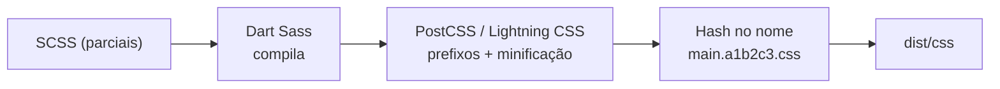
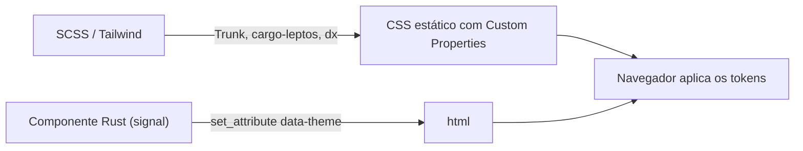

# Guia de Boas Práticas: CSS Vanilla e SCSS Moderno

> **Público-alvo:** Desenvolvedores front-end e full-stack, designers que codificam e times que mantêm design systems sem frameworks utilitários.
> **Objetivo:** Estabelecer um padrão de escrita, arquitetura, build e qualidade para estilos em **CSS puro** e **SCSS (Dart Sass)**, alinhado às práticas atuais da indústria com foco em manutenibilidade, desempenho e acessibilidade.

---

## 🧭 Sumário

1. [O Que Significa "Vanilla"?](#1-o-que-significa-vanilla)
2. [Princípios Fundamentais](#2-princípios-fundamentais)
3. [CSS Nativo Moderno: O Que Você Já Pode Usar](#3-css-nativo-moderno-o-que-você-já-pode-usar)
4. [SCSS do Jeito Certo (Sistema de Módulos)](#4-scss-do-jeito-certo-sistema-de-módulos)
5. [Arquitetura de Pastas: ITCSS + Atomic Design](#5-arquitetura-de-pastas-itcss--atomic-design)
6. [Controle da Cascata com `@layer`](#6-controle-da-cascata-com-layer)
7. [Nomenclatura: BEM e Convenções de Estado](#7-nomenclatura-bem-e-convenções-de-estado)
8. [Design Tokens e Temas (Dark Mode)](#8-design-tokens-e-temas-dark-mode)
9. [Regras de Escrita](#9-regras-de-escrita)
10. [Responsividade: Mobile-First, Fluid e Container Queries](#10-responsividade-mobile-first-fluid-e-container-queries)
11. [Acessibilidade no CSS](#11-acessibilidade-no-css)
12. [Pipeline de Build](#12-pipeline-de-build)
13. [Code-Splitting de CSS](#13-code-splitting-de-css)
14. [Qualidade: Stylelint e Prettier](#14-qualidade-stylelint-e-prettier)
15. [Anti-Patterns](#15-anti-patterns)
16. [Checklist do Desenvolvedor](#16-checklist-do-desenvolvedor)
17. [Múltiplos Temas e Temas Inclusivos](#17-múltiplos-temas-e-temas-inclusivos)
18. [CSS em Aplicações Rust](#18-css-em-aplicações-rust)
19. [Referências](#19-referências)

---

## 1. O Que Significa "Vanilla"?

O termo **Vanilla** refere-se a escrever estilos **sem frameworks de componentes ou bibliotecas utilitárias** (como Bootstrap ou Tailwind CSS). Você escreve exatamente as regras de que o projeto precisa.

| Abordagem | Descrição | Precisa de build? |
| --- | --- | --- |
| **CSS Vanilla** | CSS puro, interpretado diretamente pelo navegador. Usa recursos nativos modernos: variáveis (`--token`), aninhamento, `@layer`, `:has()`, container queries etc. | Não (recomendado apenas minificação/prefixos) |
| **SCSS Vanilla** | CSS escrito com a sintaxe `.scss` do [Sass](https://sass-lang.com/), mantendo-se próximo do CSS tradicional, mas usando módulos, mixins, funções e parciais. Compilado para CSS puro. | Sim |

### Quando escolher cada um?

Com a evolução do CSS nativo (aninhamento, variáveis, `color-mix()`, `@layer`), **boa parte dos motivos clássicos para usar Sass deixou de existir**. Ainda assim, o SCSS continua valioso em projetos grandes.

| Necessidade | CSS nativo | SCSS |
| --- | :---: | :---: |
| Variáveis / temas em tempo de execução (dark mode) | ✅ Custom properties | ⚠️ Só em compilação (use custom properties junto) |
| Aninhamento | ✅ Nativo (Baseline 2023) | ✅ |
| Dividir em vários arquivos sem custo de requisição | ❌ (`@import` nativo gera requisições em cascata) | ✅ `@use` / `@forward` |
| Mixins, loops, funções, mapas | ❌ | ✅ |
| Geração de utilitários / escalas a partir de tokens | ❌ | ✅ |

> [!TIP]
> **Regra prática:** use **custom properties do CSS para tudo que muda em tempo de execução** (tema, densidade, cor de marca) e **Sass para tudo que é resolvido em build** (organização de arquivos, mixins, breakpoints, geração de escalas).

---

## 2. Princípios Fundamentais

* **Controle total e zero runtime:** nenhuma biblioteca é executada no navegador; o CSS final contém apenas o que é usado.
* **Baixa especificidade:** estilize por **classes**; evite IDs e seletores encadeados. Especificidade baixa e previsível = código fácil de sobrescrever.
* **Componentização:** cada componente visual é isolado (um arquivo, um bloco BEM) e não "vaza" estilos para o restante da página.
* **Separação entre tokens e componentes:** cores, espaçamentos e tipografia vivem em tokens; componentes apenas consomem tokens.
* **Progressive enhancement:** recursos modernos devem degradar com elegância em navegadores que não os suportam (`@supports`).
* **Acessibilidade por padrão:** foco visível, contraste adequado, respeito às preferências do usuário (`prefers-reduced-motion`, `prefers-color-scheme`).

---

## 3. CSS Nativo Moderno: O Que Você Já Pode Usar

Recursos com amplo suporte nos navegadores atuais (consulte sempre o status **Baseline** em [web.dev/baseline](https://web.dev/baseline) ou [caniuse.com](https://caniuse.com)):

| Recurso | Uso típico |
| --- | --- |
| Custom properties (`--color-primary`) | Tokens e temas em tempo de execução |
| Aninhamento nativo (`&:hover`) | Organização sem pré-processador |
| `@layer` | Controle explícito da ordem da cascata |
| `:has()` | "Seletor pai" estilizar com base nos filhos |
| `:is()` / `:where()` | Agrupar seletores; `:where()` tem especificidade zero |
| Container queries (`@container`) | Componentes responsivos ao **seu container**, não à viewport |
| `clamp()`, `min()`, `max()` | Tipografia e espaçamento fluidos |
| `color-mix()`, `oklch()` | Variações de cor perceptualmente consistentes |
| Propriedades lógicas (`margin-inline`, `padding-block`) | Suporte nativo a idiomas RTL |
| `:focus-visible` | Foco visível apenas para navegação por teclado |
| `aspect-ratio`, `gap` (flex/grid), `subgrid` | Layouts sem hacks |

```css
/* Exemplo: card que reage ao próprio container e ao conteúdo */
.card-list {
  container-type: inline-size;
}

.card {
  display: grid;
  gap: var(--space-3);
  padding: var(--space-4);
  background: var(--color-surface);

  &:has(img) {
    grid-template-rows: auto 1fr;
  }

  @container (min-width: 40rem) {
    grid-template-columns: 12rem 1fr;
  }
}
```

---

## 4. SCSS do Jeito Certo (Sistema de Módulos)

O SCSS permite **escrever de forma modular** (dezenas de arquivos pequenos) e **entregar de forma compacta** (um CSS minificado por ponto de entrada).

1. **Para o desenvolvedor (edição organizada):** estilos divididos em **parciais** arquivos prefixados com underline, como `_button.scss`. Parciais não geram CSS sozinhos.
2. **Para o navegador (compacto):** o compilador junta tudo em um único arquivo por ponto de entrada, remove espaços, quebras de linha e comentários.

### 4.1 Use `@use` e `@forward` nunca `@import`

> [!WARNING]
> A regra `@import` do Sass está **depreciada** desde o Dart Sass 1.80 e será removida no Dart Sass 3.0. Ela polui o escopo global, duplica CSS e dificulta saber de onde vem cada variável. O **LibSass/node-sass também está descontinuado** use apenas **Dart Sass** (pacote `sass` ou `sass-embedded`).

| `@import` (legado) | `@use` / `@forward` (atual) |
| --- | --- |
| Tudo vai para o escopo global | Cada módulo tem namespace (`tokens.$color-primary`) |
| O mesmo arquivo pode ser incluído várias vezes | Cada módulo é carregado **uma única vez** |
| Variáveis privadas impossíveis | Membros com `-` ou `_` no início são privados |

### 4.2 Funções nativas: use os módulos `sass:*`

> [!WARNING]
> Funções globais como `darken()`, `lighten()`, `map-get()` e a divisão com `/` estão **depreciadas**. Use os módulos embutidos: `sass:color`, `sass:map`, `sass:math`, `sass:list`, `sass:string`.

### 4.3 Exemplo prático

Código-fonte (legível, organizado):

```scss
// abstracts/_tokens.scss
$color-primary: #3498db;
$radius-md: 0.5rem;
```

```scss
// atoms/_button.scss
@use 'sass:color';
@use '../abstracts/tokens';

.btn {
  padding: 0.625rem 1.25rem;
  border-radius: tokens.$radius-md;
  background-color: tokens.$color-primary;

  &:hover {
    // Equivalente moderno ao antigo darken($color, 10%)
    background-color: color.adjust(tokens.$color-primary, $lightness: -10%);
  }
}
```

Saída de produção (`--style=compressed`):

```css
.btn{padding:.625rem 1.25rem;border-radius:.5rem;background-color:#3498db}.btn:hover{background-color:#217dbb}
```

> [!TIP]
> Alternativa 100% nativa, útil quando a cor vem de um tema em runtime:
> `background-color: color-mix(in oklch, var(--color-primary), black 15%);`

### 4.4 Pastas com `_index.scss` e `@forward`

Cada pasta expõe uma "API" única via `_index.scss`, simplificando os imports:

```scss
// abstracts/_index.scss
@forward 'tokens';
@forward 'mixins';
@forward 'functions';
```

```scss
// Em qualquer componente
@use '../abstracts' as *;   // ou: @use '../abstracts' as abs;
```

> [!NOTE]
> `as *` remove o namespace. Use com moderação apenas para o módulo `abstracts`, que é amplamente consumido. Para os demais, mantenha o namespace e ganhe rastreabilidade.

---

## 5. Arquitetura de Pastas: ITCSS + Atomic Design

O [Atomic Design](https://atomicdesign.bradfrost.com/) (Brad Frost) divide a interface em 5 níveis. Combinado com o [ITCSS](https://www.xfive.co/blog/itcss-scalable-maintainable-css-architecture/) (Harry Roberts), que ordena o CSS **do mais genérico para o mais específico**, obtemos uma arquitetura previsível.

### 5.1 Os níveis do Atomic Design

| Nível | Definição | Exemplos de parciais |
| --- | --- | --- |
| **1. Átomos** | Menores unidades de estilo, indivisíveis de forma útil | `_button.scss`, `_input.scss`, `_label.scss`, `_heading.scss` |
| **2. Moléculas** | Combinações de átomos que funcionam como unidade | `_search-bar.scss` (input + botão), `_form-field.scss` |
| **3. Organismos** | Seções distintas formadas por moléculas e/ou átomos | `_header.scss`, `_footer.scss`, `_product-card.scss` |
| **4. Templates** | Estruturas de layout (Grid/Flexbox), sem conteúdo real | `_dashboard-layout.scss`, `_product-page-layout.scss` |
| **5. Páginas** | Instâncias específicas de templates | `_home.scss`, `_checkout.scss` |

> [!IMPORTANT]
> O nível **Páginas** deve conter **o mínimo possível** de CSS apenas ajustes realmente exclusivos daquela tela. Se um estilo de página aparece em duas telas, ele é um componente.

### 5.2 Estrutura recomendada

```
src/scss/
├── abstracts/        # Sem saída de CSS: tokens, mixins, funções
│   ├── _index.scss
│   ├── _tokens.scss
│   ├── _breakpoints.scss
│   └── _mixins.scss
├── base/             # Reset moderno, tipografia base, elementos HTML
│   ├── _index.scss
│   ├── _reset.scss
│   ├── _root.scss    # Custom properties (:root) e temas
│   └── _typography.scss
├── atoms/
├── molecules/
├── organisms/
├── templates/
├── pages/            # Ajustes específicos (mínimo possível)
├── utilities/        # Poucas classes utilitárias (.u-visually-hidden, .u-stack)
│
├── main.scss         # Ponto de entrada global (gera main.css)
├── dashboard.scss    # Ponto de entrada especializado (gera dashboard.css)
└── checkout.scss     # Ponto de entrada especializado (gera checkout.css)
```

### 5.3 Ponto de entrada (`main.scss`)

A ordem segue o ITCSS: **genérico → específico**.

```scss
// main.scss
@use 'abstracts';          // Não gera CSS
@use 'base';
@use 'atoms';
@use 'molecules';
@use 'organisms';
@use 'templates';
@use 'utilities';          // Por último: precisam vencer na cascata
```

---

## 6. Controle da Cascata com `@layer`

`@layer` torna a ordem de prioridade **explícita**, independentemente da especificidade dos seletores ou da ordem dos arquivos. Isso elimina a maior parte das "guerras de especificidade" e do uso de `!important`.

```scss
// main.scss declare a ordem uma única vez, no topo
@layer reset, base, components, layouts, utilities;
```

```scss
// atoms/_button.scss
@layer components {
  .btn { /* ... */ }
}
```

```scss
// utilities/_index.scss
@layer utilities {
  .u-hidden { display: none; }
}
```

> [!NOTE]
> Estilos **fora** de qualquer layer têm prioridade sobre todos os layers. Isso é útil para integrar CSS de terceiros: coloque-os em um layer baixo (`@layer vendor`) para que seu código sempre vença.

---

## 7. Nomenclatura: BEM e Convenções de Estado

Em CSS puro, a metodologia **BEM (Block, Element, Modifier)** garante que o estilo de um componente fique encapsulado, simulando o escopo de frameworks como React ou Vue, mas gerando um CSS único, estático e de altíssimo desempenho.

| Parte | Sintaxe | Exemplo |
| --- | --- | --- |
| **Block** | `.bloco` | `.card` |
| **Element** | `.bloco__elemento` | `.card__title` |
| **Modifier** | `.bloco--modificador` | `.card--featured` |

```scss
.card {
  padding: var(--space-4);

  &__title {             // gera .card__title (sem aumentar especificidade)
    font-size: var(--font-size-lg);
  }

  &--featured {          // gera .card--featured
    border: 2px solid var(--color-primary);
  }
}
```

### Convenções complementares

| Prefixo / padrão | Significado | Exemplo |
| --- | --- | --- |
| `is-` / `has-` | Estado temporário, controlado por JS | `.is-open`, `.has-error` |
| Atributos ARIA | **Preferível** para estados acessíveis | `[aria-expanded="true"]`, `[aria-current="page"]` |
| `u-` | Utilitário de propósito único | `.u-visually-hidden` |
| `l-` | Layout / objeto estrutural | `.l-container`, `.l-stack` |
| `js-` | Gancho para JavaScript **nunca estilizar** | `.js-toggle-menu` |

> [!TIP]
> Estilizar via atributos ARIA (`.menu[aria-expanded="true"]`) garante que **o visual e a acessibilidade nunca fiquem dessincronizados**.

**Regras de nomenclatura:**

* Nomes em **inglês**, **kebab-case**, descrevendo **função**, não aparência (`.btn--danger`, não `.btn--red`).
* Não aninhe elementos BEM: `.card__body__title` ❌ → `.card__title` ✅.
* Um bloco por arquivo; o nome do arquivo é o nome do bloco (`_card.scss` → `.card`).

---

## 8. Design Tokens e Temas (Dark Mode)

**Design tokens** são as decisões de design (cores, espaçamentos, tipografia, raios, sombras, durações) armazenadas como variáveis nomeadas. Organize-os em duas camadas:

1. **Tokens primitivos:** a paleta bruta (`--blue-500`, `--gray-100`).
2. **Tokens semânticos:** o significado de uso (`--color-primary`, `--color-surface`, `--color-text`). **Componentes consomem apenas tokens semânticos.**

```scss
// base/_root.scss
:root {
  /* Primitivos */
  --blue-500: oklch(62% 0.15 245);
  --gray-50:  oklch(98% 0 0);
  --gray-900: oklch(20% 0 0);

  /* Semânticos tema claro */
  --color-primary: var(--blue-500);
  --color-surface: var(--gray-50);
  --color-text:    var(--gray-900);

  /* Escalas */
  --space-1: 0.25rem;
  --space-2: 0.5rem;
  --space-3: 0.75rem;
  --space-4: 1rem;
  --radius-md: 0.5rem;

  color-scheme: light dark;
}

/* Tema escuro automático, conforme o sistema operacional */
@media (prefers-color-scheme: dark) {
  :root:not([data-theme='light']) {
    --color-surface: var(--gray-900);
    --color-text:    var(--gray-50);
  }
}

/* Tema escuro forçado pelo usuário (toggle) */
:root[data-theme='dark'] {
  --color-surface: var(--gray-900);
  --color-text:    var(--gray-50);
}
```

> [!TIP]
> Gere as custom properties a partir de um **mapa Sass** (ou de um arquivo JSON via [Style Dictionary](https://styledictionary.com/)) para ter uma única fonte da verdade compartilhada entre design (Figma) e código.

---

## 9. Regras de Escrita

### 9.1 Especificidade e aninhamento

* **Profundidade máxima de aninhamento: 3 níveis.** Aninhamento profundo gera seletores longos, frágeis e de alta especificidade.
* **Nunca use IDs** para estilização.
* **Evite `!important`.** Exceção aceitável: classes utilitárias que precisam sempre vencer (e mesmo assim, prefira `@layer utilities`).
* Não qualifique classes com elementos: `div.card` ❌ → `.card` ✅.
* Use `:where()` em estilos base para manter especificidade zero e facilitar sobrescrita.

```scss
// ❌ Ruim: especificidade alta e acoplamento com o HTML
.header .nav ul li a.active { }

// ✅ Bom: uma classe, especificidade baixa
.nav__link[aria-current='page'] { }
```

### 9.2 Unidades

| Uso | Unidade recomendada |
| --- | --- |
| Tamanho de fonte | `rem` (respeita a configuração de fonte do usuário) |
| Espaçamentos e raios | `rem` (via tokens) |
| Bordas finas | `px` |
| Altura de linha | Sem unidade (`line-height: 1.5`) |
| Larguras de leitura | `ch` (`max-inline-size: 65ch`) |
| Altura de tela inteira | `dvh` / `svh` (em vez de `100vh`, que falha em mobile) |
| Media/container queries | `em` ou `rem` |

### 9.3 Ordem das propriedades

Agrupe as propriedades de forma consistente (o Stylelint pode automatizar isso com `stylelint-order`):

1. **Posicionamento:** `position`, `inset`, `z-index`
2. **Box model / layout:** `display`, `flex`, `grid`, `gap`, `inline-size`, `margin`, `padding`
3. **Tipografia:** `font`, `line-height`, `color`, `text-align`
4. **Visual:** `background`, `border`, `border-radius`, `box-shadow`, `opacity`
5. **Animação / Misc:** `transition`, `animation`, `cursor`

### 9.4 Ordem dentro de um bloco SCSS

```scss
.btn {
  @include focus-ring;                 // 1. Mixins/includes
  display: inline-flex;                // 2. Propriedades do próprio bloco
  padding: var(--space-2) var(--space-4);

  &:hover,                             // 3. Pseudo-classes e estados
  &:focus-visible { }

  &::before { }                        // 4. Pseudo-elementos

  &__icon { }                          // 5. Elementos BEM

  &--primary { }                       // 6. Modificadores

  @include mq(md) { }                  // 7. Media/container queries por último
}
```

### 9.5 Comentários

* Use `//` em SCSS para comentários de desenvolvimento (não vão para o CSS final).
* Use `/* */` apenas quando o comentário **deve** existir no CSS (ex.: licenças, com `/*!`).
* Comente o **porquê**, não o **o quê** (`// z-index acima do modal de cookies`).

---

## 10. Responsividade: Mobile-First, Fluid e Container Queries

### 10.1 Mobile-first com mixin de breakpoints

Escreva o estilo base para telas pequenas e **adicione** complexidade com `min-width`:

```scss
// abstracts/_breakpoints.scss
@use 'sass:map';

$breakpoints: (
  sm: 36em,
  md: 48em,
  lg: 64em,
  xl: 80em,
);

@mixin mq($size) {
  @media (min-width: map.get($breakpoints, $size)) {
    @content;
  }
}
```

```scss
.grid {
  display: grid;
  gap: var(--space-4);

  @include mq(md) { grid-template-columns: repeat(2, 1fr); }
  @include mq(lg) { grid-template-columns: repeat(3, 1fr); }
}
```

### 10.2 Tipografia e espaçamento fluidos

Reduza a quantidade de breakpoints com `clamp()`:

```css
h1 {
  font-size: clamp(1.75rem, 1.2rem + 2.5vw, 3rem);
}
```

> [!TIP]
> Ferramentas como [Utopia](https://utopia.fyi/) geram escalas fluidas de tipografia e espaçamento prontas para virar tokens.

### 10.3 Layouts intrínsecos

Muitas vezes nem é preciso media query:

```css
.auto-grid {
  display: grid;
  grid-template-columns: repeat(auto-fit, minmax(min(16rem, 100%), 1fr));
  gap: var(--space-4);
}
```

### 10.4 Container queries

Use **media queries para o layout da página** e **container queries para componentes**, que podem aparecer em contextos de larguras diferentes (sidebar, conteúdo principal, modal).

---

## 11. Acessibilidade no CSS

* **Foco sempre visível:** nunca use `outline: none` sem substituto. Prefira `:focus-visible`.
* **Contraste:** mínimo **4.5:1** para texto normal e **3:1** para texto grande e componentes de interface (WCAG 2.2 AA).
* **Movimento reduzido:** respeite `prefers-reduced-motion`.
* **Zoom e fonte do usuário:** use `rem` para tipografia; o layout deve funcionar com zoom de 200%.
* **Alvos de toque:** mínimo de **24×24 px** (WCAG 2.2), idealmente 44×44 px.
* **Conteúdo apenas visual:** nunca transmita informação **somente** por cor.
* **Texto oculto acessível:** use uma classe `visually-hidden`, não `display: none`.

```scss
:focus-visible {
  outline: 2px solid var(--color-primary);
  outline-offset: 2px;
}

@media (prefers-reduced-motion: reduce) {
  *,
  *::before,
  *::after {
    animation-duration: 0.01ms !important;
    animation-iteration-count: 1 !important;
    transition-duration: 0.01ms !important;
    scroll-behavior: auto !important;
  }
}

.u-visually-hidden {
  position: absolute !important;
  inline-size: 1px;
  block-size: 1px;
  overflow: hidden;
  clip-path: inset(50%);
  white-space: nowrap;
}
```

---

## 12. Pipeline de Build



| Etapa | Ferramenta recomendada | Função |
| --- | --- | --- |
| Compilação | `sass` (Dart Sass) | SCSS → CSS |
| Compatibilidade | [Autoprefixer](https://github.com/postcss/autoprefixer) ou [Lightning CSS](https://lightningcss.dev/) + [Browserslist](https://browsersl.ist/) | Prefixos e transpilação de sintaxe nova conforme os navegadores-alvo |
| Minificação | Lightning CSS, cssnano ou `--style=compressed` | Reduz o tamanho do arquivo |
| Cache busting | Hash no nome do arquivo (Vite, esbuild, webpack) | Invalida o cache apenas quando o conteúdo muda |
| Source maps | Apenas em desenvolvimento (ou privados em produção) | Depuração do SCSS original no DevTools |

### Exemplo com Sass CLI (sem bundler)

```json
{
  "scripts": {
    "css:dev":   "sass src/scss:dist/css --watch --embed-source-map",
    "css:build": "sass src/scss:dist/css --style=compressed --no-source-map && postcss dist/css/*.css --use autoprefixer --replace"
  },
  "browserslist": ["defaults", "not dead"]
}
```

> [!NOTE]
> O Sass compila **um arquivo CSS para cada arquivo `.scss` que não começa com `_`**. É exatamente esse comportamento que viabiliza o code-splitting da próxima seção. Em projetos com Vite, basta instalar `sass-embedded` e importar o `.scss` o Vite cuida de compilação, minificação e hash.

---

## 13. Code-Splitting de CSS

Em vez de gerar um único arquivo gigante para o site inteiro, gere **arquivos CSS por demanda**. Isso reduz o CSS bloqueante no primeiro carregamento e melhora métricas como **FCP** e **LCP** (Core Web Vitals / Lighthouse).

### 13.1 A estratégia de divisão

**1. Bloco global (`main.css`)** usado em quase todas as páginas. Baixado uma vez e mantido em cache.

* **O que entra:** tokens, reset, tipografia base e componentes globais (header, footer, botões, formulários, modais comuns).

**2. CSS especializados (`checkout.css`, `dashboard.css` etc.)** regras exclusivas de telas específicas, pesadas ou pouco acessadas.

* **O que entra:** painéis administrativos, gráficos, landing pages específicas, fluxo de checkout.

### 13.2 Ponto de entrada especializado

```scss
// checkout.scss reaproveita tokens e mixins (que não geram CSS)
@use 'abstracts' as *;

@layer pages {
  .checkout-grid {
    display: grid;
    gap: var(--space-4);

    @include mq(lg) {
      grid-template-columns: 2fr 1fr;
    }
  }
}
```

> [!WARNING]
> **Não use `@use` de componentes (`atoms`, `organisms`) nos arquivos especializados** se eles já estão no `main.css` isso duplicaria o CSS. Arquivos especializados devem importar apenas `abstracts` (que não geram saída) e seus próprios estilos.

### 13.3 Consumo no HTML

```html
<!-- Todas as páginas -->
<link rel="stylesheet" href="/dist/css/main.a1b2c3.css">
```

```html
<!-- Apenas em /checkout: o global (já em cache) + o específico -->
<link rel="stylesheet" href="/dist/css/main.a1b2c3.css">
<link rel="stylesheet" href="/dist/css/checkout.d4e5f6.css">
```

### 13.4 Otimizações complementares

* **CSS crítico inline:** insira no `<head>` apenas o CSS necessário para a primeira dobra e carregue o restante de forma não bloqueante.
* **`media` no `<link>`:** CSS de impressão com `media="print"` não bloqueia a renderização.
* **`content-visibility: auto`:** adia a renderização de seções fora da tela.
* **Fontes:** use `font-display: swap` e `<link rel="preload">` apenas para a fonte principal.

> [!NOTE]
> Com **HTTP/2 e HTTP/3**, múltiplas requisições custam pouco. O ganho real do code-splitting não é "menos requisições", e sim **menos CSS bloqueante e cache mais granular**. Evite, porém, fragmentar demais (dezenas de arquivos minúsculos).

### 13.5 Vantagens

* **Primeiro carregamento veloz (FCP):** o visitante da home não baixa CSS da área administrativa que talvez nunca acesse.
* **Cache inteligente:** ao alterar o checkout, apenas `checkout.[hash].css` muda; o `main.[hash].css` continua em cache para usuários recorrentes.

---

## 14. Qualidade: Stylelint e Prettier

Automatize o padrão revisão de código não deve discutir indentação.

* **[Prettier](https://prettier.io/):** formatação (indentação, aspas, quebras).
* **[Stylelint](https://stylelint.io/):** regras de qualidade, convenções e erros.

```bash
npm i -D stylelint stylelint-config-standard-scss stylelint-order prettier
```

```json
// .stylelintrc.json
{
  "extends": ["stylelint-config-standard-scss"],
  "plugins": ["stylelint-order"],
  "rules": {
    "max-nesting-depth": 3,
    "selector-max-id": 0,
    "selector-max-compound-selectors": 3,
    "declaration-no-important": true,
    "selector-class-pattern": [
      "^[a-z]([a-z0-9-]+)?(__([a-z0-9]+-?)+)?(--([a-z0-9]+-?)+){0,2}$",
      { "message": "Use a convenção BEM em kebab-case" }
    ],
    "order/order": ["custom-properties", "dollar-variables", "at-rules", "declarations", "rules"]
  }
}
```

> [!TIP]
> Rode o Stylelint no editor, em um hook de pre-commit (`lint-staged` + `husky`) e no pipeline de CI.

---

## 15. Anti-Patterns

| ❌ Anti-pattern | ✅ Alternativa |
| --- | --- |
| `@import` do Sass | `@use` / `@forward` |
| `darken()`, `lighten()`, `map-get()` globais | `sass:color`, `sass:map` |
| Aninhamento com 4+ níveis | Máximo de 3; prefira classes BEM planas |
| Seletores por ID ou por tag aninhada (`.nav ul li a`) | Uma classe por elemento (`.nav__link`) |
| `!important` para "consertar" conflitos | `@layer` e especificidade baixa |
| Valores mágicos (`margin-top: 37px`) | Tokens (`var(--space-6)`) |
| Cores hardcoded nos componentes | Tokens semânticos |
| Nomes por aparência (`.text-red`, `.big-box`) | Nomes por função (`.alert--danger`) |
| `outline: none` sem substituto | `:focus-visible` com outline customizado |
| `100vh` em mobile | `100dvh` / `100svh` |
| Animar `width`, `top`, `left` | Animar `transform` e `opacity` |
| Estilizar classes `js-*` | Separar ganchos JS de estilos |
| Estilos de página que se repetem | Extrair para um componente |
| `@extend` entre arquivos diferentes | Mixins ou classes compostas no HTML |
| node-sass / LibSass | Dart Sass (`sass` ou `sass-embedded`) |

---

## 16. Checklist do Desenvolvedor

**Arquitetura**
- [ ] O estilo novo está no nível correto (átomo, molécula, organismo, template)?
- [ ] O arquivo usa `@use` com namespace (nenhum `@import`)?
- [ ] O estilo está no `@layer` adequado?
- [ ] Estilos exclusivos de uma tela estão no ponto de entrada especializado, sem duplicar componentes globais?

**Escrita**
- [ ] Nomenclatura BEM em kebab-case, descrevendo função?
- [ ] Aninhamento ≤ 3 níveis, sem IDs e sem `!important`?
- [ ] Cores, espaçamentos e fontes vêm de tokens?
- [ ] Unidades corretas (`rem` para fontes, sem unidade em `line-height`)?

**Responsividade e acessibilidade**
- [ ] Mobile-first; container queries para componentes reutilizáveis?
- [ ] Foco visível com `:focus-visible`?
- [ ] Contraste ≥ 4.5:1 (texto) e ≥ 3:1 (componentes)?
- [ ] Animações respeitam `prefers-reduced-motion`?
- [ ] Funciona em tema claro e escuro e com zoom de 200%?

**Temas**
- [ ] Componentes consomem apenas tokens semânticos (nenhuma regra duplicada por tema)?
- [ ] Cada tema foi validado quanto ao contraste?
- [ ] A escolha do usuário persiste e não há flash do tema errado ao carregar?
- [ ] Sem escolha explícita, as preferências do sistema são respeitadas?

**Build e qualidade**
- [ ] Stylelint e Prettier passam sem erros?
- [ ] O CSS de produção está minificado, com hash no nome e sem source map público?
- [ ] O Browserslist reflete os navegadores-alvo do projeto?

---

## 17. Múltiplos Temas e Temas Inclusivos

> **Cenário:** um site com vários temas selecionáveis (Claro, Escuro e temas inclusivos, como Alto Contraste e Leitura Facilitada), priorizando desempenho de renderização, tamanho de arquivo e tempo de carregamento.

A melhor opção não é o SCSS isolado nem o Tailwind puro: é colocar as **Custom Properties nativas do CSS no centro da arquitetura**. Esse é o padrão da indústria. Você não precisa abandonar o SCSS ou o Tailwind; basta que **a lógica de temas seja delegada ao navegador** por meio das variáveis nativas.

### 17.1 Por que as Custom Properties vencem

Se os temas forem implementados duplicando regras por tema (SCSS gerando um bloco inteiro de seletores para cada tema) ou aplicando variantes elemento por elemento (`dark:bg-... hc:bg-...` no Tailwind), surgem três problemas:

1. **Arquivos maiores:** o CSS (ou o HTML) cresce de forma proporcional ao número de temas.
2. **Manutenção difícil:** cada novo tema exige revisar todos os componentes.
3. **Troca de tema custosa:** soluções que trocam classes em vários elementos via JavaScript geram muitas mutações no DOM.

Com Custom Properties, os componentes são escritos **uma única vez** e o tema apenas redefine os valores dos tokens em um único ponto (`:root`). Trocar de tema é **uma única mutação no DOM** (um atributo no `<html>`).

| Critério | Regras duplicadas por tema | Custom Properties |
| --- | --- | --- |
| Tamanho do CSS com 2 temas | 2× as regras de cor | 1× regras + poucos tokens |
| Tamanho do CSS com 10 temas | 10× as regras de cor | 1× regras + 10 blocos de tokens |
| Custo para adicionar um tema | Alterar vários componentes | Criar um bloco de tokens |
| Troca em tempo de execução | Várias mutações ou recarregar o CSS | Um atributo no `<html>` |

> [!NOTE]
> Trocar um token em `:root` ainda faz o navegador recalcular os estilos dos elementos que herdam aquele valor (*style recalculation*). Isso é rápido e acontece uma única vez, mas não é "custo zero". Evite transições em `*` durante a troca e, para tokens que não precisam ser herdados, registre-os com `@property { inherits: false; }`.

### 17.2 Separe os eixos de personalização

Temas inclusivos raramente são excludentes: uma pessoa pode querer **tema escuro + texto ampliado + sem animações**. Em vez de um único `data-theme` com todas as combinações, use **um atributo por eixo**:

| Eixo | Atributo | Valores sugeridos | Preferência do sistema equivalente |
| --- | --- | --- | --- |
| Cores | `data-theme` | `light`, `dark`, `high-contrast` | `prefers-color-scheme`, `prefers-contrast` |
| Leitura | `data-reading` | `default`, `easy-read` | (não existe) |
| Movimento | `data-motion` | `default`, `reduced` | `prefers-reduced-motion` |

> [!TIP]
> Use valores em **inglês, kebab-case e sem acentos** (`easy-read`, e não `leitura-fácil`). Acentos em valores de atributos funcionam, mas causam erros de digitação, problemas de encoding e inconsistência com o restante dos tokens.

### 17.3 Estrutura dos tokens

Os nomes seguem os tokens semânticos da [seção 8](#8-design-tokens-e-temas-dark-mode):

```css
/* base/_themes.scss */

/* Tema padrão (claro) */
:root {
  --color-surface: #ffffff;
  --color-text: #1a1a1a;
  --color-primary: #1d4ed8;
  --color-focus: #1d4ed8;

  --font-family-base: system-ui, sans-serif;
  --font-size-base: 1rem;          /* rem respeita a configuração do usuário */
  --line-height-base: 1.5;
  --letter-spacing-base: normal;
  --word-spacing-base: normal;

  color-scheme: light;
}

/* Tema escuro */
:root[data-theme='dark'] {
  --color-surface: #121212;
  --color-text: #f5f5f5;
  --color-primary: #93c5fd;
  --color-focus: #93c5fd;

  color-scheme: dark;
}

/* Tema inclusivo: alto contraste */
:root[data-theme='high-contrast'] {
  --color-surface: #000000;
  --color-text: #ffff00;           /* amarelo sobre preto: contraste de ~19.6:1 */
  --color-primary: #00ffff;
  --color-focus: #ffffff;

  color-scheme: dark;
}

/* Eixo de leitura: leitura facilitada (baixa visão, dislexia) */
:root[data-reading='easy-read'] {
  --font-family-base: 'Atkinson Hyperlegible', system-ui, sans-serif;
  --font-size-base: 1.25rem;
  --line-height-base: 1.8;
  --letter-spacing-base: 0.05em;
  --word-spacing-base: 0.16em;
}
```

Os componentes **apenas consomem** os tokens, sem saber qual tema está ativo:

```css
body {
  font-family: var(--font-family-base);
  font-size: var(--font-size-base);
  line-height: var(--line-height-base);
  letter-spacing: var(--letter-spacing-base);
  word-spacing: var(--word-spacing-base);
  color: var(--color-text);
  background-color: var(--color-surface);
}
```

> [!IMPORTANT]
> Para leitura facilitada, **espaçamento** (entrelinha, entre letras e entre palavras) tem mais evidência de benefício do que fontes "especiais para dislexia". Os valores acima seguem o critério **WCAG 1.4.12 (Text Spacing)**. O layout deve continuar funcionando com eles, sem cortar ou sobrepor texto.

### 17.4 Respeite as preferências do sistema

A escolha manual do usuário deve **sobrescrever** a preferência do sistema operacional, mas, na ausência dela, o sistema decide:

```css
/* Sem escolha explícita: segue o sistema operacional */
@media (prefers-color-scheme: dark) {
  :root:not([data-theme]) {
    --color-surface: #121212;
    --color-text: #f5f5f5;
    color-scheme: dark;
  }
}

@media (prefers-contrast: more) {
  :root:not([data-theme]) {
    --color-surface: #000000;
    --color-text: #ffffff;
  }
}

/* Modo de cores forçadas (ex.: Alto Contraste do Windows):
   não brigue com ele; use as cores do sistema */
@media (forced-colors: active) {
  .btn {
    border: 1px solid ButtonText;
  }
}
```

### 17.5 Alternância, persistência e o "flash" de tema

Trocar o tema é uma única linha de JavaScript:

```js
document.documentElement.dataset.theme = 'high-contrast';
```

Mas um seletor de temas completo precisa também **persistir a escolha** e **evitar o flash do tema errado** (FOUC): a página renderiza clara por alguns milissegundos antes de o JavaScript aplicar o tema escuro.

**Solução:** um script mínimo, **inline e síncrono no `<head>`**, antes de qualquer CSS ser pintado:

```html
<head>
  <meta name="color-scheme" content="light dark">
  <script>
    // Executa antes da primeira pintura: sem flash
    (() => {
      const root = document.documentElement;
      const theme = localStorage.getItem('theme');
      const reading = localStorage.getItem('reading');
      if (theme) root.dataset.theme = theme;
      if (reading) root.dataset.reading = reading;
    })();
  </script>
  <link rel="stylesheet" href="/dist/css/main.a1b2c3.css">
</head>
```

> [!TIP]
> Em aplicações renderizadas no servidor (SSR), a solução ideal é **salvar o tema em um cookie** e o servidor já entregar `<html data-theme="dark">` pronto. Sem script de bloqueio e sem flash. Veja o exemplo em Rust na [seção 18.2](#182-aplicações-ssr-axum-actix-web-loco).

**Acessibilidade do seletor de temas:**

* Use `<button>` com `aria-pressed` ou um grupo de `<input type="radio">`; nunca `<div>` clicável.
* Rótulos em texto ("Alto contraste"), não apenas ícones ou emojis (leitores de tela leem "👁️" como "olho").
* O próprio seletor deve ser legível em **todos** os temas.
* Valide o contraste de **cada** tema (mínimo 4.5:1 para texto), não apenas do tema claro.

### 17.6 Como SCSS e Tailwind se encaixam

#### Opção A: SCSS + Custom Properties

O SCSS organiza os arquivos (estrutura do Atomic Design) e **gera os blocos de tokens a partir de um mapa**, mantendo uma única fonte da verdade:

```scss
// abstracts/_themes.scss
@use 'sass:map';

$themes: (
  light:         (surface: #ffffff, text: #1a1a1a),
  dark:          (surface: #121212, text: #f5f5f5),
  high-contrast: (surface: #000000, text: #ffff00),
);

@each $name, $tokens in $themes {
  $selector: if($name == light, ':root', ':root[data-theme="#{$name}"]');

  #{$selector} {
    @each $key, $value in $tokens {
      --color-#{$key}: #{$value};
    }
  }
}
```

**Vantagem:** os componentes compilados não mudam com 2 ou 10 temas; apenas os pequenos blocos de tokens crescem.

#### Opção B: Tailwind CSS v4

O [Tailwind CSS](https://tailwindcss.com/) v4 é construído sobre Custom Properties. Em vez de poluir o HTML com `dark:bg-slate-900 dark:text-white`, mapeie os tokens semânticos para utilitários com `@theme inline`:

```css
/* app.css */
@import 'tailwindcss';

/* Faz a variante dark: obedecer ao atributo data-theme */
@custom-variant dark (&:where([data-theme='dark'], [data-theme='dark'] *));

/* Utilitários apontam para os tokens que mudam em runtime */
@theme inline {
  --color-surface: var(--color-surface);
  --color-text: var(--color-text);
}
```

```html
<!-- Um único conjunto de classes funciona em todos os temas -->
<main class="bg-surface text-text">...</main>
```

**Vantagem:** o HTML fica enxuto e o tema é trocado sem alterar nenhuma classe.

### 17.7 Veredito

| Camada | Recomendação |
| --- | --- |
| **Base lógica** | Custom Properties controladas por atributos no `<html>` (`data-theme`, `data-reading`) |
| **Ferramenta de escrita** | **SCSS** para HTML mais limpo e controle total de tipografia e layouts acessíveis; **Tailwind v4** para velocidade de estilização direto no componente |
| **Persistência** | Cookie (SSR) ou `localStorage` + script inline no `<head>` (CSR) |
| **Padrão** | Preferências do sistema (`prefers-color-scheme`, `prefers-contrast`, `prefers-reduced-motion`) |

---

## 18. CSS em Aplicações Rust

Desenvolver aplicações web em Rust muda o **ecossistema de ferramentas**, mas **não muda a estratégia**: Custom Properties nativas continuam sendo a base mais eficiente. O que muda é **onde o CSS é compilado** e **quem controla o estado do tema**.

### 18.1 Visão geral dos cenários

| Cenário | Exemplos | Quem renderiza o HTML | Onde o CSS é compilado | Onde vive o estado do tema |
| --- | --- | --- | --- | --- |
| **SSR / Full-stack** | Axum, Actix-web, Loco + Askama, Maud, MiniJinja | Servidor | `build.rs` ou CLI no pipeline | Cookie, lido pelo servidor |
| **SPA em WebAssembly** | Leptos (CSR), Yew, Dioxus Web | Navegador (WASM) | Trunk, `cargo-leptos` ou `dx` | Signal/estado + `localStorage` |
| **Full-stack isomórfico** | Leptos SSR + hidratação, Dioxus Fullstack | Servidor e navegador | `cargo-leptos` ou `dx` | Cookie (SSR) + signal (cliente) |
| **Desktop com WebView** | Tauri | WebView do sistema | Vite, Trunk ou o bundler do front-end | Igual ao front-end usado |

> [!NOTE]
> Toolkits de interface **nativos** em Rust (egui, iced, Slint, GPUI) **não usam CSS**: eles têm sistemas próprios de estilo e tema. Este guia se aplica apenas a interfaces baseadas em HTML/WebView.

### 18.2 Aplicações SSR (Axum, Actix-web, Loco)

O servidor entrega páginas HTML prontas. O CSS é um **asset estático** compilado durante o build.

#### Compilando o SCSS

| Opção | Descrição | Recomendação |
| --- | --- | --- |
| **[grass](https://crates.io/crates/grass)** | Compilador Sass escrito em Rust puro, usado em `build.rs`. Sem dependências externas. | ✅ Ótimo para builds 100% Cargo |
| **Dart Sass (CLI)** | Compilador de referência, chamado no pipeline (`npm`, `just`, `make`) ou pelo `cargo-leptos`/Trunk. | ✅ Máxima compatibilidade |
| **[lightningcss](https://crates.io/crates/lightningcss)** | Minificador, prefixador e transpilador escrito em Rust. Complementa o grass. | ✅ Pós-processamento |
| ~~`sass-rs`~~ | Binding para o LibSass, que está **descontinuado**. | ❌ Não use |

Exemplo de `build.rs` com grass, embutindo o CSS no próprio binário:

```rust
// build.rs
use std::{env, fs, path::Path};

fn main() {
    println!("cargo:rerun-if-changed=styles");

    let options = grass::Options::default().style(grass::OutputStyle::Compressed);
    let css = grass::from_path("styles/main.scss", &options)
        .unwrap_or_else(|e| panic!("Erro ao compilar SCSS: {e}"));

    // Scripts de build devem escrever em OUT_DIR, nunca no código-fonte
    let out = Path::new(&env::var("OUT_DIR").unwrap()).join("main.css");
    fs::write(out, css).expect("Falha ao gravar main.css");
}
```

```rust
// src/assets.rs: CSS embutido no binário em tempo de compilação
pub const MAIN_CSS: &str = include_str!(concat!(env!("OUT_DIR"), "/main.css"));
```

> [!TIP]
> Se preferir servir arquivos do disco, use `tower_http::services::ServeDir` com **hash no nome do arquivo** e o cabeçalho `Cache-Control: public, max-age=31536000, immutable`. Os princípios de code-splitting da [seção 13](#13-code-splitting-de-css) valem integralmente.

#### Tailwind CSS em projetos SSR

Rode o **Tailwind CLI standalone** (binário único, sem Node.js) no pipeline de build. No Tailwind v4, declare explicitamente onde estão os templates Rust para que as classes sejam detectadas:

```css
/* styles/app.css */
@import 'tailwindcss';
@source '../templates';    /* Askama, MiniJinja, Tera */
@source '../src';          /* macros Maud ou Leptos (view!, html!) */
```

#### Tema sem flash via cookie (Axum)

No SSR, o servidor lê a preferência e já entrega o `<html>` com o atributo correto. Valide o valor contra uma **lista fechada** para impedir injeção de HTML:

```rust
use axum::response::Html;
use axum_extra::extract::CookieJar;

const THEMES: [&str; 3] = ["light", "dark", "high-contrast"];

async fn page(jar: CookieJar) -> Html<String> {
    let theme = jar
        .get("theme")
        .map(|c| c.value())
        .filter(|v| THEMES.contains(v))
        .unwrap_or("light");

    // Em produção, prefira um template Askama/MiniJinja
    Html(format!(
        r#"<!doctype html>
<html lang="pt-BR" data-theme="{theme}">
<head><link rel="stylesheet" href="/static/css/main.css"></head>
<body>...</body>
</html>"#
    ))
}
```

### 18.3 SPAs em WebAssembly (Leptos, Yew, Dioxus)

Quando o Rust compila para WebAssembly, o tema passa a ser **estado reativo** da aplicação. A arquitetura recomendada mantém a separação de responsabilidades:



#### A) O CSS continua compilado por fora

O CSS é carregado por um `<link>` no `index.html`, **e não injetado pelo WASM**. Assim, os estilos aparecem antes mesmo de o binário `.wasm` terminar de baixar.

| Ferramenta | Como integrar o CSS |
| --- | --- |
| **[Trunk](https://trunkrs.dev/)** | `<link data-trunk rel="scss" href="styles/main.scss">` ou `rel="tailwind-css"` |
| **[cargo-leptos](https://github.com/leptos-rs/cargo-leptos)** | `style-file = "style/main.scss"` e `tailwind-input-file` em `[package.metadata.leptos]`; minifica com Lightning CSS |
| **[Dioxus CLI](https://dioxuslabs.com/) (`dx`)** | Macro `asset!("/assets/main.css")` e suporte integrado ao Tailwind |

O arquivo de tokens é **o mesmo da [seção 17.3](#173-estrutura-dos-tokens)**; os componentes Rust usam apenas classes neutras, como `.card`, que consomem `var(--color-surface)`.

> [!IMPORTANT]
> Em SPAs puras (CSR), o WASM só executa depois de baixado e inicializado. **Mantenha o script inline de tema no `<head>` do `index.html`** ([seção 17.5](#175-alternância-persistência-e-o-flash-de-tema)); caso contrário, haverá flash do tema padrão enquanto o WASM carrega.

#### B) O estado do tema em Rust (Leptos 0.7+)

O componente guarda o tema em um **signal**, aplica o atributo no `<html>` e persiste a escolha. Usar um `enum` em vez de `String` faz o compilador impedir temas inválidos:

```rust
use leptos::prelude::*;

#[derive(Clone, Copy, PartialEq, Eq)]
enum Theme {
    Light,
    Dark,
    HighContrast,
}

impl Theme {
    fn as_str(self) -> &'static str {
        match self {
            Theme::Light => "light",
            Theme::Dark => "dark",
            Theme::HighContrast => "high-contrast",
        }
    }
}

#[component]
pub fn ThemeSwitcher() -> impl IntoView {
    let (theme, set_theme) = signal(Theme::Light);

    // Roda no navegador sempre que o tema muda
    Effect::new(move |_| {
        let value = theme.get().as_str();
        let Some(window) = web_sys::window() else { return };

        if let Some(root) = window.document().and_then(|d| d.document_element()) {
            let _ = root.set_attribute("data-theme", value);
        }
        if let Ok(Some(storage)) = window.local_storage() {
            let _ = storage.set_item("theme", value);
        }
    });

    let option = move |t: Theme, label: &'static str| {
        view! {
            <button
                type="button"
                aria-pressed=move || (theme.get() == t).to_string()
                on:click=move |_| set_theme.set(t)
            >
                {label}
            </button>
        }
    };

    view! {
        <div class="theme-switcher" role="group" aria-label="Tema de cores">
            {option(Theme::Light, "Claro")}
            {option(Theme::Dark, "Escuro")}
            {option(Theme::HighContrast, "Alto contraste")}
        </div>
    }
}
```

> [!NOTE]
> O exemplo exige as features `Window`, `Document`, `Element` e `Storage` da crate `web-sys` no `Cargo.toml`. O estado inicial deve ser lido do `localStorage` (CSR) ou do cookie (SSR) para refletir a escolha já aplicada pelo script do `<head>`. Em Yew, a lógica equivalente usa `use_state` e `use_effect_with`; em Dioxus, `use_signal` e `use_effect`.

### 18.4 CSS-in-Rust: quando considerar

Existem crates que permitem escrever estilos dentro do código Rust:

| Crate | Ecossistema | Como funciona | Observações |
| --- | --- | --- | --- |
| **[Stylist](https://crates.io/crates/stylist)** | Yew (principalmente) | Macro `style!` valida o CSS em compilação; as regras são **injetadas em `<style>` em tempo de execução** | Aumenta o tamanho do `.wasm` e tem custo de runtime |
| **[stylers](https://crates.io/crates/stylers)** | Leptos | CSS com escopo por componente, extraído para arquivo em compilação | Sem custo de runtime |

> [!WARNING]
> Se você usar CSS-in-Rust, **não duplique estilos por tema dentro do Rust**: isso aumenta o binário `.wasm` e reintroduz os problemas da [seção 17.1](#171-por-que-as-custom-properties-vencem). Mesmo nessas crates, os estilos devem consumir `var(--color-*)`.

### 18.5 Resumo da recomendação para Rust

1. **Rust gerencia o estado** (signal no WASM ou cookie no SSR) e altera **apenas atributos** no `<html>`.
2. **SCSS ou Tailwind, compilados fora do código Rust** (via Trunk, `cargo-leptos`, `dx`, `build.rs` com grass ou Dart Sass), geram um CSS compacto baseado em Custom Properties.
3. **O navegador faz o resto:** aplica cores, tipografia e espaçamentos acessíveis de forma nativa, sem sobrecarregar o binário Rust.
4. **Sem flash:** cookie + SSR sempre que possível; script inline no `<head>` em SPAs puras.

---

## 19. Referências

**CSS e Sass**

* [Sass: Documentação oficial](https://sass-lang.com/documentation/) · [Guia do sistema de módulos](https://sass-lang.com/blog/the-module-system-is-launched/) · [Depreciação do `@import`](https://sass-lang.com/documentation/breaking-changes/import/)
* [MDN: CSS](https://developer.mozilla.org/pt-BR/docs/Web/CSS) · [Cascade layers](https://developer.mozilla.org/en-US/docs/Learn_web_development/Core/Styling_basics/Cascade_layers) · [Container queries](https://developer.mozilla.org/en-US/docs/Web/CSS/CSS_containment/Container_queries) · [Custom properties](https://developer.mozilla.org/pt-BR/docs/Web/CSS/Using_CSS_custom_properties)
* [web.dev: Baseline](https://web.dev/baseline) · [Learn CSS](https://web.dev/learn/css)

**Arquitetura e metodologias**

* [Atomic Design (Brad Frost)](https://atomicdesign.bradfrost.com/)
* [ITCSS (Harry Roberts)](https://www.xfive.co/blog/itcss-scalable-maintainable-css-architecture/)
* [BEM: Metodologia oficial](https://getbem.com/)
* [CUBE CSS (Andy Bell)](https://cube.fyi/), alternativa moderna ao BEM puro
* [Every Layout](https://every-layout.dev/), layouts intrínsecos

**Acessibilidade e temas**

* [WCAG 2.2: Guia rápido](https://www.w3.org/WAI/WCAG22/quickref/) · [1.4.12 Text Spacing](https://www.w3.org/WAI/WCAG22/Understanding/text-spacing.html)
* [MDN: `prefers-contrast`](https://developer.mozilla.org/en-US/docs/Web/CSS/@media/prefers-contrast) · [`forced-colors`](https://developer.mozilla.org/en-US/docs/Web/CSS/@media/forced-colors)
* [Atkinson Hyperlegible (Braille Institute)](https://www.brailleinstitute.org/freefont/)

**Ferramentas**

* [Stylelint](https://stylelint.io/) · [Lightning CSS](https://lightningcss.dev/) · [Browserslist](https://browsersl.ist/)
* [Tailwind CSS v4: Theme variables](https://tailwindcss.com/docs/theme)

**Ecossistema Rust**

* [grass](https://crates.io/crates/grass) · [lightningcss (crate)](https://crates.io/crates/lightningcss)
* [Trunk](https://trunkrs.dev/) · [cargo-leptos](https://github.com/leptos-rs/cargo-leptos) · [Leptos Book](https://book.leptos.dev/) · [Dioxus](https://dioxuslabs.com/)
* [Axum](https://docs.rs/axum) · [tower-http `ServeDir`](https://docs.rs/tower-http/latest/tower_http/services/struct.ServeDir.html) · [Askama](https://docs.rs/askama)
