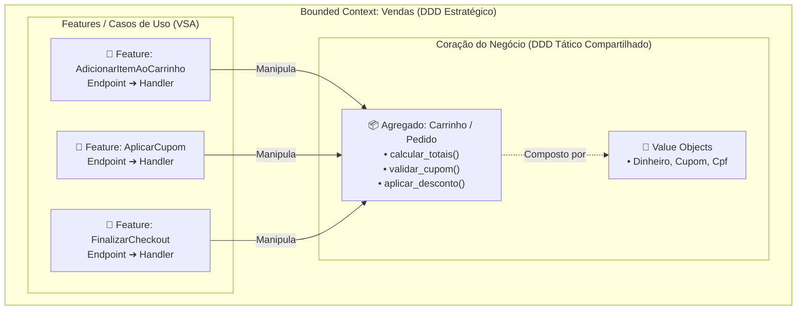
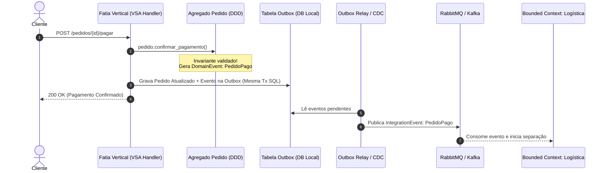
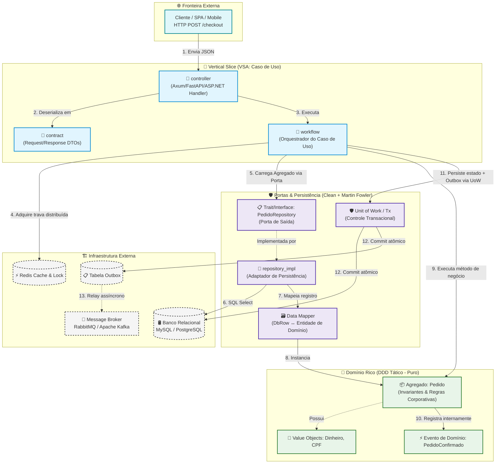

# Guia Arquitetural: Práticas Consagradas de Modelagem e Como Combiná-las
### *A Sinergia Estratégica entre Domain-Driven Design (DDD), Vertical Slice Architecture (VSA), CQRS, Clean Architecture, Padrões de Martin Fowler e EDA*

> **Público-alvo:** Engenheiros de software, arquitetos de soluções, tech leads e desenvolvedores backend.  
> **Objetivo:** Desmistificar a falsa rivalidade entre arquiteturas modernas, demonstrando de forma prática e aprofundada como DDD, VSA, CQRS, Clean Architecture, Padrões de Persistência de Martin Fowler e Arquitetura Orientada a Eventos (EDA) se complementam harmoniosamente para construir sistemas escaláveis, manuteníveis e resilientes.

---

## 🧭 Sumário

1. [A Falsa Dicotomia Arquitetural e a Matriz das 4 Dimensões](#1-a-falsa-dicotomia-arquitetural-e-a-matriz-das-4-dimensões)
2. [DDD + VSA: O Casamento da Coesão com o Domínio Rico](#2-ddd--vsa-o-casamento-da-coesão-com-o-domínio-rico)
3. [DDD + CQRS: Separando Invariantes de Escrita de Projeções de Leitura](#3-ddd--cqrs-separando-invariantes-de-escrita-de-projeções-de-leitura)
4. [DDD + Clean / Hexagonal: Portas, Adaptadores e Núcleo Agnóstico](#4-ddd--clean--hexagonal-portas-adaptadores-e-núcleo-agnóstico)
5. [DDD + Event-Driven Architecture (EDA): Eventos de Domínio vs. Integração](#5-ddd--event-driven-architecture-eda-eventos-de-domínio-vs-integração)
6. [Os Padrões de Persistência de Martin Fowler na Modelagem Moderna](#6-os-padrões-de-persistência-de-martin-fowler-na-modelagem-moderna)
7. [Diagrama Arquitetural Mestre: O Ecossistema Unificado](#7-diagrama-arquitetural-mestre-o-ecossistema-unificado)
8. [Estudo de Caso Prático: Um Grande E-Commerce de Alta Performance](#8-estudo-de-caso-prático-um-grande-e-commerce-de-alta-performance)
9. [Matriz de Decisão Arquitetural: Quando Usar Cada Combinação](#9-matriz-de-decisão-arquitetural-quando-usar-cada-combinação)
10. [Anti-Patterns e Armadilhas Comuns](#10-anti-patterns-e-armadilhas-comuns)
11. [Checklist do Engenheiro para Modelagem de Software](#11-checklist-do-engenheiro-para-modelagem-de-software)

---

## 1. A Falsa Dicotomia Arquitetural e a Matriz das 4 Dimensões

No ecossistema de engenharia de software, é comum presenciar discussões acaloradas contrapondo abordagens arquiteturais: *"Devemos usar Clean Architecture ou Vertical Slice Architecture?"*, *"DDD substitui o CQRS ou vice-versa?"*. 

Essa rivalidade é fruto de uma premissa equivocada: tratar padrões que atuam em **dimensões diferentes** como se fossem alternativas mutuamente excludentes.

Uma arquitetura de software profissional não é a adoção cega de uma única fórmula mágica, mas sim a composição precisa de respostas para quatro perguntas vitais:

```
┌─────────────────────────────────────────────────────────────────────────────┐
│                    AS 4 DIMENSÕES DA ARQUITETURA DE SOFTWARE                │
├────────────────────────────────┬────────────────────────────────────────────┤
│ Dimensão                       │ Pergunta que Responde & Padrão Aplicado    │
├────────────────────────────────┼────────────────────────────────────────────┤
│ 1. Organização do Código       │ Onde o código mora? Como os arquivos se    │
│    (Empacotamento & Coesão)    │ agrupam?                                   │
│                                │ ➔ Solução: Vertical Slice Architecture     │
├────────────────────────────────┼────────────────────────────────────────────┤
│ 2. Modelo Mental & Regras      │ Como garantimos que o negócio está correto │
│    (Invariantes do Negócio)    │ e que o código fala a língua do cliente?   │
│                                │ ➔ Solução: Domain-Driven Design (DDD)      │
├────────────────────────────────┼────────────────────────────────────────────┤
│ 3. Isolamento Tecnológico      │ Como protegemos o software de frameworks,  │
│    (Inversão de Dependência)   │ bibliotecas, bancos e protocolos externos? │
│                                │ ➔ Solução: Clean / Ports & Adapters        │
├────────────────────────────────┼────────────────────────────────────────────┤
│ 4. Fluxo de Dados & Integração │ Como os dados trafegam e como contextos    │
│    (Leitura vs. Escrita)       │ comunicam mudanças sem acoplamento forte?  │
│                                │ ➔ Solução: CQRS + Event-Driven (EDA)       │
└────────────────────────────────┴────────────────────────────────────────────┘
```

> [!TIP]
> **O DDD (Domain-Driven Design) e a VSA (Vertical Slice Architecture) são aliados naturais:**  
> Enquanto o DDD foca em compreender, modelar e proteger as regras do negócio através de limites claros, a VSA foca em organizar o código em torno do comportamento (funcionalidades/casos de uso). Juntos, eles eliminam o código espaguete e a complexidade desnecessária.

---

## 2. DDD + VSA: O Casamento da Coesão com o Domínio Rico

Na arquitetura em camadas tradicional ou em implementações engessadas da Clean Architecture, o código é fatiado horizontalmente:
- Todos os controladores ficam agrupados em `Controllers/`.
- Todos os serviços de negócio ficam em `Services/`.
- Todos os repositórios em `Repositories/`.
- Todos os modelos de dados em `Models/`.

Isso gera um problema crônico de **baixa coesão**: para alterar um único comportamento do sistema (ex: "Adicionar Cupom de Desconto"), o engenheiro precisa abrir e modificar quatro ou cinco pastas distantes entre si.

A **Vertical Slice Architecture (VSA)** resolve isso fatiando o sistema verticalmente por **caso de uso**. Cada fatia tem tudo o que precisa para rodar: seu contrato de entrada (DTO), seu ponto de entrada (Endpoint/Controller), sua orquestração de fluxo (Workflow/Handler) e sua resposta.

### Como o DDD enriquece a VSA:

A crítica mais comum à VSA quando mal executada é o risco de gerar **lógica procedural duplicada** dentro dos handlers (o chamado *Transaction Script* ou código espaguete). É aqui que o **DDD Tático** entra como salvaguarda:

1. **A VSA dá uma casa para o Caso de Uso; o DDD dá uma casa para as Regras:**  
   O handler da fatia gerencia apenas o fluxo técnico (recebe requisição, valida formato do JSON, busca dados no repositório). As regras de negócio vitais não ficam soltas no handler: elas são delegadas para o **Modelo de Domínio Rico** (Entidades, Agregados e Objetos de Valor do DDD) compartilhado entre as fatias do mesmo contexto.
2. **Flexibilidade e Sobriedade Técnica:**  
   Nem toda fatia precisa de toda a cerimônia do DDD. Em um CRUD simples ou na geração de um relatório de leitura, a fatia pode consultar o banco diretamente de forma enxuta. Quando a fatia lida com processos críticos (ex: pagamento, checkout, faturamento), ela recorre aos Agregados ricos do DDD para garantir invariantes.



### Estrutura de Diretórios: VSA + DDD

```text
src/
┗ 📂 vendas/                               <-- Bounded Context (DDD Estratégico)
   ┣ 📂 domain/                            <-- Núcleo Rico Compartilhado do Contexto
   ┃  ┣ 📄 pedido.rs (ou .cs / .ts)        <-- Agregado Raiz (Regras e Invariantes)
   ┃  ┣ 📄 item_pedido.rs                  <-- Entidade Interna
   ┃  ┣ 📄 cupom_desconto.rs               <-- Value Object (Imutável)
   ┃  ┗ 📄 eventos.rs                      <-- Eventos de Domínio (ex: PedidoFinalizado)
   ┗ 📂 features/                          <-- Fatias Verticais Independentes (VSA)
      ┣ 📂 adicionar_item/
      ┃  ┣ 📄 endpoint.rs                  <-- Rota HTTP
      ┃  ┣ 📄 dto.rs                       <-- Contrato de Entrada/Saída
      ┃  ┗ 📄 handler.rs                   <-- Orquestra: carrega Agregado e invoca método
      ┗ 📂 aplicar_cupom/
         ┣ 📄 endpoint.rs
         ┣ 📄 dto.rs
         ┗ 📄 handler.rs                   <-- Valida e aplica cupom via Agregado
```

---

## 3. DDD + CQRS: Separando Invariantes de Escrita de Projeções de Leitura

O **CQRS (Command Query Responsibility Segregation)** propõe uma premissa elegante: o modelo conceitual usado para alterar o estado do sistema não deve ser o mesmo modelo usado para ler os dados.

```
                  ┌──────────────────────────────────────────────────────────┐
                  │                 REQUISIÇÃO DO CLIENTE                    │
                  └─────────────┬──────────────────────────────┬─────────────┘
                                │                              │
                        Comando (Escrita)              Consulta (Leitura)
                                │                              │
                                ▼                              ▼
                  ┌──────────────────────────┐   ┌──────────────────────────┐
                  │   COMMAND HANDLER        │   │     QUERY HANDLER        │
                  │   (Proteção de Regras)   │   │     (Alta Performance)   │
                  └─────────────┬────────────┘   └─────────────┬────────────┘
                                │                              │
                                ▼                              ▼
                  ┌──────────────────────────┐   ┌──────────────────────────┐
                  │ Modelo Rico do DDD       │   │ Leitura Direta (Bypass)  │
                  │ (Agregados & Invariantes)│   │ (DTOs / Views / Projeções│
                  └─────────────┬────────────┘   └─────────────┬────────────┘
                                │                              │
                                ▼                              ▼
                  ┌──────────────────────────┐   ┌──────────────────────────┐
                  │  Banco de Escrita (OLTP) │──►│ Cache / Projeção / Elastic
                  └──────────────────────────┘   └──────────────────────────┘
```

### Por que o DDD se encaixa perfeitamente no CQRS?

1. **Proteção do Domínio na Escrita (Commands):**  
   Quando um comando de negócio chega (ex: `DebitarSaldo`, `SubmeterProposta`), o sistema precisa garantir invariantes complexos. Aqui brilham os Agregados e a Linguagem Ubíqua do DDD: nenhuma mutação ocorre sem a validação das regras corporativas.
2. **Descomplicação Radical na Leitura (Queries):**  
   Para exibir uma listagem de pedidos ou um dashboard analítico na tela, o sistema **não precisa** instanciar agregados de domínio nem executar validações de negócio. O CQRS autoriza o bypass do modelo de domínio: a consulta bate diretamente em projeções SQL otimizadas, visões materializadas ou caches de alta velocidade (Redis/Elasticsearch), retornando DTOs planos.

| Critério | Escrita (Commands + DDD) | Leitura (Queries + CQRS) |
| :--- | :--- | :--- |
| **Objetivo Primário** | Consistência e integridade das regras | Velocidade, baixa latência e simplicidade |
| **Abstração Central** | Agregados ricos, Entidades e Value Objects | DTOs simples, Read Models, Projeções |
| **Operação Típica** | Validação, mutação de estado, disparo de eventos | SQL `SELECT`, consultas em Redis/Elasticsearch |
| **Complexidade** | Alta fidelidade às regras de negócio | Baixa cerimônia arquitetural (Read-Only) |

---

## 4. DDD + Clean / Hexagonal: Portas, Adaptadores e Núcleo Agnóstico

A **Clean Architecture** (Robert C. Martin) e a **Arquitetura Hexagonal / Ports & Adapters** (Alistair Cockburn) estabelecem a **Regra da Dependência**: o código que expressa regras de negócio nunca deve depender de detalhes de implementação como bancos de dados, frameworks web ou bibliotecas de terceiros.

```
       [ HTTP / CLI / Grpc ]  ➔ [ Porta de Entrada (Driver Port) ]
                                          │
                                          ▼
                               ┌──────────────────────┐
                               │     CASO DE USO      │
                               │   (Workflow / VSA)   │
                               │          │           │
                               │          ▼           │
                               │  DOMÍNIO RICO (DDD)  │
                               │ (Entidades / Agreg.) │
                               └──────────┬───────────┘
                                          │
                                          ▼
       [ Porta de Saída (Driven Port / Trait) ] ➔ [ Adaptador: PostgreSQL / MySQL ]
       [ Porta de Saída (Driven Port / Trait) ] ➔ [ Adaptador: RabbitMQ / Kafka ]
```

### O DDD como Conteúdo da Clean Architecture:

- **O Domínio no Centro:** O DDD fornece a anatomia concreta para preencher o centro desses modelos arquiteturais. O "núcleo" da Clean Architecture nada mais é do que os Agregados, Entidades e Objetos de Valor do DDD.
- **Portas e Adaptadores com Repositórios:** O padrão `Repository` do DDD é modelado como uma **Porta de Saída** (uma interface ou trait pura, sem código SQL). O banco de dados concreto (PostgreSQL com SQLx, Prisma, EF Core ou Hibernate) é o **Adaptador**, residindo na infraestrutura mais externa.
- **Testabilidade Insuperável:** O domínio pode ser testado com testes unitários puros em microssegundos, sem necessidade de levantar contêineres Docker, bancos de dados ou servidores web.

---

## 5. DDD + Event-Driven Architecture (EDA): Eventos de Domínio vs. Integração

Um dos pontos de maior confusão em arquiteturas modernas é a distinção entre eventos internos e externos. O DDD define explicitamente essa fronteira:

### A Fronteira Crítica:

1. **Eventos de Domínio (*Domain Events*):**
   - **Escopo:** Internos ao Bounded Context (frequentemente no mesmo processo e na mesma transação).
   - **Significado:** Registram um fato ocorrido dentro de um Agregado (ex: `ItemAdicionadoAoCarrinho`, `CupomAplicado`).
   - **Propósito:** Notificar outras partes do mesmo contexto sem violar os limites do Agregado, mantendo a consistência imediata ou orquestrando efeitos colaterais locais.
2. **Eventos de Integração (*Integration Events*):**
   - **Escopo:** Externos, publicados em um message broker distribuído (RabbitMQ, Apache Kafka, AWS SQS).
   - **Significado:** Comunicam fatos relevantes para outros Bounded Contexts ou microsserviços (ex: `PedidoPago`, `NotaFiscalEmitida`).
   - **Propósito:** Permitir o desacoplamento temporal e estrutural entre domínios independentes, promovendo consistência eventual.



> [!IMPORTANT]
> **O Padrão Transactional Outbox:**  
> Nunca publique uma mensagem diretamente no RabbitMQ/Kafka no meio de um caso de uso antes de garantir o commit no banco de dados relacional. Se a conexão com o broker oscilar, você terá dados inconsistentes. Salve o evento em uma tabela `outbox` na **mesma transação atômica** que salvou a entidade e use um relay assíncrono para despachá-lo ao broker.

---

## 6. Os Padrões de Persistência de Martin Fowler na Modelagem Moderna

Para que o domínio do DDD e as fatias verticais da VSA permaneçam limpos e desacoplados dos esquemas do banco relacional ou NoSQL, recorremos aos padrões clássicos de arquitetura corporativa formulados por Martin Fowler (*Patterns of Enterprise Application Architecture*):

### 1. Repository Pattern
- **Conceito:** Medeia entre o domínio e a camada de mapeamento de dados, agindo como uma coleção de objetos em memória.
- **Na prática:** O caso de uso recebe uma interface (ex: `PedidoRepository`) com métodos expressivos (`obter_por_id`, `salvar`), sem vazar detalhes de dialeto SQL ou queries nativas.

### 2. Data Mapper Pattern
- **Conceito:** Uma camada de software que transfere dados entre objetos e um banco de dados, mantendo-os independentes entre si e do próprio mapeador.
- **Na prática:** Separa as structs/classes da tabela (ex: `PedidoDbRow` com anotações de ORM) das structs puras de domínio (ex: `Pedido`). O repositório converte de um para outro, impedindo que peculiaridades de banco contaminem a regra de negócio.

### 3. Unit of Work (Unidade de Trabalho)
- **Conceito:** Mantém uma lista de objetos afetados por uma transação de negócio e coordena a gravação das mudanças e a resolução de problemas de concorrência.
- **Na prática:** Em linguagens modernas como Rust, corresponde à gestão de uma transação assíncrona (`sqlx::Transaction`). Todas as mutações no agregado e inserções na outbox ocorrem na mesma transação atômica (`commit` ou `rollback`).

### 4. Identity Map
- **Conceito:** Garante que cada objeto seja carregado apenas uma vez, mantendo cada objeto carregado em um mapa. Ao fazer referência ao objeto, você consulta o mapa para localizá-lo.
- **Na prática:** Evita que duas instâncias do mesmo Agregado coexistam em memória dentro da mesma requisição, impedindo sobrescritas de estado conflitantes (*race conditions* locais).

---

## 7. Diagrama Arquitetural Mestre: O Ecossistema Unificado

O diagrama abaixo consolida visualmente como todas essas práticas consagradas cooperam em perfeita sintonia:



---

## 8. Estudo de Caso Prático: Um Grande E-Commerce de Alta Performance

Para compreender a orquestração em um cenário real de alta escala, imagine a construção de um grande e-commerce nacional:

1. **DDD Estratégico (Bounded Contexts):**  
   O sistema não é um monólito desordenado nem um emaranhado caótico de microsserviços. Ele é modelado em contextos delimitados:
   - **Contexto de Catálogo:** Foco extremo em leitura e buscas textuais.
   - **Contexto de Vendas e Checkout:** Foco absoluto em consistência transacional e integridade de pedidos.
   - **Contexto de Logística e Entrega:** Foco em rastreamento e operações assíncronas.
2. **Vertical Slice Architecture (VSA):**  
   Dentro do contexto de Vendas, os desenvolvedores não navegam por pastas globais. Cada operação do cliente (`finalizar_compra`, `adicionar_cupom`, `cancelar_pedido`) reside em uma pasta isolada. Se a funcionalidade de cupom mudar, apenas os arquivos daquela pasta são modificados.
3. **DDD Tático:**  
   O Agregado `Pedido` garante que um cupom expirado nunca seja aceito por nenhuma fatia e que pedidos acima do limite de crédito passem por aprovação manual.
4. **CQRS:**  
   A listagem de "Meus Pedidos" da tela do usuário não instancia entidades complexas. Uma fatia vertical dedicada de leitura executa um `SELECT` direto indexado ou lê do cache Redis, devolvendo os dados em menos de 10 milissegundos.
5. **EDA (Arquitetura Orientada a Eventos):**  
   Ao finalizar a compra, o contexto de Vendas grava o pedido e o evento `PedidoCriado` na tabela de outbox. O message broker (RabbitMQ) notifica o contexto de Logística e o contexto Fiscal de forma 100% desacoplada e assíncrona.

---

## 9. Matriz de Decisão Arquitetural: Quando Usar Cada Combinação

| Perfil do Sistema / Módulo | VSA | DDD Tático | CQRS | Clean / Hexagonal | EDA (Eventos) |
| :--- | :---: | :---: | :---: | :---: | :---: |
| **CRUD Básico / Painel Admin Simples** | ✅ Sim | ❌ Evitar (Overkill) | ❌ Desnecessário | ⚠️ Opcional / Leve | ❌ Evitar |
| **Módulo de Relatórios / Consultas Massivas** | ✅ Sim | ❌ Evitar | ✅ Sim (Apenas Read) | ⚠️ Simples | ❌ Não |
| **Core Business Crítico (ex: Checkout / Fintech)** | ✅ Sim | ✅ Sim (Agregados Ricos) | ✅ Sim (Write model) | ✅ Sim (Portas puras) | ✅ Sim (Outbox + Broker) |
| **Microsserviços de Integração de Terceiros** | ✅ Sim | ⚠️ Moderado | ❌ Desnecessário | ✅ Sim (Adaptadores isolados) | ✅ Sim |

---

## 10. Anti-Patterns e Armadilhas Comuns

### 1. Modelo de Domínio Anêmico em VSA (Anemic Slices)
- **O Erro:** Mover toda a lógica para dentro do arquivo `handler.rs` ou `workflow.rs`, transformando as entidades em meras estruturas de dados sem métodos (anêmicas). Com o tempo, as fatias começam a duplicar validações idênticas de negócio.
- **A Solução:** Mantenha a orquestração na fatia, mas a decisão no Agregado. Se a regra expressa um invariante corporativo, ela pertence à Entidade ou ao Objeto de Valor.

### 2. Over-Engineering em Casos Triviais
- **O Erro:** Criar portas, adaptadores, repositórios, eventos de domínio e event sourcing para uma funcionalidade de "Listar Cidades por Estado".
- **A Solução:** Aproveite a liberdade da VSA. Se uma fatia for puramente de consulta, consulte o banco diretamente via SQL simples e retorne o DTO.

### 3. Vazamento Tecnológico no Núcleo do Domínio (Leaky Abstractions)
- **O Erro:** Adicionar anotações de ORM, tags de serialização HTTP ou referências a bibliotecas de banco de dados diretamente na struct/classe do Agregado.
- **A Solução:** O domínio deve ser agnóstico. Use o padrão Data Mapper para traduzir entre structs de banco e entidades puras de negócio.

### 4. Publicação Direta sem Transação Confiável (Dual Write Problem)
- **O Erro:** Chamar `broker.publish()` imediatamente após salvar no banco. Se a rede falhar, a mensagem se perde; se o banco der rollback após o envio, o evento mentiu para o resto do sistema.
- **A Solução:** Utilize o padrão Transactional Outbox para garantir atomicidade.

---

## 11. Checklist do Engenheiro para Modelagem de Software

Antes de homologar ou colocar em produção uma arquitetura baseada nessas práticas, valide os seguintes pontos:

- [ ] **Coesão das Fatias:** O caso de uso pode ser compreendido lendo apenas os arquivos de sua respectiva pasta vertical?
- [ ] **Independência do Domínio:** As entidades do domínio compilam sem nenhuma biblioteca externa de banco de dados, web ou infraestrutura?
- [ ] **Expressividade da Linguagem:** Os métodos das entidades usam termos da Linguagem Ubíqua (ex: `cancelar_por_inadimplencia()`) em vez de simples mutadores técnicos (`set_status(3)`)?
- [ ] **Proteção de Invariantes:** É impossível instanciar um Agregado ou Value Object em estado inválido?
- [ ] **Desacoplamento de Leitura:** As consultas de alta demanda fazem bypass do modelo de domínio rico para evitar overhead inútil?
- [ ] **Atomicidade de Eventos:** A publicação de eventos de integração adota o Transactional Outbox ou mecanismo equivalente contra inconsistência distribuída?
- [ ] **Testes Isolados:** É possível cobrir 100% das regras críticas de negócio através de testes unitários rápidos sem mockar bancos de dados?
