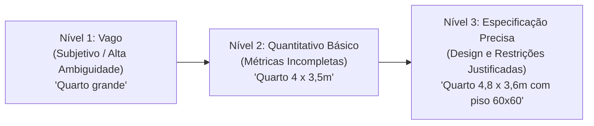
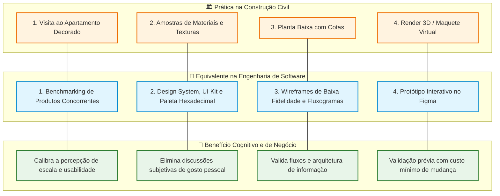
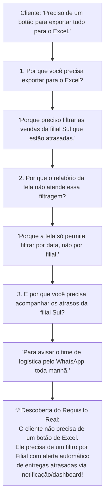
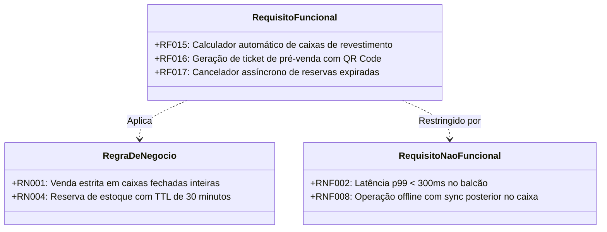
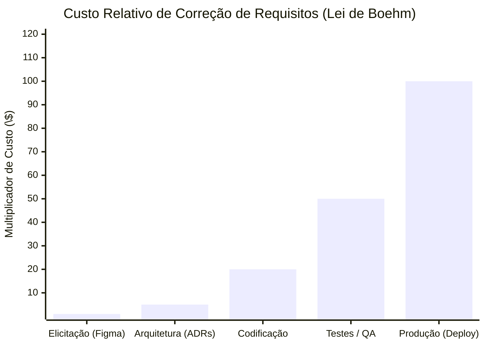
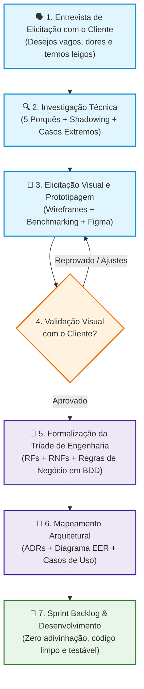

# Elicitação e Refinamento de Requisitos: Do Desejo Vago à Especificação Técnica Precisa

> Na Engenharia de Software, o maior risco de um projeto não é a complexidade do algoritmo ou a escolha do framework, mas o **abismo de comunicação entre o que o cliente imagina e o que a equipe de engenharia constrói**. Clientes raramente se expressam em termos de contratos, latências ou modelos relacionais; eles expressam sentimentos, metáforas e desejos vagos como *"quero um sistema rápido"*, *"quero uma tela bonita"* ou *"preciso de um relatório completo"*.

Sem um método deliberado de **Elicitação Visual**, **Analogias Estruturadas** e **Refinamento Contínuo**, o desenvolvedor constrói aquilo que *ele* considera rápido ou bonito, resultando inevitavelmente em frustração, retrabalho e desperdício financeiro.

Este guia estabelece o método definitivo para extrair, calibrar e traduzir as necessidades reais do cliente leigo em especificações técnicas precisas, utilizando o poderoso paralelo com a **Construção Civil** e as melhores práticas da **Engenharia de Requisitos moderna**.

---

## 1. O Espectro da Ambiguidade: Os Três Níveis de Refinamento

Uma das premissas fundamentais da engenharia diz: **"Quanto maior o nível de refinamento e detalhamento justificado, menor a ambiguidade e maior a precisão."**

O escopo de um projeto não se torna menor quando o refinamos; ele se torna **explícito e delimitado**. Para compreender essa evolução, analisamos o paralelo direto entre a construção civil e a engenharia de software em três níveis progressivos:



---

### Nível 1: Requisito Vago (Qualitativo / Ambiguidade Extrema)

Neste estágio, o requisito reflete um desejo subjetivo sem qualquer métrica mensurável.

* **Na Construção Civil:** *"Quero um quarto grande e arejado."*
  * *O problema:* O que é "grande"? Para quem mora em um apartamento de 35 $m^2$, um quarto de 12 $m^2$ é imenso. Para quem vive em uma fazenda, um quarto de 25 $m^2$ pode parecer apertado.
* **No Software:** *"Quero um relatório de vendas rápido e completo."*
  * *O problema:* O que é "rápido"? 50 milissegundos ou 10 segundos? O que é "completo"? Uma tabela com 5 colunas ou um painel analítico com gráficos comparativos, filtros dinâmicos e exportação para PDF e Excel?
* **O Diagnóstico:** O desenvolvedor é forçado a adivinhar. Quando a entrega ocorre, o cliente invariavelmente afirma: *"Não era bem isso que eu tinha imaginado"*.

---

### Nível 2: Requisito Semi-Estruturado (Quantitativo Básico / Ambiguidade Média)

Aqui, introduzem-se as primeiras métricas explícitas, mas as restrições arquiteturais, o contexto de operação e os casos de borda permanecem indefinidos.

* **Na Construção Civil:** *"Quero um quarto com dimensões de 4,00m x 3,50m (área total de 14,00 $m^2$)."*
  * *A evolução:* Agora temos uma métrica física inegociável. O construtor sabe a área da alvenaria, mas ainda não sabe onde posicionar portas, janelas, tomadas ou qual revestimento utilizar.
* **No Software:** *"Quero um relatório de vendas que exiba o total faturado no mês e carregue em até 3 segundos."*
  * *A evolução:* Estabeleceu-se uma métrica de sucesso objetiva (tempo de resposta $\le 3s$ e o dado principal). No entanto, o volume de registros suportado, o comportamento sob concorrência e os detalhes visuais continuam em aberto.

---

### Nível 3: Requisito Preciso (Especificação Técnica / Restrições de Design Justificadas)

O requisito atinge maturidade técnica quando define o **o quê**, o **como**, as **métricas de teste** e o **porquê** (*a justificativa arquitetural da restrição*).

* **Na Construção Civil:**
  > *"Quero um quarto com dimensões exatas de 4,80m x 3,60m (área de 17,28 $m^2$), utilizando porcelanato retificado de 60cm x 60cm com paginação alinhada à porta de entrada para eliminar recortes periféricos no piso, duas janelas acústicas voltadas para a face norte e 4 tomadas 20A a 30cm do piso acabado."*
  * *O ganho:* A obra torna-se imune a ambiguidades. A escolha do tamanho (múltiplos de 60cm) justifica-se tecnicamente pela economia de material e acabamento estético impecável.
* **No Software:**
  > *"Quero um endpoint e tela de relatório de vendas estruturado em tabela com paginação fixa de 50 registros por página (colunas: Data/Hora UTC, ID da Venda, Nome do Cliente, Valor Bruto, Desconto e Valor Líquido), com filtros por período e status, tempo de carregamento p99 inferior a 500ms sob carga de até 200 requisições simultâneas através de agregação em cache Redis, e funcionalidade de exportação assíncrona para arquivo CSV com notificação via WebSocket para relatórios com mais de 10.000 linhas."*
  * *O ganho:* A equipe de desenvolvimento sabe exatamente quais índices criar no banco, como modelar o cache, quais testes de carga executar e quais critérios de aceite satisfazer.

---

## 2. A Metáfora da Construção Civil: A Arte da Elicitação Visual

O cliente leigo geralmente não possui vocabulário para descrever soluções de software, mas possui clareza sobre o **problema de negócio** que deseja resolver. Para transpor essa barreira, o engenheiro de software deve atuar exatamente como o **arquiteto civil** durante as etapas de atendimento ao comprador:



### O Paralelo Prático:

1. **Visita ao Decorado $\leftrightarrow$ Benchmarking de Mercado:**  
   Quando o corretor leva o cliente para visitar um apartamento decorado, o comprador experimenta a sensação real de espaço. No software, apresentar sistemas de referência de mercado permite ao cliente apontar: *"Gostei do formato de checkout simplificado do site X, mas prefiro a visualização de produtos em grade do site Y"*.
2. **Catálogo de Revestimentos $\leftrightarrow$ Design System e Paleta Hexadecimal:**  
   O arquiteto não diz ao pintor para usar *"um azul aconchegante"*; ele especifica o código exato da tinta (ex: *Suvinil Oceano Profundo #1A365D*). No software, o desenvolvedor não programa uma tela *"elegante"*; ele implementa um Design System com tokens de espaçamento de 8px, tipografia Inter e cores hexadecimais estritas.
3. **Planta Baixa $\leftrightarrow$ Wireframe e Fluxograma de Telas:**  
   A planta define onde ficam as portas (pontos de entrada), interruptores (ações/botões) e corredores (fluxos de navegação). O wireframe estabelece a hierarquia da tela antes de perder tempo discutindo cores ou ícones.
4. **Maquete 3D $\leftrightarrow$ Protótipo Navegável (Figma):**  
   Permite ao cliente clicar nos botões, simular uma compra e perceber fricções no fluxo de trabalho antes de se escrever uma única linha de código.

---

## 3. Quatro Técnicas Avançadas para Elicitar Requisitos Ocultos

Clientes frequentemente solicitam uma **solução técnica imaginada** em vez de explicar o **problema real**. O papel do analista de requisitos é atuar como um investigador clínico aplicando técnicas consagradas da engenharia:

### Técnica 1: Os 5 Porquês (*Root-Cause Elicitation*)
Originada no Sistema Toyota de Produção, a técnica consiste em questionar sucessivamente a motivação por trás de um pedido superficial até atingir a regra de negócio central.



---

### Técnica 2: Elicitação por Contraste (*A vs. B Testing*)
Quando o cliente afirma que *"tudo é prioridade máxima"* ou não sabe expressar como quer a interação, apresente dois cenários antagônicos com seus respectivos impactos de negócio:

* **Exemplo de abordagem:**
  > *"Opção A: O sistema calcula o frete em 100ms consultando uma tabela fixa aproximada, mas pode ter diferença de R\$ 5 no frete final.*  
  > *Opção B: O sistema consulta as APIs de 4 transportadoras em tempo real, garantindo o menor valor exato, mas a tela de checkout pode demorar até 4 segundos para carregar.*  
  > *Qual dessas duas realidades melhor atende à estratégia do seu negócio?"*

Essa técnica força o cliente a tomar consciência dos **trade-offs arquiteturais** inerentes a qualquer decisão de engenharia.

---

### Técnica 3: Mapeamento de Cenários Extremos (*Edge Case Discovery*)
Clientes leigos descrevem invariavelmente o **Caminho Feliz** (*Happy Path*). O engenheiro sênior formula as perguntas que o cliente nunca pensou em fazer:

1. *"O que acontece com o pedido se a conexão de internet cair exatamente no momento em que a maquininha de cartão emitir o comprovante de pagamento?"*
2. *"Se dois operadores no balcão tentarem vender a última caixa de piso cerâmico do estoque no mesmo segundo, quem tem prioridade?"*
3. *"O que o sistema deve fazer se o cliente devolver um produto fracionado cujo lote já foi encerrado no almoxarifado?"*
4. *"Qual é o comportamento esperado se a Receita Federal demorar mais de 30 segundos para autorizar uma Nota Fiscal Eletrônica (NF-e) em um sábado de promoção?"*

---

### Técnica 4: Observação Direta em Campo (*Shadowing*)
Consiste em sentar-se ao lado do usuário real (o operador de caixa, o estoquista, o atendente de balcão) durante seu expediente de trabalho, sem interferir na operação.

* **O que o diretor da empresa diz:** *"Nossos vendedores realizam o cadastro completo do cliente com 20 campos antes de emitir o pedido."*
* **O que a observação revela:** O vendedor digita `000.000.000-00` no CPF e `teste@teste.com` no e-mail porque há uma fila de 8 clientes impacientes no balcão da loja de materiais de construção.
* **Ajuste de Engenharia:** Criação de um fluxo de **Pré-Venda Rápida** exigindo apenas telefone celular e nome, postergando a coleta dos dados cadastrais completos para a etapa final de emissão fiscal no caixa.

---

## 4. Estruturando a Especificação: Do BDD aos Critérios de Aceite

Após a elicitação visual e o refinamento, a especificação precisa ser documentada em um formato compreensível tanto para os executivos de negócio quanto para os desenvolvedores e ferramentas de testes automatizados. O padrão da indústria combina **Histórias de Usuário** com **Critérios de Aceite em formato Gherkin (BDD)**:

```gherkin
# Exemplo de Especificação Refinada para o SaaS de Materiais de Construção
Funcionalidade: Emissão de Pré-Venda no Balcão com Reserva de Estoque
  Como: Vendedor de Balcão da Loja de Materiais de Construção
  Eu quero: Registrar os itens solicitados pelo cliente e emitir um ticket de pré-venda
  Para que: O cliente possa liquidar o pagamento no caixa central sem risco de perder o estoque

  Contexto:
    Dado que o produto "Piso Porcelanato 60x60 Bege" possui saldo de 100 caixas em estoque
    E a regra de negócio "RN004 - Reserva Temporária" estipula o prazo limite de 30 minutos

  Cenário: Reserva bem-sucedida de estoque fracionado em caixas fechadas
    Dado que o cliente solicita 17 metros quadrados do piso
    Quando o vendedor adicionar o item ao pedido
    Então o sistema deve converter a metragem para a quantidade inteira de 7 caixas (17,28 m²)
    E deve bloquear temporariamente 7 caixas no estoque operacional
    E deve emitir o ticket de pré-venda contendo Identificador Único e QR Code
    E o tempo de resposta da emissão não deve exceder 400 milissegundos

  Cenário: Expiração automática da reserva por ausência de pagamento
    Dado que uma pré-venda com 7 caixas reservadas foi emitida às 14:00:00
    Quando o relógio do sistema atingir 14:30:01 sem registro de pagamento no caixa
    Então o sistema deve cancelar a pré-venda automaticamente
    E deve devolver as 7 caixas ao saldo de estoque disponível para venda
    E deve emitir um log de auditoria no Grafana Loki com a tag "estoque::reserva_expirada"
```

---

## 5. Estudo de Caso Completo: Loja de Materiais de Construção

Para demonstrar a transformação completa de um diálogo caótico em engenharia estruturada, acompanhamos o caso real de um cliente proprietário de uma rede de lojas de materiais de construção:

### Diálogo 1: A Entrevista de Elicitação Bruta

> **Cliente:** *"O meu sistema atual é uma porcaria, os clientes fazem fila no balcão e os vendedores dizem que o sistema trava tudo. Quero um sistema novo, moderno e muito mais rápido."*  
> **Engenheiro:** *"Entendi a sua dor. Quando você diz que o sistema trava, em qual momento exato o atendente mais reclama de lentidão?"*  
> **Cliente:** *"É na hora de vender piso cerâmico e cimento. O cliente pede 15 metros de piso, o vendedor precisa pegar uma calculadora de papel para saber quantas caixas precisa vender, aí digita no sistema, o estoque diz que tem, mas quando o cliente vai retirar no depósito lá nos fundos, o piso já acabou porque outro vendedor vendeu antes!"*  
> **Engenheiro:** *(Abre o Figma e rascunha uma tela simplificada na frente do cliente)*: *"Se a tela de venda tivesse um campo onde o vendedor digita apenas '15 $m^2$' e o sistema automaticamente calculasse as caixas inteiras equivalentes, bloqueasse o produto por 30 minutos no estoque e mostrasse na hora se tem no galpão, resolveria o problema da fila?"*  
> **Cliente:** *"Nossa, exatamente isso! Se fizer isso, a fila acaba!"*

---

### A Matriz de Especificação Gerada a Partir da Elicitação:



1. **Requisito Funcional (RF015):** O sistema deve calcular dinamicamente a quantidade mínima de caixas fechadas necessárias para atender ou superar a metragem quadrada informada pelo vendedor, informando a sobra de metragem resultante.
2. **Requisito Não-Funcional (RNF002 - Performance):** O cálculo de conversão e a consulta de saldo de estoque devem responder em menos de 300ms no balcão sob conexão cabeada ou Wi-Fi interna.
3. **Regra de Negócio (RN001 - Venda em Múltiplos):** Pisos e revestimentos cerâmicos possuem preço de tabela cadastrado em metros quadrados ($m^2$), porém a operação fiscal e física só pode ser faturada em unidades inteiras de caixas fechadas.
4. **Regra de Negócio (RN004 - Bloqueio de Concorrência):** A emissão da pré-venda cria um bloqueio temporário (*lock*) na tabela de saldos do Redis com tempo de expiração (*TTL*) de 30 minutos.

---

## 6. A Matriz de Custo da Mudança: A Lei de Boehm

Por que investir tempo em prototipagem visual e elicitação antes de escrever código? A resposta é puramente financeira. A **Curva de Boehm** demonstra que o custo de corrigir um requisito mal compreendido cresce exponencialmente à medida que o projeto avança no ciclo de vida:



* **Na Elicitação (\$ 1):** O cliente olha o protótipo no Figma e diz: *"Quero que o botão fique na esquerda e o cálculo mostre caixas em vez de peças"*. O designer gasta **3 minutos** para mover o componente. Custo insignificante.
* **Em Produção (\$ 100+):** O software já foi implantado. Mudar o conceito de venda de "peças" para "caixas fechadas" exige: alterar o modelo relacional do banco de dados, migrar milhões de registros legados, reescrever controllers e endpoints, alterar cálculos fiscais de NF-e, retreinar centenas de funcionários e estancar prejuízos operacionais.

> [!IMPORTANT]
> **Prototipagem rápida não é atraso; é redução de risco financeiro.** Uma hora gasta refinando requisitos com referências visuais economiza semanas de programação desperdiçada.

---

## 7. Diagrama de Fluxo: O Pipeline de Elicitação e Refinamento

O ciclo completo de transformação da demanda bruta em código pronto para a esteira de desenvolvimento é sumarizado no fluxograma a seguir:



---

## 8. Checklist e Regras de Ouro para Reuniões de Elicitação

1. **Nunca pergunte *"Como você quer o sistema?"*:** Clientes não são arquitetos de software. Pergunte: *"Qual é o processo de trabalho que mais consome o tempo da sua equipe hoje?"* e *"O que acontece na sua empresa quando esse processo falha?"*.
2. **Elimine adjetivos sem métricas numéricas:** Se o cliente disser *"rápido"*, questione a quantidade de segundos. Se disser *"fácil de usar"*, meça a quantidade máxima de cliques aceitáveis para concluir a tarefa.
3. **Leve referências visuais para a mesa:** Nunca inicie uma discussão de requisitos em uma folha em branco. Apresente telas de concorrentes, paletas de cores e fluxos navegáveis para ancorar a conversa.
4. **Isole Regras de Negócio de Requisitos Funcionais:** Lembre-se de que a regra de negócio (ex: cálculo de frete por peso cúbico ou conversão de cerâmica) existiria mesmo se a empresa operasse com papel e caneta. O software é apenas o meio de automação da regra.
5. **Registre o "Porquê" das Restrições:** Requisitos técnicos como *"usar cache Redis"* ou *"usar porcelanato 60x60 sem recorte"* só são compreendidos e mantidos pela equipe futura se a justificativa de negócio estiver documentada.
6. **Obtenha a assinatura no protótipo antes do primeiro commit:** O protótipo navegável aprovado é o contrato moral e técnico entre o cliente e o time de desenvolvimento. Qualquer alteração posterior constitui mudança formal de escopo (*Change Request*).

---

### Leituras Complementares no Guia:
* [Engenharia de Requisitos: A Tríade RF, RNF e Regras de Negócio](/001_engenharia_de_requisitos.md)
* [Decisões Arquiteturais e Registro de ADRs](/002_decisoes_arquiteturais_e_adrs.md)
* [Diagramas de Casos de Uso e Especificação de Comportamento](/004_diagramas_de_casos_de_uso.md)
