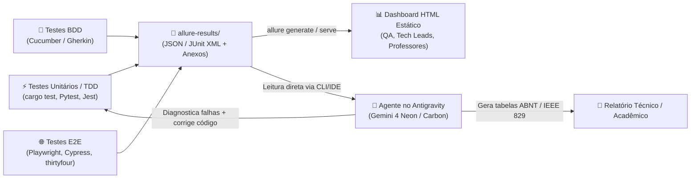

# 📊 Guia Prático de Relatórios de Testes com Allure Report (QA, Rust, CI/CD e IA)

> [!TIP]
> **Princípio Central:**
> Um bom relatório de testes não serve apenas para exibir "verde ou vermelho". Ferramentas como o **Allure Report** transformam saídas brutas de testes **Unitários (TDD)**, **BDD (Gherkin)** e **E2E** em dados estruturados (`JSON`, `XML` e anexos multimídia), úteis tanto para **decisão de QA/Produto e entrega acadêmica** quanto para **triagem autônoma com agentes de IA** (como **Gemini 4 Neon/Carbon** no **Google Antigravity**).

---

## 📋 Índice

1. [Panorama das Ferramentas: Allure Report vs. ReportPortal vs. ExtentReports](#-1-panorama-das-ferramentas-allure-report-vs-reportportal-vs-extentreports)
2. [Como Unitários (TDD), BDD e E2E Entram nos Relatórios](#-2-como-unitários-tdd-bdd-e-e2e-entram-nos-relatórios)
3. [Instalação e Setup no Debian 13/14 com Projeto Rust](#-3-instalação-e-setup-no-debian-1314-com-projeto-rust)
4. [Exemplos Práticos em Rust: Tags QA, Evidências e Valor Limite](#-4-exemplos-práticos-em-rust-tags-qa-evidências-e-valor-limite)
5. [Recursos Avançados de QA: Histórico, Flaky Tests e Categorias no CI/CD](#-5-recursos-avançados-de-qa-histórico-flaky-tests-e-categorias-no-cicd)
6. [Integração com Agentes de IA (Gemini 4 no Google Antigravity)](#-6-integração-com-agentes-de-ia-gemini-4-no-google-antigravity)
7. [Gerando Relatórios Acadêmicos (ABNT e IEEE 829) a partir do Allure](#-7-gerando-relatórios-acadêmicos-abnt-e-ieee-829-a-partir-do-allure)

---

## 🔍 1. Panorama das Ferramentas: Allure Report vs. ReportPortal vs. ExtentReports

As principais soluções open-source para centralizar resultados de testes de software são **Allure Report**, **ReportPortal** e **ExtentReports**. Todas coletam resultados de frameworks de execução e os convertem em visualizações com histórico, logs, evidências e tendências, mas atendem perfis distintos de projeto:

| Critério | **Allure Report** | **ReportPortal** | **ExtentReports** |
| :--- | :--- | :--- | :--- |
| **Perfil Ideal** | Times pequenos a grandes, projetos poliglotas, uso local/CI e relatórios estáticos | Operações de CI/CD em alta escala com múltiplos times e servidores dedicados | Projetos focados em **Java** ou **.NET** |
| **Infraestrutura** | **Leve (CLI + HTML estático)**, não exige banco nem servidor contínuo | **Pesada**, exige servidor próprio (Docker, PostgreSQL, RabbitMQ, serviços) | **Biblioteca embutida** direto no código de teste |
| **Linguagens / Frameworks** | Pytest, Playwright, Cypress, Jest, JUnit, TestNG, Cucumber, **Rust** | Integra com quase todos os runners via agentes e API REST | Java (JUnit/TestNG) e C# (.NET/NUnit) |
| **Rastreabilidade BDD / Negócio** | Nativa via `@Epic`, `@Feature`, `@Story` e passos Gherkin | Boa via atributos, tags e dashboards de lançamento | Suportada via categorias e tags |
| **Integração com Agentes de IA** | **Excelente para agentes locais:** gera `allure-results/*.json` + anexos no disco | **Excelente para CI/CD remoto:** API REST e Webhooks para triagem centralizada | **Moderada:** foco em HTML visual (exige exportar via `JsonFormatter` para poupar tokens) |

---

## 🧩 2. Como Unitários (TDD), BDD e E2E Entram nos Relatórios



* **Testes Unitários e TDD:** Geram execuções rápidas a cada ciclo de código (`cargo test`, Jest, Pytest, JUnit). No relatório, ajudam a monitorar taxa de aprovação, duração e regressões imediatas no CI.
* **BDD (ex.: Cucumber / Gherkin):** Traduzem cenários escritos em linguagem natural (`Given / When / Then`) para relatórios legíveis por QA, desenvolvedores e produto, exibindo o status individual de cada passo.
* **E2E (ex.: Playwright, Cypress, Selenium, `thirtyfour`):** Concentram evidências visuais, *screenshots*, vídeos, arquivos HAR/payloads HTTP e *stack traces*, essenciais para diagnosticar falhas de interface ou fluxos completos.

---

## 🐧 3. Instalação e Setup no Debian 13/14 com Projeto Rust

Em um ambiente **Debian (13/14)** usando o **Google Antigravity**, a integração para projetos **Rust** combina as *crates* oficiais do ecossistema Allure (`allure-cargotest` + `allure-rust-commons`) com a CLI do Allure para gerar o painel HTML.

### 3.1. Instalar o Java Runtime e a CLI do Allure no Debian

A CLI do Allure requer Java (`default-jre`). Instale via pacote `.deb` oficial publicado no repositório [allure-framework/allure2](https://github.com/allure-framework/allure2/releases) *(substitua `2.46.2` pela versão mais recente disponível, se necessário)*:

```bash
sudo apt update && sudo apt install -y default-jre wget

# Baixe o pacote .deb oficial da última release (ex.: 2.46.2)
wget https://github.com/allure-framework/allure2/releases/download/2.46.2/allure_2.46.2-1_all.deb
sudo dpkg -i allure_2.46.2-1_all.deb

# Valide a instalação
allure --version
```

### 3.2. Adicionar as *crates* ao projeto Rust

Adicione `allure-cargotest` (macros `#[allure_test]`, `#[step]` e integração com `cargo test`) e `allure-rust-commons` (metadados `epic`, `feature`, `story`, `severity`, `attachment`) como dependências de desenvolvimento:

```bash
cargo add allure-cargotest allure-rust-commons --dev
```

Ou declare manualmente no `Cargo.toml`:

```toml
[dev-dependencies]
allure-cargotest = "1.6.0"
allure-rust-commons = "1.6.0"
```

> [!NOTE]
> **E quanto a BDD e E2E em projetos Rust?**
> * **BDD (`cucumber-rs`):** Configure a saída em **JUnit XML** (que o Allure importa nativamente na mesma pasta `allure-results/`) ou registre passos via *commons*.
> * **E2E Web:** Caso rode testes E2E externos com **Playwright** ou **Cypress** (ou internos com `thirtyfour` / `fantoccini`), configure todos os runners para gravar seus arquivos no **mesmo diretório** (`target/allure-results`). O comando `allure generate` consolida unitários, BDD e E2E em um único painel.

### 3.3. Executar os testes e abrir o painel local

```bash
# 1. Executa os testes Rust e grava os JSONs em target/allure-results/
cargo test

# 2. Sobe um servidor web temporário e abre o dashboard no navegador
allure serve target/allure-results
```

Para apenas gerar os arquivos HTML estáticos (ideal para CI/CD, hospedagem ou entrega de documentação):

```bash
allure generate target/allure-results --clean -o relatorio-html
```

---

## 🦀 4. Exemplos Práticos em Rust: Tags QA, Evidências e Valor Limite

O exemplo abaixo demonstra como unir **rastreabilidade de QA** (`epic`, `feature`, `story`, `severity`), **passos reutilizáveis** (`#[step]`), **anexos de evidência** (`attachment`) e técnicas clássicas de teste (**Particionamento de Equivalência** e **Análise de Valor Limite**):

```rust
use allure_cargotest::{allure_test, step};
use allure_rust_commons::{attachment, epic, feature, parameter, severity, story};

/// Regra de negócio de exemplo: desconto válido para pedidos entre R$ 100 e R$ 1.000.
fn calcular_desconto_percentual(valor_pedido: u32) -> Result<u8, &'static str> {
    match valor_pedido {
        0..=99 => Ok(0),
        100..=500 => Ok(10),
        501..=1000 => Ok(15),
        _ => Err("Valor excede o limite de desconto automático"),
    }
}

#[step]
fn executar_calculo(valor: u32) -> Result<u8, &'static str> {
    calcular_desconto_percentual(valor)
}

#[allure_test]
#[test]
fn valor_limite_faixa_10_porcento() {
    // Rastreabilidade de Negócio / QA
    epic("Motor de Precificação");
    feature("Cálculo de Descontos");
    story("RN-04: Aplicar faixas progressivas por valor do pedido");
    severity("critical"); // blocker | critical | normal | minor | trivial

    // Parâmetros exibidos no relatório para facilitar auditoria
    parameter("tecnica", "Analise de Valor Limite");
    parameter("entrada_minima", "100");
    parameter("entrada_maxima", "500");

    let min = executar_calculo(100);
    let max = executar_calculo(500);

    // Anexa evidência estruturada (útil para QA e leitura por IA)
    let evidencia = format!(
        r#"{{"valor_100": {:?}, "valor_500": {:?}}}"#,
        min, max
    );
    attachment("evidencia_limites.json", "application/json", evidencia);

    assert_eq!(min, Ok(10));
    assert_eq!(max, Ok(10));
}

#[allure_test]
#[test]
fn particao_equivalencia_acima_do_teto() {
    epic("Motor de Precificação");
    feature("Cálculo de Descontos");
    story("RN-04: Rejeitar desconto automático acima de R$ 1.000");
    severity("normal");
    parameter("tecnica", "Particionamento de Equivalencia (Classe Invalida)");
    parameter("valor_pedido", "1500");

    let resultado = executar_calculo(1500);

    assert!(resultado.is_err());
}
```

### Para quem o Allure agrega valor na rotina de QA

| Perfil / Objetivo | Como utiliza o Allure Report |
| :--- | :--- |
| **QA / Analista de Testes** | Valida critérios de aceite na aba *Behaviors*, inspeciona *screenshots* de falhas E2E e exporta evidências de homologação. |
| **Desenvolvedor (Rust / Back-end)** | Diagnostica falhas em testes unitários, integração e contratos de API pelo *stack trace* e anexos JSON sem reproduzir tudo manualmente. |
| **Tech Lead / PO** | Acompanha a saúde da *release* por funcionalidade e severidade (`Blocker` / `Critical`) antes de aprovar o deploy em produção. |

---

## 📈 5. Recursos Avançados de QA: Histórico, *Flaky Tests* e Categorias no CI/CD

Um relatório isolado mostra apenas o "agora". Para identificar **testes instáveis (*flaky tests*)**, tendências de duração e evolução da qualidade ao longo das sprints, o Allure precisa da pasta `history/` gerada na execução anterior.

### 5.1. Preservando o histórico entre execuções

Antes de rodar `allure generate`, copie a pasta `history` do último relatório publicado para dentro da pasta atual de `allure-results/`:

```bash
# Se existir um relatório anterior (ex.: baixado de artifact/cache do CI), restaure o history
if [ -d "relatorio-html/history" ]; then
  mkdir -p target/allure-results/history
  cp -r relatorio-html/history/* target/allure-results/history/
fi

# Gera o novo relatório preservando tendências e marcação de flaky tests
allure generate target/allure-results --clean -o relatorio-html
```

### 5.2. Categorização automática de defeitos (`categories.json`)

Crie o arquivo `target/allure-results/categories.json` (ou copie de uma pasta `ci/allure/categories.json` antes do `allure generate`) para separar automaticamente **Bugs de Produto** de **Falhas de Infraestrutura/Ambiente**:

```json
[
  {
    "name": "Falhas de Infraestrutura / Timeout",
    "matchedStatuses": ["broken", "failed"],
    "messageRegex": ".*(Timeout|Connection refused|ECONNREFUSED|502 Bad Gateway).*"
  },
  {
    "name": "Bugs de Regra de Negócio (Asserção)",
    "matchedStatuses": ["failed"],
    "messageRegex": ".*(assertion|assert_eq|Expected).*"
  },
  {
    "name": "Testes Ignorados / Pendentes",
    "matchedStatuses": ["skipped"]
  }
]
```

### 5.3. Exemplo de etapa no GitHub Actions

```yaml
- name: Executar testes Rust
  run: cargo test --no-fail-fast

- name: Restaurar histórico anterior do Allure
  continue-on-error: true
  run: |
    mkdir -p target/allure-results/history
    cp -r gh-pages/history/* target/allure-results/history/ || true
    cp ci/allure/categories.json target/allure-results/ || true

- name: Gerar relatório Allure estático
  run: allure generate target/allure-results --clean -o relatorio-html
```

---

## 🤖 6. Integração com Agentes de IA (Gemini 4 no Google Antigravity)

Como o Allure salva cada caso de teste em arquivos estruturados (`target/allure-results/*.json` + anexos de imagem/log), agentes no **Google Antigravity** conseguem diagnosticar falhas sem precisar renderizar o HTML.

*(Para otimizar custo e escolha de modelo entre **Gemini 4 Hydrogen**, **Neon** e **Carbon**, consulte [Gemini-family.md](../agentes/Gemini-family.md).)*

### 6.1. Como cada ferramenta se integra ao fluxo agêntico

| Ferramenta | Melhor forma de integração | Ponto forte no fluxo com IA |
| :--- | :--- | :--- |
| **Allure Report** | Leitura direta de `allure-results/*.json` + anexos via CLI/IDE (Antigravity). | **Ideal para agentes locais:** o modelo lê o JSON do caso, analisa o *stack trace* e inspeciona *screenshots*/vídeos E2E multimodais. |
| **ReportPortal** | API REST ou Webhooks conectando o servidor do ReportPortal à API do Gemini. | **Ideal para CI/CD em escala:** classifica automaticamente falhas noturnas entre *flaky test*, bug de produto ou erro de ambiente. |
| **ExtentReports** | Exportação via `JsonFormatter` ou *parsing* do HTML final no pipeline. | Funcional, porém exige habilitar saída JSON para não desperdiçar tokens com marcação HTML de layout. |

### 6.2. Casos de uso na rotina de QA com Gemini 4

* **Triagem multimodal de falhas E2E:** Ao ler `allure-results/`, o **Gemini 4 Neon** ou **Carbon** cruza o *stack trace* de um erro no Playwright/Cypress com o *screenshot* capturado no instante da falha.
* **Ciclo autônomo de TDD e correção:** No Google Antigravity (ou em paralelo com `/swarm`), o agente executa `cargo test`, lê `target/allure-results/`, corrige o código que quebrou o contrato e reexecuta até zerar as falhas.
* **Resumo executivo de execuções:** Com nível de raciocínio `low` ou `medium`, o modelo agrupa dezenas de falhas de uma suíte noturna por causa raiz.

### 6.3. Template de Prompt para Diagnóstico Automático no Antigravity

```text
Execute `cargo test` neste projeto e analise todos os arquivos JSON gerados em `target/allure-results/`.
Para cada teste com status `failed` ou `broken`:
1. Liste o nome do teste, Epic/Feature/Story, severidade e mensagem de erro.
2. Classifique a causa provável (bug na lógica de negócio, regressão de contrato ou falha de ambiente/fixture).
3. Localize os arquivos-fonte envolvidos e proponha a correção mínima necessária sem alterar as asserções legítimas do teste.
```

---

## 🎓 7. Gerando Relatórios Acadêmicos (ABNT e IEEE 829) a partir do Allure

Em disciplinas de **Teste de Software** e projetos acadêmicos, além do código dos testes, costuma-se exigir um documento formal (PDF/DOCX em **ABNT** ou padrão **IEEE 829**). O Allure acelera tanto a parte visual quanto a redação técnica:

### Passo 1: Estruture a hierarquia pelos requisitos do trabalho
* Use `epic(...)` e `feature(...)` para mapear os **Requisitos Funcionais (RF)** ou **Casos de Uso** do projeto.
* Separe os testes por técnica no parâmetro ou na suíte (ex.: *Particionamento de Equivalência*, *Análise de Valor Limite*, *Testes Unitários*, *BDD* e *E2E*).

### Passo 2: Exporte os gráficos oficiais para ilustrar os resultados
1. Gere o painel estático com `allure generate target/allure-results --clean -o relatorio-html` (ou abra com `allure open relatorio-html`).
2. Capture as imagens das abas:
   * **Overview / Graphs:** gráficos de pizza (taxa de aprovação), severidade e duração.
   * **Behaviors:** visão hierárquica agrupada por Épicos, Funcionalidades e Histórias.

### Passo 3: Gere tabelas e análise de defeitos a partir dos JSONs

Use o prompt abaixo no **Google Antigravity** (com **Gemini 4 Neon** ou **Carbon**) para transformar os dados brutos de `target/allure-results/` em texto técnico pronto para seu documento Markdown ou LaTeX:

```text
Leia os arquivos de resultado em `target/allure-results/` e gere a seção "Resultados Obtidos e Análise de Defeitos" no padrão IEEE 829 / ABNT em Markdown (ou LaTeX):
1. Uma tabela consolidada de Casos de Teste contendo: ID, Caso de Teste, Técnica Aplicada (ex.: Valor Limite / Partição de Equivalência), Entradas (`parameters`), Resultado Esperado, Resultado Obtido e Status (`PASSED`/`FAILED`).
2. Um resumo quantitativo (total de casos, aprovados, falhos, tempo total de execução).
3. Para eventuais falhas registradas, redija uma subseção "Registro de Anomalias / Defeitos" descrevendo severidade, evidência observada e ação corretiva aplicada.
Seja estritamente fiel aos dados presentes nos arquivos JSON de `target/allure-results/`.
```

---

## ✅ Checklist Rápido de Implementação

- [ ] Instalar `default-jre` e a CLI oficial do Allure no Debian (`allure --version`).
- [ ] Adicionar `allure-cargotest` e `allure-rust-commons` em `[dev-dependencies]` no `Cargo.toml`.
- [ ] Anotar os testes com `#[allure_test]`, `epic`, `feature`, `story`, `severity` e `attachment`.
- [ ] Configurar `categories.json` e preservação da pasta `history/` no CI/CD para rastrear *flaky tests*.
- [ ] Usar leitura direta de `target/allure-results/*.json` pelo agente no Antigravity para triagem rápida ou geração de documentação técnica.
