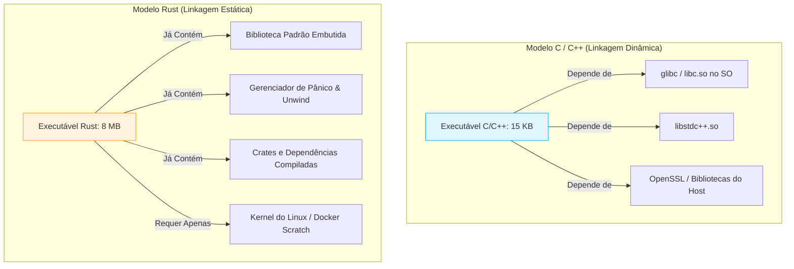
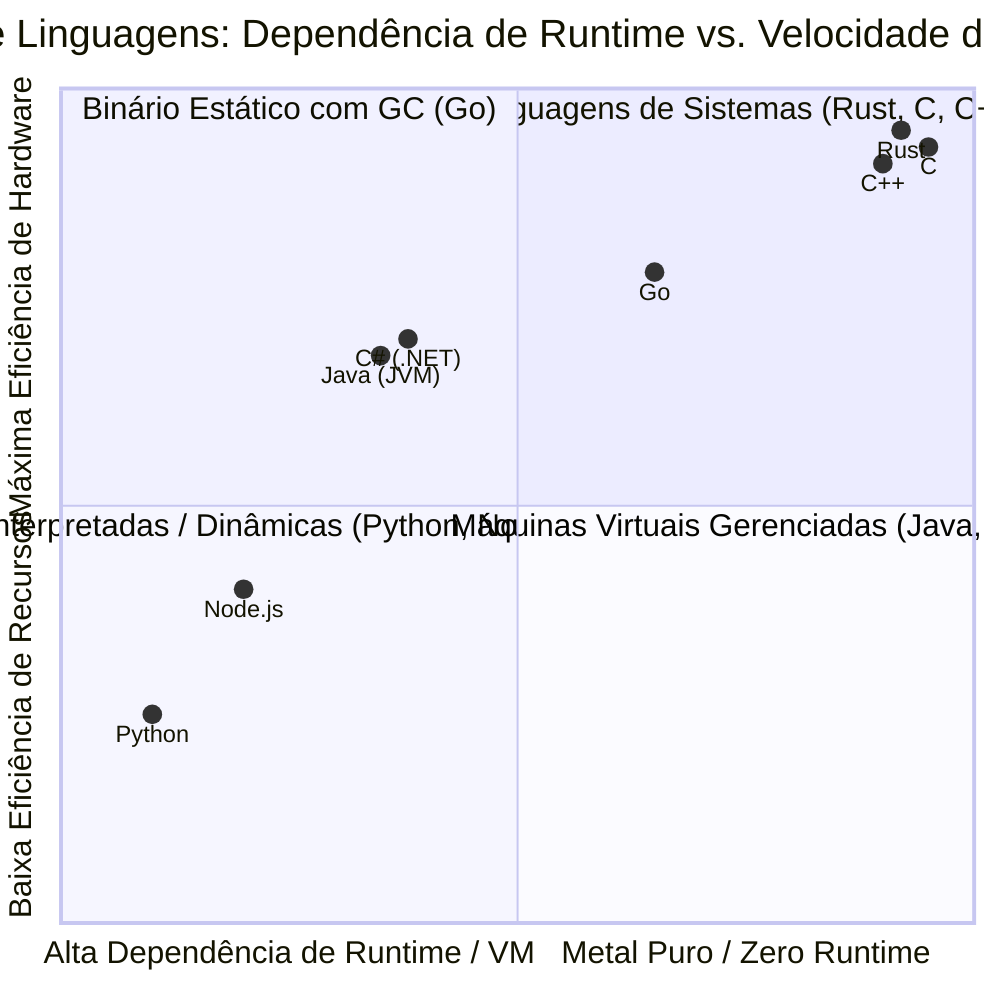
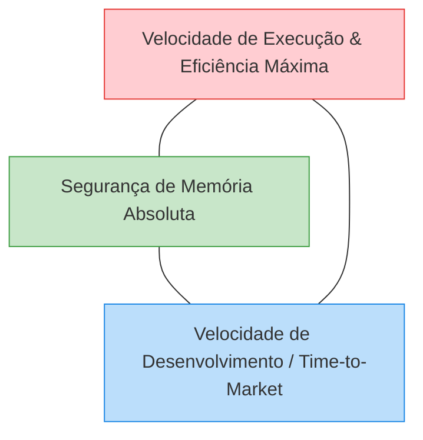
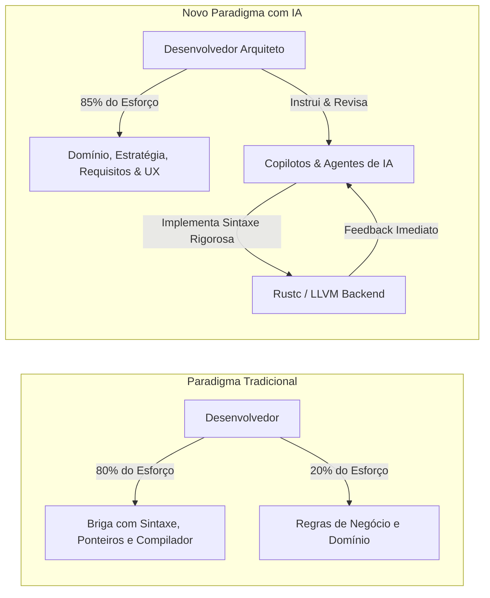
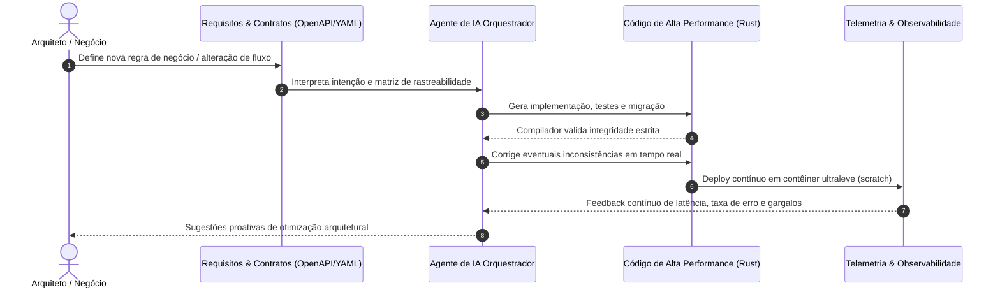

# C++ vs. Rust: O Mito do Tamanho, a Guerra de Paradigmas e a Nova Era da Engenharia com IA
### *Uma análise aprofundada sobre linkagem, consumo de recursos, segurança de memória e a transformação do desenvolvedor em arquiteto de negócios*

> 📌 **Visão Geral e Propósito:**  
> Este documento desmistifica crenças comuns sobre o tamanho de binários e uso de recursos entre **C/C++** e **Rust**, estendendo a comparação aos demais ecossistemas modernos (Go, Java, C#, Node.js e Python). Mais do que uma discussão sobre compiladores, este material analisa a grande mudança de paradigma da computação atual: como a fusão entre **linguagens de altíssima performance** e **Inteligência Artificial** liberta o desenvolvedor das minúcias de baixo nível para que ele atue como estrategista do negócio, enquanto a IA assume o papel de materializar e sustentar **aplicações vivas**.

---

## 📑 Sumário
1. [A Metáfora do Canteiro de Obras: Linkagem Estática vs. Dinâmica](#1-a-metáfora-do-canteiro-de-obras-linkagem-estática-vs-dinâmica)
2. [O Mito do Tamanho: Por que Rust Parece Maior, mas Entrega Menor Pegada Total](#2-o-mito-do-tamanho-por-que-rust-parece-maior-mas-entrega-menor-pegada-total)
3. [O Espectro Completo dos Ecossistemas: Do Metal à Loja de Materiais](#3-o-espectro-completo-dos-ecossistemas-do-metal-à-loja-de-materiais)
4. [Tabela Comparativa de Ambientes em Tempo de Execução](#4-tabela-comparativa-de-ambientes-em-tempo-de-execução)
5. [O Dilema Histórico da Engenharia de Sistemas](#5-o-dilema-histórico-da-engenharia-de-sistemas)
6. [A Revolução da IA: Do "Digitador de Código" ao Arquiteto de Negócios](#6-a-revolução-da-ia-do-digitador-de-código-ao-arquiteto-de-negócios)
7. [Aplicações Vivas: O Novo Ciclo de Vida do Software](#7-aplicações-vivas-o-novo-ciclo-de-vida-do-software)
8. [Guia Prático: Minimizando Binários Rust ao Limite Extremo](#8-guia-prático-minimizando-binários-rust-ao-limite-extremo)
9. [Matriz de Decisão Arquitetural](#9-matriz-de-decisão-arquitetural)

---

## 1. A Metáfora do Canteiro de Obras: Linkagem Estática vs. Dinâmica

A discussão sobre o tamanho de executáveis entre linguagens de baixo nível frequentemente ignora o conceito fundamental de **modelo de dependências**. Para entender a diferença prática ao implantar um sistema em um servidor VPS ou contêiner de nuvem, a metáfora da construção civil ilustra com perfeição os dois modelos:



### 🦀 O Modelo Rust (O Trabalhador Autossuficiente)
No Rust, a estratégia padrão de compilação privilegia a **linkagem estática**:
* **A analogia:** O operário chega à obra carregando uma mala de ferramentas industrial completa nas costas (martelo, alicate, capacete, óculos de proteção e parafusos).
* **Vantagens:** Se o canteiro for no meio do deserto, em uma máquina virtual sem ferramentas instaladas ou em um contêiner Docker mínimo, ele abre a mala e começa a trabalhar imediatamente. Não há risco de quebra por ausência de pacotes no sistema operacional.
* **Desvantagens:** O transporte inicial (tamanho do arquivo binário transferido pelo `scp` ou baixado da esteira de CI/CD) é maior, pois o arquivo incorpora as rotinas essenciais de que necessita.

### 🔌 O Modelo C / C++ (O Trabalhador Terceirizado)
Tradicionalmente no C e C++, o ecossistema privilegia a **linkagem dinâmica** compartilhada:
* **A analogia:** O operário chega na obra portando apenas a planta do projeto no bolso (arquivo de poucos kilobytes). Ele parte do pressuposto de que o canteiro já possui todas as bancadas, EPIs e ferramentas homologadas esperando por ele.
* **Vantagens:** O executável em si ocupa um espaço ínfimo no disco (frequentemente dezenas de kilobytes).
* **Desvantagens:** O temido pesadelo da incompatibilidade de bibliotecas (*Dependency Hell* ou divergências de `glibc` / `.dll`). Se o servidor de destino tiver uma versão da biblioteca compartilhada um patch anterior à esperada pelo binário, o programa sequer inicializa.

### 🌐 O Cenário Real: Do Servidor VPS ao Contêiner `scratch`
No desenvolvimento em nuvem contemporâneo, a balança se inverte em favor da linkagem estática:
* **No C/C++:** Para rodar com segurança em produção, você frequentemente precisa manter uma imagem Docker baseada em distribuições completas (Debian, Ubuntu, Alpine), somando de 50 MB a centenas de megabytes de pacotes do sistema apenas para satisfazer dependências dinâmicas.
* **No Rust:** Compilando com o target `musl` (`x86_64-unknown-linux-musl`), o binário torna-se 100% autônomo. Ele pode ser colocado dentro de uma imagem Docker `FROM scratch` (uma imagem vazia de 0 bytes). O contêiner final tem **estritamente o tamanho do binário compilado**, eliminando vulnerabilidades de segurança (CVEs) em nível de sistema operacional (como bugs em `curl`, `bash` ou `glibc`).

---

## 2. O Mito do Tamanho: Por que Rust Parece Maior, mas Entrega Menor Pegada Total

Um erro frequente de desenvolvedores iniciantes é compilar um simples `"Hello, World!"` em C e em Rust e concluir prematuramente que "Rust gera código inflado e pesado". A realidade técnica subjacente é muito mais rica:

```
[Código-Fonte Rust] ➔ [rustc + LLVM] ➔ [Dead Code Elimination] ➔ [LTO Global] ➔ [Binário de Alta Performance]
```

### ⚖️ Por que o Rust gera executáveis maiores por padrão (Out-of-the-Box)

1. **Monomorfização de Genéricos:**  
   Rust implementa funções e tipos genéricos duplicando o código de máquina para cada tipo concreto utilizado (semelhante aos *templates* do C++). Isso elimina chamadas indiretas (*dynamic dispatch*) e permite inline agressivo de código, alcançando velocidade máxima de execução, mas expandindo o tamanho do binário.
2. **Mecanismos de Pânico e Rastreamento (Stack Unwinding):**  
   Para garantir que falhas não corrompam a memória do processo, o Rust inclui tabelas de desmontagem de pilha e metadados detalhados de diagnóstico para registrar *backtraces* limpos caso ocorra um `panic!`.
3. **Checagem de Limites em Tempo de Execução (Bounds Checking):**  
   O compilador insere verificações de limites em acessos a vetores e fatias de memória para prevenir vulnerabilidades clássicas de *Buffer Overflow*, a menos que o otimizador consiga provar matematicamente que o índice jamais excederá o tamanho da coleção.
4. **Metadados DWARF e Símbolos de Depuração:**  
   Por padrão, mesmo compilações de *release* podem reter ponteiros de depuração e nomes de símbolos para relatórios legíveis de exceções, os quais podem ser removidos com ferramentas de *strip*.

### 🚀 Como o Rust atinge pegada operacional mínima em produção

Quando passamos do binário de brinquedo para sistemas reais de produção (APIs HTTP, processadores de eventos, filas e bancos de dados), o Rust frequentemente vence C++ e linguagens gerenciadas em consumo total:

* **Dead Code Elimination (Tree Shaking Profundo):**  
  Graças ao ecossistema do **LLVM** e ao **Link-Time Optimization (LTO)**, o compilador varre toda a árvore de dependências do projeto e descarta cirurgicamente cada função, método ou constante importada que nunca seja efetivamente invocada em tempo de execução.
* **Ausência de Runtime e Garbage Collector:**  
  Diferente de Go, Java ou C#, o Rust não possui um coletor de lixo que pausa a execução ou consome centenas de megabytes de memória RAM como reserva de alocação. Toda a disciplina de liberação de memória é resolvida em tempo de compilação pelo **Borrow Checker**.
* **Consumo de Memória Linear e Previsível:**  
  Um microsserviço em Rust costuma consumir entre **8 MB e 30 MB de memória RAM** sob carga contínua, enquanto serviços equivalentes em Java/Node.js frequentemente demandam de 200 MB a 1 GB para manter estruturas de runtime ativas.

---

## 3. O Espectro Completo dos Ecossistemas: Do Metal à Loja de Materiais

A metáfora do canteiro de obras se expande para categorizar com precisão o panorama de desenvolvimento de software atual:



### ⚙️ 1. O Metal Puro (C, C++ e Rust)
São linguagens de sistemas de primeira classe. Não há intérpretes, não há máquinas virtuais e não há intermediários.
* **Como operam:** O código é compilado diretamente em instruções binárias nativas para a arquitetura do processador (x86_64, ARM64, RISC-V).
* **Vantagem:** Latência determinística na casa dos microssegundos, controle total de registradores, caches e memória.

### 🏃 2. O Binário com Gerente de Obra Embutido (Go)
Go adotou uma abordagem intermediária muito inteligente para computação em nuvem:
* **Como opera:** Produz um binário único e de compilação ultrarrápida, similar ao Rust, mas **embute dentro do executável** um escalonador de corrotinas (goroutines M:N) e um Garbage Collector cooperativo.
* **Vantagem:** Entrega a facilidade de implantação de um binário estático sem a complexidade mental do Borrow Checker, aceitando um custo de memória um pouco mais elevado.

### 🚛 3. O "Caminhão de Ferramentas" (Java e C#)
Linguagens enterprise consagradas baseadas em máquinas virtuais (JVM e .NET CLR):
* **A analogia:** O desenvolvedor chega na obra quase sem ferramentas nos bolsos, mas exige que a empresa estacione um caminhão de suporte oficial de grande porte na entrada do canteiro.
* **Na prática:** O artefato compilado (`.jar` ou `.dll`) pode ter meros megabytes, mas exige um ambiente de execução que pesa centenas de megabytes no sistema operacional e aloca dezenas de megabytes de memória RAM apenas para subir a infraestrutura da VM.

### 🏬 4. A "Loja de Ferramentas Completa" (JavaScript/Node.js e Python)
Linguagens de tipagem dinâmica, altamente produtivas para prototipagem rápida:
* **A analogia:** O operário chega na obra e diz: *"Para eu bater este prego, primeiro precisamos construir uma loja de ferramentas inteira ao lado do terreno."*
* **Na prática:** É o ecossistema das pastas `node_modules` e dos ambientes virtuais `venv`. Scripts enxutos de poucas linhas puxam árvores de dependência com milhares de arquivos, consumindo gigabytes de espaço em disco e tornando a verificação de integridade e auditoria de segurança uma tarefa desafiadora.

---

## 4. Tabela Comparativa de Ambientes em Tempo de Execução

| Linguagem | Paradigma de Linkagem Padrão | Tamanho do Artefato Puro | Tamanho do Ambiente de Execução | Consumo de RAM em Idle | Sobrecarga de Runtime / GC |
| :--- | :--- | :--- | :--- | :--- | :--- |
| **C** | Dinâmica (via libc compartilhada) | **5 KB – 50 KB** | Depende do SO (glibc ~30 MB) | < 1 MB | **Zero** (Direto no hardware) |
| **C++** | Mista (estática + libstdc++ dinâmica) | **50 KB – 500 KB** | Depende do SO (libstdc++ / glibc) | 1 MB – 5 MB | **Zero** (Zero-cost abstractions) |
| **Rust (Padrão)** | Estática (biblioteca padrão embutida) | **1 MB – 15 MB** | Zero (Executa até em `FROM scratch`) | **2 MB – 15 MB** | **Zero** (Garantias em compilação) |
| **Rust (Otimizado)** | Estática com `strip`, LTO e `panic=abort` | **150 KB – 2 MB** | Zero (Executa até em `FROM scratch`) | **1 MB – 8 MB** | **Zero** (Garantias em compilação) |
| **Go** | Estática (com runtime embutido) | **5 MB – 25 MB** | Zero (Executável autônomo) | 15 MB – 40 MB | Baixa/Média (GC concorrente) |
| **Java (JVM)** | Bytecode em arquivo `.jar` | 2 MB – 80 MB | **150 MB – 350 MB** (JRE / JDK) | 80 MB – 300 MB | Alta (GC sofisticado de múltiplas gerações) |
| **C# (.NET)** | Bytecode em arquivo assembly `.dll` | 2 MB – 50 MB | **100 MB – 250 MB** (.NET Runtime) | 40 MB – 150 MB | Média/Alta (GC geracional) |
| **Node.js** | Código interpretado + scripts `.js` | 10 KB – 5 MB | **80 MB – 200 MB** (Node engine + V8) | 30 MB – 90 MB | Alta (V8 JIT + Garbage Collector) |
| **Python** | Bytecode compilado sob demanda (`.pyc`) | 5 KB – 2 MB | **50 MB – 150 MB** (CPython interpreter) | 20 MB – 60 MB | Alta (Reference Counting + Cyclic GC) |

---

## 5. O Dilema Histórico da Engenharia de Sistemas

Historicamente, as equipes de engenharia de software eram forçadas a escolher apenas dois vértices do chamado **Triângulo Impossível da Computação**:



* **C e C++ (Escolhiam Execução + Time-to-Market relativo):**  
  Permitiam performance astronômica, mas abriam as portas para corrupção de memória. Relatórios históricos da Microsoft e do Google indicam que **mais de 70% de todas as vulnerabilidades críticas de segurança (CVEs)** ao longo de décadas decorreram de falhas de gerenciamento de memória (*use-after-free*, *buffer overflows*, *dangling pointers*).
* **Python, Java e Node.js (Escolhiam Segurança de Memória + Time-to-Market):**  
  Entregavam produtividade rápida, mas com o custo de alto consumo energético, sobrecarga em contas de nuvem e pausas imprevisíveis causadas por coletores de lixo.
* **Rust (Resolveu o conflito, mas cobrou um pedágio severo):**  
  Eliminou os bugs de memória sem precisar de Garbage Collector, mas impôs a temida curva de aprendizado do **Borrow Checker**. Engenheiros passavam semanas lutando contra tempos de vida (*lifetimes*) e regras de posse (*ownership*), desacelerando a entrega inicial.

---

## 6. A Revolução da IA: Do "Digitador de Código" ao Arquiteto de Negócios

O surgimento e a maturidade dos modelos de Inteligência Artificial para geração e refatoração de código quebraram o último obstáculo: **a barreira da complexidade sintática de baixo nível**.



### O Desmistificador do Compilador
Antes da IA, encarar o compilador do Rust gerava frustração contínua para quem migrava de linguagens de alto nível. Com agentes e modelos atuando como pares de programação:
* Quando o compilador rejeita um trecho por violação de empréstimo (*borrowing*), a IA explica didaticamente a razão da colisão, sugere a correção semântica adequada (como o uso de `Arc<Mutex<T>>`, canais MPSC ou reorganização de escopo) e aplica a correção em segundos.
* O código pesado de infraestrutura (implementação de `From`/`Into`, serializadores, mapeamentos de traits repetitivos, migrações SQL e testes unitários exaustivos) é inteiramente sintetizado pela IA.

### O Desenvolvedor Focado no Coração do Negócio
Com a automatização da camada braçal da programação:
* **Engenharia de Requisitos:** O desenvolvedor passa a ser o guardião da verdade negocial (regras de faturamento, integridade de transações, políticas regulatórias LGPD/GDPR, experiência do cliente).
* **Modelagem de Domínio (DDD):** O foco migra para o design de *Bounded Contexts*, *Aggregates*, entidades puras e máquinas de estados finitos que blindam a regra de negócio contra inconsistências.
* **A Sinergia Imbatível (Rust + IA):** A IA funciona com maestria especial em Rust porque **o compilador de Rust é o validador definitivo mais rigoroso já criado**. Se uma IA alucinar ou gerar uma condição de corrida em C++, o código compila e explode silenciosamente em produção. Em Rust, se a IA errar na segurança de concorrência ou memória, o compilador barra a compilação na hora. A IA recebe o erro, corrige-se e entrega um artefato à prova de falhas.

---

## 7. Aplicações Vivas: O Novo Ciclo de Vida do Software

A fusão entre arquiteturas modernas e ecossistemas assistidos por IA dá origem ao conceito de **Aplicações Vivas** (*Living Applications*). Software tradicional costumava ser estático, frágil e temido: equipes evitavam refatorações profundas por receio de efeitos colaterais ocultos.



### Características Centrais das Aplicações Vivas:
1. **Intenção Executável:** O desenvolvedor define *o que* deve acontecer em especificações ricas (diagramas, tabelas de decisão, casos de uso), e a IA gera as fatias verticais correspondentes com código de alto rendimento.
2. **Auto-Reparação e Resiliência Adaptativa:** A telemetria moderna integrada com agentes de IA consegue identificar anomalias em produção, correlacionar rastreios distribuídos e sugerir *pull requests* de correção com testes de estresse antes da degradação do serviço.
3. **Refatoração Contínua sem Medo:** A dívida técnica acumulada deixa de ser um monstro inalcançável. Atualizações de versões de bibliotecas, otimizações de algoritmos e transições entre drivers de banco de dados tornam-se operações rotineiras e seguras, chanceladas por esteiras automáticas de testes.
4. **O Santo Graal da Indústria:** Atinge-se finalmente o cenário ideal da engenharia de software: **produtividade de desenvolvimento semelhante à de Python/Ruby**, combinada com **velocidade de execução, economia brutal de servidores e confiabilidade militar típicas de Rust/C**.

---

## 8. Guia Prático: Minimizando Binários Rust ao Limite Extremo

Para quem deseja construir microsserviços, utilitários CLI ou sistemas embarcados em Rust com a menor pegada possível em disco e memória, o arquivo `Cargo.toml` oferece configurações avançadas de compilação:

### ⚙️ Configuração de Alta Compactação (`Cargo.toml`)

```toml
[package]
name = "servico_ultraleve"
version = "0.1.0"
edition = "2021"

[dependencies]
# Use dependências que suportem desativar recursos desnecessários (default-features = false)

[profile.release]
opt-level = "z"        # Otimiza estritamente para menor tamanho ("s" ou "z")
lto = true             # Ativa Link-Time Optimization global entre todos os módulos
codegen-units = 1      # Unifica unidades de compilação para permitir que o LTO elimine todo código morto
panic = "abort"        # Desativa o pesado mecanismo de stack unwinding em favor de encerramento imediato
strip = true           # Remove automaticamente todos os símbolos de depuração e nomes de rotinas
```

### 🔬 Comandos Úteis de Diagnóstico e Auditoria

```bash
# 1. Compilar para target estático independente de glibc (ex: Alpine / Scratch)
cargo build --release --target x86_64-unknown-linux-musl

# 2. Inspecionar o tamanho detalhado das seções de código
size target/x86_64-unknown-linux-musl/release/servico_ultraleve

# 3. Analisar quais dependências ou funções ocupam mais espaço no binário
cargo install cargo-bloat
cargo bloat --release --crates

# 4. Remover símbolos de depuração manualmente (caso não use strip = true no Cargo.toml)
strip --strip-all target/release/servico_ultraleve
```

---

## 9. Matriz de Decisão Arquitetural

| Critério de Projeto | Escolha Ideal | Justificativa Técnica |
| :--- | :--- | :--- |
| **Sistemas Operacionais, Drivers e Código Legado Existente** | **C / C++** | Compatibilidade histórica insubstituível, ecossistemas de hardware legados e bibliotecas C já consagradas. |
| **Microsserviços de Alta Concorrência, Cloud FinOps, IFR e CLIs Modernas** | **Rust** | Zero vulnerabilidades de memória, menor consumo de energia e servidores, imagens Docker `scratch` autônomas e suporte nativo a `async`. |
| **Sistemas Corporativos Tradicionais de Larga Escala (Bancário/ERP)** | **Java / C#** | Grande disponibilidade de bibliotecas corporativas consolidadas, integração simples com legados e maturidade de monitoramento corporativo. |
| **Automações de Nuvem Rápidas, K8s Operators e Microsserviços Simples** | **Go** | Curva de aprendizado suave, compilação instantânea e excelente ecossistema nativo para nuvem. |
| **Prototipagem Exploratória Inicial, Scripts de Data Science e Treinamento de ML** | **Python** | Riqueza do ecossistema científico (PyTorch, Pandas, NumPy), onde a performance crítica já roda em C++/CUDA por baixo dos panos. |

> [!TIP]
> **A Regra de Ouro do Engenheiro Contemporâneo:**  
> Não se prenda a dogmas de linguagem. Utilize a **IA como alavanca de implementação** para aplicar as melhores linguagens de alta performance onde a eficiência energética e a segurança são inegociáveis, mantendo seu intelecto livre para liderar o que realmente gera diferencial competitivo: a **inteligência do negócio**.
