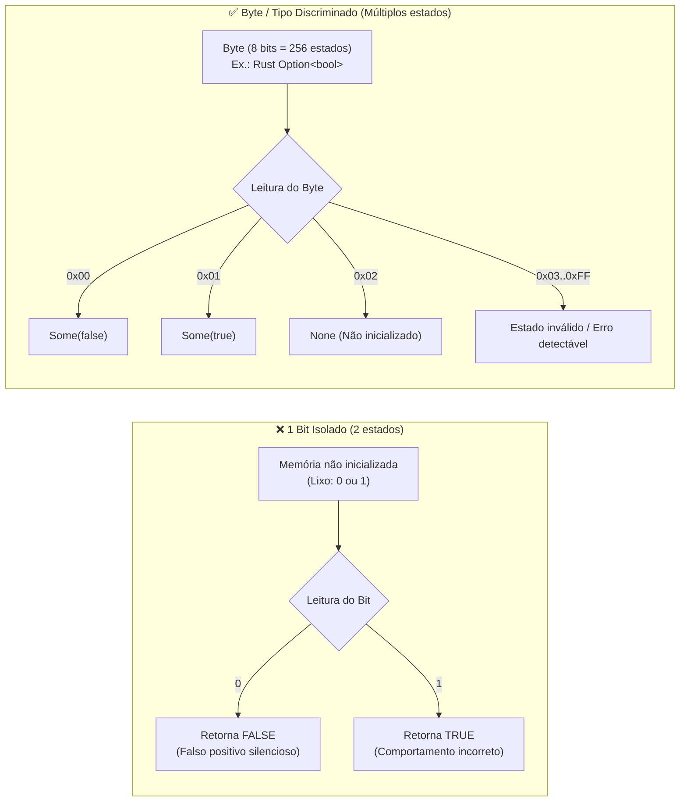

# O Problema do Binário em 1 Bit: Por que Variáveis Booleanas Usam 1 Byte

> 📌 **Visão Geral:**  
> À primeira vista, armazenar um valor booleano (`true` ou `false`) em um **byte inteiro (8 bits)** parece um desperdício de 7 bits de memória. Contudo, representar um booleano com apenas **1 bit isolado** traz falhas críticas de endereçamento, concorrência e segurança de estado, especialmente quando uma variável ainda **não foi inicializada** ou sofre corrupção na memória, podendo retornar um valor arbitrário (`0` ou `1`) como se fosse legítimo.

---

## 📑 Sumário
1. [Por que um `bool` Ocupa 1 Byte e Não 1 Bit?](#1-por-que-um-bool-ocupa-1-byte-e-não-1-bit)
2. [A Armadilha do Bit Único: Estado Não Inicializado e Integridade](#2-a-armadilha-do-bit-único-estado-não-inicializado-e-integridade)
3. [Mitigação: Estados de Controle, Paridade e *Niche Optimization*](#3-mitigação-estados-de-controle-paridade-e-niche-optimization)
4. [Na Prática: C/C++ vs. Rust vs. Hardware](#4-na-prática-cc-vs-rust-vs-hardware)
5. [Quando Realmente Usar Bits Individuais (*Bitflags*)](#5-quando-realmente-usar-bits-individuais-bitflags)
6. [Conclusão](#6-conclusão)

---

## 1. Por que um `bool` Ocupa 1 Byte e Não 1 Bit?

Em arquiteturas modernas (`x86_64`, `ARM64`, `RISC-V`), o **byte (8 bits)**, e não o bit, é a unidade fundamental de operação da memória:

1. **Memória Endereçável por Byte (*Byte-Addressable Memory*):**  
   Um ponteiro na memória RAM aponta para um **byte**, nunca para um bit específico dentro dele. Para ler ou alterar 1 único bit, a CPU precisa ler o byte inteiro, aplicar uma máscara binária (`&`, `|`, `<<`, `>>`) e gravar o byte inteiro de volta.
2. **Concorrência e *Data Races*:**  
   Se duas variáveis booleanas `flag_a` e `flag_b` compartilhassem bits vizinhos dentro do mesmo byte e duas *threads* tentassem modificá-las simultaneamente, uma sobrescreveria o bit da outra durante o ciclo de leitura-modificação-escrita (*read-modify-write*). Ao dar **1 byte exclusivo** para cada `bool`, o acesso torna-se independente em nível de hardware.
3. **Velocidade de Execução:**  
   Instruções de comparação e movimentação de bytes (`MOV`, `CMP`) são nativas no processador, enquanto o isolamento constante de bits adiciona instruções extras e reduz a performance em caminhos quentes (*hot paths*).

---

## 2. A Armadilha do Bit Único: Estado Não Inicializado e Integridade

Com apenas **1 bit**, só existem **2 estados possíveis** (`0` ou `1`). Isso cria um problema semântico grave: **não há espaço para representar "não inicializado" ou "inválido"**.

Se uma região de memória contiver lixo residual de alocações anteriores (ou sofrer inversão acidental de bit por ruído elétrico), um único bit sempre será lido como `0` (`false`) ou `1` (`true`), nunca haverá um sinal de alerta de que aquele dado não deveria ser confiável.



---

## 3. Mitigação: Estados de Controle, Paridade e *Niche Optimization*

Para mitigar a ambiguidade de 1 bit, sistemas robustos separam o **dado** dos **metadados de estado e integridade**. Com um byte disponível (ou campos dedicados), podemos combinar três informações fundamentais:

1. **O valor booleano em si:** `True` (`1`) ou `False` (`0`).
2. **Flag/Bit de inicialização:** indica se a variável já recebeu um valor válido ou se ainda está indefinida.
3. **Bit de paridade (integridade):** verifica se nenhum bit sofreu alteração acidental (*bit flip*) durante armazenamento ou transmissão.

### Tabela Verdade: Os 4 Estados Lógicos (Valor + Inicialização)

Com **2 bits** (`Inicializado` e `Valor`), obtemos $2^2 = 4$ combinações possíveis, eliminando a ambiguidade da variável não inicializada:

| Bit de Inicialização | Bit de Valor | Significado Semântico | Ação Segura |
| :---: | :---: | :--- | :--- |
| `0` | `0` | **Não inicializado** | Bloquear leitura / retornar erro ou `None` |
| `0` | `1` | **Não inicializado (lixo residual)** | Bloquear leitura / retornar erro ou `None` |
| `1` | `0` | **`False` válido** | Retornar `false` |
| `1` | `1` | **`True` válido** | Retornar `true` |

### Onde entra o Bit de Paridade?
Ao adicionar um **bit de paridade** (3º bit, ou bits de **ECC, *Error-Correcting Code*** no controlador de memória RAM), garantimos integridade física contra corrupção de bits:
* **Paridade Par (*Even Parity*):** o bit de paridade assume `0` ou `1` de modo que a soma total de bits `1` na palavra seja sempre par. Se um bit sofrer *flip* por interferência elétrica ou radiação, a paridade deixa de bater e a falha é detectada.
* **Na prática de software:** em aplicações comuns de desktop/servidor, o controle de paridade/ECC fica a cargo do **hardware da memória RAM e dos protocolos de rede** (CRC/checksums), enquanto o controle de **inicialização** é garantido pelo **compilador e pelo sistema de tipos** da linguagem.

---

## 4. Na Prática: C/C++ vs. Rust vs. Hardware

| Camada / Linguagem | Tamanho do Booleano | Como Trata "Não Inicializado" | Como Garante Integridade |
| :--- | :---: | :--- | :--- |
| **C / C++** | `1 byte` (`sizeof(bool) == 1`) | **Comportamento Indefinido (UB):** ler `bool` não inicializado pode conter qualquer valor (`0..255`) e gerar bugs sutis. | Responsabilidade manual do programador / *sanitizers* (`-fsanitize=undefined`). |
| **Rust** | `1 byte` (`bool` e `Option<bool>`) | **Segurança em compilação:** o compilador proíbe usar variável não inicializada; `Option<bool>` representa `None` no mesmo `1 byte` (*Niche Optimization*). | Apenas `0x00` e `0x01` são válidos para `bool`; `Option<bool>` usa `0x02` para `None`. |
| **Bancos SQL** | `1 byte` (+ bitmap de `NULL`) | **Lógica Ternária (3VL):** `TRUE`, `FALSE` e `NULL` (desconhecido/ausente). | *Constraints* `NOT NULL` e checksums de página no disco. |
| **Hardware / Embarcados** | `1 byte` ou registrador | Registradores de reset definidos em hardware ou flags explícitas de *ready*. | Memória **ECC**, paridade UART/SPI e *Watchdog Timers*. |

### Exemplo 1: A armadilha em C (Memória não inicializada)

```c
#include <stdio.h>
#include <stdbool.h>

int main(void) {
    bool ativo; // ❌ Não inicializada: contém lixo de memória na stack!

    // Comportamento Indefinido (Undefined Behavior):
    // Se o byte na stack for 42, C pode tratá-lo como verdadeiro,
    // mas comparações como (ativo == true) podem falhar!
    if (ativo) {
        printf("Ativo!\n");
    }
    return 0;
}
```

### Exemplo 2: A solução idiomática em Rust (*Compile-time Safety* + *Niche Optimization*)

Em Rust, o compilador **recusa compilar** se você tentar ler um `bool` não inicializado. Quando o domínio realmente precisa do estado *"ainda não definido"*, utiliza-se `Option<bool>`, que continua ocupando **exatamente 1 byte** na memória RAM:

```rust
use std::mem::size_of;

fn main() {
    // 1. O compilador impede uso sem inicialização:
    // let ativo: bool;
    // println!("{ativo}"); // ❌ Erro de compilação: used binding `ativo` isn't initialized

    // 2. Quando "não definido" é um estado válido de negócio, use Option<bool>:
    let mut aceite_termos: Option<bool> = None; // Representado internamente como 0x02

    assert_eq!(size_of::<bool>(), 1);
    assert_eq!(size_of::<Option<bool>>(), 1); // ✅ Niche optimization: zero custo extra de memória!

    aceite_termos = Some(true); // Representado internamente como 0x01
    if let Some(true) = aceite_termos {
        println!("Termos aceitos com segurança.");
    }
}
```

---

## 5. Quando Realmente Usar Bits Individuais (*Bitflags*)

Embora variáveis booleanas isoladas devam usar 1 byte, existem cenários específicos em que **empacotar vários bits em um único byte ou inteiro** (`u8`, `u32`, `u64`) é a abordagem correta, sempre usando **máscaras explícitas e valores iniciais zerados (`0x00`)**:

* **Protocolos de Rede:** cabeçalhos TCP (`SYN`, `ACK`, `FIN`, `RST` ocupam 1 bit cada em um campo de flags).
* **Permissões de Sistema de Arquivos:** modo POSIX (`rwx` = 3 bits por escopo).
* **Sistemas Embarcados e *Bitsets*:** grandes coleções de sinalizadores (ex.: `BitVec` para filtros de Bloom ou mapas de páginas de memória), onde economizar 8x de RAM compensa o custo de operações bit a bit.

---

## 6. Conclusão

Utilizar **1 byte (ou tipos discriminados sobre 1 byte)** em vez de tentar manipular **1 bit isolado** para representar valores booleanos não é desperdício: é uma necessidade imposta pela arquitetura dos processadores modernos, pela segurança em programação concorrente e pela prevenção contra estados ambíguos.

Separar explicitamente **valor**, **estado de inicialização** (seja via `Option<bool>` ou análise estática do compilador) e **verificação de integridade** (paridade/ECC nas camadas de hardware e transporte) elimina silenciosos falsos positivos e comportamentos indefinidos, garantindo que um dado booleano só seja tratado como `true` ou `false` quando realmente válido.

---

### Leituras Complementares no Guia:
* [C++ vs. Rust: O Mito do Tamanho, a Guerra de Paradigmas e a Nova Era da Engenharia com IA](/paradigmas/C++_vs_Rust.md)
* [Modelagem de Combinações e Estados Válidos em Rust](/boas-praticas/Rust/modeling-combinations.md)
