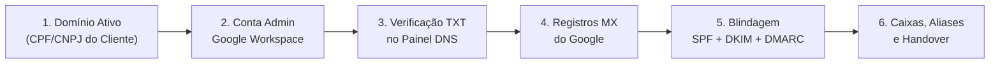

# 📧 E-mail Corporativo com Google Workspace & Proposta Comercial Consolidada

> [!TIP]
> **Resumo Executivo:** O **Google Workspace** permite conectar o domínio próprio do cliente (ex.: `contato@suaempresa.com.br` registrado no Registro.br) à interface profissional do Gmail, Google Drive, Agenda e Meet, **sem precisar contratar hospedagem de site**. A implantação completa (conta administrativa, verificação DNS, `MX`, `SPF`, `DKIM`, `DMARC` e criação de caixas/aliases) costuma ser cobrada entre **R$ 200,00 e R$ 400,00** de mão de obra.

---

## 📋 Índice

1. [Como Funciona a Integração na Prática](#-1-como-funciona-a-integração-na-prática)
2. [Quando Recomendar Google Workspace vs. Alternativas](#-2-quando-recomendar-google-workspace-vs-alternativas)
3. [Fluxo Técnico de Implantação](#-3-fluxo-técnico-de-implantação)
4. [Precificação: Implantação e Serviços Adicionais](#-4-precificação-implantação-e-serviços-adicionais)
5. [Dicas Técnicas e Comerciais para Vender Mais](#-5-dicas-técnicas-e-comerciais-para-vender-mais)
6. [Proposta Comercial Consolidada (Pronta para PDF / Docs)](#-6-proposta-comercial-consolidada-pronta-para-pdf--docs)
7. [Mensagem Curta de WhatsApp para Acompanhar a Proposta](#-7-mensagem-curta-de-whatsapp-para-acompanhar-a-proposta)

---

## ⚙️ 1. Como Funciona a Integração na Prática

* **Propriedade do domínio:** o cliente precisa ter um domínio ativo (como no [Registro.br](./quanto-cobrar-registro-dominio.md)) em seu próprio CPF ou CNPJ.
* **Verificação e apontamento de DNS:** no painel de DNS do domínio (Registro.br, Cloudflare ou hospedagem), o técnico insere o registro `TXT` de verificação de posse e os registros `MX` do Google para rotear os e-mails.
* **Blindagem anti-spam (`SPF`, `DKIM` e `DMARC`):** etapa obrigatória hoje para garantir que as mensagens enviadas não caiam no spam do Gmail, Outlook ou Yahoo.

---

## 🧭 2. Quando Recomendar Google Workspace vs. Alternativas

| Solução | Custo para o Cliente | Melhor para quem... | Pontos de Atenção |
| :--- | :--- | :--- | :--- |
| **Webmail da Hospedagem (cPanel/Plesk)** | Incluso na hospedagem | Negócio muito inicial com orçamento apertado. | IP compartilhado pode afetar entregabilidade e exige cuidado com espaço em disco. |
| **Zoho Mail / Titan** | Baixo custo por caixa | Quer e-mail dedicado fora da hospedagem gastando menos. | Interface e ecossistema mais simples que o Google. |
| **Google Workspace** | Mensalidade por usuário | Quer máxima entregabilidade, Gmail corporativo, Drive, Agenda e Meet integrados. | Cobrança por licença ativa (mitigável com *aliases* gratuitos). |

---

## 🔄 3. Fluxo Técnico de Implantação



---

## 💰 4. Precificação: Implantação e Serviços Adicionais

### Tabela de Implantação: Google Workspace Profissional

> [!NOTE]
> Os valores abaixo referem-se **exclusivamente à mão de obra técnica**. A assinatura mensal por usuário do Google Workspace e a taxa anual do domínio no Registro.br (referência: R$ 40,00) são pagas diretamente pelo cliente.

| Entregas e Configurações | Implantação Essencial *(Até 3 usuários)* | Implantação Corporativa *(4 a 10 usuários)* |
| :--- | :---: | :---: |
| Criação da conta administrativa no nome da empresa | ✅ | ✅ |
| Verificação de propriedade do domínio no DNS | ✅ | ✅ |
| Configuração dos registros `MX` (ativação dos e-mails) | ✅ | ✅ |
| Blindagem Anti-Spam (`SPF`, `DKIM` e `DMARC`) | ✅ | ✅ |
| Criação das caixas de e-mail e apelidos (*aliases*) | Até 3 contas + *aliases* | Até 10 contas + *aliases* |
| Configuração inicial de assinatura de e-mail padrão | ✅ | ✅ |
| Orientação de acesso no celular (Android/iOS) e PC | ✅ | ✅ |
| Atualização do [Manual de Ativos Digitais (Handover)](./handover.md) | ✅ | ✅ |
| **Investimento (Mão de Obra)** | **R$ 220,00** | **R$ 350,00** |

### Serviços Adicionais (Opcionais)

* **Migração de E-mails Antigos:** importação do histórico de mensagens e pastas de um webmail antigo (cPanel, Locaweb, UOL, etc.) para o Google Workspace: **R$ 80,00 a R$ 120,00 por caixa de e-mail**.
* **Treinamento Rápido para a Equipe:** sessão online de 30 a 45 minutos ensinando uso de Google Drive compartilhado, agendas da equipe e grupos de e-mail: **R$ 120,00** *(sessão única)*.

---

## 🎯 5. Dicas Técnicas e Comerciais para Vender Mais

* **Não exige hospedagem de site:** destaque ao cliente que ele não precisa pagar servidor de site apenas para ter e-mails profissionais no domínio próprio.
* **Explique a economia com *Aliases* (Apelidos):** pequenos empresários costumam achar caro pagar 4 ou 5 licenças. Mostre que eles podem contratar **1 ou 2 contas reais** (ex.: `joao@empresa.com.br`) e criar até **30 endereços alternativos gratuitos** (`contato@`, `comercial@`, `financeiro@`) caindo na mesma caixa de entrada.
* **Garanta a posse do Painel Admin:** cadastre sempre o e-mail principal do sócio como **Superadministrador** e documente no [Handover](./handover.md) que a conta pertence integralmente à empresa.
* **Programa de indicação oficial:** o Google Workspace possui *Referral Program* com comissão por novo usuário e cupons de desconto para o primeiro ano do cliente.

---

## 📄 6. Proposta Comercial Consolidada (Pronta para PDF / Docs)

Copie o modelo abaixo para o **Google Docs**, **Word**, **Canva** ou **Notion**, personalize os campos entre colchetes e exporte em **PDF** para enviar ao cliente:

```markdown
# PROPOSTA COMERCIAL: INFRAESTRUTURA E PRESENÇA DIGITAL
**Registro de Domínio, Hospedagem de Sites e E-mail Corporativo (Google Workspace)**

* **Para:** [Nome da Empresa / Cliente]
* **Data:** [DD/MM/AAAA]
* **Validade da Proposta:** 10 dias
* **Responsável Técnico:** [Seu Nome ou Sua Empresa] – [Seu WhatsApp / E-mail]

---

## 1. Objetivo e Diferencial do Nosso Trabalho
O objetivo desta proposta é estruturar a identidade digital da **[Nome da Empresa]** com segurança, estabilidade e autonomia total.

Diferente de modelos que prendem o cliente ao prestador de serviço, todo o patrimônio digital é registrado diretamente no **CPF/CNPJ da sua empresa**. Ao final da implantação, você recebe o **Manual de Ativos Digitais (Handover)** com todos os dados técnicos, prazos de renovação e histórico de manutenção.

---

## 2. Pacotes de Implantação Inicial
Escolha a estrutura ideal para o momento atual do seu negócio:

| Entregas e Configurações | Pacote 1: Essencial (Domínio) | Pacote 2: Presença Web (Domínio + Hospedagem) | Pacote 3: Corporativo (Domínio + Google Workspace) | Pacote 4: Completo (Site + Google Workspace) |
| :--- | :---: | :---: | :---: | :---: |
| Registro no Registro.br (CNPJ/CPF do cliente) | ✅ | ✅ | ✅ | ✅ |
| Consultoria e contratação de hospedagem | ❌ | ✅ | ❌ | ✅ |
| Configuração de DNS e Certificado SSL (HTTPS) | Básico | ✅ | ✅ | ✅ |
| Implantação Google Workspace (até 3 usuários + aliases) | ❌ | ❌ | ✅ | ✅ |
| Criação de e-mails na própria hospedagem | ❌ | Até 3 contas | ❌ | ❌ |
| Blindagem Anti-Spam (`SPF`, `DKIM` e `DMARC`) | ❌ | ✅ | ✅ | ✅ |
| Instalação inicial de WordPress (pronto para uso) | ❌ | ✅ | ❌ | ✅ |
| Manual de Ativos Digitais (PDF + Editável) | ✅ | ✅ | ✅ | ✅ |
| **Investimento (Mão de Obra)** | **R$ 120,00** | **R$ 290,00** | **R$ 320,00** | **R$ 490,00** |

---

## 3. Serviços Avulsos e Manutenção Contínua

| Serviço | Descrição do Escopo | Investimento |
| :--- | :--- | :---: |
| **Consultoria de Hospedagem** | Análise técnica e recomendação de até 3 provedores com melhor custo-benefício (sem configuração). | R$ 150,00 |
| **Apontamento de DNS e SSL** | Conexão de domínio existente a uma nova plataforma de site/loja e ativação de HTTPS. | R$ 120,00 |
| **Migração de Site e E-mails** | Transferência completa de arquivos e caixas postais de um servidor antigo para um novo, sem perda de dados. | A partir de R$ 350,00 |
| **Migração de Histórico (Google)** | Importação de e-mails antigos (cPanel/webmail) para dentro do Google Workspace (valor por caixa). | R$ 100,00 / caixa |
| **Usuário Extra (Google Workspace)** | Configuração adicional acima dos 3 usuários inclusos nos pacotes corporativos. | R$ 40,00 / usuário |
| **Gestão Anual de Renovação** | Monitoramento de vencimentos (domínio + servidor), conferência contra reajustes e atualização do Manual. | R$ 250,00 / ano |

---

## 4. Transparência Financeira (Taxas de Terceiros)
Para evitar bitributação e garantir que todas as contas fiquem em nome da sua empresa, os valores desta proposta referem-se **exclusivamente à mão de obra técnica**. As taxas oficiais das plataformas são pagas diretamente por você via Pix, boleto ou cartão:

* **Domínio Nacional (`.com.br`):** R$ 40,00/ano pagos diretamente ao Registro.br.
* **Hospedagem de Site:** conforme o plano escolhido no provedor recomendado (média de R$ 15,00 a R$ 35,00/mês).
* **Google Workspace:** assinatura mensal por usuário contratado, paga diretamente ao Google.

---

## 5. Prazos e Condições de Pagamento
* **Prazo de Entrega:** 2 a 4 dias úteis após aprovação da proposta e pagamento das taxas nas plataformas.
* **Forma de Pagamento (Mão de Obra):** 50% no aceite da proposta e 50% na entrega do Manual de Ativos Digitais (via Pix ou transferência).
* **Garantia Técnica:** 30 dias de suporte gratuito para ajustes relacionados às configurações entregues.

**De acordo:**
* **Responsável pela Empresa:** [Nome Completo]
* **Empresa:** [Nome da Empresa]
* **Data / Assinatura:** [DD/MM/AAAA] : ____________________________________
```

---

## 💬 7. Mensagem Curta de WhatsApp para Acompanhar a Proposta

```text
Olá, [Nome do Cliente]! Tudo bem?

Conforme conversamos, preparei a proposta completa em PDF para estruturar o domínio, o site e os e-mails corporativos da *[Nome da Empresa]* 100% no nome da sua empresa.

Resumindo as opções de implantação (mão de obra única):
1️⃣ *Essencial (Domínio):* R$ 120,00
2️⃣ *Presença Web (Domínio + Hospedagem + Site):* R$ 290,00
3️⃣ *Corporativo (Domínio + Google Workspace até 3 usuários):* R$ 320,00
4️⃣ *Completo (Domínio + Site + Google Workspace):* R$ 490,00

📌 Todas as opções incluem a entrega do *Manual de Ativos Digitais (Handover)* para a empresa ter controle total. As taxas oficiais (Registro.br / Google / Hospedagem) são pagas diretamente por você, sem acréscimos.

Qual opção faz mais sentido para analisarmos juntos?
```

### 💡 Dicas de Uso no Dia a Dia
* **Para clientes rápidos no WhatsApp:** envie a mensagem curta acima com o PDF completo em anexo, assim ele decide rápido e ainda tem o detalhamento formal para mostrar aos sócios.
* **Revisão periódica:** revise sua tabela a cada 6 meses para ajustar o valor da sua hora técnica conforme a demanda da sua agenda.
