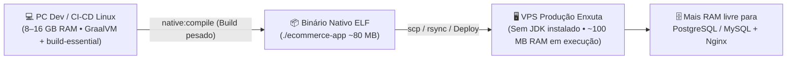

# ⚡ GraalVM Native Image para Apps Java em VPS: Economizando RAM, CPU e Dinheiro do Cliente

> [!TIP]
> **Resumo Executivo:**
> Ao compilar uma aplicação Java (**Spring Boot**, **Quarkus** ou **Micronaut**) com **GraalVM Native Image** (*Ahead-Of-Time*), você transforma o `.jar` em um **binário nativo Linux**. Em vez de consumir **300–600+ MB de RAM** e vários segundos para iniciar na JVM tradicional, a aplicação passa a consumir cerca de **40–165 MB de RAM** e inicia em **menos de 300 ms**, permitindo hospedar um e-commerce ou API em uma **VPS mais barata** sem sacrificar estabilidade para o banco de dados.

*(Este guia complementa [requisitos-hospedagem.md](./requisitos-hospedagem.md), especialmente para reduzir a necessidade de planos caros de VPS em projetos Java para pequenos negócios.)*

---

## 📋 Índice

1. [GraalVM JIT vs. GraalVM Native Image (Onde Está a Economia Real?)](#-1-graalvm-jit-vs-graalvm-native-image-onde-está-a-economia-real)
2. [Comparativo Prático na VPS: JVM Tradicional vs. Native Image](#-2-comparativo-prático-na-vps-jvm-tradicional-vs-native-image)
3. [Fluxo Correto de Build e Deploy (Regra de Ouro da VPS)](#-3-fluxo-correto-de-build-e-deploy-regra-de-ouro-da-vps)
4. [Instalando o GraalVM no Debian / Ubuntu com SDKMAN!](#-4-instalando-o-graalvm-no-debian--ubuntu-com-sdkman)
5. [Compilando Projetos Spring Boot e Quarkus para Binário Nativo](#-5-compilando-projetos-spring-boot-e-quarkus-para-binário-nativo)
6. [Deploy Enxuto na VPS com `systemd` (Sem Instalar Java no Servidor)](#-6-deploy-enxuto-na-vps-com-systemd-sem-instalar-java-no-servidor)
7. [Pegadinhas Comuns, Reflection e Quando NÃO Usar Native Image](#-7-pegadinhas-comuns-reflection-e-quando-não-usar-native-image)
8. [Checklist de Adoção para Projetos de Clientes](#-8-checklist-de-adoção-para-projetos-de-clientes)

---

## 🔍 1. GraalVM JIT vs. GraalVM Native Image (Onde Está a Economia Real?)

Muita gente confunde as duas formas de usar o **GraalVM**:

* **Modo 1: GraalVM como JVM (JIT):** Você apenas troca o OpenJDK pelo JDK da GraalVM para rodar `java -jar app.jar`. Ele usa o compilador Graal JIT para otimizar código quente em tempo de execução, mas **continua precisando da JVM, de Heap e de centenas de megabytes de RAM**.
* **Modo 2: GraalVM Native Image (AOT - *Ahead-Of-Time*):** O compilador analisa toda a aplicação durante o *build*, descarta classes não utilizadas e gera um **executável nativo ELF do Linux**. É aqui que acontece a **economia brutal de memória RAM e inicialização instantânea** na VPS.

---

## 📊 2. Comparativo Prático na VPS: JVM Tradicional vs. Native Image

Valores típicos observados em aplicações web reais (API REST + ORM/JPA + conexão com PostgreSQL/MySQL) rodando em Linux:

| Métrica na VPS de Produção | JVM Tradicional (`java -jar`) | **Quarkus (Native Image)** | **Spring Boot (AOT + Native Image)** |
| :--- | :--- | :--- | :--- |
| **Consumo de RAM (Ocioso)** | ~250–400 MB | **~20–40 MB** | **~45–100 MB** |
| **Consumo de RAM (App Web + JPA/BD)** | ~400–800+ MB | **~35–60 MB** | **~100–165 MB** |
| **Tempo de *Startup* (*Cold Start*)** | 3 a 15+ segundos | **~40–150 ms** | **~150–300 ms** |
| **Precisa instalar JDK/JRE na VPS?** | Sim (`openjdk-21-jre`) | **Não** (binário autossuficiente) | **Não** (binário autossuficiente) |
| **Impacto no plano da VPS** | Exige mais RAM para sobrar espaço ao MySQL/PostgreSQL | Cabe com folga até em VPS compacta (2–4 GB RAM) | Libera centenas de MB extras para cache do banco de dados |

> [!NOTE]
> **Por que isso importa financeiramente para o cliente?**
> Em uma VPS de **4 GB de RAM** compartilhada entre aplicação Java, **MySQL/PostgreSQL** e **Nginx**, economizar **400–600 MB** da aplicação significa poder alocar mais memória para *buffers* e índices do banco de dados, evitando *OutOfMemoryError* e postergando um *upgrade* de plano mensal.

---

## 🔄 3. Fluxo Correto de Build e Deploy (Regra de Ouro da VPS)

> [!CAUTION]
> **Nunca compile um Native Image dentro de uma VPS de produção de 2 GB ou 4 GB de RAM!**
> A compilação AOT realiza análise global (*closed-world analysis*) de todo o grafo de classes e costuma exigir **8 GB a 16 GB de RAM** + CPU intensa durante o *build*, o que travaria ou derrubaria a VPS do cliente.

Compile na sua **máquina de desenvolvimento** (ou em um runner de **CI/CD** como GitHub Actions com Linux `x86_64`) e envie **apenas o binário compilado** para o servidor:



---

## 🐧 4. Instalando o GraalVM no Debian / Ubuntu com SDKMAN!

Execute estes passos na **máquina onde será feito o build** (seu PC Linux ou container de build):

### Passo 1: Instalar dependências de compilação C/C++

O `native-image` precisa do toolchain C (`gcc`, `ld`) e cabeçalhos `zlib` para gerar o binário nativo Linux:

```bash
sudo apt update && sudo apt install -y build-essential zlib1g-dev curl unzip zip
```

### Passo 2: Instalar o SDKMAN! e o GraalVM (Java 21 ou 25 LTS)

```bash
# 1. Instalar SDKMAN!
curl -s "https://get.sdkman.io" | bash
source "$HOME/.sdkman/bin/sdkman-init.sh"

# 2. Listar versões disponíveis da família GraalVM (-graal ou -graalce)
sdk list java | grep -i graal

# 3. Instalar a versão LTS desejada (exemplos: Oracle GraalVM ou Community Edition)
sdk install java 21.0.2-graal      # Oracle GraalVM (ou versão LTS mais recente listada)
# sdk install java 21.0.2-graalce  # Alternativa Community Edition 100% open-source
```

### Passo 3: Validar o `native-image`

A partir do GraalVM para JDK 21, o utilitário **`native-image` já vem embutido** por padrão (não é mais necessário rodar `gu install native-image`):

```bash
java -version
native-image --version
```

---

## 🛠️ 5. Compilando Projetos Spring Boot e Quarkus para Binário Nativo

### 5.1. Spring Boot (3.x / 4.x)

Certifique-se de que o projeto utiliza o plugin `org.graalvm.buildtools:native-maven-plugin` (incluído automaticamente ao marcar **GraalVM Native Support** no *Spring Initializr*).

**Com Maven:**

```bash
./mvnw -Pnative native:compile
```

**Com Gradle:**

```bash
./gradlew nativeCompile
```

O binário final será gerado em `target/<nome-da-app>` (Maven) ou `build/native/nativeCompile/<nome-da-app>` (Gradle).

### 5.2. Quarkus

O Quarkus foi arquitetado desde o início para otimização em tempo de build, gerando binários ainda menores e consumindo menos RAM na compilação:

```bash
# Build nativo usando o GraalVM instalado na máquina
./mvnw package -Dnative

# Alternativa recomendada: build dentro de container Linux compatível (evita diferença de glibc)
./mvnw package -Dnative -Dquarkus.native.container-build=true
```

> [!TIP]
> **Compatibilidade de `glibc` entre seu PC e a VPS:**
> Se o seu PC roda uma distribuição muito mais nova que a VPS (ex.: Debian Testing/14 gerando binário para uma VPS Debian 12 ou Ubuntu 22.04), o binário pode falhar ao iniciar por exigir versão mais nova da `glibc`. Para evitar isso, compile via **container Docker** com a mesma base da VPS ou no próprio CI/CD usando a versão alvo.

---

## 🚀 6. Deploy Enxuto na VPS com `systemd` (Sem Instalar Java no Servidor)

Na VPS de produção, copie o binário gerado para `/opt/ecommerce/ecommerce-app`, garanta permissão de execução e crie o serviço `systemd`:

```bash
sudo mkdir -p /opt/ecommerce
# Após enviar o binário via scp/rsync:
sudo chmod +x /opt/ecommerce/ecommerce-app
sudo chown -R www-data:www-data /opt/ecommerce
```

Crie `/etc/systemd/system/ecommerce.service`:

```ini
[Unit]
Description=Ecommerce Java Native Application
After=network.target postgresql.service

[Service]
User=www-data
WorkingDirectory=/opt/ecommerce
# Opcional: limite explícito de heap nativa (ex.: -Xmx512m) para garantir previsibilidade
ExecStart=/opt/ecommerce/ecommerce-app -Xmx512m
Restart=always
RestartSec=3

[Install]
WantedBy=multi-user.target
```

Ative o serviço (ele sobe em frações de segundo atrás do Nginx):

```bash
sudo systemctl daemon-reload
sudo systemctl enable --now ecommerce
sudo systemctl status ecommerce
```

---

## ⚠️ 7. Pegadinhas Comuns, Reflection e Quando NÃO Usar Native Image

Apesar das vantagens de custo e memória, o **Native Image** exige atenção em três pontos:

### 7.1. Reflection, Proxies Dinâmicos e Recursos (`reachability metadata`)
Como o `native-image` trabalha sob a premissa de *mundo fechado* (*closed-world*), classes carregadas dinamicamente por *reflection* (sem o compilador enxergar em tempo de build) podem gerar `ClassNotFoundException` ou `NoSuchMethodException` apenas em execução.

* **Boas práticas para evitar dor de cabeça:**
  * Prefira bibliotecas modernas que já publicam metadados no **GraalVM Reachability Metadata Repository** (Spring Boot AOT e extensões do Quarkus já trazem a maioria pronta).
  * Sempre **execute seus testes de integração e E2E contra o binário nativo compilado** antes de enviar para produção, não confie apenas nos testes rodando na JVM.
  * Para código próprio com reflection ou serialização dinâmica, utilize o **Tracing Agent** durante os testes na JVM para gerar os arquivos de metadados automaticamente:
    ```bash
    java -agentlib:native-image-agent=config-output-dir=src/main/resources/META-INF/native-image -jar target/app.jar
    ```

### 7.2. Tempo de build e fluxo de desenvolvimento
* Durante o desenvolvimento diário, **continue rodando na JVM normal** (com *hot reload* instantâneo). Deixe o *build* nativo apenas para a esteira de homologação/produção (CI/CD).

### 7.3. Licenciamento (Oracle GraalVM vs. GraalVM CE)
* **GraalVM Community Edition (`-graalce`):** 100% open-source (**GPLv2 com Classpath Exception**), livre para qualquer projeto comercial ou de terceiros.
* **Oracle GraalVM (`-graal`):** Oferece recursos extras (como *Profile-Guided Optimization / PGO* e coletores avançados) sob licença **GFTC** (gratuita inclusive para uso comercial/produção em versões cobertas), mas valide sempre os termos vigentes da versão escolhida ao entregar projetos para empresas clientes.

### 7.4. Quando a JVM tradicional ainda é melhor?
* Sistemas legados com forte uso de geração dinâmica de bytecode em runtime (plugins carregados dinamicamente via `.jar` externo, scripts Groovy dinâmicos etc.).
* Serviços de altíssima carga contínua com servidores dedicados de sobra (16–64 GB RAM), onde o compilador **JIT (C2 + ZGC/G1GC)** pode extrair um *throughput* de pico ligeiramente superior após aquecimento (*warmup*).

---

## ✅ 8. Checklist de Adoção para Projetos de Clientes

- [ ] Confirmar que as dependências do projeto (drivers JDBC, gateway SDK, PDF/relatórios) suportam Native Image ou possuem *reachability metadata*.
- [ ] Manter desenvolvimento local na JVM normal e configurar o **build nativo** no PC Linux de build ou no CI/CD (mínimo 8 GB RAM no builder).
- [ ] Garantir compatibilidade de `glibc` compilando em container compatível com o OS da VPS (Debian/Ubuntu).
- [ ] Testar os fluxos críticos (checkout, webhooks de pagamento, envio de e-mails) **diretamente no binário nativo** em staging antes de publicar.
- [ ] Realizar o deploy na VPS apenas com o binário + `systemd` + proxy reverso Nginx com SSL ([requisitos-hospedagem.md](./requisitos-hospedagem.md)).

