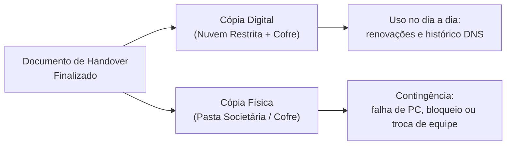

# 📝 Guia de Entrega de Handover ao Cliente (Estratégia Híbrida & Resguardo Profissional)

> [!TIP]
> **Estratégia Híbrida Recomendada:** Adote sempre duas camadas de proteção ao entregar um **Manual de Ativos Digitais / Handover** (como o do [guia de registro de domínio](./quanto-cobrar-registro-dominio.md)): mantenha uma **versão digital principal** para uso cotidiano e atualizações, e oriente o cliente a guardar uma **cópia física impressa** como plano de contingência contra falhas tecnológicas, bloqueios de e-mail ou perda de acesso.

---

## 📋 Índice

1. [Visão Geral da Estratégia Híbrida](#-1-visão-geral-da-estratégia-híbrida)
2. [Versão Digital: Uso Cotidiano e Atualizações](#-2-versão-digital-uso-cotidiano-e-atualizações)
3. [Versão Impressa: Plano de Contingência](#-3-versão-impressa-plano-de-contingência)
4. [Boas Práticas para Você (Prestador de Serviço)](#-4-boas-práticas-para-você-prestador-de-serviço)
5. [Checklist de Conferência Antes de Enviar](#-5-checklist-de-conferência-antes-de-enviar)
6. [Modelos Prontos: Termo de Recebimento e Posse](#-6-modelos-prontos-termo-de-recebimento-e-posse)

---

## 🧭 1. Visão Geral da Estratégia Híbrida



---

## 💻 2. Versão Digital: Uso Cotidiano e Atualizações

A cópia digital serve para consultar vencimentos, copiar endereços e preencher a tabela de histórico sempre que um técnico realizar alterações.

* **Nuvem corporativa com acesso restrito:** salve o arquivo editável (Google Docs ou `.docx`) em uma pasta dedicada de **Administração / TI** no Google Drive, OneDrive ou Dropbox da empresa. Libere acesso apenas aos sócios ou responsáveis diretos.
* **Cofre de senhas (recomendado para máxima segurança):** gerenciadores como **Bitwarden**, **1Password** ou **Proton Pass** oferecem *Notas Seguras* e anexos criptografados. Armazenar o documento lá dentro garante criptografia de ponta a ponta mesmo se o computador do escritório for invadido.
* **Backup offline (pendrive ou HD externo):** mantenha uma cópia em **PDF** em um dispositivo físico desconectado da internet para proteger os registros contra ataques de *ransomware*.
* **Entrega em duplo formato:** envie o **PDF** (layout travado para leitura e impressão no WhatsApp/e-mail) e o **link/arquivo editável** (para que a tabela de histórico de manutenção possa ser atualizada no futuro).

---

## 🖨️ 3. Versão Impressa: Plano de Contingência

O papel funciona como o **"cofre de emergência"** da empresa caso o computador queime, o e-mail principal seja bloqueado ou o responsável atual deixe o negócio sem repassar o acesso.

* **Pasta de documentos societários:** oriente o cliente a guardar uma via impressa junto ao Contrato Social, Certificado Digital (A1/A3) e alvarás da empresa.
* **Local trancado:** mantenha a pasta em armário com chave, gaveta trancada ou cofre do escritório, fora do alcance de visitantes ou colaboradores sem autorização administrativa.
* **Segurança mesmo no papel:** evite escrever a senha completa diretamente na folha principal do manual. Se precisar registrar para contingência, anote apenas a **dica/localização** ou coloque a senha em um **envelope lacrado separado**.

---

## 🛡️ 4. Boas Práticas para Você (Prestador de Serviço)

Como profissional técnico que realizou a implantação, proteja seu trabalho e sua responsabilidade jurídica:

* **Protocolo formal de entrega:** ao enviar os arquivos por e-mail ou WhatsApp, peça uma confirmação objetiva de recebimento (ex.: *"Documento recebido e acessos conferidos"*). Isso comprova que você entregou a posse integral dos ativos ao cliente.
* **Cópia de arquivo morto (criptografada):** guarde uma cópia da versão inicial entregue em seu próprio armazenamento criptografado (por **1 a 2 anos**). Se o cliente perder tudo, você consegue ajudá-lo rapidamente, sem depender de suporte burocrático.

> [!CAUTION]
> **Atenção à LGPD e responsabilidade sobre senhas:** na sua cópia de arquivo morto, guarde apenas os **metadados técnicos** (domínio, IDs, apontamentos DNS, datas e protocolo de entrega). **Nunca** armazene senhas pessoais do cliente em texto puro no seu arquivo morto.

---

## ✅ 5. Checklist de Conferência Antes de Enviar

- [ ] Titularidade confirmada no CPF ou CNPJ do cliente (nunca no do prestador).
- [ ] Seu perfil vinculado apenas como **Contato Técnico** (quando aplicável).
- [ ] Nenhuma senha escrita em texto puro dentro do PDF/documento.
- [ ] E-mail de recuperação e status do **2FA (Autenticação em Dois Fatores)** conferidos.
- [ ] Tabela de histórico de manutenção preenchida com a implantação inicial.
- [ ] Termo de recebimento anexado ou enviado junto na mensagem de entrega.

---

## ✍️ 6. Modelos Prontos: Termo de Recebimento e Posse

### Opção A: Versão Curta (WhatsApp ou E-mail)

```text
Olá, [Nome do Cliente]!

Segue em anexo o Manual de Ativos Digitais (Handover) referente ao domínio *[seudominio].com.br* e às configurações realizadas.

Nele constam todos os dados de titularidade em nome da sua empresa, informações de renovação, apontamentos técnicos e histórico inicial. Recomendo salvar uma cópia no cofre/nuvem da empresa e guardar uma via impressa junto aos documentos societários.

Por favor, responda a esta mensagem confirmando "Recebido e conferido" para registrarmos o encerramento formal da entrega técnica.

Qualquer dúvida futura, fico à disposição!
```

### Opção B: Versão Formal (Para incluir no final do PDF / Assinatura)

```markdown
---

## Termo de Recebimento Técnico e Posse de Ativos Digitais

Declaro para os devidos fins que recebi o **Manual de Ativos Digitais e Domínio** referente ao ativo `[seudominio].com.br`, contendo as informações de titularidade em nome da contratante, orientações de renovação, resumo da configuração técnica vigente e recomendações de segurança (incluindo ativação de 2FA e guarda segura de credenciais).

Confirmo que os acessos administrativos permanecem sob posse e responsabilidade exclusiva do(a) titular contratante a partir desta data.

* **Empresa / Titular:** [Nome / Razão Social]
* **CPF / CNPJ:** [00.000.000/0001-00]
* **Responsável pelo Recebimento:** [Nome Completo]
* **Data:** [DD/MM/AAAA]
* **Assinatura / Confirmação Eletrônica:** ______________________________________
```
