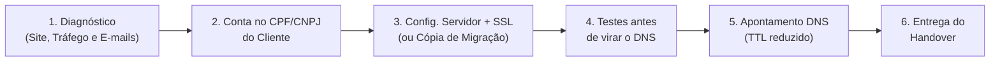

# 🖥️ Quanto Cobrar por Consultoria e Configuração de Hospedagem (Pequenos Negócios)

> [!TIP]
> **Resumo Executivo de Mercado:** Para o serviço de consultoria, escolha e configuração inicial de hospedagem para pequenos negócios, o valor de mercado mais praticado por profissionais de TI e desenvolvedores varia entre **R$ 150,00 e R$ 450,00** (pagamento único pela implantação), dependendo da complexidade e do volume de contas de e-mail. Para **migrações completas** de sites e e-mails, os valores costumam partir de **R$ 350,00 a R$ 700,00+**, e planos de **gestão recorrente** são cobrados à parte.

---

## 📋 Índice

1. [Tabela de Precificação por Modalidade](#-1-tabela-de-precificação-por-modalidade)
2. [Matriz Rápida: Qual Hospedagem Recomendar?](#-2-matriz-rápida-qual-hospedagem-recomendar)
3. [Como Estruturar sua Proposta Comercial](#-3-como-estruturar-sua-proposta-comercial)
4. [Pacotes Fechados vs. Serviços Pontuais](#-4-pacotes-fechados-vs-serviços-pontuais)
5. [Fluxo Seguro de Implantação e Migração](#-5-fluxo-seguro-de-implantação-e-migração)
6. [Dicas de Apresentação para Fechar Mais Vendas](#-6-dicas-de-apresentação-para-fechar-mais-vendas)
7. [Modelo Pronto: Proposta Comercial para WhatsApp](#-7-modelo-pronto-proposta-comercial-para-whatsapp)

---

## 📊 1. Tabela de Precificação por Modalidade

O preço final deve refletir o tempo gasto analisando planos, configurando o servidor e garantindo que o site e os e-mails funcionem sem falhas:

| Modalidade do Serviço | O que está incluso | Mão de Obra Sugerida |
| :--- | :--- | :---: |
| **Consultoria e Contratação Guiada** | Análise de necessidade (site, loja ou e-mails), comparação de 2 a 3 provedores confiáveis, criação da conta no nome do cliente e emissão da fatura do plano. | **R$ 150,00 a R$ 220,00** *(taxa única)* |
| **Consultoria + Configuração Completa** | Tudo acima + apontamento de DNS, ativação de SSL (HTTPS), criação de até 5 contas de e-mail profissional e testes de envio/recebimento. | **R$ 250,00 a R$ 450,00** *(taxa única)* |
| **Migração de Hospedagem** | Transferência de site existente (ex.: WordPress) e caixas de e-mail de um provedor antigo para o novo, sem perda de dados ou queda prolongada. | **R$ 350,00 a R$ 700,00** *(taxa única)* |
| **Gestão de Renovação e Monitoramento** | Acompanhamento de vencimentos (domínio + servidor), conferência contra reajustes abusivos e checagem periódica de backups. | **R$ 100,00 a R$ 180,00/ano** *(ou R$ 50,00 a R$ 90,00/mês com suporte)* |

---

## 🧭 2. Matriz Rápida: Qual Hospedagem Recomendar?

Escolher a infraestrutura certa evita que o cliente pague caro por recursos que não usa — ou sofra com lentidão por economizar no lugar errado:

| Perfil do Projeto do Cliente | Infraestrutura Recomendada | Observação Comercial |
| :--- | :--- | :--- |
| **Site institucional leve / Landing Page estática** | **Cloudflare Pages / Vercel / Netlify** ou hospedagem compartilhada de entrada | Custo baixíssimo (ou gratuito no tier inicial) e altíssima velocidade. |
| **Site WordPress, blog ou catálogo simples** | **Hospedagem compartilhada gerenciada** ou Cloud gerenciado | Verifique se inclui **SSL gratuito (Let's Encrypt)**, backup automático e bom suporte de e-mail. |
| **Sistema sob medida / API / E-commerce robusto** | **VPS dedicada** (ex.: Hetzner, DigitalOcean, Contabo, AWS Lightsail) | **Atenção:** VPS exige administração de SO, firewall, atualizações e backups — **nunca** entregue uma VPS sem contrato mensal de manutenção ou aviso formal de escopo. |

> [!WARNING]
> **Armadilhas comuns para alertar o cliente na consultoria:**
> 1. **Renovação triplicada:** muitos provedores dão 70% de desconto no 1º ano e triplicam a fatura na renovação.
> 2. **Cobranças extras ocultas:** SSL pago à parte, backup diário cobrado como adicional ou limite baixo de caixas de e-mail.
> 3. **E-mail corporativo:** para empresas que dependem muito de e-mail sem cair no spam, considere separar o e-mail da hospedagem do site (ex.: Google Workspace, Microsoft 365 ou Zoho Mail).

---

## 💼 3. Como Estruturar sua Proposta Comercial

Para que o pequeno empresário enxergue valor na consultoria e não ache que está pagando apenas para *"escolher um site"*, destaque os benefícios práticos:

* **Economia financeira real:** sua análise evita planos superdimensionados, armadilhas de renovação e taxas extras desnecessárias.
* **Titularidade e autonomia:** assim como no [registro de domínio](./quanto-cobrar-registro-dominio.md), contrate a hospedagem sempre usando o **CPF ou CNPJ** e os dados de cobrança do próprio cliente, documentando tudo no [Manual de Ativos Digitais (Handover)](./handover.md).
* **Repasse direto das faturas:** nunca pague a hospedagem com o seu cartão para cobrar o cliente depois. Gere o link de pagamento ou boleto direto da plataforma para o cliente quitar, evitando bitributação na sua nota fiscal e risco de inadimplência.
* **Links de afiliado com transparência (opcional):** grandes provedores possuem programas de afiliados que pagam comissão por indicação. Se você indicar apenas serviços em que realmente confia, pode obter uma receita extra do provedor sem encarecer o preço para o cliente.

---

## 📦 4. Pacotes Fechados vs. Serviços Pontuais

Apresentar opções em formato de **tabela comparativa** reduz a resistência ao preço: quando o cliente vê três níveis claros, a tendência natural é escolher o pacote intermediário ou o completo por segurança.

> [!NOTE]
> **Transparência sobre taxas de terceiros:** todos os valores abaixo referem-se exclusivamente à **mão de obra técnica**. A taxa anual do Registro.br (referência de R$ 40,00/ano) e a assinatura do provedor de hospedagem são pagas diretamente pelo cliente.

### Tabela de Pacotes Fechados (Implantação Inicial)

| Recursos e Entregas | Pacote Essencial (Domínio) | Pacote Profissional *(Mais Recomendado)* | Pacote Presença Digital Completa |
| :--- | :---: | :---: | :---: |
| Registro no Registro.br (CPF/CNPJ do cliente) | ✅ | ✅ | ✅ |
| Consultoria e escolha do plano de hospedagem | ❌ | ✅ | ✅ |
| Contratação e configuração inicial do servidor | ❌ | ✅ | ✅ |
| Apontamento de DNS (Domínio + Servidor) | Básico | ✅ | ✅ |
| Ativação de Certificado SSL (HTTPS / Cadeado) | ❌ | ✅ | ✅ |
| Criação de contas de e-mail profissional | ❌ | Até 3 contas | Até 10 contas |
| Autenticação anti-spam (`SPF`, `DKIM` e `DMARC`) | ❌ | ❌ | ✅ |
| Instalação inicial de WordPress (se necessário) | ❌ | ❌ | ✅ |
| Manual de Ativos Digitais ([Handover](./handover.md) PDF + Editável) | ✅ | ✅ | ✅ |
| **Investimento (Mão de Obra)** | **R$ 120,00** | **R$ 290,00** | **R$ 450,00** |

### Tabela de Serviços Pontuais e Manutenção (Avulsos)

| Serviço Pontual | Descrição do Escopo | Valor Sugerido |
| :--- | :--- | :---: |
| **Consultoria de Escolha de Hospedagem** | Análise técnica da demanda do negócio e recomendação de até 3 provedores com melhor custo-benefício (sem configuração). | **R$ 150,00** |
| **Apontamento de DNS e SSL** | Conexão de domínio já existente a uma nova plataforma (site, loja virtual ou landing page) com ativação de HTTPS. | **R$ 120,00** |
| **Configuração de E-mails Profissionais** | Criação de até 5 caixas de e-mail, configuração de segurança (`SPF`/`DKIM`/`DMARC`) e orientação de acesso no celular/PC. | **R$ 160,00** |
| **Migração de Hospedagem** | Transferência completa de arquivos de site e e-mails de um servidor antigo para um novo, sem perda de dados. | **A partir de R$ 350,00** |
| **Gestão Anual de Renovação** | Monitoramento de vencimentos (domínio + servidor), conferência contra reajustes abusivos e atualização do Manual. | **R$ 150,00 / ano** |

---

## 🔄 5. Fluxo Seguro de Implantação e Migração



> [!TIP]
> **Dica de ouro em migrações:** antes de trocar o DNS no dia da virada, reduza o **TTL** dos registros para `300` segundos (5 minutos) com 24h de antecedência e teste o site novo localmente editando seu arquivo `hosts` (ou usando a URL temporária do servidor). Isso evita que o site fique fora do ar durante a propagação.

---

## 🎯 6. Dicas de Apresentação para Fechar Mais Vendas

* **Destaque o "Pacote Profissional" como o mais escolhido:** colocar uma etiqueta visual de *"Mais Recomendado"* ou *"Melhor Custo-Benefício"* na coluna do meio aumenta significativamente a taxa de conversão.
* **Use a autonomia como argumento de venda:** explique ao cliente que, ao contrário de agências que retêm o domínio e a hospedagem, você entrega tudo no nome da empresa dele junto com o [Manual de Ativos Digitais](./handover.md), garantindo liberdade total.
* **Defina o prazo de entrega por escrito:** deixe claro na proposta que os pacotes iniciais são entregues em até **2 a 3 dias úteis** após a confirmação do pagamento das taxas pelo cliente.

---

## 💬 7. Modelo Pronto: Proposta Comercial para WhatsApp

```text
Olá, [Nome do Cliente]! Tudo bem?

Preparei 3 opções transparentes para deixarmos o domínio e a hospedagem da *[Nome da Empresa]* 100% no nome da sua empresa, com segurança e documentação completa:

1️⃣ *Pacote Essencial (Domínio):* R$ 120,00
• Registro no Registro.br no seu CPF/CNPJ + Manual de Ativos Digitais (Handover).

2️⃣ *Pacote Profissional (Mais Escolhido):* R$ 290,00
• Tudo do Essencial + consultoria e configuração da hospedagem;
• Apontamento de DNS + Certificado SSL (cadeado de segurança);
• Até 3 contas de e-mail profissional configuradas.

3️⃣ *Pacote Presença Digital Completa:* R$ 450,00
• Tudo do Profissional + até 10 contas de e-mail;
• Proteção anti-spam avançada (SPF, DKIM e DMARC);
• Instalação inicial do WordPress (se necessário).

📌 *Importante:* As taxas oficiais (R$ 40,00/ano do Registro.br e o plano de hospedagem escolhido) são pagas diretamente por você via Pix/boleto oficial, sem acréscimos.
⏱️ *Prazo de entrega:* 2 a 3 dias úteis após a aprovação e compensação das taxas.

Qual pacote faz mais sentido para o momento da empresa?
```
