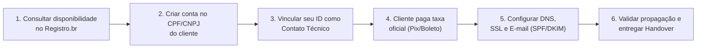

# 💰 Quanto Cobrar pelo Registro e Configuração de Domínio no Registro.br (Pequenos Negócios)

> [!TIP]
> **Resumo Executivo de Mercado:** Para o serviço de registro e configuração inicial de um domínio `.br` no **Registro.br** para pequenos negócios, profissionais de TI e desenvolvedores costumam cobrar entre **R$ 80,00 e R$ 200,00** de mão de obra para registro e apontamento padrão, podendo chegar a **R$ 350,00** em pacotes completos com Cloudflare, SSL e autenticação de e-mail, **somados à taxa oficial do domínio** (referência de **R$ 40,00/ano** para 1 ano; sempre confirme o valor vigente em [registro.br](https://registro.br) antes de fechar o orçamento).

---

## 📋 Índice

1. [Tabela de Precificação Sugerida](#-1-tabela-de-precificação-sugerida)
2. [Como Explicar ao Cliente (Domínio vs. DNS vs. Hospedagem)](#-2-como-explicar-ao-cliente-domínio-vs-dns-vs-hospedagem)
3. [Fluxo Profissional de Atendimento](#-3-fluxo-profissional-de-atendimento)
4. [Boas Práticas Comerciais e Técnicas](#-4-boas-práticas-comerciais-e-técnicas)
5. [Gestão de Renovação e Receita Recorrente](#-5-gestão-de-renovação-e-receita-recorrente)
6. [Handover: Documento de Entrega Técnica](#-6-handover-documento-de-entrega-técnica)
7. [Modelo Pronto: Mensagem Comercial (WhatsApp)](#-7-modelo-pronto-mensagem-comercial-whatsapp)
8. [Modelo Pronto: Manual de Ativos Digitais e Domínio (Handover)](#-8-modelo-pronto-manual-de-ativos-digitais-e-domínio)

---

## 📊 1. Tabela de Precificação Sugerida

O valor da mão de obra varia conforme a complexidade técnica e o nível de responsabilidade entregue ao cliente:

| Escopo do Serviço | O que está incluso | Mão de Obra Sugerida | Taxa Oficial (1 ano) | Total Estimado (1º Ano) |
| :--- | :--- | :---: | :---: | :---: |
| **1. Cadastro e Registro Básico** | Verificação de disponibilidade, criação da conta no CPF/CNPJ do cliente e emissão do Pix/boleto oficial. | R$ 80,00 a R$ 100,00 | R$ 40,00 | **R$ 120,00 a R$ 140,00** |
| **2. Registro + Apontamento DNS** | Tudo do básico + troca de *Nameservers* (`NS`) para hospedagem ou criação de registros `A` / `CNAME` e validação de propagação. | R$ 120,00 a R$ 180,00 | R$ 40,00 | **R$ 160,00 a R$ 220,00** |
| **3. Pacote Completo (Produção)** | Registro + DNS (Cloudflare ou Registro.br) + redirecionamento `www`/SSL + configuração de e-mail profissional (`MX`, `SPF`, `DKIM` e `DMARC`) + Manual de Handover. | R$ 200,00 a R$ 350,00 | R$ 40,00 | **R$ 240,00 a R$ 390,00** |

> [!NOTE]
> Se o cliente contratar o desenvolvimento do site ou loja virtual com você, é comum **embutir** o registro simples no valor do projeto ou cobrar o pacote completo como item separado na proposta para dar transparência ao que é infraestrutura e ao que é serviço técnico.

---

## 🧠 2. Como Explicar ao Cliente (Domínio vs. DNS vs. Hospedagem)

Pequenos empresários costumam confundir o domínio com o site ou com o e-mail. Usar uma analogia simples evita atritos na cobrança:

* **Domínio (`suaempresa.com.br`):** é o **endereço / escritura do terreno** registrado no Registro.br. Quem paga é o dono, no CPF ou CNPJ dele.
* **DNS (Nameservers e Zonas):** é a **placa de sinalização / GPS** que diz para onde enviar quem digita o endereço (o site vai para o servidor X; os e-mails vão para o servidor Y).
* **Hospedagem / Servidor de E-mail:** é o **prédio construído no terreno** onde ficam os arquivos do site e as caixas de entrada.

---

## 🔄 3. Fluxo Profissional de Atendimento



---

## 🛡️ 4. Boas Práticas Comerciais e Técnicas

Para evitar dor de cabeça jurídica, fiscal e operacional com clientes de pequeno porte, adote estas regras desde o primeiro contato:

* **Titularidade sempre no nome do cliente:** nunca registre o domínio usando o seu próprio CPF ou CNPJ. A conta no Registro.br deve ser criada com os dados da empresa ou do sócio titular, garantindo que o patrimônio digital pertença legalmente ao contratante.
* **Seu perfil como Contato Técnico:** após criar a conta do cliente, adicione o seu próprio ID do Registro.br como **Contato Técnico** (ou Administrativo) do domínio. Assim você gerencia zonas de DNS e renovações sem precisar pedir a senha pessoal do cliente toda vez.
* **Repasse transparente da taxa oficial:** deixe explícito na proposta que os R$ 40,00 são uma taxa anual paga diretamente ao NIC.br/Registro.br, e que o seu honorário corresponde à consultoria e configuração técnica. O cenário ideal é gerar o Pix ou boleto no painel e enviá-lo para o **próprio cliente pagar**, evitando que você pague imposto sobre um valor que é apenas repasse.
* **Ative a Autenticação em Dois Fatores (2FA):** oriente (ou ajude) o cliente a habilitar o 2FA na conta do Registro.br logo após o primeiro acesso.
* **Alerta preventivo contra golpes de boleto:** avise o cliente logo na entrega que **o Registro.br não envia boletos pelo correio** e não cobra taxas extras de *"proteção de marca"* ou *"anuidade de diretório"*. Golpistas monitoram registros novos via RDAP/WHOIS para disparar cobranças falsas.

---

## 🔁 5. Gestão de Renovação e Receita Recorrente

Se o cliente não tem equipe de TI interna, você pode oferecer um plano opcional de acompanhamento anual (**R$ 60,00 a R$ 120,00/ano** de gestão, além da taxa oficial do domínio) cobrindo:

1. Monitoramento de vencimento com envio da guia oficial no momento certo (ou renovação automática controlada).
2. Verificação periódica de validade do SSL e integridade dos registros DNS (`A`, `CNAME`, `MX`, `SPF`, `DKIM`, `DMARC`).
3. Suporte rápido caso o cliente troque de provedor de e-mail ou hospedagem no futuro.

---

## 📦 6. Handover: Documento de Entrega Técnica

Entregar um **Manual de Ativos Digitais (Handover)** ao final do serviço transmite profissionalismo, elimina a sensação de *"ficar refém do técnico"* e sustenta perfeitamente a cobrança na faixa superior (**R$ 180,00 a R$ 350,00**).

### O que incluir no documento
* **Dados de Titularidade:** domínio registrado, ID da conta no Registro.br, CPF/CNPJ do titular e e-mail principal de recuperação.
* **Resumo da Configuração Atual:** data do registro, próximo vencimento, provedor de DNS (Registro.br, Cloudflare ou hospedagem) e serviços conectados (site, e-mail, SSL).
* **Tabela de Histórico de Manutenção:** colunas com *Data*, *O que foi alterado*, *Motivo* e *Responsável*, evitando que outro profissional apague registros críticos por engano no futuro.
* **Guia de Emergência:** passos curtos para renovar no painel oficial e aviso explícito para não apagar registros `MX`, `TXT` ou `CNAME`.

### Cuidados de Segurança (O que NÃO colocar)

> [!CAUTION]
> **Nunca inclua senhas em texto puro no documento de Handover.**
> Se esse arquivo trafegar por WhatsApp ou e-mail comum e vazar, terceiros podem sequestrar o domínio. Em vez da senha real, registre apenas o **e-mail de recuperação**, o **status do 2FA** e uma **dica de onde a credencial foi salva** (ex.: gerenciador de senhas como Bitwarden ou cofre da empresa).

* **Evite anexar documentos sensíveis no mesmo PDF:** CPF/CNPJ de titularidade são públicos na consulta RDAP/WHOIS, mas não misture fotos de RG/CNH, contrato social ou dados bancários dentro do manual técnico.

---

## 💬 7. Modelo Pronto: Mensagem Comercial (WhatsApp)

Copie e adapte este texto para enviar um orçamento claro e profissional ao cliente:

```text
Olá, [Nome do Cliente]! Tudo bem?

Verifiquei a disponibilidade do domínio *[nomedoseudominio].com.br* e ele está livre para registro.

Para deixar tudo configurado no nome da sua empresa com segurança e transparência, o investimento funciona assim:

1️⃣ *Taxa oficial do Registro.br:* R$ 40,00/ano (eu gero o Pix/boleto direto no painel oficial em nome do seu CPF/CNPJ para você pagar sem acréscimos).
2️⃣ *Serviço técnico de configuração:* R$ [Valor, ex: 180,00] (pagamento único), incluindo:
   • Criação da conta no Registro.br em nome da sua empresa (100% no seu nome);
   • Configuração do meu ID apenas como contato técnico;
   • Apontamento de DNS para o site e e-mails (com SSL/cadeado ativo);
   • Entrega do Manual de Ativos Digitais (Handover) com todo o histórico documentado.

Se aprovar, me envie por favor:
- CPF ou CNPJ para titularidade;
- Nome completo / Razão Social;
- E-mail principal (onde chegarão os avisos oficiais);
- Telefone e CEP.

Fico à disposição!
```

---

## 📄 8. Modelo Pronto: Manual de Ativos Digitais e Domínio

Copie o modelo abaixo para o **Google Docs**, **Word**, **Notion** ou **Canva**, preencha os campos entre colchetes e exporte em **PDF** ao enviar para o cliente:

```markdown
# MANUAL DE ATIVOS DIGITAIS E DOMÍNIO
**Documento de Entrega Técnica e Histórico de Manutenção**

* **Cliente / Empresa:** [Nome da Empresa]
* **Data de Entrega:** [DD/MM/AAAA]
* **Responsável Técnico pela Implantação:** [Seu Nome / Sua Empresa] – [WhatsApp / E-mail]

---

## 1. Dados de Titularidade (Propriedade Legal)
Este domínio está registrado oficialmente em nome da sua empresa. Guarde estas informações em local seguro.

* **Domínio Registrado:** `[seudominio].com.br`
* **Órgão Registrador:** Registro.br (`https://registro.br`)
* **Titular (CPF ou CNPJ):** `[00.000.000/0001-00]`
* **ID da Conta no Registro.br:** `[ABC123]`
* **ID do Contato Técnico:** `[XYZ999]` (Responsável pela manutenção de DNS)
* **E-mail de Cadastro e Recuperação:** `[contato@empresa.com.br]` *(avisos oficiais de renovação chegam aqui)*
* **Onde a senha está guardada:** `[Ex: Cofre Bitwarden da empresa / Navegador do computador administrativo]`
* **Autenticação em Dois Fatores (2FA):** `[ ] Ativada (Celular/App: [Final])`  `[ ] Pendente`

---

## 2. Ciclo de Vida e Renovação
Para manter o site e os e-mails no ar sem interrupções, o domínio precisa ser renovado antes do vencimento.

* **Data do Registro Inicial:** `[DD/MM/AAAA]`
* **Próximo Vencimento:** `[DD/MM/AAAA]` *(recomendamos criar um lembrete 15 dias antes)*
* **Periodicidade Contratada:** `[ ] 1 Ano`  `[ ] 2 Anos`  `[ ] 5 Anos`
* **Forma de Pagamento Utilizada:** `[ ] Pix`  `[ ] Boleto`  `[ ] Cartão de Crédito`

---

## 3. Configuração Técnica Atual (DNS e Serviços)
Resumo de para onde o seu domínio está apontando neste momento:

* **Gerenciador de DNS Atual:** `[ ] Registro.br`  `[ ] Cloudflare`  `[ ] Painel da Hospedagem`
* **Servidores DNS (Nameservers):**
  * **NS1 (Master):** `[ex: ns1.hospedagem.com.br ou a.sec.dns.br]`
  * **NS2 (Slave):** `[ex: ns2.hospedagem.com.br ou b.sec.dns.br]`
* **Serviços Ativos Conectados:**
  * **Site Institucional / Loja:** Hospedado em `[Nome da Plataforma / Provedor]`
  * **E-mail Profissional:** Provedor `[ex: Google Workspace / Zoho / Titan / cPanel]`
  * **Autenticação de E-mail:** `[ ] SPF`  `[ ] DKIM`  `[ ] DMARC`
  * **Certificado de Segurança (SSL/HTTPS):** `[ ] Ativo`  `[ ] Não configurado`

---

## 4. Guia Rápido para o Proprietário
* **Como renovar:** acesse `https://registro.br`, clique em **Acessar Conta**, informe seu ID ou CPF/CNPJ e sua senha. Na tela inicial, clique sobre o domínio e selecione **Renovar** para gerar o Pix ou boleto oficial.
* **Cuidado com golpes:** o Registro.br **nunca** envia boletos pelos Correios nem cobra taxas extras de *"manutenção/proteção de marca"*. Só pague cobranças geradas dentro do painel oficial.
* **Antes de alterar registros DNS:** nunca apague registros `MX`, `TXT` ou `CNAME` sem consultar suporte técnico, pois isso pode tirar seus e-mails e o site do ar imediatamente.

---

## 5. Histórico de Manutenção e Alterações

| Data | O que foi alterado? | Motivo / Serviço | Técnico Responsável |
| :--- | :--- | :--- | :--- |
| `[DD/MM/AAAA]` | Registro inicial e apontamento de DNS | Implantação do site, SSL e e-mails | `[Seu Nome]` |
```

---

### 💡 Dicas finais antes de entregar ao cliente
* **Identidade visual discreta:** coloque sua logomarca no cabeçalho e seu contato profissional no rodapé, quando o cliente precisar de manutenção daqui a 1 ano, ele lembrará de você imediatamente.
* **Formato de envio:** envie a versão final em **PDF** (para preservar tabelas e formatação no WhatsApp/e-mail) e, se o cliente tiver equipe interna, compartilhe também o link editável no Google Docs ou `.docx` para que o histórico da Seção 5 continue sendo atualizado.
