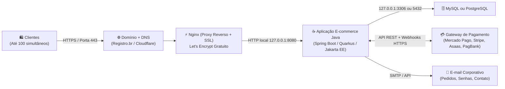

# 🛒 Requisitos de Hospedagem para E-commerce em Java (Até 100 Usuários Simultâneos)

> [!TIP]
> **Resumo Executivo:**
> Para publicar um e-commerce desenvolvido em **Java** (com **MySQL** ou **PostgreSQL**) atendendo até **100 usuários simultâneos**, os dois requisitos técnicos obrigatórios são **Domínio** e **Servidor VPS** (com Java, banco de dados, proxy reverso e **SSL/HTTPS** configurados). O **e-mail corporativo** é opcional para o site abrir, mas indispensável para credibilidade, notificações de pedidos, recuperação de senha e atendimento ao cliente.

---

## 📋 Índice

1. [Arquitetura e Itens Necessários](#-1-arquitetura-e-itens-necessários)
2. [Dimensionamento de Hardware (Java + Banco de Dados para 100 Usuários)](#-2-dimensionamento-de-hardware-java--banco-de-dados-para-100-usuários)
3. [Preparando o Ambiente na VPS (Java, Banco, Nginx e SSL)](#-3-preparando-o-ambiente-na-vps-java-banco-nginx-e-ssl)
4. [Gateways de Pagamento e E-mail Corporativo/Transacional](#-4-gateways-de-pagamento-e-e-mail-corporativotransacional)
5. [Referência Ilustrativa de Custos e Limites (Novembro de 2026)](#-5-referência-ilustrativa-de-custos-e-limites-novembro-de-2026)
6. [Cuidados e Armadilhas na Contratação de Serviços](#-6-cuidados-e-armadilhas-na-contratação-de-serviços)
7. [Checklist de Publicação e Próximos Passos](#-7-checklist-de-publicação-e-próximos-passos)

---

## 🧭 1. Arquitetura e Itens Necessários



### Os 3 pilares da contratação inicial

| Item | Obrigatoriedade para o site abrir | Papel no E-commerce |
| :--- | :--- | :--- |
| **1. Domínio** (`suaempresa.com.br`) | **Obrigatório** | Endereço profissional da loja e base para certificados SSL e e-mails corporativos. |
| **2. Servidor VPS (Linux)** | **Obrigatório** | Máquina virtual onde rodam o runtime **Java**, o **MySQL/PostgreSQL** e o **Nginx**. |
| **3. E-mail Corporativo** (`contato@...`) | Opcional para subir, **essencial para operar** | Envio de confirmações de pedido, recuperação de senha, suporte e credibilidade perante o cliente. |

### Dois requisitos técnicos obrigatórios dentro da VPS

Como uma VPS é entregue apenas com o sistema operacional Linux ("crua"), o responsável técnico precisará configurar:

1. **Certificado SSL (HTTPS):** É gratuito (via **Let's Encrypt**), porém **obrigatório**. Sem HTTPS válido, os navegadores exibem alerta de *"site não seguro"* (espantando compradores) e os gateways de pagamento (Pix/cartão) recusam *webhooks* e integrações em produção.
2. **Ambiente da aplicação:** Instalação do **Java (`JDK`/`JRE`)**, do banco de dados (**MySQL** ou **PostgreSQL**), do **Nginx** (ou Apache) como proxy reverso na porta `443` e do serviço de inicialização automática (`systemd`).

---

## ⚙️ 2. Dimensionamento de Hardware (Java + Banco de Dados para 100 Usuários)

Aplicações Java (especialmente **Spring Boot**) possuem consumo de memória base mais alto devido à JVM (*Heap* + *Metaspace* + *Threads*), e dividir a mesma máquina com um banco relacional exige margem de RAM e CPU para evitar lentidão ou quedas (*OutOfMemoryError*) durante picos de acesso simultâneo.

| Cenário de Carga | vCPU | Memória RAM | Disco NVMe | Avaliação Prática |
| :--- | :---: | :---: | :---: | :--- |
| **Homologação / Início muito leve** *(10–30 simultâneos)* | 1 vCPU | 4 GB | 40–50 GB | Funciona para testes e loja recém-aberta, mas **1 vCPU gargala rápido** se vários clientes finalizarem checkout ou gerarem relatórios ao mesmo tempo. |
| **Recomendado para até 100 usuários simultâneos** | **2 a 4 vCPU** | **8 GB** | **80 GB+** | **Ponto ideal de estabilidade:** permite reservar ~`2,5–3 GB` para a JVM (`-Xmx`), ~`2–3 GB` para cache/buffers do MySQL ou PostgreSQL e folga para Nginx, SO e backups. |
| **Expansão / Alta Concorrência** *(>100 simultâneos)* | 4+ vCPU | 8–16 GB *(ou BD separado)* | 100+ GB | Recomendável separar o banco de dados em outra VPS (ou serviço gerenciado) e adicionar **Redis** para cache de catálogo e sessões. |

> [!WARNING]
> **Atenção ao plano de 1 vCPU / 4 GB RAM:**
> Embora apareça como opção econômica inicial, se a loja realmente atingir picos próximos de **100 usuários simultâneos** (navegando, filtrando produtos e fechando carrinho no mesmo minuto), **1 núcleo de vCPU** costuma gerar fila de requisições e lentidão perceptível. Planeje iniciar com **2 vCPU / 4–8 GB** ou deixar o *upgrade* imediato previsto no orçamento.
>
> 💡 **Dica de Otimização de Custos:** se você compilar o sistema Java como binário nativo usando **GraalVM Native Image**, o consumo de memória cai de ~400–800 MB para **~40–165 MB**, liberando bastante RAM para o banco de dados em VPS menores. Veja o tutorial completo em [graalvm.md](./graavm.md).

---

## 🚀 3. Preparando o Ambiente na VPS (Java, Banco, Nginx e SSL)

Fluxo resumido para uma VPS com **Debian** ou **Ubuntu LTS**:

### 3.1. Instalar Java, Banco de Dados e Nginx

```bash
sudo apt update && sudo apt upgrade -y

# 1. Runtime Java LTS (ex.: OpenJDK 21)
sudo apt install -y openjdk-21-jre-headless

# 2. Escolha UM banco de dados: PostgreSQL OU MariaDB/MySQL
sudo apt install -y postgresql            # Opção PostgreSQL
# sudo apt install -y mariadb-server      # Opção compatível com MySQL

# 3. Proxy reverso e Certbot (Let's Encrypt SSL)
sudo apt install -y nginx certbot python3-certbot-nginx ufw
```

### 3.2. Proteger portas e manter o banco apenas local

Nunca exponha diretamente a porta da aplicação Java (`8080`) nem a porta do banco (`3306` ou `5432`) para a internet pública:

```bash
sudo ufw allow OpenSSH
sudo ufw allow 'Nginx Full'
sudo ufw enable
```

*(Para endurecimento avançado de portas e SSH na VPS, consulte [bloqueando-portas.md](../seguranca/bloqueando-portas.md).)*

### 3.3. Configurar o Nginx como Proxy Reverso + HTTPS

Crie `/etc/nginx/sites-available/ecommerce` apontando para a aplicação Java local (`127.0.0.1:8080`):

```nginx
server {
    listen 80;
    server_name sualoja.com.br www.sualoja.com.br;

    location / {
        proxy_pass http://127.0.0.1:8080;
        proxy_set_header Host $host;
        proxy_set_header X-Real-IP $remote_addr;
        proxy_set_header X-Forwarded-For $proxy_add_x_forwarded_for;
        proxy_set_header X-Forwarded-Proto $scheme;
    }
}
```

Ative o site e emita o certificado SSL gratuito com renovação automática:

```bash
sudo ln -s /etc/nginx/sites-available/ecommerce /etc/nginx/sites-enabled/
sudo nginx -t && sudo systemctl reload nginx
sudo certbot --nginx -d sualoja.com.br -d www.sualoja.com.br
```

### 3.4. Rodar a aplicação Java como serviço (`systemd`)

Em `/etc/systemd/system/ecommerce.service`, defina a memória máxima da JVM de acordo com a RAM disponível na VPS (exemplo abaixo dimensionado para uma VPS de 4 GB):

```ini
[Unit]
Description=Ecommerce Java Application
After=network.target

[Service]
User=www-data
WorkingDirectory=/opt/ecommerce
ExecStart=/usr/bin/java -Xms512m -Xmx2048m -jar /opt/ecommerce/app.jar
SuccessExitStatus=143
Restart=always
RestartSec=5

[Install]
WantedBy=multi-user.target
```

```bash
sudo systemctl daemon-reload
sudo systemctl enable --now ecommerce
```

---

## 💳 4. Gateways de Pagamento e E-mail Corporativo/Transacional

### 4.1. Pagamentos online (Pix, Cartão e Boleto)

Você **não precisa** contratar servidor ou infraestrutura extra para processar pagamentos. Basta criar uma conta comercial em um gateway (como **Mercado Pago**, **PagBank/PagSeguro**, **Asaas**, **Pagar.me** ou **Stripe**) e integrar a API REST no backend Java:

* Armazene *Client ID / Secret / Access Token* em variáveis de ambiente seguras (nunca no código-fonte).
* Implemente um endpoint HTTPS para receber **Webhooks** de confirmação de pagamento (validando a assinatura criptográfica enviada pelo gateway).

### 4.2. Por que usar E-mail Corporativo (e cuidados com envios automáticos)

O e-mail corporativo (`contato@sualoja.com.br`, `pedidos@sualoja.com.br`) é fundamental para:
* Receber e responder contatos de clientes e fornecedores com credibilidade.
* Enviar confirmações de pedido, atualizações de entrega e links de recuperação de senha.

> [!NOTE]
> **E-mail corporativo vs. E-mail transacional em escala:**
> Caixas de e-mail comuns possuem limite diário de envio (ex.: 1.000 mensagens/24h). Para o início da loja, funcionam bem; porém, se o volume de notificações automáticas ou campanhas crescer, vale separar os disparos do sistema para um provedor transacional dedicado (Amazon SES, Resend, Mailgun ou Postmark) mantendo o e-mail corporativo apenas para caixas humanas. Veja detalhes de DNS (`SPF`, `DKIM`, `DMARC`) e Google Workspace em [e-mail-corporativo.md](./e-mail-corporativo.md).

---

## 💰 5. Referência Ilustrativa de Custos e Limites (Novembro de 2026)

> [!NOTE]
> **Aviso sobre valores:** Os preços e limites abaixo são **referências meramente ilustrativas** obtidas em consulta de mercado em **novembro de 2026** e podem sofrer alterações promocionais ou reajustes. O cliente tem total liberdade para escolher qualquer provedor que atenda aos requisitos técnicos do sistema.

### 5.1. Exemplo de composição de infraestrutura

| Serviço | Provedor Exemplo | Especificação / Recurso | Custo Ilustrativo |
| :--- | :--- | :--- | :--- |
| **Registro de Domínio (`.com.br`)** | Registro.br | Titularidade direta no CPF/CNPJ do cliente | **R$ 40,00 / ano** |
| **Servidor VPS (Entrada)** | Hostinger (`KVM 1`) | 1 vCPU, 4 GB RAM, 50 GB NVMe, 4 TB banda | **R$ 29,99 / mês** *(1º ciclo)* → **R$ 59,99 / mês** *(renovação)* |
| **E-mail Corporativo** | Hostinger (por caixa) | 1 caixa profissional com domínio próprio | **R$ 2,49 / mês** |

*(Lembre-se de avaliar planos superiores como **2 vCPU / 8 GB RAM** caso haja picos reais próximos a 100 usuários simultâneos.)*

### 5.2. Exemplo de limites por caixa de E-mail Corporativo (Hostinger)

| Recurso | Limite de Referência |
| :--- | :--- |
| **Armazenamento por caixa de e-mail** | 5,00 GB |
| **Quantidade de mensagens por caixa** | 100.000 e-mails |
| **Limite de envio diário** | 1.000 envios a cada 24 horas |
| **Tamanho máximo do e-mail de saída** | 35 MB |
| **Tamanho máximo de anexos** | 25 MB |
| **Destinatários por mensagem (`Para`, `Cc`, `Cco`)** | 100 destinatários |
| **Aliases por caixa de e-mail** | 5 aliases |
| **Encaminhamentos por caixa de e-mail** | 5 encaminhamentos |

---

## ⚠️ 6. Cuidados e Armadilhas na Contratação de Serviços

Antes de fechar qualquer plano com o provedor escolhido, alerte o cliente sobre cinco pontos críticos:

1. **Subdimensionamento de recursos:** Planos básicos (como 1 vCPU) podem parecer suficientes no primeiro dia, mas não sustentam 100 usuários simultâneos durante promoções ou campanhas sem *upgrade*.
2. **Preço de renovação bem mais alto:** É comum planos anunciarem descontos agressivos no primeiro ciclo e dobrarem (ou triplicarem) o valor na renovação automática.
3. **Pegadinhas de assinatura e fidelidade:** Verifique se o menor preço mensal exibido exige contratação antecipada de **24 ou 48 meses**, e desmarque add-ons pré-selecionados no carrinho (como SSL pago, sendo que o Let's Encrypt é gratuito).
4. **O "barato que sai caro":** Provedores com planos extremamente baratos ou "gratuitos" geralmente exigem cartão de crédito cadastrado e aplicam cobranças surpresa por excedente de banda/CPU ou suspendem a conta abruptamente sem aviso prévio.
5. **Titularidade no nome do cliente:** Contrate domínio, VPS e gateway de pagamento sempre no **CPF/CNPJ e cartão do cliente**, nunca no seu nome como desenvolvedor. Documente todos os acessos conforme [handover.md](./handover.md).

---

## ✅ 7. Checklist de Publicação e Próximos Passos

- [ ] Registrar o domínio no CPF/CNPJ do cliente (consulte [quanto-cobrar-registro-dominio.md](./quanto-cobrar-registro-dominio.md)).
- [ ] Escolher e provisionar a VPS com margem de CPU/RAM compatível com picos esperados (consulte [quanto-cobrar-consultoria-hospedagem.md](./quanto-cobrar-consultoria-hospedagem.md)).
- [ ] Instalar Java LTS, MySQL/PostgreSQL (escutando só em `127.0.0.1`), Nginx, `systemd` e SSL via Certbot.
- [ ] Configurar e-mail corporativo com registros `MX`, `SPF`, `DKIM` e `DMARC` (consulte [e-mail-corporativo.md](./e-mail-corporativo.md)).
- [ ] Integrar e testar o gateway de pagamento em *sandbox* antes de virar para chaves de produção.
- [ ] Configurar backups automáticos externos do banco de dados antes da inauguração da loja.
- [ ] Entregar os acessos e documentação formal ao cliente ([handover.md](./handover.md)).
