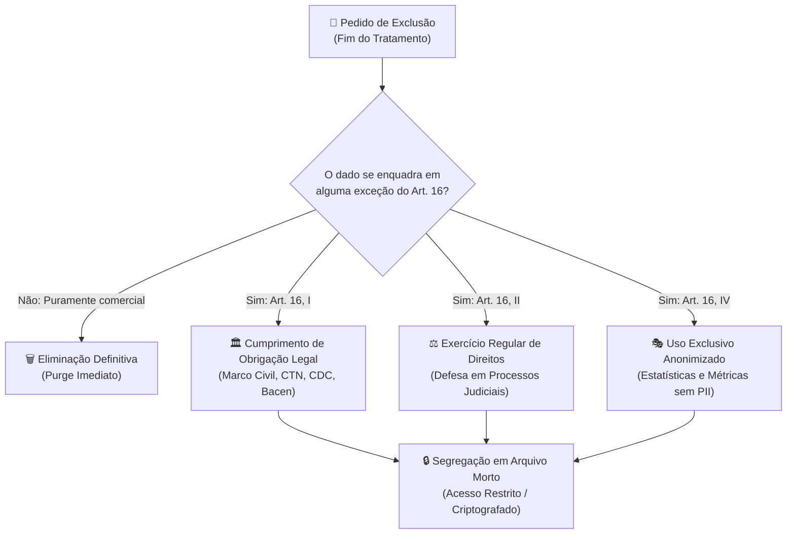
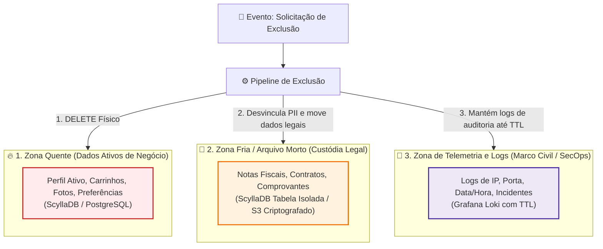
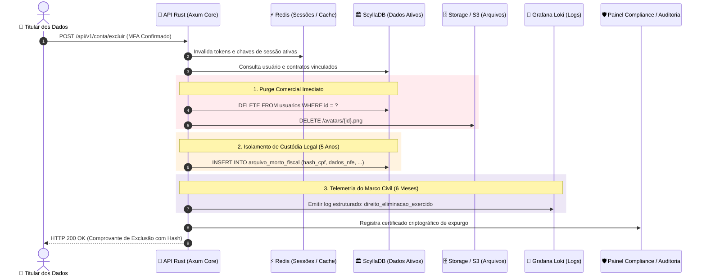

# LGPD e Engenharia de Software: Ciclo de Vida de Dados, Retenção Legal e Arquitetura de Exclusão

> A exclusão de contas e dados pessoais frequentemente gera um dilema aparente entre o **Direito à Eliminação** (Art. 18, VI e Art. 16 da LGPD) e as **Obrigações Legais de Guarda** impostas por leis como o Marco Civil da Internet, o Código Tributário Nacional e o Código de Defesa do Consumidor. Não se trata de uma contradição legislativa, mas de uma **coexistência planejada de normas**.

A própria LGPD (Lei nº 13.709/2018) estabeleceu expressamente em seu **Artigo 16** as hipóteses onde a empresa não apenas *pode*, mas **deve manter dados armazenados**, mesmo após o pedido formal de exclusão por parte do usuário.

Para os engenheiros de software e arquitetos de sistemas, o desafio reside em desenhar pipelines de dados capazes de **segregar dados comerciais (descartáveis)** de **dados fiscais e de auditoria (obrigatórios)**, garantindo conformidade jurídica sem comprometer a integridade operacional.

---

## 1. O Fundamento Legal da Retenção: Artigo 16 da LGPD

O Artigo 16 da LGPD estabelece que os dados pessoais devem ser eliminados após o término do seu tratamento. Contudo, o próprio artigo elenca **quatro salvaguardas explícitas** que autorizam e exigem a retenção:



### 1. Cumprimento de Obrigação Legal ou Regulatória (Art. 16, I)
A empresa deve reter dados quando outra lei federal ou órgão regulador (como Receita Federal, Banco Central, ANVISA ou CVM) exigir a sua guarda por prazos específicos.
* **Exemplo maior: Marco Civil da Internet (Lei nº 12.965/2014, Art. 15):** Obriga qualquer provedor de aplicações na internet a manter os **registros de acesso (IP, porta lógica, data e hora UTC)** sob sigilo pelo prazo mínimo de **6 meses**.

### 2. Exercício Regular de Direitos em Processos Judiciais (Art. 7º, VI e Art. 16, II)
A organização tem o direito constitucional de preservar evidências para se defender em eventuais litígios cíveis, trabalhistas ou consumeristas futuros.
* Se um usuário encerra a conta, mas pode contestar judicialmente uma entrega ou cobrança nos anos seguintes, os contratos, comprovantes de aceite de termos e transações devem ser retidos pelo prazo prescricional da ação (tipicamente de **3 a 5 anos**).

### 3. Segurança do Controlador e Prevenção a Fraudes (Art. 7º, IX e Art. 11, II, "g")
O tratamento para fins de segurança de redes e integridade de sistemas é respaldado pelo Legítimo Interesse.
* O IP de um atacante que realizou tentativas de DoS com payloads anômalos (como visto no tutorial de [Resposta a Payloads Anômalos](/seguranca/reagir-payloads-grandes.md)) pode ser retido temporariamente no Redis e auditado no Loki como evidência forense de legítima defesa cibernética.

---

## 2. Prazos Legais de Retenção Obrigatória no Brasil (Tabela Mestre)

| Categoria do Dado | Legislação de Origem | Prazo Obrigatório | Destino na Arquitetura | Ação ao Expirar o Prazo |
| :--- | :--- | :---: | :--- | :--- |
| **Preferências / Marketing** | Consentimento (LGPD Art. 7º, I) | 0 dias (Imediato) | ScyllaDB / Redis / CRM | **Deleção física permanente (Purge)** |
| **Registros de Conexão** | Marco Civil (Lei 12.965/14, Art. 15) | **6 meses** | Grafana Loki (Logs) | Expiração automática (TTL de retenção) |
| **Notas Fiscais / Faturamento** | Código Tributário Nacional (Art. 173/174) | **5 anos** | ScyllaDB (Tabela de Arquivo) | Descarte seguro ou anonimização |
| **Contratos e Aceite de Termos** | Código de Defesa do Consumidor (Art. 27) | **5 anos** | Object Storage Criptografado (S3) | Destruição de chave ou expurgo |
| **Registros Trabalhistas (RH)** | CLT e Constituição Federal (Art. 7º, XXIX) | **5 a 20 anos** | Storage Frio (Glacier / Cold) | Purge definitivo após prescrição |
| **Logs de Ataques e Incidentes** | LGPD (Legítimo Interesse de Segurança) | **1 a 5 anos** | Grafana Loki / S3 WORM | Expiração conforme política de SecOps |

---

## 3. As Três Zonas de Dados em Engenharia de Software

Uma arquitetura orientada à conformidade não mistura dados de tráfego comum com registros de custódia legal. A segregação é estruturada em três zonas operacionais:



### 1. Zona Quente (Dados Ativos e Comerciais)
* **O que contém:** Nome fantasia, avatar, histórico de navegação, interesses, listas de desejos e tokens de sessão.
* **Tratamento na Exclusão:** **Expurgo Imediato (*Hard Delete*)**. Nenhum desses dados pode permanecer em índices de busca (Elasticsearch), caches (Redis) ou tabelas ativas da aplicação.

### 2. Zona Fria / Arquivo Morto (Dados Fiscais e Contratuais)
* **O que contém:** Dados estritamente necessários para prestar contas à Receita Federal ou responder a ações judiciais (ID fiscal, data de transação, valor faturado, logs de auditoria de aceite de contrato).
* **Tratamento na Exclusão:** O vínculo com a identidade civil do usuário é quebrado ou pseudonimizado. Os registros são movidos para tabelas isoladas ou *buckets* de custódia fria com acesso estritamente restrito a oficiais de compliance (DPO) e corpo jurídico via MFA.

### 3. Zona de Telemetria e Logs (Marco Civil da Internet)
* **O que contém:** Linhas de log geradas pela camada HTTP com o mapeamento entre `user_id`, endereço IP de origem, porta lógica e timestamp UTC.
* **Tratamento na Exclusão:** Mantidos no **Grafana Loki** até o vencimento exato da janela de 6 meses exigida pelo Marco Civil, sendo descartados automaticamente pelo mecanismo de retenção do storage.

---

## 4. Padrões de Implementação Técnica

### 1. O Anti-Pattern do "Soft Delete" Ingênuo
Muitos desenvolvedores acreditam que atender à LGPD resume-se a adicionar uma coluna `deleted_at: Option<DateTime>` na tabela de usuários e filtrar `WHERE deleted_at IS NULL` nas consultas da API.

> [!WARNING]
> **Por que o soft delete tradicional viola a LGPD:**
> Se o usuário solicitou a exclusão e seu e-mail, telefone, CPF e foto continuam legíveis na tabela do banco de dados (mesmo marcados com flag de deletado), o dado pessoal **continua sob tratamento indevido**. Em caso de vazamento (*data breach*), a empresa será penalizada pela ANPD por manter dados sem base legal ativa.

### 2. Anonimização vs. Pseudonimização (Art. 12 da LGPD)

* **Pseudonimização (Art. 13, § 4º):** O dado pessoal tem seus identificadores diretos substituídos por uma chave fictícia (ex: UUID ou Hash), mas ainda é possível reidentificar o titular se você possuir a tabela de correlação mantida em ambiente separado e seguro. **Dados pseudonimizados continuam sujeitos à LGPD.**
* **Anonimização (Art. 12):** O dado perde qualquer possibilidade de associação direta ou indireta ao indivíduo, considerando a utilização de meios técnicos razoáveis e disponíveis na ocasião de seu tratamento. **Dados verdadeiramente anonimizados deixam de ser considerados dados pessoais perante a lei.**

### 3. A Técnica do *Crypto-Shredding* (Destruição Criptográfica)
Em sistemas modernos com backups imutáveis baseados em snapshots ou armazenamento WORM (*Write Once, Read Many*), apagar fisicamente um registro específico de um arquivo de backup de 30 dias atrás pode ser computacionalmente inviável.

A solução padrão da indústria é o **Crypto-Shredding**:
1. Cada usuário possui uma **chave de criptografia individual (DEK - Data Encryption Key)** gerenciada por um cofre (KMS / HashiCorp Vault).
2. Os dados sensíveis do usuário são criptografados em repouso com sua respectiva DEK.
3. Quando o usuário exerce o direito de exclusão, a aplicação **destrói irrevogavelmente a DEK do usuário**.
4. Sem a chave, os dados sensíveis tornam-se cifras matemáticas indecifráveis em todos os bancos, réplicas e backups históricos, equivalendo tecnicamente à destruição definitiva.

---

## 5. Implementação Prática em Rust: Pipeline de Anonimização

O código a seguir demonstra o processo seguro de transformação de um usuário ativo em um registro arquivado de conformidade, garantindo a eliminação de dados de marketing e a pseudonimização dos dados contratuais:

```rust
use chrono::{DateTime, Utc};
use serde::{Deserialize, Serialize};
use uuid::Uuid;

/// Entidade de Domínio em uso operacional (Zona Quente)
#[derive(Debug, Clone, Serialize, Deserialize)]
pub struct UsuarioAtivo {
    pub id: Uuid,
    pub nome_completo: String,
    pub email: String,
    pub cpf: String,
    pub telefone: String,
    pub avatar_url: Option<String>,
    pub aceitou_marketing: bool,
    pub data_criacao: DateTime<Utc>,
}

/// Registro Histórico de Custódia Legal (Zona Fria / Arquivo Morto)
/// Preserva apenas o estritamente exigido pelo CTN e CDC, desprovido de dados comerciais.
#[derive(Debug, Clone, Serialize, Deserialize)]
pub struct RegistroCustodiaLegal {
    pub usuario_id: Uuid,
    // CPF anonimizado preservando apenas hash para conciliação fiscal
    pub hash_fiscal_cpf: String,
    pub status: StatusCustodia,
    pub data_solicitacao_expurgo: DateTime<Utc>,
    pub data_limite_retencao_legal: DateTime<Utc>,
}

#[derive(Debug, Clone, Serialize, Deserialize)]
pub enum StatusCustodia {
    AnonimizadoParaFinsFiscais,
}

impl UsuarioAtivo {
    /// Executa o pipeline de expurgo em conformidade com a LGPD
    pub fn expurgar_dados_comerciais(self) -> (RegistroCustodiaLegal, Vec<String>) {
        // 1. Identifica artefatos externos que devem ser fisicamente deletados
        let mut recursos_para_purge_fisico = Vec::new();
        if let Some(avatar) = self.avatar_url {
            recursos_para_purge_fisico.push(avatar);
        }

        // 2. Calcula data limite de guarda legal (5 anos para CDC / Código Tributário)
        let agora = Utc::now();
        let limite_retencao = agora + chrono::Duration::days(5 * 365);

        // 3. Gera hash unidirecional seguro (HMAC/SHA256) do CPF para fins fiscais
        let hash_cpf = ring::digest::digest(&ring::digest::SHA256, self.cpf.as_bytes());
        let hash_hex = hex::encode(hash_cpf.as_ref());

        // 4. Cria o registro morto de auditoria (sem nome, email, telefone ou foto)
        let registro_arquivo = RegistroCustodiaLegal {
            usuario_id: self.id,
            hash_fiscal_cpf: hash_hex,
            status: StatusCustodia::AnonimizadoParaFinsFiscais,
            data_solicitacao_expurgo: agora,
            data_limite_retencao_legal: limite_retencao,
        };

        // 5. Emissão de Log Estruturado de Auditoria (sem vazar PII)
        tracing::info!(
            target: "auditoria_lgpd",
            usuario_id = %self.id,
            acao = "direito_eliminacao_exercido",
            prazo_legal_retencao_anos = 5,
            "Conta de usuário purgada. Dados comerciais deletados e dados fiscais isolados."
        );

        (registro_arquivo, recursos_para_purge_fisico)
    }
}
```

---

## 6. Configuração de Retenção Automática nas Ferramentas

Para evitar que dados fiquem armazenados além dos prazos estritos da lei, configure políticas de expiração automática (*Time to Live*) nos componentes da infraestrutura:

### 1. Retenção de 6 Meses no Grafana Loki (Marco Civil da Internet)
No arquivo de configuração do Loki (`loki-config.yaml`), ative o `compactor` para purgar logs de conexões HTTP após 180 dias:

```yaml
compactor:
  working_directory: /loki/compactor
  compaction_interval: 10m
  retention_enabled: true
  retention_delete_delay: 2h

limits_config:
  # Retenção padrão de 180 dias (6 meses - Marco Civil da Internet)
  retention_period: 180d
  
  per_stream_limits:
    # Logs operacionais descartáveis expiram em 14 dias
    - selector: '{env="dev"}'
      priority: 1
      retention_period: 14d
```

### 2. TTL Nativo no ScyllaDB / Cassandra
Para tabelas de tokens, sessões e logs de acesso temporários, utilize a instrução nativa `DEFAULT_TIME_TO_LIVE`:

```sql
-- Registros de sessão de login expiram automaticamente em 30 dias
CREATE TABLE IF NOT EXISTS api_keyspace.sessoes_ativas (
    usuario_id uuid,
    token_sessao text,
    ip_conexao inet,
    data_login timestamp,
    PRIMARY KEY (usuario_id, token_sessao)
) WITH DEFAULT_TIME_TO_LIVE = 2592000; -- 30 dias em segundos
```

### 3. Ciclo de Vida no Armazenamento de Objetos (AWS S3 / MinIO)
Para notas fiscais em PDF e contratos assinados retidos por 5 anos:
* **0 a 90 dias:** Armazenamento padrão (S3 Standard).
* **91 a 1.825 dias (5 anos):** Transição automática para arquivo frio (*S3 Glacier Flexible Retrieval*), reduzindo custos de armazenamento em até 80%.
* **Após 1.825 dias:** Regra de expiração definitiva (*Expiration Action*), deletando o objeto automaticamente.

---

## 7. Diagrama Arquitetural do Ciclo de Exclusão

O diagrama abaixo ilustra o fluxo orquestrado quando o usuário aciona a funcionalidade "Excluir Minha Conta":



---

## 8. Resumo e Regras de Ouro para Engenheiros de Software

1. **A exclusão da LGPD não revoga o Marco Civil:** Mantenha os registros de conexão (endereço IP, porta lógica e timestamp) por no mínimo **6 meses**, configurando retenção automática no Grafana Loki.
2. **Dados fiscais e contratos exigem guarda de 5 anos:** Documentos tributários (NF-e, comprovantes de faturamento) devem ser retidos por 5 anos conforme o Código Tributário Nacional, mas desvinculados do acesso da aplicação comercial.
3. **Abandone o Soft Delete Ingênuo:** Não mantenha e-mail, telefone e dados pessoais sensíveis na tabela ativa sob a justificativa de `deleted_at`. Anonimize o registro ou mova-o para uma tabela isolada de arquivo morto.
4. **Aplique o Princípio da Minimização:** Colete apenas os dados estritamente necessários para a finalidade da aplicação. Quanto menos dados pessoais você armazena, menor é o passivo regulatório em caso de incidente de segurança.
5. **Automação via TTL:** Utilize políticas de ciclo de vida nativas nos bancos e no storage (TTL no Redis e ScyllaDB, retenção no Loki e Lifecycle no S3) para garantir que dados expirados sejam destruídos sem intervenção humana manual.

---

### Leituras Complementares no Guia:
* [Stack de Coleta e Centralização de Logs](/seguranca/stack-de-coleta-de-logs.md)
* [Segurança Proativa: Monitoramento e Resposta a Payloads Anômalos em Rust](/seguranca/reagir-payloads-grandes.md)
* [Ofuscamento de Rotas Administrativas e Defesa em Profundidade](/seguranca/ofuscamento-rotas-admin.md)
