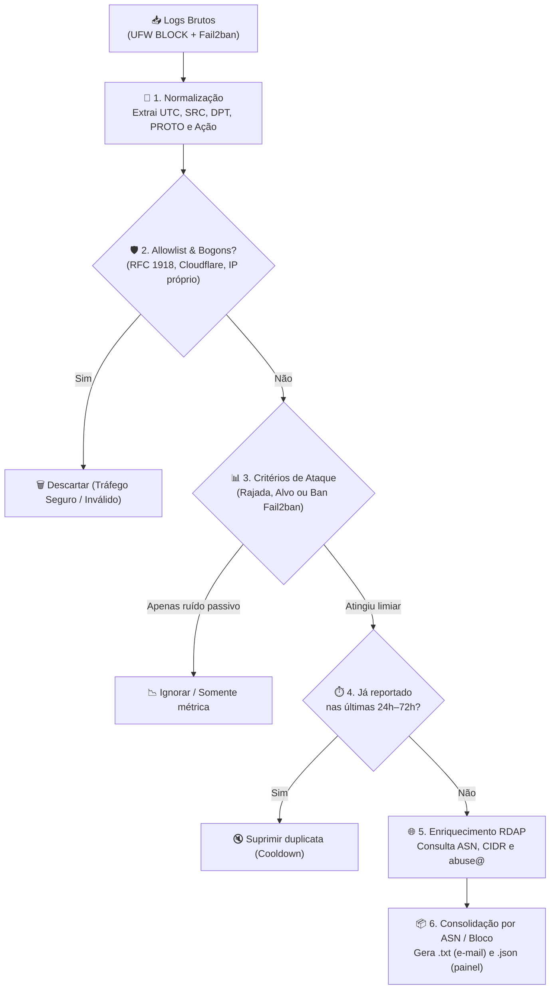

# Automação de Relatórios de Segurança (`abuse@`): Triagem de Logs UFW/Fail2ban e Binário CLI em Rust

> Em uma VPS com recursos limitados, um binário CLI dedicado para triagem de logs costuma ser uma escolha muito mais enxuta e previsível do que manter uma pilha completa de observabilidade (como ELK ou Loki/Grafana) apenas para detectar e denunciar ataques de rede. Quando o objetivo é **transformar bloqueios de firewall e banimentos em denúncias técnicas de alta precisão para endereços `abuse@`**, processar eventos localmente via código dá controle total sobre limiares, deduplicação e eliminação de falsos positivos.

A principal vantagem de filtrar e correlacionar os dados antes de gerar qualquer relatório é evitar que seu servidor envie denúncias contra **ruído legítimo da internet**, como *crawlers* verificados de buscadores, pesquisas acadêmicas (ex.: Shodan, Censys) ou erros pontuais de roteamento, concentrando os esforços exclusivamente em **infraestrutura maliciosa reincidente**.

---

## 1. Quando Usar um Pipeline CLI Leve vs. Stack Completa de Logs

Antes de implementar a automação, vale situar onde essa abordagem se encaixa em relação a uma [Stack Completa de Coleta de Logs](/seguranca/stack-de-coleta-de-logs.md):

| Critério | Binário CLI Dedicado (UFW + Fail2ban) | Stack Completa (Alloy/Vector + Loki + Grafana) |
| :--- | :--- | :--- |
| **Consumo de RAM / CPU** | 🟢 Mínimo (executa sob demanda via `systemd` e encerra) | 🟡/🔴 Contínuo (daemons ativos 24/7 + indexação/cache) |
| **Propósito Principal** | Triagem automática, enriquecimento RDAP e geração de relatórios `abuse@` | Observabilidade distribuída, dashboards, LogQL e auditoria histórica |
| **Acoplamento com a API** | 🟢 Zero (lê logs do SO em processo isolado) | 🟢 Baixo (coleta via `stdout` / container) |
| **Complexidade Operacional** | 🟢 Um executável + dois arquivos `systemd` | 🟡 Docker Compose / clusters / retenção em Object Storage |
| **Cenário Ideal** | VPS enxuta, servidor único ou camada complementar de resposta a incidentes | Múltiplos serviços, times de SRE/SecOps e correlação distribuída |

> [!TIP]
> As duas abordagens não são excludentes: você pode manter a stack de logs apenas para telemetria da aplicação e usar um binário CLI isolado para processar os logs de borda do sistema operacional (`UFW` e `Fail2ban`).

---

## 2. Critérios para Separar Ataques Reais de Ruído da Internet

Provedores de hospedagem, operadoras e equipes de CSIRT/Abuse recebem milhares de notificações automatizadas por dia. Relatórios sem critério ou com falsos positivos são ignorados rapidamente, ou pior, levam o seu e-mail/domínio a listas de bloqueio.

O fluxo de triagem deve agir como um funil progressivo:



Para alcançar alta taxa de aceitação pelas equipes de abuso, o motor de triagem deve avaliar quatro sinais combinados:

### 1. Frequência e Rajada (*Burst Rate*)
* **Ruído:** `1` a `5` pacotes bloqueados pelo UFW em portas aleatórias distribuídos ao longo de várias horas (varredura passiva de fundo da internet).
* **Ataque:** Dezenas de tentativas em poucos segundos ou reincidência contínua em janelas curtas (ex.: **mais de 20 bloqueios em 1 minuto** ou **mais de 100 eventos na janela de 1 hora**).

### 2. Alvo, Intenção e Confirmação Multi-Sinal
* **Ruído:** *Port scan* genérico e isolado em portas fechadas sem continuidade.
* **Ataque:**
  * Tentativas repetidas de força bruta no SSH (confirmadas por evento de `Ban` no `/var/log/fail2ban.log`).
  * Varredura sequencial direcionada a portas de administração e bancos de dados (`22`, `23`, `3306`, `5432`, `6379`, `27017`, `9200`).
  * **Cuidado com UDP *Spoofing*:** Em pacotes `PROTO=UDP`, o IP de origem pode ser facilmente forjado (*IP spoofing* em ataques de reflexão/amplificação DNS, NTP ou SSDP). Dê prioridade a conexões **`PROTO=TCP` com flag `SYN`** ou falhas confirmadas em camada de aplicação (Fail2ban/Nginx), evitando denunciar vítimas de falsificação de IP.

### 3. Lista de Exclusão (*Allowlist* e Endereços Reservados)
Antes de qualquer consulta externa, descarte obrigatoriamente:
* **Endereços privados e reservados (*Bogons* / RFC 1918 / RFC 6598):** `127.0.0.0/8`, `10.0.0.0/8`, `172.16.0.0/12`, `192.168.0.0/16`, `100.64.0.0/10` (CGNAT), `169.254.0.0/16`, `::1/128`, `fc00::/7`, `fe80::/10`.
* **Sua própria infraestrutura:** IP estático do escritório, VPN administrativa e servidores de monitoramento (*healthcheck* / UptimeRobot).
* **Infraestrutura legítima conhecida:** Faixas oficiais de proxies reversos que você utiliza (ex.: Cloudflare) e *crawlers* verificados (Googlebot, Bingbot, preferencialmente validados via faixas JSON oficiais publicadas pelos próprios provedores ou *Forward-Confirmed reverse DNS*).

### 4. Enriquecimento via RDAP e Consolidação por ASN
Em vez de executar o comando `whois` e lidar com formatos de texto inconsistentes entre diferentes registros regionais (ARIN, RIPE, LACNIC, APNIC, AFRINIC), utilize o protocolo moderno **RDAP (*Registration Data Access Protocol*, RFCs 7480–7484)**.
* **Por que RDAP é superior:** Responde via HTTPS em **JSON estruturado e padronizado**, possui serviço de *bootstrap* global (ex.: `https://rdap.org/ip/{ip}`) que redireciona automaticamente para o RIR autoritativo do bloco, e expõe o e-mail de abuso dentro de entidades com papel (`"roles": ["abuse"]`).
* **Consolidação por ASN / Bloco CIDR:** Se 8 IPs diferentes pertencentes ao mesmo bloco ou ASN atacarem sua VPS na mesma janela, agrupe-os em **um único relatório consolidado** direcionado ao contato `abuse@` responsável, em vez de disparar 8 e-mails separados.

---

## 3. Anatomia dos Logs de Origem (UFW e Fail2ban)

Para construir um parser confiável, é essencial conhecer o formato exato emitido pelo kernel/UFW e pelo Fail2ban.

### Logs do UFW via `journalctl` (em UTC)
O comando `journalctl -g "UFW BLOCK" --utc --no-pager` (ou, caso seu `journalctl` não possua suporte a PCRE2 para `-g`, `journalctl -k -o short-iso --utc --no-pager | grep "UFW BLOCK"`) gera linhas como esta:

```text
2026-11-22T18:14:02+0000 vps-prod kernel: [148291.402112] [UFW BLOCK] IN=eth0 OUT= MAC=52:54:00:ab:cd:ef SRC=198.51.100.42 DST=203.0.113.10 LEN=60 TOS=0x00 PREC=0x00 TTL=51 ID=41234 DF PROTO=TCP SPT=54812 DPT=22 WINDOW=64240 RES=0x00 SYN URGP=0
```

Campos indispensáveis para o relatório:
* **Timestamp UTC:** `2026-11-22T18:14:02+0000` (o uso de `--utc` elimina ambiguidades de fuso horário e horário de verão para o provedor receptor).
* **`SRC=`:** Endereço IPv4 ou IPv6 de origem (o infrator).
* **`DST=`:** Endereço IP de destino (sua VPS, pode ser mascarado ou omitido conforme sua política interna se necessário, mas normalmente ajuda o NOC a validar o tráfego).
* **`PROTO=`:** Protocolo (`TCP`, `UDP`, `ICMP`).
* **`SPT=` e `DPT=`:** Porta de origem e porta de destino. **Manter o `SPT=` é crucial**, pois quando o IP de origem está atrás de um CGNAT (*Carrier-Grade NAT*), o provedor só consegue identificar o assinante específico cruzando `IP + Porta de Origem + Timestamp UTC`.

### Logs do Fail2ban (`/var/log/fail2ban.log`)
O Fail2ban registra ações de banimento indicando a *jail* violada (ex.: `sshd`, `nginx-botsearch`):

```text
2026-11-22 18:15:10,412 fail2ban.actions        [1042]: NOTICE  [sshd] Ban 198.51.100.42
```

> [!IMPORTANT]
> **Atenção ao fuso horário do Fail2ban:** Por padrão, o `/var/log/fail2ban.log` registra timestamps no **fuso horário local do sistema** (ex.: `America/Sao_Paulo`), enquanto o `journalctl --utc` entrega timestamps em UTC. Se sua VPS não estiver configurada com timezone `UTC`, converta o horário do Fail2ban para UTC antes de incluí-lo no relatório final.

---

## 4. Pipeline de Execução e Escolha da Linguagem

Independentemente da linguagem adotada, o pipeline deve seguir quatro estágios bem definidos:

1. **Coleta:** Lê a janela das últimas $N$ horas de `journalctl` (`--since "1 hour ago"`) e as linhas recentes de `/var/log/fail2ban.log`.
2. **Normalização:** Extrai `Timestamp (UTC)`, `IP de Origem`, `Porta de Origem`, `Porta de Destino`, `Protocolo` e eventual `Jail` do Fail2ban.
3. **Triagem (Regras de Negócio):** Descarta *allowlist*/bogons, aplica os limiares de rajada, eleva a pontuação de IPs banidos no Fail2ban e verifica o histórico de *cooldown*.
4. **Enriquecimento e Saída:** Consulta o RDAP para obter ASN/bloco/contato `abuse@`, consolida por provedor e grava os relatórios prontos em disco (`.txt` em inglês técnico para e-mail + `.json` estruturado para revisão).

### Python vs. Rust: Qual Escolher?

| Aspecto | Python (Stdlib: `subprocess`, `re`, `ipaddress`, `urllib`) | Rust (Binário CLI Compilado) |
| :--- | :--- | :--- |
| **Velocidade de Prototipação** | 🟢 Muito rápida (script único sem compilação) | 🟡 Moderada (compilação e tipagem estática) |
| **Consumo em VPS** | 🟡 Carrega interpretador Python (~20–40 MB RAM) | 🟢 Mínimo (~2–8 MB RAM, execução em milissegundos) |
| **Dependências em Produção** | Requer runtime Python compatível no servidor | Zero runtime (binário único estático ou dinâmico mínimo) |
| **Segurança de Tipos (IP/CIDR)** | Tipagem dinâmica (`ipaddress`) | Tipagem forte em tempo de compilação (`IpAddr`, `IpNet`) |

Para ambientes de produção com orçamento enxuto de memória ou que já utilizam Rust no backend, **um binário CLI em Rust** oferece o melhor equilíbrio entre segurança, previsibilidade e baixo impacto.

---

## 5. Arquitetura Desacoplada: Binário CLI Rust + Backoffice Axum

Um erro arquitetural comum é embutir a leitura de logs do sistema operacional (`journalctl`, `/var/log/*`) diretamente dentro do servidor web principal (como uma API em **Axum**). Isso viola o princípio de menor privilégio e acopla responsabilidades de infraestrutura à camada HTTP:

* O servidor web passaria a exigir acesso ao grupo `adm` ou `systemd-journal` (aumentando o raio de impacto caso ocorra uma vulnerabilidade na aplicação web).
* Consultas pesadas de regex ou chamadas HTTP externas para RDAP poderiam disputar CPU ou descritores de arquivo com requisições legítimas de clientes.

A arquitetura recomendada mantém **isolamento total por meio do sistema de arquivos**:

```mermaid
graph LR
    classDef sys fill:#fff3e0,stroke:#ef6c00,stroke-width:2px;
    classDef cli fill:#e8f5e9,stroke:#2e7d32,stroke-width:2px;
    classDef fs fill:#ede7f6,stroke:#4527a0,stroke-width:2px;
    classDef web fill:#e1f5fe,stroke:#0288d1,stroke-width:2px;

    Timer["⏱️ systemd timer<br/>(Execução horária/diária)"]:::sys -->|Dispara Type=oneshot| CLI["🦀 Binário CLI: abuse-reporter<br/>(Grupo: systemd-journal, adm)"]:::cli
    Logs["📜 Logs do SO<br/>(journalctl + fail2ban.log)"]:::sys -->|Leitura| CLI
    RDAP["🌐 API Pública RDAP<br/>(rdap.org)"]:::sys <-->|Consulta ASN & abuse@| CLI
    CLI -->|Grava relatórios prontos| Dir[("📁 /var/lib/abuse-reports/<br/>(*.txt, *.json, state.json)")]:::fs
    Dir -.->|Leitura sob demanda<br/>(Read-Only)| Axum["🚀 Backoffice Axum<br/>(Painel Administrativo)"]:::web
```

Dessa forma:
1. O binário `abuse-reporter` executa por poucos milissegundos via `systemd timer`, processa os eventos, salva os artefatos em `/var/lib/abuse-reports/` e encerra.
2. O processo do **Axum** nunca toca em logs do sistema operacional nem faz consultas RDAP em tempo real: caso você deseje revisar ou aprovar relatórios pelo painel administrativo, o Axum apenas lê os arquivos `.json` ou `.txt` já consolidados nessa pasta (em modo somente leitura).

---

## 6. Implementação Prática em Rust Enxuto

Para economizar recursos e manter o tempo de compilação baixo, o binário evita puxar um runtime assíncrono completo (`tokio` + `reqwest`) para uma tarefa síncrona de linha de comando.

### 1. Dependências Mínimas (`Cargo.toml`)

```toml
[package]
name = "abuse-reporter"
version = "0.1.0"
edition = "2021"

[dependencies]
ipnet = "2.10"                                       # Comparação eficiente de faixas CIDR (allowlist/bogons)
regex = "1.11"                                       # Parsing de linhas UFW e Fail2ban
serde = { version = "1.0", features = ["derive"] }   # Serialização de relatórios e estado de cooldown
serde_json = "1.0"                                   # Parsing de respostas RDAP JSON e saída para o backoffice
ureq = { version = "2.12", features = ["json"] }     # Cliente HTTP síncrono ultraleve para consultar RDAP
```

### 2. Estrutura Modular da Solução (`src/main.rs`)

O exemplo abaixo demonstra o núcleo completo do fluxo: coleta de `journalctl` e `/var/log/fail2ban.log` (usando `std::io::BufReader` sobre `std::fs::File`), filtro de *allowlist* via `ipnet`, pontuação de ataque, consulta RDAP com espaçamento entre chamadas e geração dos relatórios consolidados em `.json` (prontos para leitura pelo backoffice ou renderização no template `.txt` da seção seguinte).

```rust
use ipnet::IpNet;
use regex::Regex;
use serde::{Deserialize, Serialize};
use std::collections::{HashMap, HashSet};
use std::fs::{self, File};
use std::io::{BufRead, BufReader};
use std::net::IpAddr;
use std::path::Path;
use std::process::Command;
use std::time::{Duration, SystemTime, UNIX_EPOCH};

const FAIL2BAN_LOG: &str = "/var/log/fail2ban.log";
const OUTPUT_DIR: &str = "/var/lib/abuse-reports";
const MIN_UFW_BLOCKS: usize = 20;

#[derive(Debug, Clone, Serialize)]
struct SecurityEvent {
    timestamp_utc: String,
    src_ip: IpAddr,
    src_port: Option<u16>,
    dst_port: Option<u16>,
    proto: String,
    raw_line: String,
}

#[derive(Debug, Serialize)]
struct ConsolidatedReport {
    asn_or_network: String,
    abuse_email: String,
    ips: Vec<IpAddr>,
    total_ufw_blocks: usize,
    fail2ban_jails: Vec<String>,
    sample_logs: Vec<String>,
}

#[derive(Debug, Deserialize)]
struct RdapResponse {
    handle: Option<String>,
    name: Option<String>,
    #[serde(default)]
    entities: Vec<RdapEntity>,
}

#[derive(Debug, Deserialize)]
struct RdapEntity {
    #[serde(default)]
    roles: Vec<String>,
    #[serde(rename = "vcardArray")]
    vcard_array: Option<serde_json::Value>,
    #[serde(default)]
    entities: Vec<RdapEntity>,
}

/// Constrói a allowlist padrão com faixas reservadas (RFC 1918 / Bogons) e IPs confiáveis.
fn build_allowlist() -> Vec<IpNet> {
    let cidrs = [
        "127.0.0.0/8",
        "10.0.0.0/8",
        "172.16.0.0/12",
        "192.168.0.0/16",
        "100.64.0.0/10", // CGNAT
        "169.254.0.0/16",
        "::1/128",
        "fc00::/7",
        "fe80::/10",
        // Adicione aqui faixas da Cloudflare ou seu IP administrativo:
        // "203.0.113.50/32",
    ];
    cidrs.iter().filter_map(|c| c.parse().ok()).collect()
}

fn is_allowlisted(ip: IpAddr, allowlist: &[IpNet]) -> bool {
    allowlist.iter().any(|net| net.contains(&ip))
}

/// Coleta bloqueios do UFW das últimas 1 hora em UTC via journalctl.
fn collect_ufw_events(allowlist: &[IpNet]) -> Vec<SecurityEvent> {
    let output = Command::new("journalctl")
        .args(["-g", "UFW BLOCK", "--utc", "--since", "1 hour ago", "--no-pager", "-o", "short-iso"])
        .output();

    let Ok(out) = output else {
        eprintln!("Falha ao executar journalctl");
        return Vec::new();
    };

    let re = Regex::new(
        r"^(\S+)\s+.*\[UFW BLOCK\].*SRC=([^\s]+).*PROTO=([^\s]+)(?:.*SPT=(\d+))?(?:.*DPT=(\d+))?",
    )
    .expect("Regex UFW inválida");

    let stdout = String::from_utf8_lossy(&out.stdout);
    let mut events = Vec::new();

    for line in stdout.lines() {
        // Ignora pacotes UDP sem confirmação para reduzir risco de falso positivo por IP spoofing
        if line.contains("PROTO=UDP") {
            continue;
        }
        if let Some(caps) = re.captures(line) {
            if let Ok(ip) = caps[2].parse::<IpAddr>() {
                if is_allowlisted(ip, allowlist) {
                    continue;
                }
                events.push(SecurityEvent {
                    timestamp_utc: caps[1].to_string(),
                    src_ip: ip,
                    proto: caps[3].to_string(),
                    src_port: caps.get(4).and_then(|m| m.as_str().parse().ok()),
                    dst_port: caps.get(5).and_then(|m| m.as_str().parse().ok()),
                    raw_line: line.to_string(),
                });
            }
        }
    }
    events
}

/// Coleta IPs banidos recentemente no /var/log/fail2ban.log usando std::io::BufReader.
fn collect_fail2ban_bans(allowlist: &[IpNet]) -> HashMap<IpAddr, HashSet<String>> {
    let mut bans: HashMap<IpAddr, HashSet<String>> = HashMap::new();
    let Ok(file) = File::open(FAIL2BAN_LOG) else {
        return bans;
    };

    let re = Regex::new(r"NOTICE\s+\[([^\]]+)\]\s+Ban\s+([^\s]+)").expect("Regex Fail2ban inválida");
    let reader = BufReader::new(file);

    for line in reader.lines().map_while(Result::ok) {
        if let Some(caps) = re.captures(&line) {
            if let Ok(ip) = caps[2].parse::<IpAddr>() {
                if !is_allowlisted(ip, allowlist) {
                    bans.entry(ip).or_default().insert(caps[1].to_string());
                }
            }
        }
    }
    bans
}

/// Extrai recursivamente o e-mail de contato da entidade com role "abuse" no JSON RDAP (jCard).
fn extract_abuse_email(entities: &[RdapEntity]) -> Option<String> {
    for entity in entities {
        if entity.roles.iter().any(|r| r == "abuse") {
            if let Some(vcard) = &entity.vcard_array {
                if let Some(fields) = vcard.get(1).and_then(|v| v.as_array()) {
                    for field in fields {
                        let is_email = field.get(0).and_then(|k| k.as_str()) == Some("email");
                        if is_email {
                            if let Some(addr) = field.get(3).and_then(|v| v.as_str()) {
                                return Some(addr.to_string());
                            }
                        }
                    }
                }
            }
        }
        if let Some(nested) = extract_abuse_email(&entity.entities) {
            return Some(nested);
        }
    }
    None
}

/// Consulta RDAP com agente síncrono leve (ureq) respeitando timeout e pequeno espaçamento.
fn lookup_rdap(ip: IpAddr) -> Option<(String, String)> {
    let url = format!("https://rdap.org/ip/{ip}");
    let agent = ureq::AgentBuilder::new()
        .timeout(Duration::from_secs(10))
        .build();

    let resp: RdapResponse = agent
        .get(&url)
        .set("Accept", "application/rdap+json")
        .call()
        .ok()?
        .into_json()
        .ok()?;

    let network = resp.name.or(resp.handle).unwrap_or_else(|| "UNKNOWN-NET".to_string());
    let email = extract_abuse_email(&resp.entities)?;
    Some((network, email))
}

fn main() -> std::io::Result<()> {
    let allowlist = build_allowlist();
    let ufw_events = collect_ufw_events(&allowlist);
    let f2b_bans = collect_fail2ban_bans(&allowlist);

    // Agrupa eventos UFW por IP de origem
    let mut events_by_ip: HashMap<IpAddr, Vec<SecurityEvent>> = HashMap::new();
    for ev in ufw_events {
        events_by_ip.entry(ev.src_ip).or_default().push(ev);
    }

    // Seleciona apenas IPs que cruzaram o limiar de rajada OU foram banidos pelo Fail2ban
    let mut candidates: HashSet<IpAddr> = HashSet::new();
    for (ip, evs) in &events_by_ip {
        if evs.len() >= MIN_UFW_BLOCKS {
            candidates.insert(*ip);
        }
    }
    for ip in f2b_bans.keys() {
        candidates.insert(*ip);
    }

    if candidates.is_empty() {
        println!("Nenhum ataque relevante detectado nesta janela.");
        return Ok(());
    }

    // Consolida múltiplos IPs pelo mesmo contato abuse@ / rede
    let mut by_abuse_desk: HashMap<String, ConsolidatedReport> = HashMap::new();
    for ip in candidates {
        // Pausa curta entre chamadas RDAP para respeitar rate limits dos RIRs
        std::thread::sleep(Duration::from_millis(300));
        let Some((network, email)) = lookup_rdap(ip) else {
            continue;
        };

        let entry = by_abuse_desk.entry(email.clone()).or_insert_with(|| ConsolidatedReport {
            asn_or_network: network.clone(),
            abuse_email: email,
            ips: Vec::new(),
            total_ufw_blocks: 0,
            fail2ban_jails: Vec::new(),
            sample_logs: Vec::new(),
        });

        entry.ips.push(ip);
        if let Some(evs) = events_by_ip.get(&ip) {
            entry.total_ufw_blocks += evs.len();
            for sample in evs.iter().take(5) {
                entry.sample_logs.push(sample.raw_line.clone());
            }
        }
        if let Some(jails) = f2b_bans.get(&ip) {
            for jail in jails {
                if !entry.fail2ban_jails.contains(jail) {
                    entry.fail2ban_jails.push(jail.clone());
                }
            }
        }
    }

    fs::create_dir_all(OUTPUT_DIR)?;
    let epoch = SystemTime::now().duration_since(UNIX_EPOCH).unwrap_or_default().as_secs();

    for (idx, report) in by_abuse_desk.values().enumerate() {
        let json_path = Path::new(OUTPUT_DIR).join(format!("report_{epoch}_{idx}.json"));
        let json_data = serde_json::to_string_pretty(report)?;
        fs::write(json_path, json_data)?;
    }

    println!("Gerados {} relatório(s) consolidado(s) em {OUTPUT_DIR}.", by_abuse_desk.len());
    Ok(())
}
```

> [!NOTE]
> Em produção, adicione um arquivo de estado (ex.: `/var/lib/abuse-reports/cooldown.json`) registrando o último timestamp de relatório por IP para evitar notificar o mesmo endereço repetidamente a cada execução horária do timer.

---

## 7. Padrão de E-mail para `abuse@` (Alta Taxa de Aceitação)

As equipes de NOC/Abuse operam majoritariamente em **inglês técnico** e muitas utilizam analisadores automáticos (ou triagem rápida). Um bom arquivo `.txt` gerado pelo script deve seguir estas regras:

1. **Assunto (*Subject*) informativo:** Inclua o(s) IP(s), o tipo de abuso e a referência temporal em UTC.
2. **Resumo objetivo no topo:** IP(s) de origem, tipo de ataque (*SSH brute-force*, *port scanning*), total de eventos e janela exata em **UTC**.
3. **Evidências brutas sem adulteração:** Inclua de 5 a 20 linhas reais do log contendo **timestamp UTC, IP de origem, porta de origem (`SPT`), porta de destino (`DPT`) e protocolo**.
4. **Sem linguagem emocional ou ameaças:** Seja estritamente factual e técnico.

### Template Recomendado (`.txt`)

```text
Subject: [Abuse Report] Brute-Force / Port Scan from 198.51.100.42 (UTC 2026-11-22)

Hello Abuse Team,

We are writing to report malicious network activity originating from IP address(es)
under your responsibility (Network: NET-198-51-100-0).

Summary of Incident:
- Source IP(s):      198.51.100.42
- Activity Type:     Repeated SSH brute-force attempts & firewall blocks (Fail2ban + UFW)
- Time Window (UTC): 2026-11-22T18:00:00Z to 2026-11-22T18:59:59Z
- Total Events:      47 blocked TCP SYN packets; banned in Fail2ban jail [sshd]
- Target Port(s):    22/TCP

Raw Log Evidence (all timestamps in UTC):
2026-11-22T18:14:02+0000 vps-prod kernel: [UFW BLOCK] IN=eth0 OUT= SRC=198.51.100.42 DST=203.0.113.10 PROTO=TCP SPT=54812 DPT=22 SYN
2026-11-22T18:14:04+0000 vps-prod kernel: [UFW BLOCK] IN=eth0 OUT= SRC=198.51.100.42 DST=203.0.113.10 PROTO=TCP SPT=54818 DPT=22 SYN
2026-11-22T18:15:10+0000 vps-prod fail2ban.actions: NOTICE [sshd] Ban 198.51.100.42

Please investigate and take appropriate action according to your Acceptable Use Policy.

Best regards,
Security Operations
```

---

## 8. Automação Segura com `systemd` (Hardening e Anti-Spam)

Em vez de manter um daemon em loop infinito com `sleep`, utilize um par **`.service` (`Type=oneshot`) + `.timer`**, aplicando diretivas de *sandboxing* do `systemd` para limitar o que o binário pode ler e escrever.

### 1. Criar usuário de serviço e diretório de saída

```bash
sudo useradd --system --no-create-home --shell /usr/sbin/nologin abuse-reporter
sudo usermod -aG systemd-journal,adm abuse-reporter
sudo mkdir -p /var/lib/abuse-reports
sudo chown abuse-reporter:www-data /var/lib/abuse-reports
sudo chmod 0750 /var/lib/abuse-reports
```

*(Ajuste o grupo `www-data` para o grupo do usuário que executa o seu backoffice Axum, garantindo acesso somente leitura aos arquivos gerados.)*

### 2. Unidade de Serviço (`/etc/systemd/system/abuse-reporter.service`)

```ini
[Unit]
Description=Triagem de logs UFW/Fail2ban e geracao de relatorios abuse@
After=network-online.target
Wants=network-online.target

[Service]
Type=oneshot
User=abuse-reporter
Group=abuse-reporter
SupplementaryGroups=systemd-journal adm
ExecStart=/usr/local/bin/abuse-reporter

# Hardening / Menor Privilégio
NoNewPrivileges=true
PrivateTmp=true
ProtectSystem=strict
ProtectHome=true
ReadWritePaths=/var/lib/abuse-reports
```

### 3. Timer Agendado (`/etc/systemd/system/abuse-reporter.timer`)

```ini
[Unit]
Description=Executa a triagem de abuso de seguranca a cada hora

[Timer]
OnCalendar=hourly
RandomizedDelaySec=120
Persistent=true

[Install]
WantedBy=timers.target
```

### 4. Ativação e Monitoramento

```bash
sudo systemctl daemon-reload
sudo systemctl enable --now abuse-reporter.timer

# Verificar próximos disparos e execução manual de teste
systemctl list-timers --all | grep abuse-reporter
sudo systemctl start abuse-reporter.service
journalctl -u abuse-reporter.service -n 50 --no-pager
```

---

## 9. Boas Práticas, Salvaguardas e Conformidade

Antes de habilitar qualquer disparo automático de e-mail via SMTP/API, observe estas salvaguardas essenciais:

1. **Inicie em Modo *Dry-Run* (Revisão Humana):** Nas primeiras semanas, configure o binário apenas para gerar os arquivos `.txt` e `.json` em `/var/lib/abuse-reports/`. Revise manualmente os relatórios para calibrar seus limiares e expandir sua *allowlist* antes de automatizar o envio.
2. **Implemente *Cooldown* e Deduplicação:** Nunca denuncie o mesmo IP ou sub-rede mais de uma vez a cada **24 a 72 horas**. Enxurradas de e-mails repetidos prejudicam a reputação do seu servidor de saída e podem resultar em bloqueio pelo destinatário.
3. **Respeite a LGPD e a Minimização de Dados:** A coleta e preservação de IPs ofensores para defesa cibernética e notificação a provedores enquadra-se no **legítimo interesse de segurança** (LGPD, Art. 7º, IX). Ainda assim, defina retenção automática (ex.: limpar relatórios com mais de 90–180 dias) e evite incluir dados pessoais de usuários legítimos nas amostras de log (consulte os detalhes em [LGPD e Engenharia de Software](/seguranca/LGPD-o-que-guardar.md)).
4. **Reduza a Superfície de Ataque na Origem:** Relatórios de abuso são uma medida reativa/colaborativa. Combine-os com medidas preventivas como bloqueio de portas não essenciais e ocultação de serviços administrativos.

---

### Leituras Complementares no Guia:
* [Arquitetura de Observabilidade: Stack de Coleta de Logs, Auditoria e Telemetria](/seguranca/stack-de-coleta-de-logs.md)
* [Redução de Superfície de Ataque: Bloqueio de Portas, SSH Oculto e Multiplexação na Porta 443](/seguranca/bloqueando-portas.md)
* [LGPD e Engenharia de Software: Ciclo de Vida de Dados, Retenção Legal e Arquitetura de Exclusão](/seguranca/LGPD-o-que-guardar.md)
* [Segurança Proativa: Monitoramento e Resposta a Payloads Anômalos em Rust](/seguranca/reagir-payloads-grandes.md)
* [Ofuscamento de Rotas Administrativas e Defesa em Profundidade](/seguranca/ofuscamento-rotas-admin.md)
