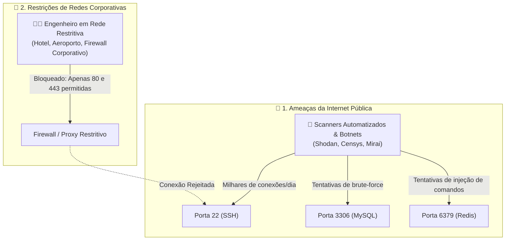
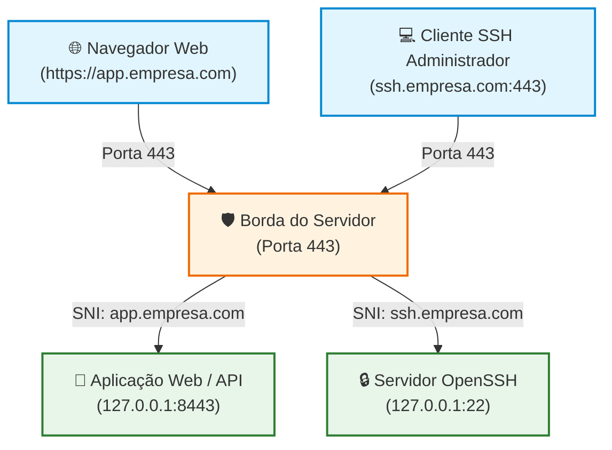
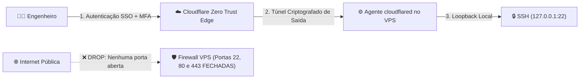

# Redução de Superfície de Ataque: Bloqueio de Portas, SSH Oculto e Multiplexação na Porta 443

> Na segurança de infraestrutura e redes, expor serviços administrativos e portas de bancos de dados diretamente para a internet pública (como a porta `22` do SSH, `3306` do MySQL ou `6379` do Redis) é equivalente a manter fechaduras expostas em plena praça pública. Scanners automatizados (como Shodan, Censys e botnets de força bruta) varrem continuamente a faixa de endereços IPv4 e IPv6 em busca de portas abertas e vulnerabilidades de dia zero (*zero-day*).

A melhor estratégia de **Defesa em Profundidade** consiste em **reduzir a superfície de ataque ao mínimo absoluto**: manter no firewall público apenas as portas indispensáveis ao negócio (HTTP `80` e HTTPS `443`), encapsulando ou multiplexando acessos administrativos através de **roteamento por SNI (Nginx Stream)**, **multiplexadores de camada de transporte (SSLH)** ou **túneis privados Zero Trust**.

---

## 1. O Problema: Scanners de Rede e Bloqueios em Redes Corporativas

A exposição das portas tradicionais de infraestrutura cria dois problemas antagônicos:



1. **Ataques de Força Bruta e Esgotamento de Logs:** Um servidor com a porta `22` aberta para a internet acumula milhares de tentativas diárias de invasão com credenciais comuns (`root`, `admin`, `ubuntu`). Isso polui logs de auditoria e consome ciclos de CPU na negociação de chaves criptográficas.
2. **Restrições de Conectividade do Administrador:** Muitas redes corporativas, estações em clientes ou conexões Wi-Fi públicas bloqueiam o tráfego de saída para qualquer porta diferente de `80` (HTTP) e `443` (HTTPS), impedindo o operador de conectar ao SSH em momentos de crise.

A solução técnica elegante para ambos os desafios é **fazer o SSH "pegar carona" na porta 443**, coexistindo com o tráfego HTTPS normal do seu e-commerce ou API.

---

## 2. Visão Geral das Três Estratégias de Multiplexação

Para atender tanto o seu tráfego web legítimo quanto o acesso administrativo na mesma porta `443`, existem três abordagens consolidadas na indústria:



---

## 3. Abordagem 1: Nginx com Módulo Stream (SNI Routing na Camada 4)

O Nginx é primariamente conhecido como servidor HTTP (Camada 7). No entanto, com o módulo **`stream`** (Camada 4 / TCP), ele pode atuar como um roteador de pacotes brutos utilizando a extensão **SNI (*Server Name Indication*)** do handshake TLS, sem precisar descriptografar a conexão.

### Como Funciona:
1. O cliente inicia um handshake TLS informando o subdomínio desejado no campo SNI.
2. A diretiva `ssl_preread on;` do Nginx inspeciona o nome do servidor sem quebrar o sigilo da chave privada.
3. Se o SNI for `ssh.empresa.com`, o Nginx encaminha os bytes puros para o SSH local (`127.0.0.1:22`).
4. Se o SNI for qualquer outro (ex: `app.empresa.com`), ele repassa para o bloco `http` interno escutando em `127.0.0.1:8443`.

### Configuração no `/etc/nginx/nginx.conf`:

```nginx
# /etc/nginx/nginx.conf

user www-data;
worker_processes auto;
pid /run/nginx.pid;

events {
    worker_connections 1024;
}

# ==============================================================================
# CAMADA 4 (TCP STREAM) - Multiplexador na Borda Externa (Porta 443)
# ==============================================================================
stream {
    # Mapeamento dinâmico baseado no cabeçalho SNI do handshake TLS
    map $ssl_preread_server_name $backend_alvo {
        ssh.empresa.com         127.0.0.1:22;   # SSH Oculto
        default                 127.0.0.1:8443; # Aplicações Web convencionais
    }

    server {
        listen 443;
        listen [::]:443;

        # Habilita a leitura do SNI sem descriptografar os pacotes
        ssl_preread on;
        proxy_pass $backend_alvo;

        # Timeouts estendidos para sessões interativas de terminal
        proxy_connect_timeout 10s;
        proxy_timeout 8h;
    }
}

# ==============================================================================
# CAMADA 7 (HTTP) - Servidor Web Interno (Escuta apenas em 127.0.0.1:8443)
# ==============================================================================
http {
    include /etc/nginx/mime.types;
    default_type application/octet-stream;

    # O servidor web tradicional agora escuta internamente na 8443
    server {
        listen 127.0.0.1:8443 ssl http2;
        server_name app.empresa.com;

        ssl_certificate /etc/letsencrypt/live/app.empresa.com/fullchain.pem;
        ssl_certificate_key /etc/letsencrypt/live/app.empresa.com/privkey.pem;

        location / {
            # Repassa para sua aplicação Rust / Axum
            proxy_pass http://127.0.0.1:3000;
            proxy_set_header Host $host;
            proxy_set_header X-Real-IP $remote_addr;
            proxy_set_header X-Forwarded-For $proxy_add_x_forwarded_for;
        }
    }

    # Painel Administrativo de Filas (RabbitMQ Management)
    server {
        listen 127.0.0.1:8443 ssl http2;
        server_name rabbit.empresa.com;

        ssl_certificate /etc/letsencrypt/live/rabbit.empresa.com/fullchain.pem;
        ssl_certificate_key /etc/letsencrypt/live/rabbit.empresa.com/privkey.pem;

        location / {
            proxy_pass http://127.0.0.1:15672;
            proxy_set_header Host $host;
        }
    }
}
```

### Como Conectar a partir da sua Máquina Local:

Como o SSH nativo não envia cabeçalhos SNI de TLS por padrão, configuramos o cliente OpenSSH local (`~/.ssh/config`) para encapsular o tráfego em TLS através do utilitário `openssl s_client`:

```ssh-config
# ~/.ssh/config na sua máquina local

Host servidor-producao
    HostName ssh.empresa.com
    Port 443
    User devsecops
    IdentityFile ~/.ssh/id_ed25519
    # O openssl inicia o handshake TLS com o SNI correto antes de acoplar o SSH
    ProxyCommand openssl s_client -quiet -connect %h:%p -servername %h
    ServerAliveInterval 60
```

Agora, basta executar o comando padrão de conexão:
```bash
ssh servidor-producao
```

---

## 4. Abordagem 2: SSLH (Multiplexador de Protocolos sem Encapsulamento)

O **SSLH** (*SSL/SSH multiplexer*) é um utilitário de baixo nível em C projetado especificamente para rodar como daemon na porta `443`. Ele inspeciona os **primeiros bytes do payload TCP** recebido:
* Se o pacote iniciar com a string literal `SSH-2.0...`, ele repassa para a porta `22`.
* Se o pacote iniciar com bytes de handshake TLS (`0x16 0x03...`), ele repassa para o servidor web na porta `8443`.
* Suporta ainda rotear pacotes de OpenVPN ou WireGuard.

```bash
# Instalação no Debian / Ubuntu:
sudo apt-get install sslh -y
```

### Configuração no `/etc/default/sslh`:
```ini
RUN=yes
DAEMON=/usr/sbin/sslh
DAEMON_OPTS="--user sslh --listen 0.0.0.0:443 --ssh 127.0.0.1:22 --ssl 127.0.0.1:8443 --pidfile /var/run/sslh/sslh.pid"
```

> [!TIP]
> **Vantagem do SSLH:** Você não precisa de `ProxyCommand` com OpenSSL no cliente local. Um simples `ssh -p 443 devsecops@seu_ip_ou_dominio` funciona nativamente.
> 
> **Desvantagem:** O Nginx perde o IP original do visitante (todos os acessos web aparecem como originados de `127.0.0.1`), a menos que você configure suporte ao protocolo **Proxy Protocol v2** no SSLH e no Nginx.

---

## 5. Abordagem 3: O Padrão Ouro Moderno — Túneis Zero Trust (Cloudflare Tunnel)

Se você utiliza ou planeja utilizar a Cloudflare, a abordagem de arquitetura mais segura da atualidade é o **Cloudflare Tunnel (Zero Trust)**:



1. **Zero Portas Abertas no Firewall:** O firewall do seu VPS rejeita **todas** as conexões de entrada (`INPUT DROP`), inclusive a porta 22 e a porta 443.
2. **Conexão Exclusivamente de Saída (*Outbound Only*):** O agente leve `cloudflared` instalado no VPS inicia uma conexão persistente e segura de dentro do servidor para a borda da Cloudflare.
3. **Autenticação em Dois Fatores (MFA) Pré-SSH:** Para conectar no SSH, o engenheiro deve primeiro se autenticar com e-mail corporativo, Google Workspace ou chave física (WebAuthn) na tela de login da Cloudflare.

---

## 6. Por que Bancos de Dados (MySQL e Redis) NÃO Devem Ser Expostos na 443?

Embora seja tecnicamente possível usar o Nginx Stream para expor o MySQL (`db.empresa.com:443`) ou o Redis (`cache.empresa.com:443`), **essa prática é contraindicada por padrões de segurança corporativa**:
* Protocolos de banco de dados não possuem isolamento nativo para navegação pública.
* Aumenta a probabilidade de falhas de autenticação e ataques de força bruta contra senhas de banco.
* Obriga a emissão e configuração de certificados TLS individuais dentro de cada instância do MySQL e Redis.

### A Boa Prática: Túneis SSH Locais (*SSH Port Forwarding*)

Mantenha o MySQL (`3306`) e o Redis (`6379`) escutando **estritamente em `127.0.0.1`**. Quando você precisar consultar o banco a partir do seu computador pessoal (via DBeaver, TablePlus ou RedisInsight), utilize um **túnel SSH seguro**:

```bash
# Abre um túnel criptografado seguro ligando seu localhost ao servidor remoto
ssh -L 3306:127.0.0.1:3306 -L 6379:127.0.0.1:6379 servidor-producao -N
```

No seu DBeaver ou TablePlus, conecte normalmente apontando para `Host: localhost` e `Port: 3306`. O tráfego viajará 100% criptografado pelo canal SSH na porta 443, sem que o MySQL precise ser exposto à internet.

---

## 7. Comparativo das Estratégias

| Critério | Nginx Stream (SNI) | SSLH Multiplexer | Cloudflare Tunnel (Zero Trust) | Túnel SSH Manual |
| :--- | :---: | :---: | :---: | :---: |
| **Porta 22 Exposta na Web?** | ❌ Não (Oculta na 443) | ❌ Não (Oculta na 443) | ❌ Não (Zero portas abertas) | Sim (ou oculta via SNI) |
| **Comando SSH Nativo?** | Requer `ProxyCommand` | 🟢 Sim (`ssh -p 443`) | Requer agente local | 🟢 Sim nativo |
| **Preservação de IP Real Web?** | 🟢 Sim (Nativo no Nginx) | 🟡 Requer Proxy Protocol | 🟢 Sim (`CF-Connecting-IP`) | 🟢 Sim |
| **Proteção por 2FA/SSO Prévia?** | ❌ Não | ❌ Não | 🟢 Sim (Zero Trust) | ❌ Não |
| **Complexidade de Manutenção** | Média | Baixa | Baixa | Baixa |
| **Dependência de Terceiros** | 🟢 Nenhuma (100% próprio) | 🟢 Nenhuma (100% próprio) | 🔴 Depende da Cloudflare | 🟢 Nenhuma |

---

## 8. Hardening do Servidor e Firewall Host (UFW)

Uma vez validada a multiplexação do SSH na porta `443`, aplique o isolamento completo das portas no firewall do sistema operacional (`ufw`):

### 1. Garantir Bind Estrito em `127.0.0.1` nos Serviços Locais:
Verifique os arquivos de configuração para assegurar que nenhum serviço escute na interface pública `0.0.0.0`:
* **MySQL (`/etc/mysql/my.cnf`):** `bind-address = 127.0.0.1`
* **Redis (`/etc/redis/redis.conf`):** `bind 127.0.0.1`
* **OpenSSH (`/etc/ssh/sshd_config`):** `ListenAddress 127.0.0.1:22` (se usar Nginx Stream localmente)

### 2. Regras de Firewall com UFW:
```bash
# 1. Política padrão: Bloqueia tudo o que entra, permite o que sai
sudo ufw default deny incoming
sudo ufw default allow outgoing

# 2. Permite apenas portas públicas necessárias
sudo ufw allow 80/tcp comment 'HTTP Padrao para Renovacao Let's Encrypt'
sudo ufw allow 443/tcp comment 'HTTPS e SSH Multiplexado'

# 3. Fecha a porta 22 tradicional na interface pública
sudo ufw deny 22/tcp comment 'Bloqueio estrito da porta padrao do SSH'

# 4. Habilita o firewall
sudo ufw enable
```

---

## 9. ⚠️ Alerta Crítico: Prevenção de Trancamento (*Anti-Lockout Checklist*)

Configurar firewalls e alterar portas de SSH envolve o risco de você **perder o acesso remoto à sua própria máquina** se cometer um erro de sintaxe.

> [!CAUTION]
> **Checklist de Segurança Antes de Fechar a Porta 22:**
> 
> 1. **Mantenha uma sessão ativa aberta:** NUNCA feche a janela do terminal onde você está conectado enquanto testa a nova configuração. Mantenha essa sessão aberta e abra uma **segunda janela separada** para testar a conexão na porta 443.
> 2. **Valide o Acesso de Emergência (Console VNC/Web):** Verifique com antecedência o acesso ao console de recuperação web do seu provedor de VPS (Hostinger, Hetzner, DigitalOcean ou AWS Serial Console). O console web conecta diretamente à placa de vídeo virtualizada do servidor, funcionando mesmo se o SSH e o firewall estiverem completamente inoperantes.
> 3. **Temporizador de Rollback Automático (Script de Segurança):** Se estiver configurando o firewall remotamente, você pode agendar o desligamento temporário do firewall caso perca a conexão:
>    ```bash
>    # Se algo der errado, o cron desativa o firewall após 10 minutos
>    echo "sudo ufw disable" | at now + 10 minutes
>    ```
>    Se o teste na porta 443 for bem-sucedido, basta cancelar a tarefa com `atrm`.
> 4. **Desative Autenticação por Senha:** Em `/etc/ssh/sshd_config`, configure `PasswordAuthentication no` e utilize exclusivamente chaves assimétricas seguras (`ed25519`).

---

## 10. Resumo e Regras de Ouro

1. **Feche todas as portas administrativas para o mundo:** Portas como `22` (SSH), `3306` (MySQL) e `6379` (Redis) nunca devem responder em IPs públicos abertos.
2. **Utilize a porta 443 como porta única de entrada:** Aproveite a ubiquidade da porta HTTPS para transpor redes corporativas restritivas e esconder serviços de varreduras automatizadas na internet.
3. **Não exponha bancos de dados na web:** Bancos de dados devem ser acessados exclusivamente via túneis SSH (`ssh -L`) ou VPN interna, mantendo o bind local restrito a `127.0.0.1`.
4. **Adote Zero Trust quando possível:** Soluções como Cloudflare Tunnel eliminam a necessidade de abrir qualquer porta de entrada no firewall, adicionando autenticação multifator antes mesmo do handshake do SSH.
5. **Nunca encerre sua sessão antes de testar a nova:** Previna bloqueios catastróficos mantendo sempre uma sessão administrativa aberta e conhecendo os procedimentos de acesso via console VNC de emergência do seu provedor.

---

### Leituras Complementares no Guia:
* [Ofuscamento de Rotas Administrativas e Defesa em Profundidade](/seguranca/ofuscamento-rotas-admin.md)
* [Segurança Proativa: Monitoramento e Resposta a Payloads Anômalos em Rust](/seguranca/reagir-payloads-grandes.md)
* [Stack de Coleta e Centralização de Logs](/seguranca/stack-de-coleta-de-logs.md)
* [LGPD e Engenharia de Software: Ciclo de Vida e Retenção Legal](/seguranca/LGPD-o-que-guardar.md)
