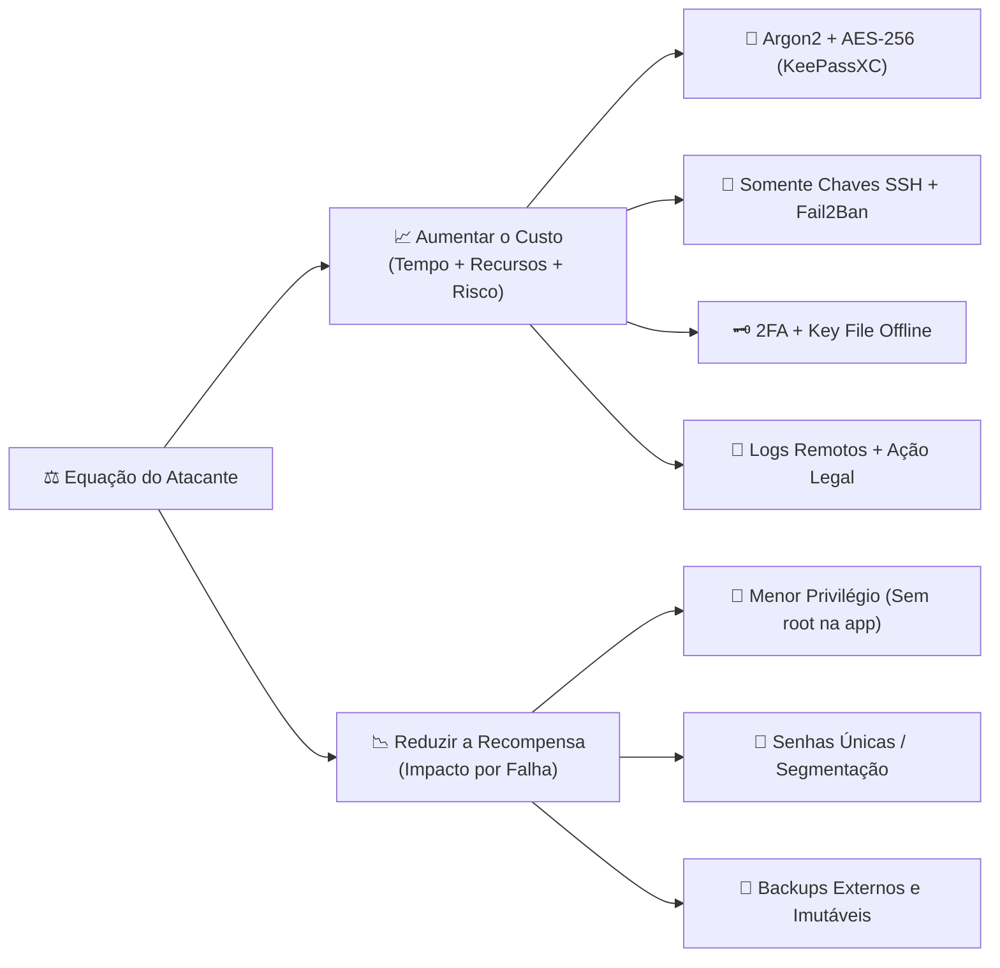

# ⚖️ Segurança Baseada em Custo-Benefício: A Equação do Atacante

> [!TIP]
> **Princípio Central:**
> Como a segurança absoluta é matemática e fisicamente impossível, o objetivo prático da defesa cibernética é **quebrar a equação econômica do atacante**, tornando o custo de invadir maior que a recompensa esperada e canalizando ou dissuadindo ataques movidos por ego.

---

## 📋 Índice

1. [A Equação do Atacante](#-1-a-equação-do-atacante)
2. [Alvo de Oportunidade vs. Alvo Direcionado](#-2-alvo-de-oportunidade-vs-alvo-direcionado)
3. [Ataques Movidos a Ego e Desafio Técnico](#-3-ataques-movidos-a-ego-e-desafio-técnico)
4. [Deception e Preservação Forense na Prática](#-4-deception-e-preservação-forense-na-prática)
5. [O Equilíbrio Ideal de Defesa](#-5-o-equilíbrio-ideal-de-defesa)

---

## 🧮 1. A Equação do Atacante

Para que um ataque racional faça sentido econômico ao invasor, a relação precisa ser favorável a ele:

$$\text{Recompensa} > \text{Custo (Tempo + Recursos + Risco)}$$

Quando você aplica os conceitos descritos em [vps-management.md](./vps-management.md), você ataca os **dois lados** dessa equação simultaneamente:

### 1.1. Aumentando o Custo ("Casa fortemente protegida e vigiada")
* **Criptografia forte (`Argon2` + `AES-256` / `ChaCha20` no KeePassXC):** Exige anos de processamento e custo computacional proibitivo para tentar força bruta contra uma frase-senha longa.
* **Chaves SSH em vez de senhas na VPS + Firewall / Fail2Ban:** O atacante automatizado (*bot*) bate na porta, identifica que autenticação por senha está desativada e migra imediatamente para um servidor mal configurado na mesma faixa de IP.
* **Duplo Fator (`2FA`) e *Key File* offline:** Mesmo que o invasor obtenha parte das credenciais (ou copie o `.kdbx` da nuvem), ele ainda precisa comprometer um segundo dispositivo físico ou arquivo isolado.

### 1.2. Reduzindo a Recompensa ("Objetos de baixo valor e fragmentados")
* **Princípio do Menor Privilégio:** Nunca execute aplicações web ou bancos como `root` na VPS. Se uma aplicação for comprometida, o invasor fica confinado a um usuário sem poderes administrativos globais.
* **Segmentação (não colocar todos os ovos na mesma cesta):** Utilize senhas e tokens exclusivos por serviço. Se um serviço secundário vazar, o dano fica isolado àquela conta.
* **Backups externos e imutáveis:** Em um eventual ataque de *ransomware* na VPS, a recompensa do resgate cai a zero, basta destruir o servidor comprometido e subir uma nova instância a partir do backup limpo.

---

## 🎯 2. Alvo de Oportunidade vs. Alvo Direcionado

Na internet pública, a imensa maioria dos ataques contra servidores VPS e contas pessoais são **ataques de oportunidade**: redes de *bots* varrendo faixas inteiras de IPv4/IPv6 em busca de portas abertas, senhas padrão ou softwares desatualizados.

Para esse perfil de ameaça, você não precisa ser "impenetrável", precisa apenas ser **substancialmente mais caro de invadir do que o vizinho**. Assim que o script automatizado percebe que sua VPS exige chave SSH, bloqueia rajadas na borda e não responde a credenciais comuns, ele descarta o alvo automaticamente.

---

## 🧠 3. Ataques Movidos a Ego e Desafio Técnico

Quando o atacante deixa de agir apenas por ganho financeiro e passa a ser motivado por **ego, notoriedade ou desafio técnico** (*"quanto mais difícil, mais instigante"*), a equação tradicional se altera. A resposta estratégica combina **dois caminhos complementares**:

### 3.1. Canalizando o Ego: Divulgação Responsável (VDP e Hall da Fama)

Quando a motivação do pesquisador é reconhecimento (*"provar que encontrou uma falha"*), oferecer uma saída ética e prestigiada desarma o ataque destrutivo:

* ***Vulnerability Disclosure Policy* (VDP) via `security.txt`:** Mesmo um site pequeno ou VPS pessoal pode publicar `/.well-known/security.txt` (**RFC 9116**) informando um e-mail de contato e agradecendo relatos de boa-fé. *(Veja o passo a passo completo em [security-hall-of-fame.md](./security-hall-of-fame.md).)*
* **O poder do "Hall da Fama":** Para muitos pesquisadores independentes, ter o nome creditado em uma página pública de agradecimentos (`Acknowledgments`) ou receber uma carta formal de reconhecimento funciona como portfólio profissional, transformando um potencial invasor em um aliado gratuito.

### 3.2. Elevando o Risco Pessoal: Defesa Ativa e Dissuasão

Quando não há boa-fé e o atacante insiste por provocação ou má intenção, a estratégia deixa de ser apenas "trancar a porta" e passa a **elevar drasticamente o risco pessoal**:

* ***Honeypots* e *Deception* (Enganação):** Em vez de apenas bloquear imediatamente, armadilhas controladas (portas simuladas, endpoints falsos ou arquivos-isca isolados) fazem o atacante gastar tempo em um ambiente fictício enquanto ferramentas registram seus passos, payloads e origem.
* **Coleta forense e rastreabilidade fora da VPS:** Logs enviados em tempo real para fora do servidor garantem que, mesmo se o invasor tentar apagar rastros locais, IPs, *timestamps*, cabeçalhos e requisições permaneçam intactos. *(Veja [stack-de-coleta-de-logs.md](../stack-de-coleta-de-logs.md).)*
* **Ação legal e denúncia formal:** No Brasil, a invasão de dispositivo informático é crime previsto no **Art. 154-A do Código Penal** (Lei Carolina Dieckmann, com penas agravadas pela **Lei nº 14.155/2021**). Quando um atacante percebe que há preservação de provas para denúncia ao provedor (*Abuse Report*) e acionamento de Delegacias Especializadas de Crimes Cibernéticos, o "desafio" vira risco jurídico concreto, fazendo a maioria recuar.

---

## 🪤 4. Deception e Preservação Forense na Prática

Algumas medidas simples que elevam o custo e o risco para atacantes persistentes sem impactar usuários reais:

1. **Bloqueio e registro de varreduras comuns na borda/origem:** Rotas como `/.env`, `/.git`, `/wp-login.php` ou `/phpmyadmin` (quando você não utiliza essas ferramentas) nunca são acessadas por usuários legítimos; qualquer requisição ali é forte indicador de varredura automatizada ou reconhecimento ativo.
2. **Alertas automáticos de acesso suspeito:** Configure o `Fail2Ban` ou alertas no servidor de logs para notificar tentativas repetidas em portas administrativas ou arquivos-isca.
3. **Envio de *Abuse Report* com evidências:** Diante de ataques persistentes vindos de datacenters ou VPS externas, utilize o modelo pronto em [report-abuse.md](../templates/report-abuse.md) anexando data/hora com fuso **UTC** e trecho dos logs para que o provedor suspenda a origem abusiva.

> [!WARNING]
> **Cuidado com contramedidas ilegais (*Hack-back*):**
> Defesa ativa **não** significa atacar de volta o IP de origem (que muitas vezes pertence a uma máquina comprometida de terceiros ou proxy). Limite-se a bloquear, enganar dentro da sua própria infraestrutura, preservar evidências e acionar provedores e autoridades competentes.

---

## ⚖️ 5. O Equilíbrio Ideal de Defesa

Na engenharia de segurança moderna, combina-se **discrição com clareza institucional**:

* Evite "segurança por ostentação" (banners provocativos no SSH ou páginas exibindo defesas para desafiar invasores).
* Mantenha um canal claro e respeitoso de divulgação responsável (`/.well-known/security.txt`).
* Nos bastidores, opere com menor privilégio, criptografia forte, backups imutáveis e monitoramento silencioso pronto para resposta técnica e legal.
