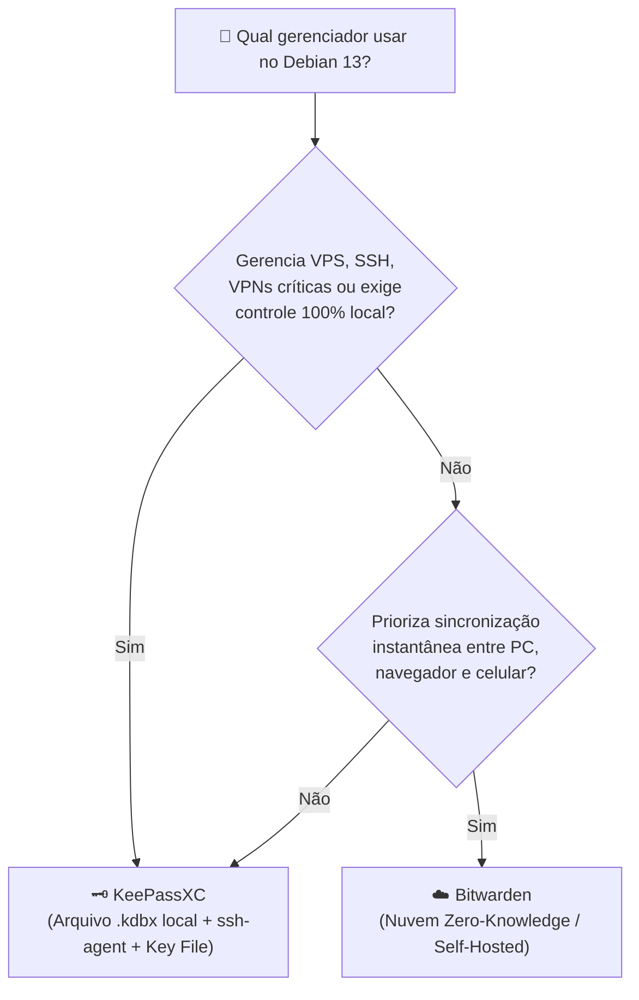

# 🔐 Comparativo de Gerenciadores de Senhas no Debian 13 (Bitwarden vs. KeePassXC)

> [!TIP]
> **Princípio Central:**
> No **Debian 13 (Trixie)**, a escolha entre **Bitwarden** e **KeePassXC** depende do seu modelo de ameaça e rotina: escolha **Bitwarden** pela praticidade automática entre desktop, navegador e celular; escolha **KeePassXC** quando precisar de controle **offline-first**, integração nativa com **`ssh-agent`** e gestão de infraestrutura crítica (**VPNs e VPS**).

---

## 📋 Índice

1. [Visão Geral e Fluxo de Decisão](#-1-visão-geral-e-fluxo-de-decisão)
2. [Tabela Comparativa para Debian 13](#-2-tabela-comparativa-para-debian-13)
3. [Quando Escolher Cada Um](#-3-quando-escolher-cada-um)
4. [Instalação Recomendada no Debian 13 (Atenção ao Sandbox)](#-4-instalação-recomendada-no-debian-13-atenção-ao-sandbox)
5. [Onde o KeePassXC é Superior: VPNs e Infraestrutura Crítica](#-5-onde-o-keepassxc-é-superior-vpns-e-infraestrutura-crítica)

---

## 🧭 1. Visão Geral e Fluxo de Decisão



---

## 📊 2. Tabela Comparativa para Debian 13

| Característica | **Bitwarden** (Praticidade Multiplataforma) | **KeePassXC** (Controle Local / Infraestrutura) |
| :--- | :--- | :--- |
| **Armazenamento** | Nuvem criptografada (*Zero-Knowledge*) ou servidor próprio (*Vaultwarden*) | Arquivo local `.kdbx` criptografado (`AES-256` / `ChaCha20`) sob seu controle |
| **Instalação no Debian 13** | Flatpak, AppImage, pacote `.deb` ou extensão de navegador | Nativo nos repositórios oficiais: `sudo apt install keepassxc` |
| **Custo** | Gratuito (uso ilimitado); plano *Premium* opcional (US\$ 10/ano) para TOTP e anexos | **100% gratuito e open-source** (sem limitações de recursos) |
| **Integração com Navegador** | Excelente (extensão oficial leve com *autofill* imediato) | Muito boa (via extensão `KeePassXC-Browser` + pacote nativo) |
| **Agente SSH (`ssh-agent`)** | Limitado ao cliente desktop / SSH Agent recente, menos flexível que cofres locais por entrada | **Nativo e maduro:** injeta chaves na memória ao abrir e remove ao travar |
| **Ideal para** | Uso cotidiano entre celular, navegador e múltiplos computadores | Privacidade máxima, **VPS, VPNs, arquivos de chave** e ambientes restritos |

---

## 🔍 3. Quando Escolher Cada Um

* **Escolha o Bitwarden se:** você prioriza comodidade absoluta no navegador e no celular (Android/iOS). No Debian 13, apenas a extensão oficial no Firefox ou Chromium já resolve a maior parte do uso diário com preenchimento automático (*autofill*) e gerador de senhas/frases-senha,mantendo a opção de usar o cliente desktop via Flatpak.
* **Escolha o KeePassXC se:** você administra servidores, prefere não depender de serviços externos (ou já sincroniza pastas com **Syncthing**, **Nextcloud** ou **`rclone`**) e precisa integrar senhas, anexos criptografados, TOTP e chaves SSH em um único arquivo portátil (`.kdbx`).

> [!NOTE]
> **É possível usar os dois juntos?**
> Sim, é uma prática muito comum em engenharia: usar o **Bitwarden** para contas pessoais/cotidianas no navegador e celular, e manter um cofre **KeePassXC** separado (com *Key File* offline) exclusivamente para chaves SSH, VPNs, `root` e tokens de produção.

---

## 📦 4. Instalação Recomendada no Debian 13 (Atenção ao Sandbox)

### KeePassXC (preferencialmente via `apt`)

```bash
sudo apt update && sudo apt install -y keepassxc
```

> [!IMPORTANT]
> **Por que preferir `apt` em vez de Flatpak para o KeePassXC?**
> O empacotamento em sandbox (Flatpak/Snap) costuma bloquear ou dificultar a comunicação nativa entre a extensão `KeePassXC-Browser` e o navegador, além de restringir o acesso ao socket do `ssh-agent` (`/run/user/1000/ssh-agent.socket`). A versão oficial dos repositórios do Debian (`apt`) funciona sem atritos.

### Bitwarden (via Flatpak)

```bash
flatpak install flathub com.bitwarden.desktop
```

---

## 🛡️ 5. Onde o KeePassXC é Superior: VPNs e Infraestrutura Crítica

Para gerenciar acessos de **VPN remota** e infraestrutura de servidores no Debian, o KeePassXC supera soluções puramente em nuvem por eliminar dependências externas e concentrar artefatos de rede no mesmo cofre:

### 5.1. Vantagens para VPNs (OpenVPN, WireGuard, NetworkManager)

* **Independência de rede (*Offline-first*):** Se você estiver sem internet ou dentro de uma rede corporativa isolada precisando autenticar na VPN para acessar recursos internos, o `.kdbx` local continua 100% disponível.
* **Anexo de arquivos criptografados:** Permite guardar certificados digitais (`.crt`, `.p12`), perfis `.ovpn` (OpenVPN) e arquivos `.conf` (WireGuard) diretamente dentro da entrada da VPN, protegidos pela mesma criptografia do cofre.
* **Agente SSH integrado pós-VPN:** Assim que você conecta na VPN e abre o terminal no Debian, o KeePassXC já injetou suas chaves SSH no `ssh-agent` para acessar servidores internos sem expor chaves no disco. *(Veja o guia completo em [vps-management.md](./vps-management.md).)*
* ***Auto-Type* (quando em sessão X11):** Muitos clientes de VPN e prompts de terminal/NetworkManager não aceitam extensões de navegador; em sessões **X11**, o *Auto-Type* simula o teclado para preencher usuário, senha e TOTP direto na janela do cliente VPN.

### 5.2. Boas práticas específicas para VPN + Debian 13

1. **Estrutura recomendada para uma entrada de VPN:**
   * **Usuário / Senha:** credenciais da VPN.
   * **Aba Avançado > Anexos:** arquivo `.ovpn` ou `.conf` + certificados do cliente (extraia temporariamente em `/tmp` ou diretório protegido apenas quando precisar importar no NetworkManager: `nmcli connection import type openvpn file empresa.ovpn` ou `type wireguard`).
   * **TOTP configurado na entrada:** agiliza conexões VPN que exigem token de 6 dígitos.
2. **Wayland vs. X11 no Debian 13:** No **Wayland** (padrão do GNOME e KDE Plasma no Debian 13), o compositor gráfico bloqueia digitação simulada global entre janelas (*Auto-Type*) por segurança. Nesse caso, utilize os atalhos de cópia segura do KeePassXC (`Ctrl+B` usuário, `Ctrl+C` senha, `Ctrl+T` TOTP), que limpam a área de transferência automaticamente após 10 segundos.
3. **Backup + *Key File* offline:** Combine uma frase-senha mestra forte com um **Arquivo-Chave (*Key File*)** armazenado fora da pasta do `.kdbx` (ou sincronizado apenas via mídia física/LAN) e mantenha cópias de backup criptografadas fora do computador principal.
