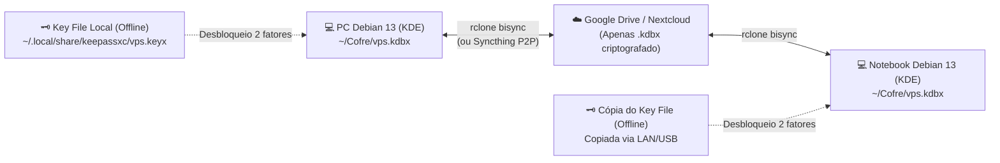

# 🔐 Gestão Segura de Servidores VPS com KeePassXC no Debian 13 (KDE Plasma Wayland)

> [!TIP]
> **Princípio Central:**
> Para administrar servidores VPS a partir de múltiplas máquinas Linux (**PC desktop + notebook**), o **KeePassXC** é a solução mais robusta porque mantém suas chaves SSH, senhas de `root`/`sudo`, credenciais de banco de dados, tokens de API e códigos 2FA em **um único arquivo `.kdbx` criptografado** (AES-256 / ChaCha20), injetando chaves privadas **apenas na memória** (`ssh-agent`) enquanto o cofre estiver desbloqueado.

*(Se você ainda está avaliando opções entre gerenciadores locais e em nuvem no Debian, consulte também o comparativo em [comparacao.md](./comparacao.md).)*

---

## 📋 Índice

1. [Por que o KeePassXC é Ideal para Administrar VPS](#-1-por-que-o-keepassxc-é-ideal-para-administrar-vps)
2. [Configurando KeePassXC + ssh-agent no Debian 13 (KDE Wayland)](#-2-configurando-keepassxc--ssh-agent-no-debian-13-kde-wayland)
3. [Estratégias de Sincronização entre PC e Notebook](#-3-estratégias-de-sincronização-entre-pc-e-notebook)
4. [Sincronização Bidirecional Segura com rclone bisync (Google Drive)](#-4-sincronização-bidirecional-segura-com-rclone-bisync-google-drive)
5. [Regra de Ouro na Nuvem: Key File, Versionamento e Quebra de Ciclo Fechado](#-5-regra-de-ouro-na-nuvem-key-file-versionamento-e-quebra-de-ciclo-fechado)
6. [Particularidades do KDE Plasma (Wayland) no Dia a Dia](#-6-particularidades-do-kde-plasma-wayland-no-dia-a-dia)
7. [Checklist Operacional (Setup e Rotina)](#-7-checklist-operacional-setup-e-rotina)

---

## 🎯 1. Por que o KeePassXC é Ideal para Administrar VPS

Administrar uma ou mais VPS envolve lidar com muitas credenciais complexas e heterogêneas (chaves criptográficas, `root`/`sudo`, bancos de dados e painéis externos) que não devem ficar expostas em arquivos de texto ou dispersas em diretórios sem proteção.

### Principais ganhos operacionais

* **Integração nativa com o `ssh-agent`:** Você armazena suas chaves privadas SSH (como `id_ed25519`) dentro do cofre `.kdbx`. Ao desbloquear o KeePassXC, ele carrega as chaves na memória do agente; ao bloquear ou fechar o cofre, ele remove as chaves automaticamente. Não é necessário manter chaves descriptografadas soltas em `~/.ssh/`.
* **Organização de toda a *stack* da VPS:** Tudo o que pertence a um servidor fica agrupado em uma estrutura clara e auditável:
  * Chave SSH privada, chave pública e *passphrase*.
  * Senha do usuário `root` e de usuários administrativos (`sudo`).
  * Credenciais de bancos de dados (MariaDB, PostgreSQL, Redis) e tokens de API (Cloudflare, provedores de e-mail, S3).
  * Anexos sensíveis (`.pem`, certificados, configs de WireGuard/OpenVPN e chaves de recuperação).
* **Autenticação 2FA (TOTP) integrada:** Gera códigos de 6 dígitos direto no desktop para painéis de provedores (Hostinger, DigitalOcean, AWS) e Cloudflare, sem depender do celular a todo momento.
* **Proteção da área de transferência:** Ao copiar uma senha ou token, o KeePassXC limpa o *clipboard* automaticamente após um curto intervalo (padrão de **10 segundos**).

### Sugestão de estrutura de pastas dentro do cofre (`.kdbx`)

```text
Cofre-Infra.kdbx
├── 🖥️ VPS-Producao
│   ├── SSH (usuario-admin / id_ed25519)
│   ├── Root / Console de Emergencia (hPanel / VNC)
│   ├── Banco de Dados (MariaDB / Redis)
│   └── Tokens de API (Cloudflare / SMTP)
├── 🌐 Provedores & DNS
│   ├── Painel Hostinger (+ TOTP)
│   └── Painel Cloudflare (+ TOTP)
└── 🧪 Laboratorio-Staging
    └── SSH & Credenciais de Teste
```

---

## 🔑 2. Configurando KeePassXC + `ssh-agent` no Debian 13 (KDE Wayland)

No **Debian 13 (Trixie)** com **KDE Plasma sobre Wayland**, variáveis de ambiente da sessão gráfica não dependem mais de scripts antigos do X11 (`/etc/X11/Xsession.d/`). Para o KeePassXC e o terminal enxergarem exatamente o mesmo `ssh-agent`, utilize o *socket* nativo do `systemd --user`.

### Passo 1: Instalar o KeePassXC e ativar o `ssh-agent.socket`

```bash
sudo apt update && sudo apt install -y keepassxc openssh-client
systemctl --user enable --now ssh-agent.socket
systemctl --user status ssh-agent.socket
```

Por padrão, o *socket* ficará ativo em `/run/user/1000/ssh-agent.socket` (onde `1000` é o seu UID).

### Passo 2: Exportar `SSH_AUTH_SOCK` na sessão KDE Plasma (Wayland)

Garanta que aplicativos gráficos (como o KeePassXC iniciado pelo menu do KDE) recebam a variável `SSH_AUTH_SOCK` apontando para o *socket* do `systemd`:

```bash
mkdir -p ~/.config/plasma-workspace/env
cat << 'EOF' > ~/.config/plasma-workspace/env/ssh-agent.sh
#!/bin/sh
export SSH_AUTH_SOCK="${XDG_RUNTIME_DIR}/ssh-agent.socket"
EOF
chmod +x ~/.config/plasma-workspace/env/ssh-agent.sh
```

> [!NOTE]
> **Atenção a conflitos com `gpg-agent`:**
> Se o comando `echo $SSH_AUTH_SOCK` retornar algo como `/run/user/1000/gnupg/S.gpg-agent.ssh`, o `gpg-agent` assumiu o lugar do OpenSSH agent (e costuma impedir que o KeePassXC remova chaves dinamicamente ao travar o cofre). Caso ocorra, remova `enable-ssh-support` de `~/.gnupg/gpg-agent.conf` e reinicie a sessão gráfica.

### Passo 3: Habilitar a integração no KeePassXC

1. Encerre e entre novamente na sessão KDE (para carregar `~/.config/plasma-workspace/env/ssh-agent.sh`).
2. Abra o **KeePassXC** e vá em **Ferramentas > Configurações > Agente SSH**.
3. Marque **Habilitar integração com o Agente SSH**.
4. *(Opcional)* Caso o *socket* não seja detectado automaticamente, ative a substituição manual de `SSH_AUTH_SOCK` apontando para `/run/user/1000/ssh-agent.socket`.
5. Em **cada entrada de SSH** da sua VPS:
   * Anexe o arquivo da chave privada (ou aponte para o anexo).
   * Na aba **Agente SSH** da entrada, marque:
     * **Adicionar chave ao agente quando o banco de dados for aberto/desbloqueado**;
     * **Remover chave do agente quando o banco de dados for fechado/bloqueado**;
     * *(Recomendado em notebooks)* **Exigir confirmação do usuário ao usar esta chave**.

### Passo 4: Validar no terminal e ajustar `~/.ssh/config`

Com o cofre desbloqueado, confirme se a chave foi carregada na memória:

```bash
echo "$SSH_AUTH_SOCK"
ssh-add -l
```

Quando você travar o KeePassXC, `ssh-add -l` passará a responder `The agent has no identities.`, provando que a chave saiu da memória.

Para evitar que o cliente SSH tente várias chaves erradas ao conectar em múltiplas VPS, configure `~/.ssh/config` com `IdentitiesOnly yes` (ou deixe sem `IdentityFile` se usar apenas o agente):

```sshconfig
Host minha-vps
    HostName 203.0.113.10
    User deploy
    Port 22
    IdentitiesOnly yes
```

*(Para reforçar ainda mais o acesso SSH na VPS, veja [bloqueando-portas.md](../bloqueando-portas.md) e [port-knocking.md](../port-knocking.md).)*

---

## 🔄 3. Estratégias de Sincronização entre PC e Notebook

Todo o cofre do KeePassXC reside em um único arquivo portátil (`.kdbx`), incluindo senhas, anexos de chaves SSH e códigos TOTP. Ao sincronizar esse arquivo entre o PC principal e o notebook, o comportamento é idêntico nos dois dispositivos.



### Comparativo dos principais métodos

| Método | Como Funciona | Vantagem Principal | Cuidados |
| :--- | :--- | :--- | :--- |
| **1. `rclone bisync` + Nuvem (Google Drive / Nextcloud)** | Sincroniza bidirecionalmente uma pasta local (`~/Cofre`) com a nuvem via terminal/atalho. | **Praticidade + backup em nuvem:** funciona mesmo com o PC principal desligado e mantém histórico de versões. | Nunca suba o *Key File* para a nuvem; evite editar nos dois dispositivos ao mesmo tempo. |
| **2. Syncthing (P2P)** | Sincroniza o `.kdbx` diretamente entre PC e notebook via rede local ou internet, ponto a ponto. | **Zero nuvem:** dados nunca passam por servidores de terceiros; gratuito e automático. | Exige que ambos estejam ligados simultaneamente (ou um terceiro nó/NAS) para propagar alterações. |
| **3. GNOME Online Accounts** | Montagem nativa do Google Drive no gerenciador de arquivos (apenas se usar ambiente **GNOME**). | Configuração 100% gráfica sem linha de comando. | Depende de rede estável durante a escrita e é específico para GNOME. |
| **4. Pendrive criptografado (LUKS)** | Transporte físico do arquivo `.kdbx` entre PC e notebook. | **Isolamento físico (*Air-gap*):** zero superfície de ataque na rede. | Menos prático no dia a dia; exige backup extra contra perda física do pendrive. |

> [!WARNING]
> **Por que evitar o `kio-gdrive` (integração nativa do Dolphin no KDE)?**
> No **KDE Plasma**, abrir e salvar arquivos `.kdbx` diretamente sobre montagens virtuais KIO (`gdrive:/`) pode causar erros de bloqueio (*file locking*) ou corrupção parcial durante gravações atômicas do KeePassXC. Trabalhar sobre uma pasta local (`~/Cofre`) sincronizada via **`rclone bisync`** elimina esse risco.

---

## ☁️ 4. Sincronização Bidirecional Segura com `rclone bisync` (Google Drive)

Como o Google Drive não possui cliente oficial para Linux, o **`rclone bisync`** é a abordagem mais confiável para manter `~/Cofre` sincronizado nos dois computadores Debian sem sobrescrever alterações acidentalmente (ao contrário de `rclone sync`, que espelha apenas em uma direção).

### Passo 1: Instalar e configurar o `rclone` (no PC e no Notebook)

```bash
sudo apt update && sudo apt install -y rclone
rclone config
```

No assistente interativo:
1. Digite `n` para criar um novo *remote* e nomeie como `gdrive`.
2. Selecione **Google Drive** na lista de provedores.
3. Deixe `client_id` e `client_secret` em branco (ou use credenciais próprias do Google Cloud, se desejar maior cota), escolha acesso completo (`1`) e conclua a autenticação no navegador.

### Passo 2: Criar a pasta local e inicializar o `bisync`

Crie a pasta nos dois computadores:

```bash
mkdir -p ~/Cofre
```

Na **primeira execução**, inicialize primeiro no computador que já contém o arquivo `.kdbx` original (para enviá-lo ao Drive) e depois repita no segundo computador (para baixá-lo):

```bash
rclone bisync ~/Cofre gdrive:Cofre --resync
```

### Passo 3: Uso diário e automação no KDE

Antes de abrir o cofre, ou logo após salvar uma nova senha/chave no KeePassXC, rode:

```bash
rclone bisync ~/Cofre gdrive:Cofre
```

*(Dica: caso queira simular antes de aplicar alterações em caso de dúvida, adicione `--dry-run`.)*

Para agilizar no terminal, adicione um *alias* ao `~/.bashrc` ou `~/.zshrc`:

```bash
alias sync-cofre='rclone bisync ~/Cofre gdrive:Cofre --verbose'
```

No **KDE Plasma**, você também pode criar um atalho gráfico via **KMenuEdit** (Editor de Menu do KDE) executando `rclone bisync ~/Cofre gdrive:Cofre` para sincronizar com um clique antes de abrir o KeePassXC.

> [!NOTE]
> **E se o Notebook rodar Windows ou macOS?**
> Instale o aplicativo oficial **Google Drive for Desktop**, espelhe a pasta `Cofre` localmente e aponte o KeePassXC para o arquivo `.kdbx` dentro dela.

### Passo 4: Como evitar e resolver conflitos de edição

* **Boa prática:** Feche ou sincronize o cofre ao encerrar o uso em uma máquina antes de editar na outra.
* **Se houver edição offline simultânea:** O `rclone` ou o Drive criará uma cópia de conflito. Nunca apague imediatamente, abra o banco principal no KeePassXC, acesse **Banco de Dados > Mesclar de um banco de dados** (*Merge from Database*) e selecione o arquivo conflitante para unir todas as alterações sem perda de dados.

---

## 🛡️ 5. Regra de Ouro na Nuvem: Key File, Versionamento e Quebra de Ciclo Fechado

Armazenar o `.kdbx` no Google Drive traz praticidade e backup remoto, mas exige três regras de defesa em profundidade:

### 5.1. Use um Arquivo-Chave (*Key File*) fora da nuvem

1. No KeePassXC, acesse **Banco de Dados > Segurança do Banco de Dados > Adicionar proteção adicional > Arquivo-Chave**.
2. Gere um novo arquivo-chave (ex.: `vps.keyx`) e salve em uma pasta **fora** de `~/Cofre`, como `~/.local/share/keepassxc-keys/vps.keyx` com permissão restrita:
   ```bash
   mkdir -p ~/.local/share/keepassxc-keys
   chmod 700 ~/.local/share/keepassxc-keys
   chmod 600 ~/.local/share/keepassxc-keys/vps.keyx
   ```
3. **Nunca envie o `.keyx` para o Google Drive.** Copie-o manualmente para o notebook usando um pendrive ou transferência direta na rede local (`scp`).
4. Resultado: mesmo que um invasor comprometa sua conta Google e baixe o `.kdbx`, o cofre será **matematicamente impossível de abrir** sem a frase-senha mestra **e** o *Key File* físico.

### 5.2. Aproveite o versionamento do Google Drive

O Google Drive preserva automaticamente versões anteriores do mesmo arquivo por até **30 dias** (ou 100 versões). Em caso de corrupção acidental, clique com o botão direito no `.kdbx` na interface web do Drive > **Gerenciar versões** e restaure a cópia anterior. *(Complemente ainda com backups periódicos em mídia externa criptografada.)*

### 5.3. Evite o "Ciclo Fechado" entre Google Authenticator e KeePassXC

> [!IMPORTANT]
> **Não tranque a chave do próprio cofre dentro do cofre!**
> Se o `.kdbx` está no Google Drive e a senha + 2FA da sua Conta Google existirem **apenas dentro do `.kdbx`**, uma falha no disco local impedirá que você baixe o cofre novamente.

Separe os papéis de autenticação de forma limpa:
* **No Google Authenticator (celular) + códigos de backup impressos/offline:** Mantenha o 2FA da sua **Conta Google** (que protege o Drive onde está o `.kdbx`) e contas de recuperação de emergência.
* **No KeePassXC (desktop):** Cadastre o 2FA (**TOTP**) do painel da **VPS**, **Cloudflare**, **registradores de domínio**, **GitHub** e demais serviços administrados, ganhando agilidade no desktop e backup criptografado automático dentro do `.kdbx`.

---

## 🖥️ 6. Particularidades do KDE Plasma (Wayland) no Dia a Dia

* **Área de transferência (Klipper):** O gerenciador nativo do KDE (Klipper) armazena histórico do que você copia. O KeePassXC envia uma sinalização compatível com Wayland/KDE para que senhas copiadas **não fiquem gravadas no histórico do Klipper** e sejam apagadas após **10 segundos**. Confirme em **Configurações > Segurança > Limpar área de transferência após X segundos**.
* **Auto-Type no Wayland (KWin):** Por isolamento de segurança do compositor Wayland, a digitação automática global simulada entre janelas (*Auto-Type*) é bloqueada por padrão. No fluxo diário no KDE Wayland, use os atalhos diretos do KeePassXC:
  * **`Ctrl + B`**: Copiar nome de usuário
  * **`Ctrl + C`**: Copiar senha
  * **`Ctrl + T`**: Copiar código 2FA (TOTP)

---

## ✅ 7. Checklist Operacional (Setup e Rotina)

### Configuração Inicial (PC e Notebook)
- [ ] Instalar `keepassxc`, `openssh-client` e `rclone` no Debian 13.
- [ ] Habilitar `systemctl --user enable --now ssh-agent.socket` e criar `~/.config/plasma-workspace/env/ssh-agent.sh`.
- [ ] Confirmar após relogar que `echo "$SSH_AUTH_SOCK"` aponta para `ssh-agent.socket` (e não para `gpg-agent`).
- [ ] Configurar o cofre `.kdbx` com **frase-senha forte + Key File offline** (sem subir o `.keyx` na nuvem).
- [ ] Anexar as chaves SSH da VPS ao cofre e validar carregamento/remoção com `ssh-add -l`.
- [ ] Inicializar `rclone bisync ~/Cofre gdrive:Cofre --resync` no PC principal e depois no notebook.
- [ ] Manter o 2FA da Conta Google fora do `.kdbx` (Google Authenticator no celular + códigos de recuperação offline).

### Rotina Diária
- [ ] Rodar `rclone bisync ~/Cofre gdrive:Cofre` antes de abrir o cofre (ou após adicionar novas credenciais).
- [ ] Desbloquear o KeePassXC apenas durante a janela de administração da VPS e **travá-lo (`Ctrl + L`)** ao terminar para limpar as chaves do `ssh-agent`.
