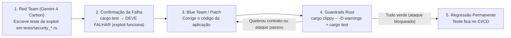

# 🛡️ Auditoria Adversarial, Pentest Assistido e Auto-Cura com Gemini 4 Carbon no Google Antigravity

> [!WARNING]
> **Escopo Autorizado & Ambiente Isolado:** Todas as técnicas ofensivas (*Red Team*, scripts de PoC, *fuzzing* e testes de carga) descritas neste guia devem ser executadas **exclusivamente em repositórios próprios, ambientes locais (`localhost`) ou sandboxes autorizados** — nunca contra ambientes de produção ou sistemas de terceiros sem autorização formal.

> [!TIP]
> **Por que usar após o pentest tradicional?** Ferramentas automatizadas de SAST/DAST identificam padrões conhecidos, mas costumam falhar em **lógica de negócio**, **IDOR**, **condições de corrida (*race conditions*)** e **cadeias multi-etapas**. O **Gemini 4 Carbon** dentro do **Google Antigravity** atua como revisor adversarial capaz de raciocinar sobre fluxos inteiros de execução e comprovar falhas com código executável.

---

## 📋 Índice

1. [O Papel do Gemini 4 Carbon no Antigravity](#-1-o-papel-do-gemini-4-carbon-no-antigravity)
2. [4 Estratégias Práticas de Auditoria Adversarial](#-2-4-estratégias-práticas-de-auditoria-adversarial)
3. [O que Auditar: Vetores Prioritários (OWASP / API)](#-3-o-que-auditar-vetores-prioritários)
4. [Prompt Prático de Auditoria Red Team (Copiável)](#-4-prompt-prático-de-auditoria-red-team)
5. [Ciclo-Fechado e Auto-Cura (*Self-Healing*) em Rust](#-5-ciclo-fechado-e-auto-cura-em-rust)
6. [Ferramentas do Ecossistema Rust para Acoplar ao Loop](#-6-ferramentas-do-ecossistema-rust-para-acoplar-ao-loop)
7. [Configurando a Regra Permanente no Antigravity (`.agents/rules/security-loop.md`)](#-7-configurando-a-regra-permanente-no-antigravity)

---

## 🧠 1. O Papel do Gemini 4 Carbon no Antigravity

O **Google Antigravity** é o ambiente de desenvolvimento agêntico (IDE e CLI) do Google, e o **Gemini 4 Carbon** é um modelo de raciocínio avançado da Google DeepMind com forte ênfase em **defesa cibernética e auditoria de código**.

Em vez de fazer apenas leitura estática de sintaxe, ele consegue:
* Correlacionar rotas HTTP, middlewares, regras de domínio e configurações de infraestrutura em conjunto;
* Simular mentalmente ataques de múltiplos passos;
* Escrever provas de conceito (**PoCs**) reproduzíveis para separar **vulnerabilidades reais** de **falsos positivos**.

---

## 🎯 2. 4 Estratégias Práticas de Auditoria Adversarial

### 1. Use `/swarm` com Verificação Adversarial
Dentro do Antigravity, o recurso `/swarm` orquestra múltiplos agentes em paralelo em *worktrees* isolados:
* **Agentes Auditores:** inspecionam camadas distintas em paralelo (rotas HTTP, autenticação/RBAC, queries de banco, parsing de payloads e configs de Nginx/Docker/Cloudflare).
* **Agentes Verificadores Adversariais:** tentam explorar as suspeitas levantadas pelos auditores para comprovar se a brecha é explorável na prática antes de propor qualquer patch.

### 2. Ative o Nível de Esforço *High* (Raciocínio Profundo)
No seletor de modelos do Antigravity, selecione **Gemini 4 Carbon** com esforço/pensamento em **High**. Esse modo é ideal para detectar cadeias complexas que scanners comuns não enxergam:
* *Race conditions* (TOCTOU, compras ou saques concorrentes);
* Escalonamento de privilégios em múltiplas chamadas;
* *SSRF* indireto, *bypass* de validação em parsers e vazamentos por canal lateral (*timing attacks*).

### 3. Combine Análise de Código (SAST) com Validação Dinâmica (DAST)
Como o agente possui acesso controlado ao terminal e ao navegador em sandbox, instrua-o a executar o ciclo completo localmente:
1. Ler o código-fonte do backend e mapear os endpoints críticos.
2. Subir o servidor em ambiente local de testes.
3. Escrever e rodar um script (`curl`, Python ou teste de integração) tentando explorar a falha suspeita.
4. Aplicar a correção e reexecutar o exploit para **provar** que a brecha foi fechada.

### 4. Revisão Conjunta de Código + Borda (Full-Context)
Aproveitando a janela de contexto ampla do Gemini 4 Carbon, carregue simultaneamente o código da aplicação e os arquivos de perímetro (`nginx.conf`, regras de `ufw`/Fail2Ban e regras exportadas da Cloudflare) para identificar discrepâncias onde uma requisição malformada passe pelo proxy reverso e atinja o backend desprotegido (ex.: *HTTP Request Smuggling*, *Path Normalization* ou spoofing de `X-Forwarded-For`).

---

## 🔍 3. O que Auditar: Vetores Prioritários

| Domínio de Risco | Exemplos de Falhas para Procurar |
| :--- | :--- |
| **Autenticação & Sessão** | Enumeração de usuários (tempo de resposta/mensagens distintas), JWT sem validação de algoritmo/expiração, bypass de 2FA, CSRF. |
| **Autorização (IDOR / BOLA)** | Usuário A acessando/alterando pedidos, contratos ou arquivos do Usuário B ou de outro *tenant* apenas trocando o `id`/`uuid`. |
| **Entrada & Serialização** | SQL Injection em queries dinâmicas, Path Traversal (`../`), DoS por payload gigante ou ReDoS, *Price Tampering* (confiar em preço vindo do JSON do cliente). |
| **Lógica de Negócio & Concorrência** | Aplicação dupla de cupom, saldo negativo por requisições simultâneas, transições inválidas de máquina de estados (FSM). |
| **Infraestrutura & Segredos** | Chaves no histórico/logs, headers de segurança ausentes (`CSP`, `HSTS`), bypass direto ao IP da VPS ignorando CDN/WAF. |

---

## 💬 4. Prompt Prático de Auditoria Red Team

Copie e adapte este prompt no Antigravity (com o **Gemini 4 Carbon** em nível **High**):

```text
Atue como um pesquisador de segurança ofensiva (Red Team).
Analise a base de código e os arquivos de configuração de servidor deste projeto com rigor máximo.
Procure falhas de lógica de negócio, IDOR/BOLA, escalonamento de privilégios, injeção (SQL/Comando), bypass de autenticação, condições de corrida, DoS de parsing e vazamento de segredos.

Regras obrigatórias:
1. Não reporte suspeitas teóricas sem evidência do caminho exato no código (arquivo e linha).
2. Para cada vulnerabilidade confirmada, escreva primeiro um teste reproduzível (ou PoC local) que comprove a exploração no ambiente de teste.
3. Só proponha a correção após validar a falha e reexecute toda a suíte de testes após o patch para provar que a brecha foi fechada sem regressões.
```

> [!CAUTION]
> **Controle de execução no terminal:** ao permitir que o agente execute PoCs locais no terminal, mantenha a política de revisão manual ativada para comandos destrutivos, alterações de sistema ou chamadas de rede externas — nunca rode exploits contra ambientes fora da sua sandbox local.

---

## 🦀 5. Ciclo-Fechado e Auto-Cura em Rust

O **Rust** potencializa o ciclo fechado (*closed-loop* / *self-healing*) com o Gemini 4 Carbon porque o compilador (`rustc`), o sistema de tipos, o `cargo test` e o `clippy` atuam como **barreiras determinísticas**: o agente não consegue "alucinar" código inseguro ou quebrar contratos de compilação sem ser barrado imediatamente.

### Arquitetura do Loop (*Security-Driven Development*)



### Passo a passo do loop
1. **Red Team (Teste de Exploit):** o agente analisa rotas (`Axum`/`Actix`), queries (`SQLx`/`Diesel`) e middlewares, criando um teste de integração (ex.: `tests/security_idor.rs`) simulando o ataque (troca de `tenant_id` no JWT, payload malformado ou corrida com `tokio::join!`).
2. **Prova da Falha:** executa `cargo test`; o teste precisa **falhar** inicialmente (confirmando que o vetor de ataque realmente funciona antes da correção).
3. **Blue Team (Auto-Cura):** o agente corrige a camada afetada (domínio, caso de uso ou middleware).
4. **Verificação Automática de Regressão:**
   ```bash
   cargo clippy --workspace --tests -- -D warnings
   cargo test --workspace
   ```
   O ciclo só termina quando **o novo teste de segurança passa** (bloqueando o ataque) e **toda a suíte existente continua verde** com zero *warnings*.

---

## 🧰 6. Ferramentas do Ecossistema Rust para Acoplar ao Loop

Você pode instruir o agente (via regra de workspace) a combinar o Gemini 4 Carbon com estas ferramentas nativas:

| Ferramenta Rust | Papel no Ciclo-Fechado com IA |
| :--- | :--- |
| **`cargo-fuzz` / `bolero`** | **Fuzzing guiado por IA:** o agente cria *fuzz targets* para parsers, deserializadores (`serde`) e cálculos; ao surgir um *panic* ou comportamento anômalo, o input causador vira teste de regressão e gera a correção. |
| **`cargo-audit` & `cargo-deny`** | **Segurança de Supply Chain:** identifica CVEs conhecidas e licenças incompatíveis no `Cargo.lock`, atualiza crates vulneráveis e adapta eventuais *breaking changes*. |
| **`proptest` / `quickcheck`** | **Testes Baseados em Propriedades:** valida invariantes universais (ex.: *"nenhum usuário comum lê dados de outro tenant para qualquer input"*), gerando milhares de entradas aleatórias. |
| **`cargo-llvm-cov` / `tarpaulin`** | **Cobertura de Caminhos Críticos:** garante cobertura rigorosa nas rotas de autenticação, middlewares de autorização e parsers críticos. |

---

## ⚙️ 7. Configurando a Regra Permanente no Antigravity

Para transformar esse fluxo em padrão do projeto, crie uma regra versionada em **`.agents/rules/security-loop.md`** (ou incorpore no `AGENTS.md` do repositório):

```markdown
# Regra de Segurança e Auto-Cura (Security-Driven Development)

1. Nenhuma correção de vulnerabilidade é considerada concluída sem um teste automatizado de regressão em `tests/` (ou módulo `#[cfg(test)]`) que reproduza o vetor de ataque original e comprove seu bloqueio.
2. Nunca introduza blocos `unsafe` ao corrigir ou otimizar código de segurança, salvo justificativa formal e validação com `cargo +nightly miri test`.
3. Toda correção deve passar sem exceções por:
   - `cargo clippy --workspace --tests -- -D warnings`
   - `cargo test --workspace`
   - `cargo audit` (quando houver alterações de dependências)
4. Nunca afrouxe asserções de testes existentes ou adicione `#[allow(...)]` para silenciar alertas de segurança.
```

> [!NOTE]
> **Dica de fluxo no Antigravity:** combine essa regra com `/swarm` (um agente focado em escrever testes adversariais com `proptest`/requisições HTTP e outro focado em aplicar o patch mantendo os *guardrails* do Rust verdes) ou use `/boost` em auditorias complexas de arquitetura.
