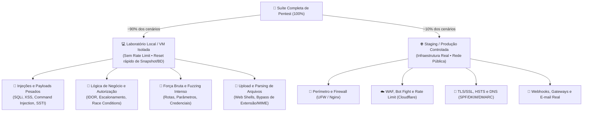

# 🛡️ Estratégia de Pentest: Laboratório Local (90%) vs. Ambiente Online (10%)

> [!WARNING]
> **USO ÉTICO E AUTORIZADO**
>
> Execute testes de intrusão (*pentest*) e varreduras automatizadas **apenas em ambientes próprios ou com autorização formal por escrito**. Além dos aspectos legais, testes agressivos sem aviso prévio violam os Termos de Serviço da maioria dos provedores de nuvem e CDNs, podendo causar suspensão de conta. Consulte também [disclaimer.md](../disclaimer.md).

> [!TIP]
> **Princípio Central (Padrão Ouro):**
> Não execute toda a bateria de testes diretamente em produção. **Separe os cenários entre um laboratório local isolado (~90%) e o ambiente online (~10%)**. Assim, você ganha velocidade, segurança jurídica/contratual e evita derrubar o site para usuários reais ou corromper o banco de dados de produção.

---

## 📋 Índice

1. [A Regra 90/10: O que Testar Localmente vs. Online](#-1-a-regra-9010-o-que-testar-localmente-vs-online)
2. [Preparando o Ambiente Online sem Se Bloquear](#-2-preparando-o-ambiente-online-sem-se-bloquear)
3. [VPS e Cloudflare: Escopo, Proxy e Recuperação](#-3-vps-e-cloudflare-escopo-proxy-e-recuperação)
4. [Execução em Fases: Divisão dos Testes em 5 Blocos](#-4-execução-em-fases-divisão-dos-testes-em-5-blocos)
5. [Calibragem de Ferramentas e Redução de Falsos Positivos](#-5-calibragem-de-ferramentas-e-redução-de-falsos-positivos)
6. [Checklist Operacional (Pré, Durante e Pós-Teste)](#-6-checklist-operacional-pré-durante-e-pós-teste)

---

## 🎯 1. A Regra 90/10: O que Testar Localmente vs. Online

Ao dividir uma suíte completa de verificações (por exemplo, ~150 cenários entre aplicação e infraestrutura), a maior parte dos testes valida **código, lógica de negócio e tratamento de entradas**, que não dependem da internet pública para serem reproduzidos.



### 1.1. O que rodar no Ambiente Local (~90% dos cenários)

Em um laboratório local (VMs no VirtualBox/VMware, containers ou rede isolada replicando sua stack, como **Debian + Nginx + MariaDB/Redis + Rust/PHP**), você tem controle total e latência praticamente zero. Rode localmente todos os testes voltados para a aplicação:

* **Injeções e Payloads Pesados:** *SQL Injection* (SQLi), *Cross-Site Scripting* (XSS), *Command Injection* e *Server-Side Template Injection* (SSTI). Como esses testes inserem lixo no banco ou travam processos, rodar localmente permite restaurar o banco de dados em segundos.
* **Lógica de Negócio e Autorização:** Quebra de controle de acesso (IDOR), escalonamento de privilégios, manipulação de fluxos de carrinho/pagamento e *Race Conditions* (condições de corrida).
* **Força Bruta e Fuzzing Intenso:** Quebra de senhas e enumeração massiva de rotas e parâmetros. Sem *Rate Limit* de provedores externos, centenas de cenários rodam sem bloqueios artificiais.
* **Análise de Arquivos e Upload:** Envio de *web shells*, tentativa de *path traversal*, *bypass* de extensão dupla e manipulação de *MIME type* / *magic bytes*.

> [!NOTE]
> **Dica de arquitetura para o laboratório local:**
> Para que o teste local reflita a produção com fidelidade, configure a VM servidora com exatamente as mesmas versões de sistema operacional, pacotes e variáveis de ambiente da sua VPS (por exemplo, mesma versão do Debian, Nginx, MariaDB/Redis e runtime Rust/PHP). Veja o passo a passo de preparação de VM em [simulando-VPS-Debian14.md](../servidorVPS/simulando-VPS-Debian14.md).

### 1.2. O que deixar exclusivamente para o Ambiente Online (~10% dos cenários)

Reserve o ambiente de produção (ou preferencialmente um subdomínio de **Staging** na mesma infraestrutura) apenas para o que depende da rede pública, da borda e de serviços de terceiros:

| Categoria | O que testar Online | Por que só funciona Online? |
| :--- | :--- | :--- |
| **Perímetro e Firewall (`UFW` / `Nginx`)** | *Port scanning* externo (`Nmap`), exposição de portas administrativas e bloqueio de acesso direto ao IP da VPS (*bypass* de CDN). | Na rede local não há roteamento de borda nem as regras exatas da interface pública do provedor. |
| **WAF e Regras da Cloudflare** | Eficácia de bloqueio geográfico, *Rate Limiting*, proteção contra bots e cabeçalhos HTTP injetados na borda. | O proxy reverso e os filtros de borda da CDN não existem no ambiente local. |
| **Criptografia e DNS** | Validade de certificados SSL/TLS, cifras fracas, HSTS, DNSSEC e registros de e-mail (`SPF`, `DKIM`, `DMARC`). | Dependem de registros DNS públicos e certificados emitidos para o domínio real. |
| **Integrações Reais** | *Webhooks* de gateways de pagamento, APIs externas e entrega real de e-mails transacionais. | Em ambiente local costumam usar *mocks* ou ambientes de *sandbox*. |

---

## 🛡️ 2. Preparando o Ambiente Online sem Se Bloquear

Ao disparar ferramentas automatizadas (scanners de vulnerabilidade, *fuzzers* ou testes de força bruta) contra um servidor online, mecanismos como **Cloudflare WAF**, **Fail2Ban** e **UFW/iptables** identificarão o comportamento como ataque e banirão o IP de origem automaticamente.

Para executar os testes online com segurança e garantir que você não perca o controle do servidor:

### 2.1. Separe a origem do ataque (IPs distintos)

* **Use uma máquina externa dedicada para o teste:** Provisione uma VPS temporária (DigitalOcean, Linode, AWS, etc.) apenas para rodar ferramentas como Kali Linux, `Nmap`, `Nikto`, `Nuclei` ou `OWASP ZAP`. Se esse IP for banido, sua máquina pessoal e seu escritório continuam operando normalmente.
* **Nunca teste a partir da sua rede doméstica ou corporativa:** Se o seu IP fixo for bloqueado pelo provedor de hospedagem ou pela Cloudflare, você perderá acesso não apenas ao site, mas possivelmente também ao SSH e ao painel administrativo.

### 2.2. Garanta vias de recuperação fora de banda (*Out-of-Band*)

Antes de iniciar qualquer varredura, prepare acessos de contingência que não dependam das regras normais de firewall do sistema operacional:

1. **Console de Emergência (Browser Terminal / VNC / Serial Console):** Verifique se o painel do provedor (Hostinger hPanel, AWS, Contabo, etc.) oferece acesso direto ao terminal pelo navegador. Esse console emula teclado e monitor conectados fisicamente ao servidor, funcionando mesmo se SSH e HTTP estiverem bloqueados. **Teste esse acesso antes do pentest.**
2. **IP de Gerenciamento na Lista de Permissões (*Allowlist*):** Adicione o IP da sua rede principal (ou de uma VPN dedicada de administração) no `ignoreip` do Fail2Ban e nas regras de permissão do firewall/Cloudflare.
   > [!IMPORTANT]
   > **Nunca rode o pentest a partir do IP que está na *Allowlist***, caso contrário você mascarará proteções que um atacante real enfrentaria.
3. **Snapshots e Backups:** Crie um *snapshot* completo da VPS e um *dump* do banco de dados imediatamente antes de começar. Testes intrusivos podem corromper registros ou derrubar serviços.

### 2.3. Cuidados Legais, Contratuais e Operacionais

* **Comunique o provedor quando aplicável:** Muitas empresas de nuvem e CDNs exigem aviso prévio ou proíbem varreduras agressivas nos Termos de Serviço (especialmente planos gratuitos/Pro de CDN). Tráfego de ataque não autorizado pode gerar suspensão da conta por abuso.
* **Prefira Homologação (*Staging*):** Sempre que possível, aponte os testes para um ambiente *staging* isolado para evitar degradação ou indisponibilidade para clientes reais.

---

## ☁️ 3. VPS e Cloudflare: Escopo, Proxy e Recuperação

Em arquiteturas comuns com **VPS (ex.: Hostinger) + proxy reverso/WAF (Cloudflare)**, a preparação exige atenção dupla: proteger o acesso de recuperação na VPS e decidir se o alvo do teste é a **borda (WAF)** ou a **aplicação/origem pura**.

### 3.1. Ajuste o Fail2Ban e o Firewall na VPS

Antes dos testes, confirme suas regras de proteção para seu IP administrativo (nunca para o IP da máquina atacante):

```ini
# /etc/fail2ban/jail.local
[DEFAULT]
# Adicione aqui APENAS o IP de administração/VPN (separe múltiplos com espaço)
ignoreip = 127.0.0.1/8 ::1 <SEU_IP_DE_ADMINISTRACAO>
```

Após editar, recarregue o Fail2Ban e valide o status:

```bash
sudo systemctl reload fail2ban
sudo fail2ban-client status
```

*(Para endurecimento prévio de portas administrativas e restrição de origem aos IPs da Cloudflare, consulte [bloqueando-portas.md](./bloqueando-portas.md) e [saved-traffic-cost.md](./saved-traffic-cost.md).)*

### 3.2. Defina o escopo na Cloudflare (Nuvem Laranja vs. Direto na Origem)

| Modo de Teste | Como Configurar | O que Avalia | Cuidados |
| :--- | :--- | :--- | :--- |
| **Com Proxy Ativo (Nuvem Laranja)** | Testes apontando normalmente para o domínio público (`https://seudominio.com`). | Eficácia real do **WAF**, *Bot Fight Mode*, regras geográficas e *Rate Limiting* da Cloudflare. | A CDN bloqueará grande parte dos payloads automatizados, **mascarando falhas no seu código**. Planos Free/Pro não autorizam pentests volumétricos agressivos. |
| **Direto no IP de Origem (via `/etc/hosts`)** | Na **máquina de ataque**, mapeie o domínio para o IP real da VPS em `/etc/hosts` (sem desligar a Nuvem Laranja no DNS público!). | Segurança real do **Nginx, sistema e aplicação** sem a proteção da CDN. | Se o firewall da VPS bloquear acesso fora dos IPs da Cloudflare, libere temporariamente **apenas o IP da máquina de ataque** nas portas `80`/`443` e remova ao concluir. |

Exemplo de resolução local apenas na máquina de ataque (sem expor o IP real no DNS público):

```bash
# /etc/hosts (na máquina atacante)
<IP_REAL_DA_VPS> seudominio.com www.seudominio.com
```

> [!TIP]
> **Por que usar `/etc/hosts` na máquina de ataque em vez de mudar o DNS para Nuvem Cinza?**
> Alterar o registro DNS público para *DNS Only* (Nuvem Cinza) remove a proteção de DDoS/WAF para **todos os usuários reais** e expõe o IP de origem em históricos públicos de DNS. Usando `/etc/hosts` na máquina atacante, o público continua protegido pela Cloudflare enquanto você testa a origem diretamente.

### 3.3. Comandos de Recuperação Rápida (Browser Terminal)

Deixe os comandos abaixo anotados para colar no Console de Emergência do provedor caso a máquina de teste seja banida entre os blocos:

```bash
# 1. Listar jails ativas para descobrir o nome exato da jail que baniu o IP
sudo fail2ban-client status

# 2. Desbanir o IP da máquina de teste em uma jail específica (ex.: sshd, nginx-http-auth, recidive)
sudo fail2ban-client set <NOME_DA_JAIL> unbanip <IP_DA_MAQUINA_DE_TESTE>

# 3. Ou limpar todos os banimentos temporários de todas as jails
sudo fail2ban-client unban --all
```

---

## 🧩 4. Execução em Fases: Divisão dos Testes em 5 Blocos

É uma excelente prática dividir os testes em blocos progressivos. Executar dezenas ou centenas de cenários simultaneamente satura CPU e RAM da VPS, gera falsos positivos por *timeout*, polui os logs (dificultando correlacionar qual *payload* causou qual erro) e aciona bloqueios de DDoS antes de testar as falhas lógicas.

| Bloco | Foco do Teste | Cuidados Operacionais |
| :--- | :--- | :--- |
| **1. Reconhecimento e Infra** | Portas abertas (`Nmap`), cabeçalhos HTTP, SSL/TLS, versão de serviços e registros DNS. | **Baixo impacto.** Raramente derruba serviços; já valida se o firewall bloqueia *port scans* e portas administrativas. |
| **2. Enumeração e Diretórios** | Descoberta de rotas ocultas, arquivos de backup (`.env`, `.git`, `.sql`), painéis admin (`Gobuster`/`Dirsearch`/`Feroxbuster`). | **Controle a taxa de requisições** (*threads*/RPS) para evitar negação de serviço (DoS) acidental ou banimento precoce. |
| **3. Autenticação e Sessão** | Força bruta controlada, *bypass* de login, manipulação de JWT/cookies, controle de acesso (IDOR). | **Monitore o Fail2Ban e logs.** Se o IP de teste for bloqueado, a defesa funcionou; registre o evento e desbloqueie o IP para seguir. |
| **4. Injeção e Input** | SQL Injection, XSS, Command Injection, SSRF e SSTI em formulários, cabeçalhos e APIs. | **Maior risco de dano.** Pode inserir dados inválidos no banco ou travar *workers*. Execute logo após confirmar que o *snapshot* está íntegro. |
| **5. Regras de Negócio e Upload** | Upload de arquivos maliciosos, manipulação de preços/fluxos, *Race Conditions* e validação de *webhooks*. | **Execução manual ou semi-automatizada** (via *Burp Suite* ou *OWASP ZAP* interceptando requisições específicas). |

---

## 🎛️ 5. Calibragem de Ferramentas e Redução de Falsos Positivos

Scanners genéricos rodados com configuração padrão disparam milhares de requisições inúteis (ex.: testar vulnerabilidades de WordPress ou Tomcat contra uma API em Rust ou PHP customizada), aumentando o risco de queda do serviço e gerando relatórios cheios de ruído.

### 5.1. Ajuste as ferramentas por perfil de tráfego

* **`Nmap` (Bloco 1):** Evite `-T5` (insano) em ambientes com proteção de borda; prefira `-T3` ou `-T4` focado nas portas relevantes (`-p 22,80,443,3306,6379` ou top ports) para não saturar conexões simultâneas.
* **`Gobuster` / `Feroxbuster` / `Dirsearch` (Bloco 2):** Limite concorrência e cadência (ex.: `-t 10` ou `--rate-limit 20`) e use *wordlists* alinhadas à tecnologia do servidor (evite listas gigantes de `.asp`/`.jsp` se a stack é Nginx + Rust/PHP).
* **`Nuclei` (Blocos 1, 2 e 4):**
  * Filtre *templates* pelas tecnologias detectadas (`-tags nginx,php,mariadb` ou exclua stacks irrelevantes) para cortar falsos positivos e tempo de varredura.
  * Limite o ritmo com flags como `-rl 25 -c 10` (25 requisições/segundo, 10 concorrentes).
* **`OWASP ZAP` / `Burp Suite` (Blocos 3, 4 e 5):**
  * Defina o **Escopo (*Scope*)** estritamente para o domínio/subdomínio alvo (evitando escanear domínios de terceiros ou gateways externos).
  * Configure *throttling* (atraso entre requisições) no *Active Scanner* e desative *plugins* de ataque incompatíveis com o banco/linguagem da aplicação.

### 5.2. Correlacionando testes com logs da aplicação

Durante cada bloco, acompanhe os logs em tempo real na VPS para distinguir falhas reais da aplicação de bloqueios esperados do servidor web:

```bash
# Exemplo: acompanhar erros do Nginx e banimentos do Fail2Ban simultaneamente
sudo tail -f /var/log/nginx/error.log /var/log/fail2ban.log
```

*(Para centralização e análise estruturada de eventos, consulte [stack-de-coleta-de-logs.md](./stack-de-coleta-de-logs.md), e para mitigação de requisições abusivas com corpo grande, veja [reagir-payloads-grandes.md](./reagir-payloads-grandes.md).)*

---

## ✅ 6. Checklist Operacional (Pré, Durante e Pós-Teste)

### Antes de iniciar (Online)
- [ ] Confirmar autorização formal e conformidade com os Termos de Serviço do provedor/CDN.
- [ ] Executar os ~90% de testes de aplicação/lógica primeiro no **laboratório local**.
- [ ] Criar **snapshot da VPS** e **backup lógico do banco de dados**.
- [ ] Testar o acesso via **Console de Emergência (Browser Terminal / VNC)** no painel do provedor.
- [ ] Garantir que o **IP administrativo** está em *Allowlist* (`ignoreip` no Fail2Ban e firewall) e que a **máquina de ataque usa outro IP**.
- [ ] Definir se o bloco testará a **borda (Cloudflare)** ou a **origem direta (`/etc/hosts` na máquina de ataque)**.

### Durante a execução
- [ ] Rodar **um bloco por vez** (1 ao 5), mantendo concorrência e *rate limit* calibrados.
- [ ] Monitorar CPU, memória (`htop`), logs do Nginx e do Fail2Ban em busca de degradação ou falsos positivos.
- [ ] Documentar cada achado com **requisição reproduzível**, **impacto real** e **evidência de resposta** (descartando alertas genéricos não confirmados).

### Após concluir
- [ ] Remover liberações temporárias de firewall feitas para o IP da máquina de ataque.
- [ ] Remover entradas temporárias do `/etc/hosts` da máquina de ataque e validar o acesso normal via Cloudflare.
- [ ] Limpar registros de teste criados no banco ou **restaurar o snapshot**, caso os testes intrusivos tenham sujado o ambiente de homologação.
- [ ] Priorizar correções pela severidade (Crítica/Alta primeiro) e **revalidar no laboratório local** antes de subir para produção.
