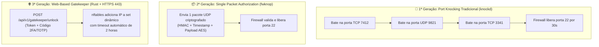
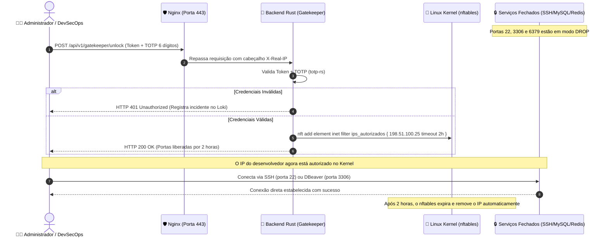

# Port Knocking e Liberação Dinâmica de Portas: Do Knocking Clássico ao Gatekeeper Web em Rust

> Na segurança ofensiva e defensiva, portas abertas em servidores públicos (como SSH `22`, MySQL `3306` e Redis `6379`) são os alvos primários de scanners automatizados. A técnica de **Port Knocking** (batida de porta) e sua evolução moderna, o **Web-Based Gatekeeper**, mantêm essas portas em modo **DROP** silencioso no firewall por padrão, destrancando o acesso temporariamente apenas para o endereço IP do operador legítimo após a validação de uma credencial ou sinal prévio.

Essa abordagem complementa o [bloqueio de portas e multiplexação na porta 443](/seguranca/bloqueando-portas.md) e o [ofuscamento de rotas administrativas](/seguranca/ofuscamento-rotas-admin.md), criando um ambiente onde o servidor aparenta estar completamente desligado ou inerte para qualquer invasor na internet.

---

## 1. A Evolução da Proteção Oculta de Portas

Existem três gerações de mecanismos para desbloqueio sob demanda:



### 1.1 Port Knocking Tradicional (`knockd`)
* **Como funciona:** O cliente tenta abrir conexões TCP/UDP em uma sequência secreta de portas fechadas (ex: `7412`, `9821`, `3341`). Um daemon em segundo plano (`knockd`) escuta a interface de rede via `libpcap`. Ao detectar a sequência exata, ele injeta uma regra temporária no `iptables`.
* **Desvantagens modernas:**
  * Trafega em texto plano na rede (vulnerável a bisbilhoteiros de rede / *sniffing*).
  * Redes com NAT ou operadoras móveis (CGNAT) podem reordenar os pacotes, quebrando a sequência e impedindo o acesso.
  * Facilmente identificável por sistemas IDS/IPS modernos.

### 1.2 Single Packet Authorization (SPA / `fwknop`)
* **Como funciona:** Substitui a sequência de portas por um **único pacote UDP criptografado** contendo carimbo de data/hora (*timestamp*), assinatura HMAC e a solicitação de acesso.
* **Vantagens:** Imune a ataques de repetição (*replay attacks*) e invisível para scanners de portas.
* **Desvantagem:** Exige a instalação de um software cliente proprietário (`fwknop-client`) em cada computador ou dispositivo móvel que você usar para acessar a infraestrutura.

### 1.3 Web-Based Gatekeeper (Rust + HTTPS 443 + `nftables`)
* **Como funciona:** Aproveita a porta HTTPS `443` já aberta para a sua aplicação web normal. O backend em Rust expõe uma rota administrativa protegida por **Autenticação Multifator (TOTP/2FA)**.
* **Vantagens:**
  * **Zero clientes extras:** Funciona de qualquer máquina com um simples comando `curl` ou pelo próprio navegador web.
  * **Zero portas novas abertas:** Não depende de portas UDP estranhas; trafega 100% dentro do túnel TLS da porta 443.
  * **Alta granularidade:** O Linux (`nftables`) remove automaticamente o IP após o período estipulado (ex: 2 horas), sem necessidade de cron jobs de limpeza.

---

## 2. Arquitetura do Web-Based Gatekeeper

O diagrama a seguir detalha o ciclo de vida completo da solicitação de liberação e expiração:



---

## 3. Configuração do Firewall Host com `nftables` (Sets com Timeout Nativo)

Diferente do legado `iptables`, o moderno **`nftables`** possui suporte nativo a conjuntos de elementos (*sets*) com parâmetros de expiração temporária automática (**`flags timeout`**).

Edite o arquivo de configuração `/etc/nftables.conf`:

```nftables
#!/usr/sbin/nft -f

flush ruleset

table inet filter {
    # Conjunto dinâmico de IPs com expiração automática gerenciada pelo Kernel
    set ips_autorizados {
        type ipv4_addr
        flags timeout
    }

    chain input {
        type filter hook input priority filter; policy drop;

        # 1. Permite tráfego local de loopback e conexões já estabelecidas
        iif "lo" accept
        ct state established,related accept

        # 2. Portas públicas universais (HTTP e HTTPS)
        tcp dport { 80, 443 } accept

        # 3. Portas restritas: Só aceita pacotes se o IP de origem estiver no set
        ip saddr @ips_autorizados tcp dport 22   accept comment "SSH sob demanda"
        ip saddr @ips_autorizados tcp dport 3306 accept comment "MySQL sob demanda"
        ip saddr @ips_autorizados tcp dport 6379 accept comment "Redis sob demanda"

        # 4. Qualquer outra conexão de entrada é descartada silenciosamente
        drop
    }

    chain forward {
        type filter hook forward priority filter; policy drop;
    }

    chain output {
        type filter hook output priority filter; policy accept;
    }
}
```

Aplique as regras com:
```bash
sudo nft -f /etc/nftables.conf
```

---

## 4. Implementação Segura no Backend Rust (Axum + TOTP)

Para que o backend web atue como porteiro sem violar o **Princípio do Menor Privilégio**, a aplicação Rust executará como usuário comum (`www-data` ou `app`), invocando o utilitário `nft` através de uma concessão restrita no arquivo `/etc/sudoers.d/rust-gatekeeper`.

### 1. Configuração do Sudo Restrito (`/etc/sudoers.d/rust-gatekeeper`):
```sudoers
# Permite que o usuário www-data execute exclusivamente o comando de inserção no set
www-data ALL=(ALL) NOPASSWD: /usr/sbin/nft add element inet filter ips_autorizados *
```

### 2. Implementação do Handler em Rust:

```rust
use axum::{
    extract::{ConnectInfo, Json, State},
    http::{HeaderMap, StatusCode},
    response::IntoResponse,
    routing::post,
    Router,
};
use serde::{Deserialize, Serialize};
use std::net::{IpAddr, SocketAddr};
use std::process::Command;
use totp_rs::{Algorithm, Secret, TOTP};

#[derive(Debug, Deserialize)]
pub struct UnlockPayload {
    pub segredo_admin: String,
    // Código de 6 dígitos gerado pelo app no celular (Google Authenticator / Authy)
    pub codigo_totp: String,
}

pub struct AppState {
    pub token_mestre: String,
    pub totp_secret: String,
}

pub fn rotas_gatekeeper(estado: AppState) -> Router {
    Router::new()
        .route("/api/v1/infra/gatekeeper/unlock", post(destrancar_firewall_handler))
        .with_state(std::sync::Arc::new(estado))
}

pub async fn destrancar_firewall_handler(
    State(state): State<std::sync::Arc<AppState>>,
    headers: HeaderMap,
    connect_info: ConnectInfo<SocketAddr>,
    Json(payload): Json<UnlockPayload>,
) -> impl IntoResponse {
    // 1. Extração segura do IP real do cliente
    let client_ip = extrair_ip_real(&headers, &connect_info);

    // 2. Validação do Token de Administrador
    if payload.segredo_admin != state.token_mestre {
        tracing::warn!(
            target: "auditoria_seguranca",
            ip = %client_ip,
            "Tentativa de desbloqueio de firewall com token mestre incorreto."
        );
        return (StatusCode::UNAUTHORIZED, "Acesso negado.").into_response();
    }

    // 3. Validação do Código 2FA/TOTP (Janela de 30 segundos)
    let secret_bytes = Secret::Encoded(state.totp_secret.clone()).to_bytes().unwrap();
    let totp = TOTP::new(
        Algorithm::SHA1,
        6,
        1,
        30,
        secret_bytes,
    ).unwrap();

    let codigo_valido = totp.check_current(&payload.codigo_totp).unwrap_or(false);
    if !codigo_valido {
        tracing::error!(
            target: "auditoria_seguranca",
            ip = %client_ip,
            "Falha de autenticação TOTP na rota de desbloqueio do firewall."
        );
        return (StatusCode::UNAUTHORIZED, "Código 2FA inválido ou expirado.").into_response();
    }

    // 4. Executa a inserção do IP no conjunto dinâmico do nftables (Timeout de 2 horas)
    // Prevenção contra Command Injection: Passagem direta como argumentos isolados
    let status_comando = Command::new("sudo")
        .arg("/usr/sbin/nft")
        .arg("add")
        .arg("element")
        .arg("inet")
        .arg("filter")
        .arg("ips_autorizados")
        .arg(format!("{{ {} timeout 2h }}", client_ip))
        .status();

    match status_comando {
        Ok(status) if status.success() => {
            tracing::info!(
                target: "auditoria_seguranca",
                ip = %client_ip,
                duracao_horas = 2,
                "Portas administrativas (SSH/MySQL/Redis) liberadas com sucesso via Gatekeeper."
            );
            (
                StatusCode::OK,
                Json(serde_json::json!({
                    "status": "sucesso",
                    "mensagem": "Portas administrativas liberadas para o seu IP por 2 horas.",
                    "ip_liberado": client_ip.to_string()
                })),
            ).into_response()
        }
        _ => {
            tracing::error!(
                target: "auditoria_seguranca",
                ip = %client_ip,
                "Falha ao executar comando nftables no sistema operacional."
            );
            (StatusCode::INTERNAL_SERVER_ERROR, "Erro ao atualizar regras de firewall.").into_response()
        }
    }
}

/// Extração de IP com fallback seguro
fn extrair_ip_real(headers: &HeaderMap, connect_info: &ConnectInfo<SocketAddr>) -> IpAddr {
    if let Some(cf_ip) = headers.get("cf-connecting-ip")
        .and_then(|v| v.to_str().ok())
        .and_then(|s| s.parse::<IpAddr>().ok())
    {
        return cf_ip;
    }
    if let Some(real_ip) = headers.get("x-real-ip")
        .and_then(|v| v.to_str().ok())
        .and_then(|s| s.parse::<IpAddr>().ok())
    {
        return real_ip;
    }
    connect_info.0.ip()
}
```

---

## 5. Script de Automação no Cliente (Conexão com Um Clique)

Para que o administrador não precise abrir o navegador ou digitar requisições manuais a cada login, crie um utilitário simples em sua máquina local (`vps-unlock.sh`):

```bash
#!/usr/bin/env bash
# vps-unlock.sh: Destranca o firewall do servidor e inicia a conexão SSH imediatamente

set -e

SERVER_URL="https://app.empresa.com/api/v1/infra/gatekeeper/unlock"
ADMIN_TOKEN="SEGREDO_SUPER_FORTE_DEFINIDO_NO_ENV"
TOTP_SECRET_BASE32="JBSWY3DPEHPK3PXP" # Seu segredo TOTP para geração automática

# Gera o código TOTP de 6 dígitos via oathtool (ou solicite via read para digitar do celular)
if command -v oathtool &> /dev/null; then
    CODIGO_2FA=$(oathtool --totp -b "$TOTP_SECRET_BASE32")
else
    read -p "Digite o código 2FA do seu celular: " CODIGO_2FA
fi

echo "🔓 Solicitando liberação temporária das portas para o IP local..."

RESPOSTA=$(curl -s -X POST "$SERVER_URL" \
    -H "Content-Type: application/json" \
    -d "{\"segredo_admin\": \"$ADMIN_TOKEN\", \"codigo_totp\": \"$CODIGO_2FA\"}")

echo "Resultado: $RESPOSTA"

# Imediatamente após receber a autorização do firewall, inicia a conexão SSH
echo "🚀 Conectando via SSH..."
ssh devsecops@app.empresa.com
```

Basta tornar o script executável e criar um alias no seu terminal:
```bash
chmod +x vps-unlock.sh
alias conectar-vps="./vps-unlock.sh"
```

---

## 6. Camadas Adicionais de Proteção no Endpoint de Desbloqueio

Como a rota `/api/v1/infra/gatekeeper/unlock` é a fechadura mestra do seu firewall, ela deve receber proteções perimétricas reforçadas no Nginx:

```nginx
# Configuração de Rate Limiting Estrito para a rota de desbloqueio
limit_req_zone $binary_remote_addr zone=gatekeeper_limit:10m rate=3r/m;

server {
    server_name app.empresa.com;

    location = /api/v1/infra/gatekeeper/unlock {
        # Permite no máximo 3 requisições por minuto por IP com rejeição imediata
        limit_req zone=gatekeeper_limit nodelay;

        proxy_pass http://127.0.0.1:3000;
        proxy_set_header Host $host;
        proxy_set_header X-Real-IP $remote_addr;
        proxy_set_header X-Forwarded-For $proxy_add_x_forwarded_for;
    }
}
```

> [!TIP]
> **Ofuscamento de Caminho:** Para reduzir ruídos em scanners de URL, combine esta prática com o [ofuscamento de rotas administrativas](/seguranca/ofuscamento-rotas-admin.md), renomeando a rota pública no seu `.env` para algo imprevisível (ex: `/api/v1/auth/k9f2-dynamic-access-point`).

---

## 7. Comparativo das Técnicas de Liberação Sob Demanda

| Critério | Port Knocking Clássico (`knockd`) | SPA (`fwknop`) | Web Gatekeeper (Rust + `nftables`) | VPN Mesh (Tailscale/WireGuard) |
| :--- | :---: | :---: | :---: | :---: |
| **Dependência de Cliente Local** | 🟡 Requer cliente de knocking | 🔴 Requer binário `fwknop` | 🟢 Zero (usa apenas `curl`/browser) | 🔴 Requer cliente VPN ativo |
| **Resistência a Replay Attack** | ❌ Nula (Sniffing expõe portas) | 🟢 Total (HMAC + Timestamp) | 🟢 Total (TLS 1.3 + TOTP efêmero) | 🟢 Total (Criptografia de chave pública) |
| **Suporte a 2FA / Celular** | ❌ Inviável | 🟡 Complexo | 🟢 Nativo (Google Authenticator) | 🟢 Nativo (SSO corporativo) |
| **Resiliência a CGNAT / Redes Móveis** | 🔴 Baixa (Pacotes fora de ordem) | 🟢 Alta (1 único pacote) | 🟢 Perfeita (Sessão TCP estável) | 🟢 Perfeita (Traversal UDP/STUN) |
| **Controle de Timeout no Kernel** | 🟡 Requer script de cron | 🟡 Gerenciado pelo daemon | 🟢 Nativo do `nftables` | 🟡 Requer revogação manual de chave |
| **Superfície de Ataque Exposta** | Portas TCP/UDP aleatórias | 1 Porta UDP secreta | Apenas a porta HTTPS 443 existente | Nenhuma porta pública |

---

## 8. Resumo e Regras de Ouro

1. **Mantenha tudo em DROP por padrão:** A política padrão das portas `22`, `3306` e `6379` no firewall deve ser `drop`, sem emitir respostas `ICMP Port Unreachable` ou `TCP RST`. O servidor deve aparentar não existir.
2. **Utilize o `nftables` moderno:** Substitua o legado `iptables` por conjuntos com expiração nativa (`flags timeout`). Isso elimina scripts frágeis de agendamento de limpeza de IPs.
3. **Exija sempre Autenticação Multifator (TOTP):** Nunca utilize apenas uma senha estática na rota de desbloqueio. A obrigatoriedade do código de 6 dígitos que expira em 30 segundos impede que credenciais vazadas abram a infraestrutura.
4. **Aplique o Princípio do Menor Privilégio:** A aplicação web em Rust deve rodar como usuário não-privilegiado, executando exclusivamente a linha específica do comando `nft add element` via sudo restrito sem senha.
5. **Integre com a Stack de Logs:** Registre todas as tentativas de liberação de portas (bem-sucedidas ou rejeitadas) com `target: "auditoria_seguranca"`, permitindo que o [Grafana Loki](/seguranca/stack-de-coleta-de-logs.md) alerte a equipe em caso de anomalias.

---

### Leituras Complementares no Guia:
* [Redução de Superfície de Ataque: Bloqueio de Portas e Multiplexação na 443](/seguranca/bloqueando-portas.md)
* [Ofuscamento de Rotas Administrativas e Defesa em Profundidade](/seguranca/ofuscamento-rotas-admin.md)
* [Segurança Proativa: Monitoramento e Resposta a Payloads Anômalos em Rust](/seguranca/reagir-payloads-grandes.md)
* [Stack de Coleta e Centralização de Logs](/seguranca/stack-de-coleta-de-logs.md)
