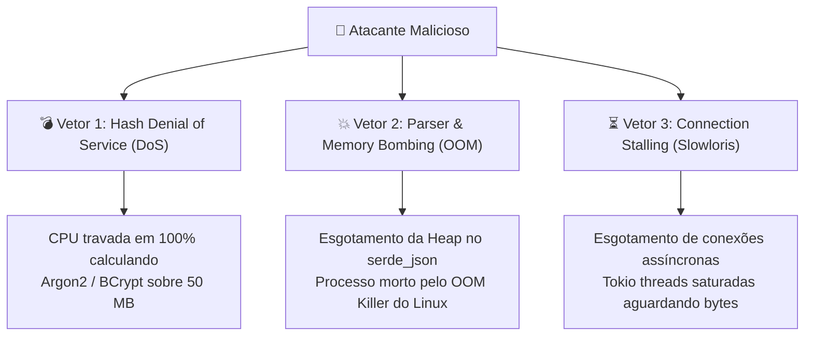
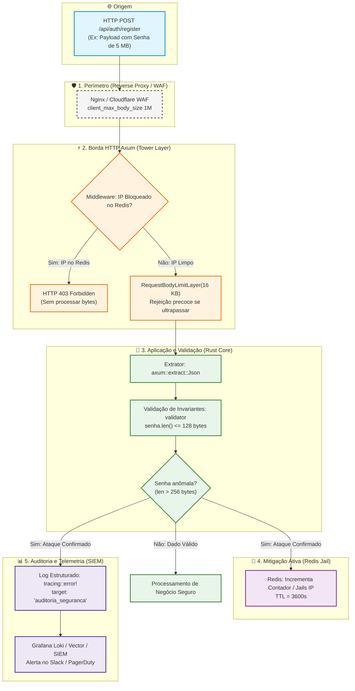

# Segurança Proativa: Monitoramento e Resposta a Payloads Anômalos em Rust

> O envio de payloads ou campos de texto com tamanhos anômalos (como uma senha de 50 MB ou um corpo JSON desproporcional) raramente é um erro acidental de usuário: na imensa maioria dos casos, trata-se de sondagem maliciosa, tentativa de **Negação de Serviço (DoS)** por exaustão de CPU em algoritmos criptográficos ou esgotamento de memória RAM (*Out of Memory* - OOM).

Transformar essa tentativa de ataque em uma **oportunidade de defesa ativa** permite auditar, mitigar e neutralizar atacantes antes que causem qualquer degradação nos serviços legítimos.

Em vez de apenas descartar a requisição com um erro genérico, uma arquitetura resiliente utiliza **Defesa em Profundidade**, correlacionando middlewares de limitação de taxa, armazenamento volátil em memória (Redis) e pipelines de auditoria e observabilidade (Tracing + Grafana Loki).

---

## 1. Modelagem de Ameaças: Por que o Atacante Envia Payloads Anômalos?

Compreender o objetivo do invasor é o primeiro passo para desenhar contramedidas eficazes:



1. **CPU Starvation em Funções Criptográficas:** Algoritmos como Argon2id, bcrypt ou PBKDF2 foram matematicamente projetados para demandar alto custo computacional por ciclo. Calcular o hash de uma entrada com megabytes de comprimento pode bloquear uma thread por minutos, tornando a API inacessível com um volume reduzido de requisições.
2. **Esgotamento da Heap (*Parser Bombing*):** Deserializadores JSON como o `serde_json` precisam alocar estruturas intermediárias dinâmicas na Heap para acomodar nós de texto extensos. Requisições concorrentes com payloads desmedidos forçam o alocador do sistema operacional até o disparo do *OOM Killer*.
3. **Saturação de Conexões (*Slowloris / Large Stalling*):** Transmitir payloads imensos em taxas de transferência reduzidas mantém sockets abertos indefinidamente, exaurindo os descritores de arquivo (*file descriptors*) do servidor.

---

## 2. A Arquitetura Defensiva em 5 Camadas

Uma resposta profissional a payloads anômalos não delega toda a segurança a um único ponto do sistema. Ela atua em camadas sucessivas de contenção:



---

## 3. Camada 1: Proteção Perimétrica no Reverse Proxy (Nginx)

A melhor requisição maliciosa é aquela que **sequer chega à aplicação Rust**. No proxy reverso (Nginx, Caddy ou Traefik), restrinja o tamanho do corpo da requisição globalmente e aplique limites estritos em rotas sensíveis:

```nginx
# /etc/nginx/conf.d/api_security.conf

# Limite global padrão para rotas comuns
client_max_body_size 2M;

server {
    listen 443 ssl http2;
    server_name api.empresa.com;

    # Rotas de Autenticação: limite estrito de 16 KB!
    # Nenhuma credencial legítima precisa de mais do que isso.
    location ~* ^/api/v1/auth/(login|register|reset-password) {
        client_max_body_size 16k;

        proxy_pass http://127.0.0.1:3000;
        proxy_set_header X-Real-IP $remote_addr;
        proxy_set_header X-Forwarded-For $proxy_add_x_forwarded_for;
        proxy_set_header Host $host;
    }

    # Demais rotas da aplicação
    location / {
        proxy_pass http://127.0.0.1:3000;
        proxy_set_header X-Real-IP $remote_addr;
        proxy_set_header X-Forwarded-For $proxy_add_x_forwarded_for;
        proxy_set_header Host $host;
    }
}
```

---

## 4. Camada 2: Limitação Granular no Framework Axum

No framework Axum, você pode configurar o [`DefaultBodyLimit`](https://docs.rs/axum/latest/axum/extract/struct.DefaultBodyLimit.html) de forma global e sobrescrevê-lo com limites estritos em rotas de alto risco usando a camada `RequestBodyLimitLayer`:

```rust
use axum::{
    extract::DefaultBodyLimit,
    routing::post,
    Router,
};
use tower_http::limit::RequestBodyLimitLayer;

pub fn criar_roteador() -> Router {
    // 1. Rota de autenticação: teto máximo rígido de 16 KB
    let rotas_auth = Router::new()
        .route("/login", post(login_handler))
        .route("/register", post(cadastrar_usuario_handler))
        .layer(RequestBodyLimitLayer::new(16 * 1024)); // 16 KB

    // 2. Roteador raiz com limite global de segurança (ex: 2 MB)
    Router::new()
        .nest("/api/v1/auth", rotas_auth)
        .layer(DefaultBodyLimit::max(2 * 1024 * 1024)) // 2 MB para as demais rotas
}
```

> [!TIP]
> Se um cliente malicioso tentar enviar uma requisição de 100 KB para `/api/v1/auth/login`, o Axum interromperá a leitura do *stream* imediatamente e responderá com o status `HTTP 413 Payload Too Large` sem alocar a string na memória.

---

## 5. Camada 3: Extração Segura do Endereço IP do Cliente

Para aplicar bloqueios e auditorias, o sistema precisa capturar o endereço IP real da requisição. Em ambientes corporativos atrás de proxies reversos ou CDNs (Cloudflare, AWS ALB, Nginx), confiar ingenuamente em cabeçalhos HTTP pode permitir ataques de **IP Spoofing**.

```rust
use axum::{
    extract::{ConnectInfo, Request},
    http::HeaderMap,
};
use std::net::{IpAddr, SocketAddr};

/// Extrai o IP real do cliente levando em conta proxies reversos de confiança
pub fn extrair_ip_cliente(headers: &HeaderMap, connect_info: &ConnectInfo<SocketAddr>) -> IpAddr {
    // 1. Se estiver atrás de Cloudflare corporativo:
    if let Some(cf_ip) = headers.get("cf-connecting-ip")
        .and_then(|v| v.to_str().ok())
        .and_then(|s| s.parse::<IpAddr>().ok())
    {
        return cf_ip;
    }

    // 2. Se estiver atrás de Nginx/Load Balancer configurado com X-Real-IP:
    if let Some(real_ip) = headers.get("x-real-ip")
        .and_then(|v| v.to_str().ok())
        .and_then(|s| s.parse::<IpAddr>().ok())
    {
        return real_ip;
    }

    // 3. Fallback seguro: Socket IP da conexão física TCP
    connect_info.0.ip()
}
```

> [!WARNING]
> Nunca faça leitura cega do cabeçalho `X-Forwarded-For` sem validar se o proxy anterior expurga cabeçalhos forjados. Um atacante pode injetar `X-Forwarded-For: 1.1.1.1` para culpar outro IP ou burlar restrições.

---

## 6. Camada 4: Middleware Reativo de Banimento Dinâmico no Redis (*IP Jailing*)

O objetivo do middleware de contenção é verificar na velocidade da memória RAM (Redis) se o IP solicitante está na lista de bloqueio temporário (*jail*). Se estiver, a requisição é barrada no início do ciclo HTTP:

```rust
use axum::{
    extract::{ConnectInfo, Request, State},
    http::StatusCode,
    middleware::Next,
    response::{IntoResponse, Response},
    Json,
};
use std::net::SocketAddr;
use std::sync::Arc;

pub struct AppState {
    pub redis: deadpool_redis::Pool,
}

/// Middleware que rejeita requisições de IPs que cometeram infrações de segurança
pub async fn verificar_ip_bloqueado(
    State(state): State<Arc<AppState>>,
    connect_info: ConnectInfo<SocketAddr>,
    req: Request,
    next: Next,
) -> Result<Response, StatusCode> {
    let client_ip = extrair_ip_cliente(req.headers(), &connect_info);
    let chave_ban = format!("security:banned:ip:{}", client_ip);

    // Obtém conexão assíncrona do pool Redis
    if let Ok(mut conn) = state.redis.get().await {
        let esta_bloqueado: bool = redis::cmd("EXISTS")
            .arg(&chave_ban)
            .query_async(&mut conn)
            .await
            .unwrap_or(false);

        if esta_bloqueado {
            // Rejeição imediata sem carregar payload ou tocar no banco de dados
            return Err(StatusCode::FORBIDDEN);
        }
    }

    // Prossegue com a requisição normalmente
    Ok(next.run(req).await)
}
```

---

## 7. Camada 5: Detector de Anomalia no Handler e Punição Ativa

Quando a requisição passa pelo limite de tamanho global (ex: 16 KB), mas viola o limite funcional do campo de senha (por exemplo, a senha permitida é de até 128 caracteres, mas o payload contém 4.000 caracteres), **isso não é um erro de digitação**. É uma tentativa deliberada de abuso.

O handler deve capturar esse padrão, aplicar uma política de pontuação (*Strike System*) no Redis e emitir um log de severidade crítica:

```rust
use axum::{
    extract::{ConnectInfo, Json, State},
    http::{HeaderMap, StatusCode},
    response::IntoResponse,
};
use serde::Deserialize;
use std::net::SocketAddr;
use std::sync::Arc;
use validator::Validate;

#[derive(Debug, Deserialize, Validate)]
pub struct CadastroRequest {
    #[validate(length(min = 3, max = 50, message = "Nome inválido"))]
    pub nome: String,

    #[validate(email(message = "E-mail inválido"))]
    pub email: String,

    // Invariante de negócio: Senha aceita no máximo 128 bytes
    #[validate(length(min = 8, max = 128, message = "A senha deve ter entre 8 e 128 caracteres."))]
    pub senha: String,
}

pub async fn cadastrar_usuario_handler(
    State(state): State<Arc<AppState>>,
    connect_info: ConnectInfo<SocketAddr>,
    headers: HeaderMap,
    Json(payload): Json<CadastroRequest>,
) -> impl IntoResponse {
    let client_ip = extrair_ip_cliente(&headers, &connect_info);
    let tamanho_senha_bytes = payload.senha.len();

    // 1. Validação de Regras de Domínio do DTO
    if let Err(erros) = payload.validate() {
        
        // 🚨 ANÁLISE DE ANOMALIA: Violação desmedida do limite de senha
        // Limite do negócio: 128 bytes. Se enviou > 256 bytes, é sondagem/ataque!
        if tamanho_senha_bytes > 256 {
            // Executa a punição e registra a ocorrência
            registrar_e_mitigar_ataque(&state, client_ip, tamanho_senha_bytes).await;

            return (
                StatusCode::BAD_REQUEST,
                Json(serde_json::json!({
                    "erro": "requisicao_anomala",
                    "mensagem": "Comportamento não compatível com o protocolo de segurança."
                }))
            ).into_response();
        }

        // Falha convencional de validação (ex: senha de 6 caracteres ou e-mail sem @)
        return (StatusCode::UNPROCESSABLE_ENTITY, Json(erros)).into_response();
    }

    // 2. Prossegue para a criação de conta segura (com hashing Argon2id)
    (StatusCode::CREATED, "Usuário cadastrado com sucesso!").into_response()
}

/// Registra o incidente na auditoria e pune o IP com banimento temporário
async fn registrar_e_mitigar_ataque(state: &AppState, ip: std::net::IpAddr, tamanho_bytes: usize) {
    // 1. Log Estruturado de Alta Severidade para o SIEM
    tracing::error!(
        target: "auditoria_seguranca",
        evento = "ataque_dos_senha_detectado",
        ip_origem = %ip,
        tamanho_recebido_bytes = tamanho_bytes,
        limite_esperado_bytes = 128,
        acao_tomada = "ip_bloqueado_temporariamente",
        "ALERTA CRÍTICO: Payload de senha desproporcional detectado. Possível ataque DoS por exaustão de CPU."
    );

    // 2. Punição Ativa no Redis: Sistema de 3 Strikes ou Bloqueio Imediato
    if let Ok(mut conn) = state.redis.get().await {
        let chave_strikes = format!("security:strikes:ip:{}", ip);
        let chave_ban = format!("security:banned:ip:{}", ip);

        // Incrementa infração com expiração de 15 minutos
        let strikes: i32 = redis::cmd("INCR")
            .arg(&chave_strikes)
            .query_async(&mut conn)
            .await
            .unwrap_or(1);

        let _ : () = redis::cmd("EXPIRE")
            .arg(&chave_strikes)
            .arg(900) // Janela de 15 minutos
            .query_async(&mut conn)
            .await
            .unwrap_or(());

        // Se cometeu infração grave (> 1024 bytes) ou acumulou 3 tentativas: BAN IMEDIATO!
        if tamanho_bytes > 1024 || strikes >= 3 {
            let tempo_ban_segundos = 3600; // 1 Hora de bloqueio total
            let _ : () = redis::cmd("SETEX")
                .arg(&chave_ban)
                .arg(tempo_ban_segundos)
                .arg("bloqueado_por_payload_anomalo")
                .query_async(&mut conn)
                .await
                .unwrap_or(());

            tracing::warn!(
                target: "auditoria_seguranca",
                ip_origem = %ip,
                duracao_ban_segundos = tempo_ban_segundos,
                "IP colocado em quarentena (Jail) no Redis com sucesso."
            );
        }
    }
}
```

> [!CAUTION]
> **Privacidade e Conformidade (LGPD / GDPR / OWASP):** NUNCA, sob nenhuma hipótese, grave o texto cru da senha nos logs de erro (`tracing::error!`). Registre apenas o **tamanho em bytes**, o **endereço IP**, a **rota** e a **severidade**. Gravar senhas em logs de texto viola normas de segurança e expõe usuários a vazamentos internos.

---

## 8. Camada 6: Auditoria Centralizada e Alertas no SIEM (Grafana Loki)

Emitir o log com `target: "auditoria_seguranca"` conecta a aplicação diretamente à [Stack de Coleta de Logs](/seguranca/stack-de-coleta-de-logs.md).

### 1. Visualização e Filtragem com LogQL (Grafana):
No painel do Grafana, os analistas de segurança podem filtrar tentativas de ataque em tempo real:

```logql
{app="api_rust", target="auditoria_seguranca"} |= "ataque_dos_senha_detectado"
```

### 2. Regra de Alerta Proativo (Grafana Alerting / Prometheus Alertmanager):
Você pode configurar uma regra de disparo para notificar a equipe de infraestrutura no Slack, Discord ou PagerDuty se houver uma investida coordenada:

```yaml
# Regra de Alerta Prometheus / Loki
groups:
  - name: alertas_seguranca
    rules:
      - alert: AtaquePayloadAnomaloEmMassa
        expr: sum(rate({target="auditoria_seguranca"}[1m])) > 5
        for: 1m
        labels:
          severity: critical
        annotations:
          summary: "Múltiplas tentativas de DoS por payload excessivo detectadas"
          description: "O sistema detectou mais de 5 payloads com strings anômalas no último minuto. O IP atacante foi mitigado no Redis."
```

---

## 9. Matriz de Resposta a Incidentes por Categoria de Payload

| Tamanho do Campo | Classificação de Risco | Ação na Borda HTTP | Tratamento na Aplicação | Punição / Mitigação |
| :--- | :---: | :--- | :--- | :--- |
| **8 a 128 bytes** | 🟢 Legítimo | Processa normalmente | Executa validação e hash | Nenhuma (Fluxo padrão) |
| **129 a 256 bytes** | 🟡 Suspeito / Erro | Processa normalmente | Retorna `422 Unprocessable` | Registra log de validação leve |
| **257 B a 16 KB** | 🟠 Alerta Médio | Aceito pela camada HTTP | Bloqueia antes do Hash | Adiciona *strike* no Redis; Log de Auditoria |
| **16 KB a 2 MB** | 🔴 Alerta Crítico | Barrado pelo `RequestBodyLimitLayer` | Nem chega ao Handler | Retorna `413 Payload Too Large` imediato |
| **> 2 MB** | 🚨 Ataque Evidente | Rejeitado pelo Nginx / Proxy | Servidor Rust não é atingido | Drop na conexão TCP (`client_max_body_size`) |

---

## 10. Resumo e Regras de Ouro da Segurança Proativa

1. **Rejeite no ponto mais periférico possível:** Configure `client_max_body_size` no Nginx e `RequestBodyLimitLayer` no Axum para barrar requisições antes que o deserializador JSON use a memória Heap.
2. **Nunca passe strings anômalas para o algoritmo de Hash:** O custo do Argon2id/bcrypt deve ser reservado exclusivamente para senhas que atendam rigorosamente ao tamanho máximo pré-estabelecido (ex: $\le 128$ bytes).
3. **Puna a reincidência com Redis Jail:** Implemente um sistema de *strikes* voláteis. Atacantes que enviam payloads anômalos de forma repetida devem ser banidos temporariamente (15 a 60 minutos) com respostas imediatas `403 Forbidden`.
4. **Respeite a privacidade na auditoria:** Jamais grave o conteúdo da senha no log de auditoria. Registre apenas o comprimento do dado, o timestamp, a rota e o endereço IP de origem.
5. **Integre com Observabilidade em Tempo Real:** Conecte o `tracing::error!` a coletores como Grafana Alloy/Vector e visualize os picos de incidentes no Grafana Loki para acompanhar investidas contra a sua infraestrutura.

---

### Leituras Complementares no Guia:
* [Validação de Strings, Limite de Tamanho e Newtypes em Rust](/boas-praticas/Rust/validacao-string.md)
* [Stack de Coleta e Centralização de Logs](/seguranca/stack-de-coleta-de-logs.md)
* [Ofuscamento de Rotas Administrativas e Defesa em Profundidade](/seguranca/ofuscamento-rotas-admin.md)
