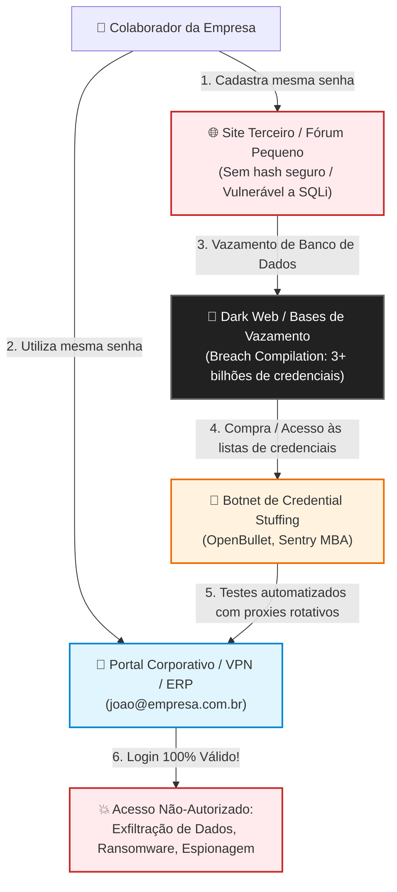
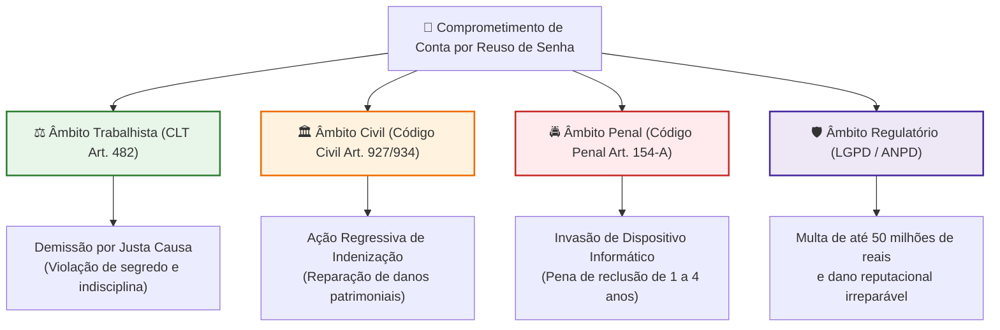
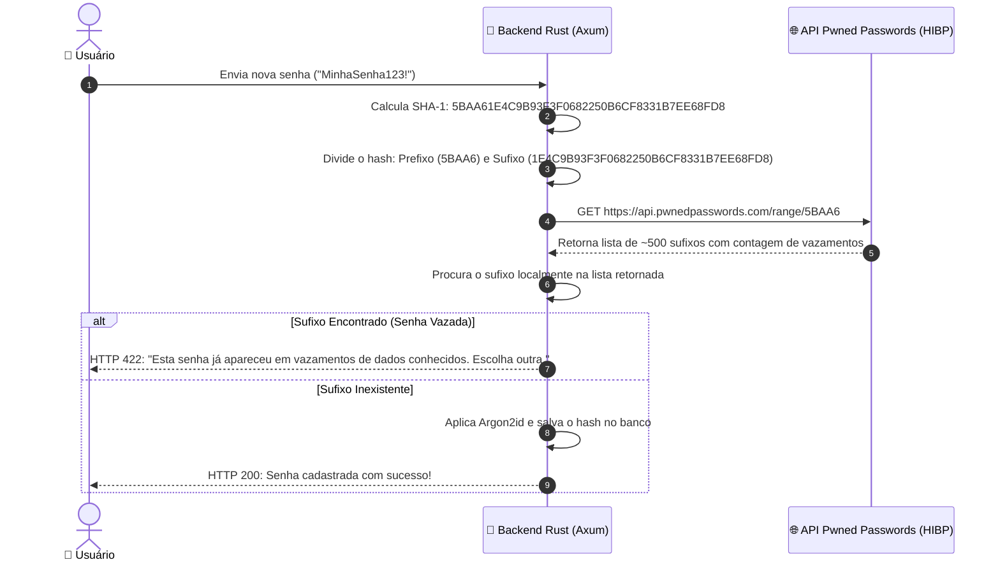
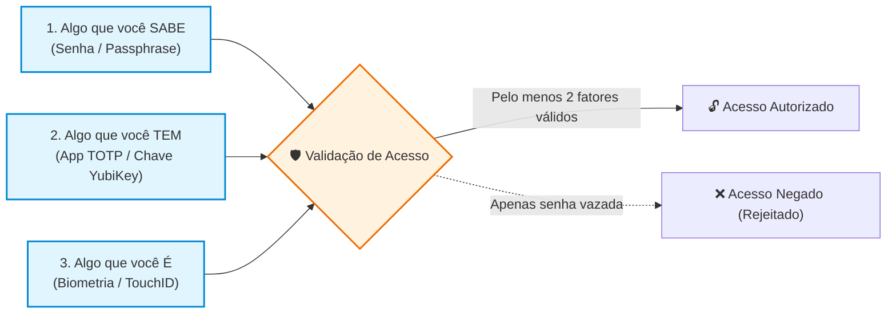
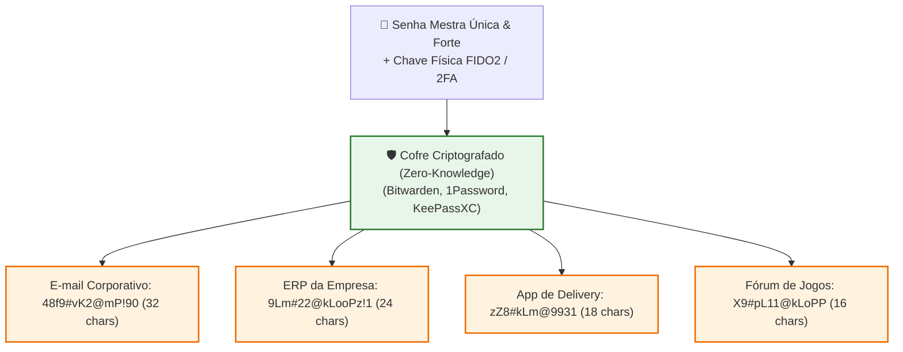

# O Perigo da Reutilização de Senhas: Credential Stuffing, Riscos Corporativos e Defesa em Profundidade

> Entre todas as vulnerabilidades cibernéticas, a **reutilização de senhas** (*Password Reuse*) é uma das mais silenciosas e devastadoras. O usuário médio mantém dezenas de contas digitais e, por conveniência cognitiva, tende a replicar a mesma combinação de e-mail e senha (ou variações triviais) em múltiplos serviços: desde fóruns de discussão despretensiosos e aplicativos secundários até e-mails corporativos, sistemas de ERP e portais bancários.

Quando um serviço de menor relevância sofre um vazamento de dados (*data breach*), a credencial exposta transforma-se imediatamente em um vetor de ataque direto contra a rede corporativa por meio de ataques automatizados de **Credential Stuffing**.

Este guia analisa a mecânica desse ataque, as consequências jurídicas e trabalhistas no Brasil, as diretrizes modernas do **NIST SP 800-63B** e as contramedidas técnicas indispensáveis na engenharia de software para blindar aplicações corporativas.

---

## 1. A Anatomia do Ataque: Do Fórum de Jogos à Intrusão Corporativa

O usuário frequentemente acredita que criar uma senha complexa (ex: `T3cl@d0#F0rt3!2024`) é suficiente para garantir sua proteção. No entanto, a segurança de uma senha depende estritamente do **elo mais fraco onde ela foi cadastrada**:



### O Que é *Credential Stuffing*?
Diferente de ataques de força bruta tradicionais (que tentam adivinhar senhas gerando combinações aleatórias), o *Credential Stuffing* baseia-se na injeção em massa de pares de credenciais (`email:senha`) reais, obtidas em vazamentos de terceiros.
* Atacantes utilizam ferramentas automatizadas e redes de proxies residenciais para contornar bloqueios simples por IP.
* As taxas médias de sucesso variam entre **1% e 3%**. Em uma lista vazada de 500.000 credenciais, isso representa de **5.000 a 15.000 contas comprometidas** sem que uma única falha de código tenha sido explorada na aplicação corporativa.

---

## 2. Cenários Comuns do Cotidiano Corporativo

A reutilização de senhas raramente é percebida como perigosa pelo colaborador. Cenários clássicos incluem:

* **O Cadastro em E-commerce ou App de Entrega:** O funcionário cadastra o e-mail corporativo (`nome@empresa.com.br`) em um aplicativo de delivery ou loja online para receber notificações no horário de trabalho, utilizando a mesma senha do seu computador de trabalho.
* **Ferramentas Gratuitas e Conversores Online:** Inscrição em sites de conversão de arquivos (ex: PDF para Excel) ou ferramentas temporárias que exigem login rápido. Muitos desses portais armazenam senhas em texto puro ou com algoritmos obsoletos (MD5/SHA-1) sem *salt*.
* **Variações Previsíveis:** O colaborador adota o padrão de mudar apenas o prefixo ou o sufixo (ex: `Empresa2024!`, `Banco2024!`, `Netflix2024!`). Dicionários modernos de quebra de senhas (*hashcat rules*) testam essas variações de forma automatizada em segundos.

---

## 3. Consequências Corporativas e Responsabilização Jurídica

O comprometimento de credenciais corporativas acarreta desdobramentos severos em múltiplos níveis do ordenamento jurídico brasileiro:



### 1. Responsabilidade Trabalhista (CLT): Justa Causa
A senha corporativa é pessoal, intransferível e de uso exclusivamente profissional. O compartilhamento ou a negligência grave no manuseio de credenciais pode configurar falta grave segundo o **Artigo 482 da CLT**:
* **Alínea "g" (Violação de segredo da empresa):** Se o vazamento da credencial expuser segredos industriais, tabelas de custos ou código-fonte.
* **Alínea "h" (Indisciplina ou insubordinação):** Descumprimento expresso da Política de Segurança da Informação (PSI) assinada pelo colaborador.
* **Sanções aplicáveis:** Advertência formal, suspensão disciplinar e **Demissão por Justa Causa**, sem direito a aviso prévio ou saque de FGTS.

### 2. Responsabilidade Civil: Ação de Reparação e Regresso
Se a invasão de uma conta corporativa causar prejuízos materiais (ex: ordens falsas de pagamento, exclusão de bancos de dados ou vazamento de dados de clientes), a empresa responde perante terceiros, mas pode mover **ação regressiva contra o empregado** (Artigo 934 do Código Civil) caso fique comprovada culpa manifesta ou desrespeito às normas de segurança interna.

### 3. Responsabilidade Penal (Código Penal):
O uso indevido de credenciais alheias para obter vantagem ilícita ou destruir dados configura crime:
* **Art. 154-A do Código Penal (Lei Carolina Dieckmann / Lei 14.155/2021):** *Invadir dispositivo informático alheio, conectado ou não à rede de computadores, mediante violação indevida de mecanismo de segurança.* Pena: **Reclusão de 1 a 4 anos e multa** (podendo ser ampliada se houver prejuízo econômico ou obtenção de comunicações privadas).

### 4. Responsabilidade Regulatória (LGPD):
Conforme abordado no tutorial de [Ciclo de Vida de Dados e LGPD](/seguranca/LGPD-o-que-guardar.md), incidentes decorrentes de credenciais comprometidas que resultem em vazamento de dados pessoais sujeitam a empresa a multas administrativas da ANPD de até **R\$ 50.000.000,00 por infração**, além de publicização obrigatória do incidente.

---

## 4. O Papel da Engenharia de Software: Prevenção Ativa no Backend

A engenharia de software não deve delegar a segurança unicamente à boa vontade do usuário. O sistema deve implementar contramedidas programáticas no ciclo de autenticação:

### 1. Verificação de Senhas Comprometidas com *k-Anonymity* (API Have I Been Pwned)
No momento em que o usuário tenta cadastrar ou alterar sua senha, o backend deve consultar se aquela credencial exata já vazou publicamente em algum incidente mundial.

Para não enviar a senha do usuário pela rede (o que seria uma falha gravíssima), utiliza-se o modelo matemático **k-Anonymity**:
1. O backend calcula o hash SHA-1 da senha em memória.
2. Envia para a API externa **apenas os primeiros 5 caracteres** do hash (o prefixo).
3. A API devolve uma lista com todos os sufixos de hashes conhecidos que começam com aquele prefixo.
4. O backend pesquisa localmente se o restante do seu hash consta na lista retornada.



---

### Implementação Prática em Rust com `reqwest` e `sha1`:

```rust
use sha1::{Digest, Sha1};

#[derive(Debug, PartialEq)]
pub enum StatusSenha {
    Segura,
    Comprometida { ocorrencias: u64 },
}

/// Verifica se a senha fornecida consta em vazamentos públicos mundiais sem expor o segredo
pub async fn verificar_senha_vazada(senha: &str) -> Result<StatusSenha, Box<dyn std::error::Error>> {
    // 1. Calcula o SHA-1 da senha em maiúsculas
    let mut hasher = Sha1::new();
    hasher.update(senha.as_bytes());
    let hash_completo = format!("{:X}", hasher.finalize());

    // 2. Divide em prefixo de 5 caracteres e sufixo restante (k-Anonymity)
    let prefixo = &hash_completo[..5];
    let sufixo_alvo = &hash_completo[5..];

    // 3. Consulta a base global do Have I Been Pwned enviando APENAS o prefixo
    let url = format!("https://api.pwnedpasswords.com/range/{}", prefixo);
    let client = reqwest::Client::builder()
        .user_agent("Guia-Desenvolvimento-Software-SecCheck")
        .build()?;

    let resposta = client.get(&url).send().await?.text().await?;

    // 4. Analisa a lista retornada em busca do sufixo
    for linha in resposta.lines() {
        if let Some((sufixo_retornado, contagem_str)) = linha.split_once(':') {
            if sufixo_retornado.eq_ignore_ascii_case(sufixo_alvo) {
                let ocorrencias = contagem_str.trim().parse::<u64>().unwrap_or(1);
                return Ok(StatusSenha::Comprometida { ocorrencias });
            }
        }
    }

    Ok(StatusSenha::Segura)
}
```

---

### 2. Autenticação Multifator Obrigatória (MFA / 2FA / Passkeys)
Se a empresa exige autenticação de múltiplos fatores, o vazamento isolado da senha torna-se inútil para o atacante automatizado:



* **Passkeys / WebAuthn (FIDO2):** O padrão criptográfico moderno mais seguro da atualidade. A chave privada nunca sai do dispositivo seguro do usuário (TPM / Secure Enclave), tornando ataques de phishing e reutilização de senhas matematicamente impossíveis.
* **Aplicativos de Autenticação (TOTP):** Como implementado no tutorial de [Port Knocking e Gatekeeper](/seguranca/port-knocking.md), o código de 6 dígitos expira a cada 30 segundos, inviabilizando botnets de *Credential Stuffing*.

---

### 3. Mitigação na Borda contra Botnets de Credential Stuffing
Conforme detalhado no guia de [Monitoramento e Resposta a Payloads Anômalos](/seguranca/reagir-payloads-grandes.md):
* **Rate Limiting no Nginx / Axum:** Limitar tentativas de autenticação para no máximo 5 requisições por minuto por IP.
* **Account Lockout Exponencial:** Após 5 tentativas falhas para o mesmo usuário, aplicar bloqueio progressivo na memória RAM via **Redis** (1 minuto $\rightarrow$ 5 minutos $\rightarrow$ 30 minutos).
* **Auditoria de Eventos no Loki:** Emitir logs com `target: "auditoria_seguranca"` para registrar picos de falhas de autenticação (`evento = "falha_login_multiplo"`).

---

## 5. Diretrizes Modernas de Senhas: O Que Mudou com o NIST SP 800-63B?

Por décadas, políticas corporativas forçavam os colaboradores a trocar senhas a cada 30 ou 90 dias e a incluir caracteres especiais complexos (`@#$`). A pesquisa moderna em psicologia e segurança da informação provou que **essas práticas antigas pioram a segurança**:

| Prática Antiga (Obsoleta) | Diretriz Moderna (NIST SP 800-63B) | Justificativa Científica |
| :--- | :--- | :--- |
| **Rotação Periódica Obrigatória** (Trocar a cada 30/60 dias) | **Troca Apenas Sob Comprometimento** (Não forçar troca arbitrária) | Usuários forçados a trocar senhas com frequência apenas incrementam números no final (`Senha@1` $\rightarrow$ `Senha@2`), gerando padrões previsíveis. |
| **Regras Rígidas de Composição** (Obrigatório: 1 maiúscula, 1 número, 1 símbolo) | **Prioridade para o Comprimento Total** (Mínimo de 12 a 16 caracteres) | Forçar composição leva a substituições mecânicas (`P@ssw0rd`). O tamanho da string confere resistência exponencialmente maior à força bruta. |
| **Perguntas de Segurança Pessoais** (*"Qual o nome do seu primeiro animal?"*) | **Proibição de Perguntas Secretas** | Respostas a perguntas pessoais são facilmente descobertas via engenharia social e redes sociais (LinkedIn, Instagram). |
| **Tolerância a Senhas Comuns** | **Bloqueio de Senhas Vazadas** (Consulta obrigatória à lista do HIBP) | Bloquear ativamente senhas que constam em vazamentos públicos elimina mais de 95% dos riscos de *Credential Stuffing*. |

> [!TIP]
> **Adote Frases-Senha (*Passphrases*):**  
> Em vez de senhas curtas e truncadas como `K8#m!9`, incentive o uso de frases-senha com múltiplas palavras aleatórias:  
> `cavalo-bateria-grampo-azul-2026`  
> Uma frase desse tipo possui mais de 30 caracteres, é imensamente mais resistente a ataques de dicionário e muito mais fácil de memorizar pelo ser humano.

---

## 6. O Papel dos Gerenciadores de Senhas

A única maneira de manter senhas únicas, randômicas e longas para centenas de sites sem sofrer sobrecarga mental é adotar um **Gerenciador de Senhas (*Password Manager*)**:



### Regras de Ouro para o Cofre de Senhas:
1. **Obrigatório MFA no Gerenciador:** O cofre que armazena todas as suas credenciais deve ser protegido por uma senha mestra robusta aliada a um segundo fator resistente a phishing (aplicativo TOTP ou chave YubiKey).
2. **Criptografia *Zero-Knowledge*:** Plataformas como Bitwarden e 1Password não conhecem a sua senha mestra. Todos os dados são criptografados localmente no seu dispositivo antes de sincronizarem com a nuvem.
3. **Preenchimento Automático Protege contra Phishing:** Gerenciadores de senhas verificam o domínio exato no navegador. Se você estiver em uma página falsa de phishing (`login.micros0ft.com`), o gerenciador **recusa-se a preencher a senha**, alertando sobre a fraude visual.

---

## 7. Matriz de Avaliação de Riscos de Métodos de Autenticação

| Método de Autenticação | Resistência a Reuso | Resistência a Phishing | Resistência a Força Bruta | Complexidade de Adoção |
| :--- | :---: | :---: | :---: | :---: |
| **Senha Simples Reutilizada** | 🔴 Nula | 🔴 Nula | 🔴 Baixa | 🟢 Mínima (Inseguro) |
| **Senha Longa + SMS** | 🟡 Média | 🔴 Baixa (SIM Swap) | 🟢 Alta | 🟢 Baixa |
| **Senha Longa + TOTP (App)** | 🟢 Alta | 🟡 Média | 🟢 Muito Alta | 🟢 Baixa |
| **Chave Física FIDO2 (YubiKey)** | 🚀 Máxima | 🚀 Imune (Criptografia de Origem) | 🚀 Máxima | 🟡 Média (Custo de Hardware) |
| **Passkeys (WebAuthn)** | 🚀 Máxima | 🚀 Imune (Par de Chaves Assimétricas) | 🚀 Máxima | 🟢 Baixa a Média (Padrão W3C) |

---

## 8. Resumo e Regras de Ouro

### Para o Desenvolvedor e Engenheiro de Software:
1. **Verifique senhas comprometidas no cadastro:** Utilize a API de *k-Anonymity* do Have I Been Pwned para impedir que usuários cadastrem senhas conhecidas em vazamentos globais.
2. **Proteja endpoints de autenticação na borda:** Implemente limites estritos de taxa (*Rate Limiting*) no Nginx/Axum e bloqueio temporário no Redis para neutralizar ferramentas de *Credential Stuffing*.
3. **Adote Hashing de Alta Resistência:** Utilize **Argon2id** com parâmetros calibrados de memória e CPU para impedir que senhas vazadas do seu banco sejam decifradas rapidamente.
4. **Implemente MFA por padrão:** A exigência de um segundo fator independente (TOTP / WebAuthn) neutraliza ataques mesmo quando a senha do colaborador foi exposta.

### Para o Colaborador e Usuário Corporativo:
1. **Regra Zero de Segurança:** NUNCA utilize a sua senha corporativa em serviços pessoais (redes sociais, e-commerces, aplicativos de lazer).
2. **Utilize um Gerenciador de Senhas:** Não tente memorizar dezenas de senhas; utilize um cofre criptografado com 2FA ativo para gerar senhas aleatórias e longas para cada site.
3. **Priorize Frases-Senha Longas:** Quando precisar memorizar uma senha (como a senha mestra ou a do computador), componha uma frase com 4 ou mais palavras aleatórias.
4. **Comunique Suspeitas Imediatamente:** Se você suspeitar que uma conta foi comprometida, avise a equipe de segurança e troque a credencial imediatamente. A proatividade reduz o impacto legal e operacional.

---

### Leituras Complementares no Guia:
* [Prevenção Contra Roubo de Sessão e Gestão de Tokens](/boas-praticas/security/session-security-manager.md)
* [Segurança Proativa: Monitoramento e Resposta a Payloads Anômalos em Rust](/seguranca/reagir-payloads-grandes.md)
* [Stack de Coleta e Centralização de Logs](/seguranca/stack-de-coleta-de-logs.md)
* [LGPD e Engenharia de Software: Ciclo de Vida e Retenção Legal](/seguranca/LGPD-o-que-guardar.md)
* [Validação de Strings, Limite de Tamanho e Newtypes em Rust](/boas-praticas/Rust/validacao-string.md)
