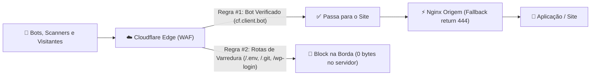

# 🛡️ Economizar Tráfego e Recursos Bloqueando Varreduras Automatizadas na Borda (Cloudflare WAF & Nginx)

> [!TIP]
> **Princípio Central:** Não puna com banimento permanente de IP no primeiro acesso, um único `GET` em `/mcp/` ou `/.well-known/` costuma ser apenas sondagem passiva de indexadores. Em vez disso, **filtre varreduras conhecidas na borda (WAF/CDN)** para economizar banda e CPU antes que a requisição chegue ao seu servidor, aplicando *Rate Limiting* apenas em volumes abusivos.

---

## 📋 Índice

1. [Sondagem Passiva vs. Ataque: Como Decidir?](#-1-sondagem-passiva-vs-ataque-como-decidir)
2. [Por que um `404` da Aplicação Ainda Consome Seus Recursos](#-2-por-que-um-404-da-aplicação-ainda-consome-seus-recursos)
3. [Arquitetura de Filtragem na Borda vs. Origem](#️-3-arquitetura-de-filtragem-na-borda-vs-origem)
4. [Passo a Passo: Configurando o Cloudflare WAF (Plano Gratuito)](#-4-passo-a-passo-configurando-o-cloudflare-waf-plano-gratuito)
5. [Exceção Segura para Google / Gemini e Seus Agentes](#-5-exceção-segura-para-google--gemini-e-seus-agentes)
6. [Defesa em Profundidade no Nginx (Camada de Origem)](#-6-defesa-em-profundidade-no-nginx-camada-de-origem)
7. [Cuidados para Não Bloquear Seus Próprios Agentes e SSH](#-7-cuidados-para-não-bloquear-seus-próprios-agentes-e-ssh)

---

## 🔍 1. Sondagem Passiva vs. Ataque: Como Decidir?

Com a popularização de agentes de IA e do *Model Context Protocol* (MCP), diversos rastreadores testam automaticamente rotas como `/mcp/`, `/llms.txt` ou `/.well-known/` (de forma análoga a `/robots.txt` ou `/sitemap.xml`). Banir o IP definitivamente logo na primeira requisição gera falsos positivos contra extensões de navegador, ferramentas de monitoramento e indexadores legítimos.

| Cenário | O que fazer | Motivo técnico |
| :--- | :--- | :--- |
| **Você não usa MCP no site** | Retorne `404 Not Found` (preferencialmente na borda/servidor web) ou bloqueie no WAF. | Sinaliza que o recurso não existe sem gastar processamento da aplicação. |
| **Você usa MCP apenas internamente** | Exija autenticação (`Token`/`OAuth`) ou restrinja por IP (*Allowlist*) e retorne `401`/`403`. | Garante controle de acesso real sem depender de "segurança por obscuridade". |
| **Muitas requisições do mesmo IP** | Aplique **Rate Limiting** (ex.: limite de requisições ou de `404` por minuto). | Mitiga sobrecarga e *flood* automaticamente sem listas manuais de banimento. |

---

## 💸 2. Por que um `404` da Aplicação Ainda Consome Seus Recursos

Um erro `404` comum gerado pela aplicação **não economiza** sua cota de tráfego nem sua CPU, porque a requisição já atravessou a rede, acordou o backend e devolveu uma resposta:

* **Banda (Tráfego):** páginas de `404` estilizadas pelo framework enviam cabeçalhos + HTML/CSS/JS (dezenas de kilobytes por tentativa). Multiplicado por milhares de varreduras diárias, isso consome a franquia da hospedagem.
* **CPU e Memória:** em stacks como WordPress, Laravel ou Next.js, cada `404` inicializa o runtime, carrega rotas e muitas vezes consulta o banco de dados apenas para concluir que a página não existe.

### Comparativo de Estratégias para Cortar o Gasto na Raiz

| Estratégia | Onde configurar | Impacto na sua hospedagem |
| :--- | :--- | :--- |
| **Bloqueio na Borda (WAF)** | Cloudflare (inclusive plano Free) | **Zero custo no servidor.** A requisição é encerrada na rede da CDN antes de tocar no seu IP. |
| **Fechar conexão (`444`)** | Nginx (`return 444;`) | **Custo quase zero.** Derruba a conexão TCP imediatamente sem enviar cabeçalhos nem corpo. |
| **`404` Estático / Vazio** | Nginx / Apache | **Custo mínimo.** Responde poucos bytes direto do servidor web, sem acionar PHP, Node.js ou banco. |
| **Rate Limiting** | Cloudflare ou Nginx | Bloqueia temporariamente IPs com excesso de requisições ou rajadas de `404` por minuto. |

---

## 🏗️ 3. Arquitetura de Filtragem na Borda vs. Origem



---

## ☁️ 4. Passo a Passo: Configurando o Cloudflare WAF (Plano Gratuito)

No plano gratuito (*Free*) da Cloudflare, você tem direito a **5 Custom Rules** de WAF. Com apenas uma regra bem escrita, já é possível barrar na borda centenas de varreduras comuns.

### Passo 1: Criar a regra de bloqueio de rotas
1. Acesse o painel da Cloudflare e selecione o seu domínio.
2. No menu lateral, vá em **Security > WAF > Custom rules**.
3. Clique em **Create rule** e dê um nome claro (ex.: `Bloquear Varreduras e Scanners`).
4. Em **When incoming requests match...**, clique em **Edit expression** para colar a expressão em texto.
5. Cole a regra abaixo e **remova** qualquer caminho que o seu site realmente utilize (por exemplo, se você usa WordPress, não bloqueie `/wp-admin` nem `/wp-login` globalmente):

```text
(starts_with(lower(http.request.uri.path), "/mcp")) or
(starts_with(lower(http.request.uri.path), "/.env")) or
(starts_with(lower(http.request.uri.path), "/.git")) or
(starts_with(lower(http.request.uri.path), "/wp-admin")) or
(starts_with(lower(http.request.uri.path), "/wp-login")) or
(starts_with(lower(http.request.uri.path), "/xmlrpc.php")) or
(starts_with(lower(http.request.uri.path), "/phpmyadmin"))
```

> [!NOTE]
> **Por que usar `starts_with(lower(...))` em vez de `contains`?**
> 1. `lower(...)` impede que o bot burle a regra enviando `/.ENV` ou `/WP-ADMIN` em maiúsculas.
> 2. `starts_with` evita falsos positivos: se você usar `contains "/mcp"`, uma página legítima como `/blog/o-que-e-mcp` seria bloqueada por acidente.

6. Em **Choose action**, selecione **Block**.
7. Clique em **Deploy**.

### Passo 2: Ativar proteção extra contra bots
1. Ainda em **Security**, acesse **Bots**.
2. Ative o **Bot Fight Mode** (disponível no plano gratuito).

### Passo 3: Garantir que o proxy esteja ativo
As regras do WAF só funcionam quando o tráfego passa pela rede da Cloudflare:
1. Acesse **DNS > Records**.
2. Confirme que os registros `A`, `AAAA` ou `CNAME` do site estão com a **nuvem laranja ativada (`Proxied`)**. Os registros em cinza (*DNS only*) vão direto para o servidor e ignoram o WAF.

---

## 🤖 5. Exceção Segura para Google / Gemini e Seus Agentes

Para liberar rastreadores oficiais do Google (como `Googlebot`, `Google-Extended`, `GoogleOther` e serviços ligados ao Gemini) **sem confiar no cabeçalho `User-Agent`** (que qualquer atacante pode falsificar), utilize o campo `cf.client.bot` da Cloudflare, que valida bots verificados via DNS reverso e listas oficiais mantidas pela própria Cloudflare.

### Passo 1: Criar a regra de exceção (`Skip`)
1. Em **Security > WAF > Custom rules**, clique em **Create rule**.
2. Nomeie como `Liberar Bots Verificados (Google / Search)`.
3. Clique em **Edit expression** e insira:

```text
(cf.client.bot)
```

> [!WARNING]
> **Cuidado ao liberar ASNs inteiros de nuvem (como Google Cloud `AS396982`)!**
> * `cf.client.bot` já cobre os crawlers oficiais do Google com segurança.
> * Evite adicionar `(ip.geoip.asnum in {15169 396982})` com *Skip* global antes da regra de bloqueio: como `AS396982` pertence ao Google Cloud Platform, **qualquer pessoa** pode alugar uma VM no GCP e varrer `/.env` ou `/.git` no seu domínio burlando o seu WAF.
> * Se você tiver **agentes próprios** rodando no GCP que precisem chamar uma API sua, libere apenas a rota específica deles combinada com autenticação (ou IP fixo), por exemplo:
>   `(ip.geoip.asnum eq 396982 and starts_with(http.request.uri.path, "/api/meu-agente/"))`

4. Em **Choose action**, selecione **Skip**.
5. Marque **All remaining custom rules** (para que bots verificados não caiam na regra de bloqueio seguinte).
6. Clique em **Deploy**.

### Passo 2: Ajustar a ordem de execução (Crucial)
As *Custom Rules* são avaliadas **de cima para baixo**:
1. Na lista de **Custom rules**, arraste a regra `Liberar Bots Verificados` para a **posição #1**, acima da regra `Bloquear Varreduras e Scanners`.

> [!IMPORTANT]
> **Limitação do *Bot Fight Mode* no plano Free:**
> No plano gratuito, as regras de `Skip` das *Custom Rules* **não** ignoram o *Bot Fight Mode* básico (esse bypass completo só existe no *Super Bot Fight Mode* dos planos pagos). O *Bot Fight Mode* gratuito já permite bots verificados (`cf.client.bot`), mas se algum script próprio seu em nuvem for bloqueado por ele, desative o *Bot Fight Mode* e confie nas suas *Custom Rules* + *Rate Limiting* na origem.

---

## ⚡ 6. Defesa em Profundidade no Nginx (Camada de Origem)

Mesmo usando Cloudflare, atacantes frequentemente varrem blocos inteiros de IPv4 tentando acessar o **IP direto do seu servidor** (pulando a CDN). Para economizar recursos de verdade, combine duas medidas no servidor:

1. **Restringir as portas `80`/`443` no firewall** apenas aos IPs oficiais da Cloudflare (veja também [bloqueando-portas.md](./bloqueando-portas.md)).
2. **Retornar `444` no Nginx** para caminhos sensíveis ou inexistentes caso alguma requisição chegue à origem:

```nginx
# Derruba conexão TCP imediatamente (sem enviar corpo nem cabeçalhos)
location ~* ^/(\.env|\.git|wp-login\.php|xmlrpc\.php|phpmyadmin) {
    return 444;
}
```

*(Veja também o guia complementar sobre [ofuscamento-rotas-admin.md](./ofuscamento-rotas-admin.md) para reduzir exposição de painéis administrativos.)*

---

## 🔐 7. Cuidados para Não Bloquear Seus Próprios Agentes e SSH

1. **Conexões SSH não passam pelo WAF:** as regras Web da Cloudflare atuam somente em HTTP/HTTPS (portas `80` e `443`). No plano gratuito, o tráfego SSH (porta `22`) vai direto ao IP do servidor (ou túnel), sem interferência do WAF ou do *Bot Fight Mode*.
2. **Rotas HTTP dos seus agentes:** confira se os endpoints usados pelas suas automações não colidem com os prefixos bloqueados na regra da Seção 4. Usar `starts_with` em vez de `contains` já reduz esse risco drasticamente.
