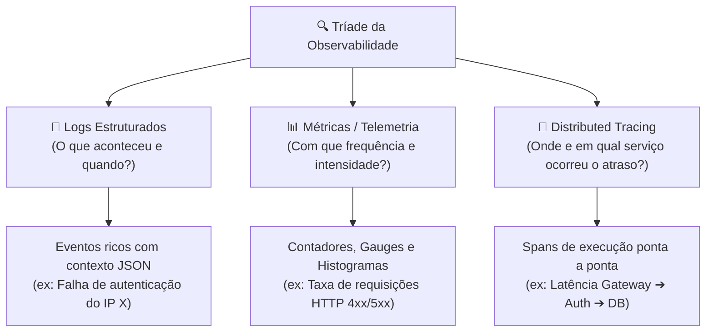
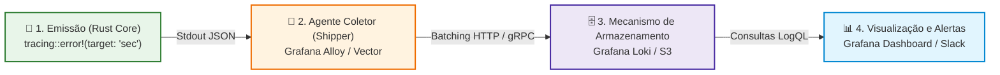
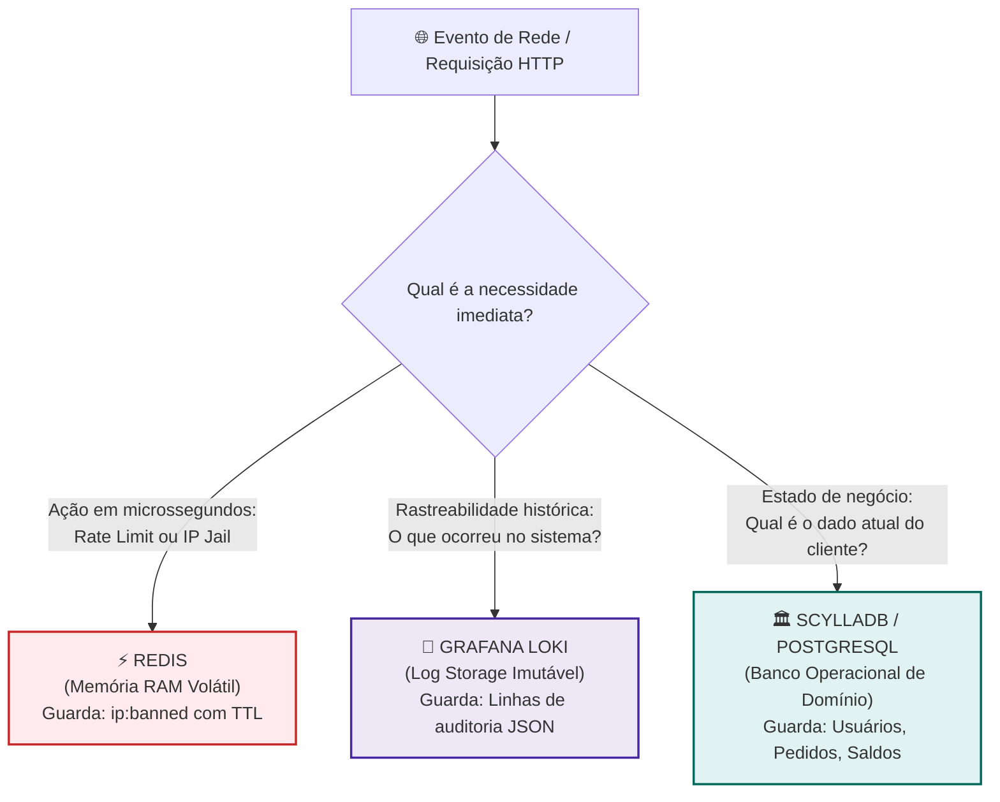
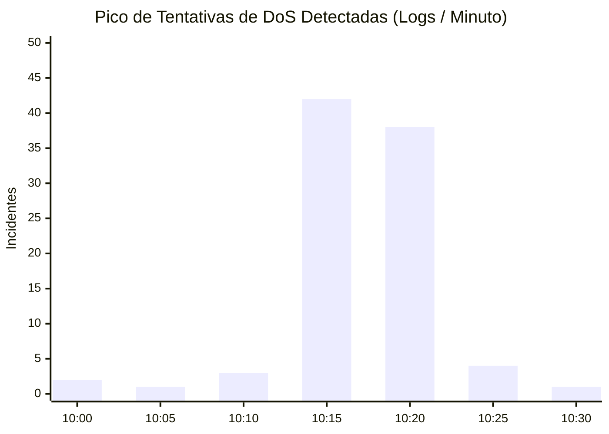

# Arquitetura de Observabilidade: Stack de Coleta de Logs, Auditoria e Telemetria

> Em arquiteturas corporativas modernas, microsserviços distribuídos e sistemas conteinerizados (Docker / Kubernetes), acessar servidores de produção via SSH para inspecionar arquivos de log estáticos (`/var/log/app.log`) com comandos como `tail -f` ou `grep` é um anti-padrão grave. Uma **Stack de Coleta de Logs** centraliza, indexa, armazena e correlaciona eventos em tempo real, viabilizando auditoria de segurança, depuração proativa e resposta automatizada a incidentes.

Quando combinada com sistemas de armazenamento rápido em memória (Redis) e bancos operacionais de alta vazão (ScyllaDB / PostgreSQL), a stack de logs completa a tríade de sustentação de sistemas resilientes: **mitigação em tempo real**, **persistência de domínio** e **rastreabilidade histórica imutável**.

---

## 1. Os Três Pilares da Observabilidade Moderna

A observabilidade moderna transcende a simples gravação de mensagens de texto; ela é sustentada por três pilares complementares:



* **Logs:** Registros detalhados de eventos discretos que ocorreram no sistema, enriquecidos com metadados (timestamp, severidade, IP, identificador de usuário, payload sanitizado).
* **Métricas:** Séries temporais numéricas agregadas (taxas de requisição, uso de CPU, percentis de latência $p95$/$p99$), ideais para detecção rápida de anomalias em painéis gráficos.
* **Traces:** Rastreamento distribuído que correlaciona uma requisição através de múltiplos microsserviços usando um identificador único de rastreio (`trace_id`).

---

## 2. A Anatomia de uma Stack de Logs (As 4 Camadas)

O ciclo de vida de um log desde a sua emissão no código Rust até a exibição em um dashboard de segurança é estruturado em quatro camadas fundamentais:



### 1. Camada de Emissão (Instrumentação da Aplicação)
O código da aplicação gera eventos contextualizados utilizando bibliotecas como o [`tracing`](https://crates.io/crates/tracing) em Rust.
* **Boa prática (12-Factor App):** A aplicação nunca deve gerenciar arquivos `.log` em disco diretamente nem lidar com rotação de arquivos (*logrotate*). Ela deve emitir fluxos contínuos de texto estruturado (JSON) para a saída padrão (`stdout`), delegando a captura para a infraestrutura.

### 2. Camada de Coleta e Roteamento (*Log Shipper / Collector*)
Um processo leve executado como *daemon* ou *sidecar* monitora as saídas dos contêineres ou sockets do sistema operacional, adiciona metadados de ambiente (como `container_name`, `host`, `namespace`) e transmite os logs em lotes compactados para o repositório central.
* **Principais opções:** Grafana Alloy (o substituto moderno do Promtail), Vector (escrito em Rust, ultra-rápido e econômico em RAM), FluentBit e Logstash.

### 3. Camada de Armazenamento e Indexação (*Storage Engine*)
O servidor central responsável por receber os logs brutos, compactá-los e persistir em disco ou em armazenamento de objetos (*Object Storage*).
* **Grafana Loki:** Adota a abordagem de **indexar apenas os metadados (labels)**, mantendo o corpo da mensagem comprimido em blocos (chunks). Isso resulta em um consumo de armazenamento e memória drasticamente menor que o dos concorrentes.
* **Elasticsearch / OpenSearch:** Indexa cada palavra de cada log em árvores invertidas (*inverted index*). Excelente para buscas textuais difusas, mas com custo elevado de disco e memória RAM.

### 4. Camada de Visualização e Gestão de Incidentes (*Dashboard & Alerting*)
A interface web interativa onde engenheiros e operadores de segurança analisam gráficos, realizam consultas forenses em tempo real e configuram regras de alerta para mensageiros como Slack, Telegram ou PagerDuty.
* **Principais opções:** Grafana (para Loki/Prometheus) e Kibana (para Elasticsearch).

---

## 3. Divisão de Responsabilidades: Loki vs. ScyllaDB vs. Redis

Uma dúvida frequente de arquitetura reside na escolha entre bancos de dados operacionais e agregadores de logs. Cada componente possui propósitos, características e garantias de consistência totalmente distintas:



### 1. Redis (Memória RAM Volátil — Camada de Ação Imediata)
* **Tempo de Acesso:** Sub-milissegundo (microssegundos).
* **Natureza dos Dados:** Dados efêmeros com expiração automática (TTL), contadores de acesso, listas de IPs em quarentena (*jails*) e sessões ativas.
* **Propósito:** Responder com velocidade instantânea: *"Este IP está autorizado a prosseguir agora?"*. Se o IP for malicioso, o Redis permite barrá-lo antes que a requisição gaste recursos do sistema.

### 2. Grafana Loki (Agregador de Logs — Histórico Imutável e Auditoria)
* **Tempo de Acesso:** Milissegundos a segundos para consultas analíticas.
* **Natureza dos Dados:** Fluxos cronológicos imutáveis de texto semi-estruturado, compactados em blocos e armazenados em *Object Storage* de baixo custo (AWS S3, MinIO, GCP Storage).
* **Propósito:** Responder à investigação forense: *"Quantos ataques ocorreram hoje? Quais IPs participaram? Qual o padrão de carga nas últimas 72 horas?"*.
* **Não é um banco de aplicação:** Você não consulta o Loki para validar se uma senha está correta ou se o cliente possui saldo em conta.

### 3. ScyllaDB / Bancos Relacionais (Banco de Domínio — Estado Atual)
* **Tempo de Acesso:** Baixa latência (1 a 5 ms) com suporte a transações ou partição massiva.
* **Natureza dos Dados:** Tabelas fortemente tipadas com esquemas definidos (*schemas*), índices secundários e relações.
* **Propósito:** Responder: *"Qual é o e-mail, nome e hash de senha cadastrados para o usuário ID 4501?"*.

### Matriz Comparativa Direta:

| Critério | Redis | Grafana Loki | ScyllaDB / PostgreSQL |
| :--- | :--- | :--- | :--- |
| **Local de Armazenamento** | 100% Memória RAM | Disco / Object Storage (S3/MinIO) | Disco SSD NVMe + Cache em RAM |
| **Estrutura dos Dados** | Chave-Valor, Sets, Hashes | Linhas de log em texto + Labels | Tabelas estruturadas (Linhas e Colunas) |
| **Estratégia de Busca** | Chave exata (`GET key`) | Filtros por labels e texto (LogQL) | Chave primária e índices (SQL/CQL) |
| **Custo de Retenção** | 🔴 Alto (Memória RAM cara) | 🟢 Mínimo (Compressão extrema no S3) | 🟡 Médio/Alto (Discos rápidos para I/O) |
| **Mutabilidade** | Leituras e escritas instantâneas | Somente escrita contínua (Imutável) | Atualizações e deleções frequentes |
| **Papel na Segurança** | Bloqueio ativo de IPs em tempo real | Auditoria pós-incidente e métricas | Armazenamento de credenciais e papéis |

---

## 4. Comparativo das Principais Stacks do Mercado

| Stack | Modelo | Consumo de Recursos | Facilidade de Operação | Cenário Ideal |
| :--- | :--- | :--- | :--- | :--- |
| **Grafana Stack (LGTM / Loki)** | Open Source / Auto-hospedado | 🟢 Baixo (Indexa apenas labels) | 🟢 Alta (Integração nativa com Grafana) | Microsserviços modernos, Kubernetes, orçamentos eficientes |
| **Elastic Stack (ELK / OpenSearch)** | Open Source / Corporativo | 🔴 Alto (Indexa texto completo em memória) | 🟡 Média a Complexa (Clustering e JVM) | Empresas que precisam de busca textual profunda no estilo Google |
| **ClickHouse + Vector** | Open Source / Colunar | 🟡 Médio (Alto throughput de escrita) | 🟡 Média | Big Data, telemetria massiva, bilhões de eventos/dia |
| **Datadog / Dynatrace** | SaaS Proprietário (Nuvem) | 🟢 Zero servidor para manter | 🟢 Máxima (Agente automatizado) | Equipes enxutas que preferem pagar para evitar gerenciar infra |

---

## 5. Implementação Prática em Rust com o Crate `tracing`

O ecossistema oficial para instrumentação idiomática em Rust é composto pelos crates [`tracing`](https://crates.io/crates/tracing) e [`tracing-subscriber`](https://crates.io/crates/tracing-subscriber).

A configuração a seguir inicializa um coletor que formata os logs em **JSON estruturado** diretamente para a saída padrão (`stdout`), pronto para ingestão por agentes de telemetria:

```rust
use tracing_subscriber::{layer::SubscriberExt, util::SubscriberInitExt, EnvFilter};

/// Inicializa o subsistema global de logs estruturados em JSON
pub fn inicializar_telemetria() {
    // 1. Configura filtro de severidade (ex: default INFO, mas permite sobrescrita via RUST_LOG)
    let env_filter = EnvFilter::try_from_default_env()
        .unwrap_or_else(|_| EnvFilter::new("info,auditoria_seguranca=debug"));

    // 2. Camada de formatação JSON para Stdout (padrão 12-Factor App)
    let formatador_json = tracing_subscriber::fmt::layer()
        .json()
        .flatten_event(true)       // Achata os campos de metadados no mesmo nível do JSON
        .with_current_span(true)   // Adiciona contexto do span assíncrono ativo
        .with_span_list(false)
        .with_target(true);        // Permite filtrar por módulo/alvo (ex: target: "auditoria_seguranca")

    // 3. Registra o subscriber globalmente na runtime
    tracing_subscriber::registry()
        .with(env_filter)
        .with(formatador_json)
        .init();
}
```

### Exemplo de Emissão de Eventos de Auditoria na Aplicação:

```rust
pub async fn autenticar_usuario(ip_origem: &str, usuario: &str, senha_bytes: usize) {
    if senha_bytes > 256 {
        // 🚨 LOG DE AUDITORIA: target customizado e campos estruturados
        tracing::error!(
            target: "auditoria_seguranca",
            evento = "tentativa_dos_senha",
            ip = %ip_origem,
            usuario = %usuario,
            tamanho_senha_bytes = senha_bytes,
            severidade = "critica",
            "Tentativa de autenticação com payload anômalo detectada."
        );
        return;
    }

    // Log operacional comum de depuração
    tracing::info!(
        target: "aplicacao::auth",
        usuario = %usuario,
        "Usuário autenticado com sucesso."
    );
}
```

### Saída Gerada no Terminal (JSON Puro):
```json
{"timestamp":"2026-11-09T10:45:00.123Z","level":"ERROR","target":"auditoria_seguranca","evento":"tentativa_dos_senha","ip":"198.51.100.42","usuario":"admin","tamanho_senha_bytes":4096,"severidade":"critica","message":"Tentativa de autenticação com payload anômalo detectada."}
```

---

## 6. Ambiente Completo com Docker Compose (Loki + Alloy + Grafana)

Para montar uma stack local completa de observabilidade com custo zero e consumo mínimo de recursos, utilize a composição abaixo:

```yaml
# docker-compose.observability.yml
version: "3.8"

services:
  # 1. Mecanismo de Armazenamento de Logs
  loki:
    image: grafana/loki:3.0.0
    container_name: loki
    ports:
      - "3100:3100"
    command: -config.file=/etc/loki/local-config.yaml
    volumes:
      - ./loki-data:/loki
    restart: unless-stopped

  # 2. Agente Coletor Moderno (Grafana Alloy)
  alloy:
    image: grafana/alloy:v1.0.0
    container_name: alloy
    volumes:
      - /var/run/docker.sock:/var/run/docker.sock:ro
      - ./config.alloy:/etc/alloy/config.alloy
    command: run --server.http.listen-addr=0.0.0.0:12345 /etc/alloy/config.alloy
    depends_on:
      - loki
    restart: unless-stopped

  # 3. Painel de Visualização e Dashboards
  grafana:
    image: grafana/grafana:11.0.0
    container_name: grafana
    ports:
      - "3000:3000"
    environment:
      - GF_SECURITY_ADMIN_PASSWORD=admin_seguro
    volumes:
      - ./grafana-data:/var/lib/grafana
    depends_on:
      - loki
    restart: unless-stopped
```

### Configuração do Coletor (`config.alloy`):
O Grafana Alloy descobre automaticamente os contêineres Docker e encaminha os logs para o Loki:

```alloy
// Descobre contêineres Docker locais
discovery.docker "containers" {
  host = "unix:///var/run/docker.sock"
}

// Coleta as saídas stdout/stderr dos contêineres
loki.source.docker "docker_logs" {
  host       = "unix:///var/run/docker.sock"
  targets    = discovery.docker.containers.targets
  forward_to = [loki.write.local_loki.receiver]
}

// Encaminha os lotes compactados para o serviço Loki
loki.write "local_loki" {
  endpoint {
    url = "http://loki:3100/loki/api/v1/push"
  }
}
```

---

## 7. Consultas com LogQL e Alertas em Tempo Real

No painel do Grafana (conectado à fonte de dados do Loki), os analistas de segurança consultam os logs utilizando **LogQL** (linguagem inspirada no PromQL):

### 1. Filtrar Apenas Incidentes Críticos de Segurança:
```logql
{container_name="api_rust"} | json | target = "auditoria_seguranca"
```

### 2. Filtrar Ataques Vindos de uma Sub-rede ou IP Específico:
```logql
{container_name="api_rust"} | json | target = "auditoria_seguranca" and ip =~ "198.51.100.*"
```

### 3. Transformar Logs em Métrica (Taxa de Ataques por Minuto):
Essa consulta calcula quantas tentativas de ataque ocorreram por minuto nos últimos 15 minutos:
```logql
sum by (ip) (rate({container_name="api_rust"} | json | target = "auditoria_seguranca" [1m]))
```



### 4. Configuração de Alerta Automático (Grafana Alerting):
Você pode configurar uma regra de disparo contínuo:
* **Condição:** Se `sum(rate({target="auditoria_seguranca"}[1m])) > 10` durante 2 minutos consecutivos.
* **Ação:** Enviar notificação crítica via Webhook para o canal `#incidentes-seguranca` no Slack ou disparar chamado no PagerDuty.

---

## 8. Arquitetura Integrada de Produção

Este diagrama ilustra a colaboração harmônica entre a aplicação Rust, o Redis para mitigação imediata, o Grafana Loki para auditoria e o ScyllaDB para persistência de negócio:

```mermaid
graph TD
    %% Estilos Globais
    classDef client fill:#e1f5fe,stroke:#0288d1,stroke-width:2px;
    classDef app fill:#e8f5e9,stroke:#2e7d32,stroke-width:2px;
    classDef fast fill:#ffebee,stroke:#c62828,stroke-width:2px;
    classDef audit fill:#ede7f6,stroke:#4527a0,stroke-width:2px;
    classDef db fill:#e0f2f1,stroke:#00695c,stroke-width:2px;

    Client["🌐 Cliente / Atacante"]:::client -->|1. Requisição HTTP| RustApp["💎 Aplicação Rust (Axum Core)"]:::app

    %% Mitigação Ativa
    RustApp <-->|2. Consulta & Bloqueio Instantâneo<br/>(Sub-milissegundo)| Redis[("⚡ Redis<br/>Blacklist de IPs (Jail)")]:::fast

    %% Auditoria Assíncrona
    RustApp -->|3. Stdout: Log JSON Estruturado| Shipper["🚚 Agente Coletor<br/>(Grafana Alloy / Vector)"]:::audit
    Shipper -->|4. Push em Lotes Compactados| Loki[("🗄️ Grafana Loki<br/>Armazenamento em Chunks")]:::audit
    Loki --> Grafana["📊 Grafana Dashboard<br/>Alertas no Slack / PagerDuty"]:::audit

    %% Fluxo de Negócio Legítimo
    RustApp <-->|5. Dados Válidos de Domínio<br/>(Usuários, Contas, Pedidos)| ScyllaDB[("🏛️ ScyllaDB / PostgreSQL<br/>Persistência Transacional")]:::db
```

---

## 9. Boas Práticas e Regras de Ouro para Observabilidade

1. **Trate logs como fluxos contínuos de eventos (12-Factor App):** Nunca configure caminhos de arquivos locais dentro do código da aplicação (`/var/log/app.log`). Escreva sempre para `stdout`/`stderr` e permita que o orquestrador (Docker / Kubernetes) colete os dados.
2. **Priorize Logs Estruturados em JSON:** O texto não-estruturado (*printf debugging*) exige expressões regulares lentas e frágeis na busca. Emita campos tipados (`ip`, `usuario_id`, `duracao_ms`) para habilitar filtros diretos no Loki.
3. **Higienização Obrigatória de PII (Proteção de Dados):**
   * NUNCA registre senhas, códigos de verificação (CVV/MFA) ou tokens JWT completos nos logs.
   * Mascare dados sensíveis (ex: CPF: `123.***.***-00`, E-mail: `u***@dominio.com`).
4. **Estabeleça Retenção Diferenciada no Storage:**
   * Logs operacionais de debug: retenção de 7 a 14 dias.
   * Logs de auditoria e segurança (`target: "auditoria_seguranca"`): retenção de 90 a 365 dias em Object Storage econômico (AWS S3 Glacier ou MinIO).
5. **Correlacione com `Trace ID`:** Emita sempre um identificador único de requisição (*Correlation ID*) presente tanto no log da aplicação quanto no cabeçalho HTTP de resposta (`X-Request-Id`), permitindo rastrear o ciclo completo de um erro relatado por um cliente.

---

### Leituras Complementares no Guia:
* [Segurança Proativa: Monitoramento e Resposta a Payloads Anômalos em Rust](/seguranca/reagir-payloads-grandes.md)
* [Validação de Strings, Limite de Tamanho e Newtypes em Rust](/boas-praticas/Rust/validacao-string.md)
* [Ofuscamento de Rotas Administrativas e Defesa em Profundidade](/seguranca/ofuscamento-rotas-admin.md)
