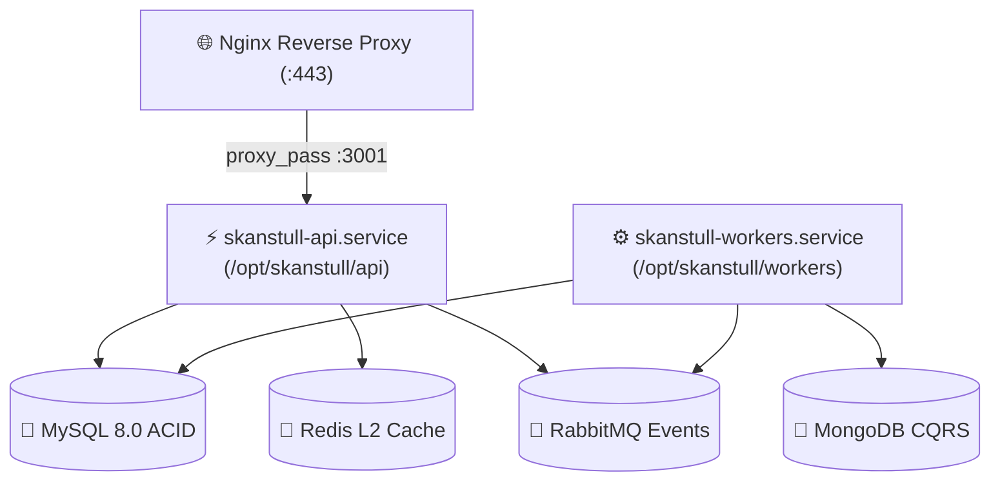

# 🚀 Guia Operacional: Configuração de Serviços Systemd em Produção (Linux/Debian) - Skanstull

Este guia padroniza a criação, permissões, hardening de segurança e gerenciamento dos daemons em segundo plano da **Skanstull** no servidor Debian/Ubuntu via `systemd`.

---

## 📌 1. Visão Geral da Arquitetura de Processos

A Skanstull divide suas responsabilidades em dois processos independentes compilados em Rust:

1. **`skanstull-api.service` (API HTTP Axum):**
   * Servidor assíncrono Tokio ouvindo na porta local `127.0.0.1:3001`.
   * Atende requisições do Storefront SSR, API RESTful, Checkout e Painel Administrativo.
2. **`skanstull-workers.service` (Background Workers Daemon):**
   * Consumidor de mensageria assíncrona RabbitMQ (eventos de pedidos, faturamento e recuperação de senha).
   * Processamento contínuo do *Transactional Outbox Pattern* (sincronização relacional MySQL $\rightarrow$ MongoDB Read Model CQRS).



---

## 📁 2. Preparação do Diretório Operacional e Permissões

Antes de registrar os serviços, garanta que a estrutura de diretórios em `/opt/skanstull` exista com as permissões corretas para o usuário de sistema `www-data`:

```bash
# 1. Cria a árvore de diretórios do ambiente
sudo mkdir -p /opt/skanstull/public
sudo mkdir -p /opt/skanstull/templates
sudo mkdir -p /opt/skanstull/uploads

# 2. Ajusta a titularidade para o usuário do servidor web (www-data)
sudo chown -R www-data:www-data /opt/skanstull

# 3. Garante permissões adequadas de execução e leitura
sudo chmod -R 755 /opt/skanstull
```

> [!IMPORTANT]
> O arquivo `.env` contém credenciais sensíveis de banco de dados e segredos JWT. Garanta que apenas o proprietário e o grupo `www-data` consigam lê-lo:
> ```bash
> sudo chmod 640 /opt/skanstull/.env
> sudo chown www-data:www-data /opt/skanstull/.env
> ```

---

## ⚙️ 3. Criação dos Arquivos de Serviço Systemd

### 3.1. Serviço da API HTTP (`/etc/systemd/system/skanstull-api.service`)

Crie ou edite o arquivo de unidade:
```bash
sudo nano /etc/systemd/system/skanstull-api.service
```

Cole o conteúdo abaixo:

```ini
[Unit]
Description=Skanstull Web API em Rust (Axum)
After=network.target mariadb.service mysql.service redis-server.service rabbitmq-server.service mongod.service
Wants=mariadb.service redis-server.service

[Service]
# Usuário e grupo sem privilégios de root para segurança defensiva
User=www-data
Group=www-data

# Diretório base e carregamento automático de variáveis
WorkingDirectory=/opt/skanstull
EnvironmentFile=-/opt/skanstull/.env

# Caminho absoluto para o binário da API
ExecStart=/opt/skanstull/api

# Política de auto-recuperação (Self-Healing)
Restart=on-failure
RestartSec=3
StartLimitIntervalSec=60
StartLimitBurst=10

# Limite elevado de descritores de arquivos para conexões concorrentes
LimitNOFILE=65536

# Isolamento e segurança básica do processo (Systemd Hardening)
PrivateTmp=true
ProtectSystem=full
NoNewPrivileges=true

# Encaminhamento de logs estruturados (Tracing) para o journald do Linux
StandardOutput=journal
StandardError=journal
SyslogIdentifier=skanstull-api

# Parâmetros padrão de runtime
Environment=RUST_LOG=info,alpha_api=debug
Environment=SERVER_PORT=3001

[Install]
WantedBy=multi-user.target
```

---

### 3.2. Serviço dos Background Workers (`/etc/systemd/system/skanstull-workers.service`)

Crie o arquivo de unidade para os consumidores e processador de outbox:
```bash
sudo nano /etc/systemd/system/skanstull-workers.service
```

Cole o conteúdo abaixo:

```ini
[Unit]
Description=Skanstull Background Workers & Outbox Daemon em Rust (Tokio)
After=network.target mariadb.service mysql.service redis-server.service rabbitmq-server.service mongod.service
Wants=mariadb.service rabbitmq-server.service mongod.service

[Service]
User=www-data
Group=www-data

WorkingDirectory=/opt/skanstull
EnvironmentFile=-/opt/skanstull/.env

# Caminho absoluto para o binário dos workers
ExecStart=/opt/skanstull/workers

Restart=on-failure
RestartSec=5
StartLimitIntervalSec=60
StartLimitBurst=10

LimitNOFILE=65536
PrivateTmp=true
ProtectSystem=full
NoNewPrivileges=true

StandardOutput=journal
StandardError=journal
SyslogIdentifier=skanstull-workers

Environment=RUST_LOG=info,workers=debug

[Install]
WantedBy=multi-user.target
```

---

## 🔄 4. Ativação e Gerenciamento dos Serviços

Após criar ou alterar qualquer arquivo em `/etc/systemd/system/`, execute os passos a seguir:

```bash
# 1. Notifica o systemd sobre as novas unidades
sudo systemctl daemon-reload

# 2. Habilita a inicialização automática no boot do sistema e inicia agora
sudo systemctl enable --now skanstull-api.service
sudo systemctl enable --now skanstull-workers.service
```

### Comandos de Gestão Diária:
| Ação | Comando |
| :--- | :--- |
| **Verificar Status** | `sudo systemctl status skanstull-api.service skanstull-workers.service` |
| **Reiniciar API** | `sudo systemctl restart skanstull-api.service` |
| **Reiniciar Workers** | `sudo systemctl restart skanstull-workers.service` |
| **Parar Serviços** | `sudo systemctl stop skanstull-api.service skanstull-workers.service` |

---

## 🔍 5. Verificação de Saúde e Diagnóstico Operacional

### 5.1. Teste de Conectividade Local
Verifique se a API está respondendo na porta `3001` no localhost:
```bash
# 1. Verifica se a porta 3001 está aberta ouvindo conexões
ss -tulpn | grep 3001

# 2. Executa healthcheck HTTP no endpoint de liveness
curl -I http://127.0.0.1:3001/healthz
# Retorno esperado: HTTP/1.1 200 OK

# 3. Executa deep healthcheck com validação de pools (MySQL, Redis, MongoDB)
curl -s http://127.0.0.1:3001/readyz
```

### 5.2. Acompanhamento de Logs em Tempo Real
Para monitorar a telemetria do Rust Tracing via `journalctl`:

```bash
# Seguir logs da API em tempo real
journalctl -u skanstull-api.service -f -o cat

# Seguir logs dos Workers em tempo real
journalctl -u skanstull-workers.service -f -o cat

# Ver as últimas 50 linhas com timestamps completos
journalctl -u skanstull-api.service -n 50 --no-pager
```


---

### 3.2. Serviço dos Background Workers (`/etc/systemd/system/skanstull-workers.service`)

Crie o arquivo de unidade para os consumidores e processador de outbox:
```bash
sudo nano /etc/systemd/system/skanstull-workers.service
```

Cole o conteúdo abaixo:

```ini
[Unit]
Description=Skanstull Background Workers & Outbox Daemon em Rust (Tokio)
After=network.target mariadb.service mysql.service redis-server.service rabbitmq-server.service mongod.service
Wants=mariadb.service rabbitmq-server.service mongod.service

[Service]
User=www-data
Group=www-data

WorkingDirectory=/opt/skanstull
EnvironmentFile=-/opt/skanstull/.env

# Caminho absoluto para o binário dos workers
ExecStart=/opt/skanstull/workers

Restart=on-failure
RestartSec=5
StartLimitIntervalSec=60
StartLimitBurst=10

LimitNOFILE=65536
PrivateTmp=true
ProtectSystem=full
NoNewPrivileges=true

StandardOutput=journal
StandardError=journal
SyslogIdentifier=skanstull-workers

Environment=RUST_LOG=info,workers=debug

[Install]
WantedBy=multi-user.target
```

---

## 🔄 4. Ativação e Gerenciamento dos Serviços

Após criar ou alterar qualquer arquivo em `/etc/systemd/system/`, execute os passos a seguir:

```bash
# 1. Notifica o systemd sobre as novas unidades
sudo systemctl daemon-reload

# 2. Habilita a inicialização automática no boot do sistema e inicia agora
sudo systemctl enable --now skanstull-api.service
sudo systemctl enable --now skanstull-workers.service
```

### Comandos de Gestão Diária:
| Ação | Comando |
| :--- | :--- |
| **Verificar Status** | `sudo systemctl status skanstull-api.service skanstull-workers.service` |
| **Reiniciar API** | `sudo systemctl restart skanstull-api.service` |
| **Reiniciar Workers** | `sudo systemctl restart skanstull-workers.service` |
| **Parar Serviços** | `sudo systemctl stop skanstull-api.service skanstull-workers.service` |

---

## 🔍 5. Verificação de Saúde e Diagnóstico Operacional

### 5.1. Teste de Conectividade Local
Verifique se a API está respondendo na porta `3001` no localhost:
```bash
# 1. Verifica se a porta 3001 está aberta ouvindo conexões
ss -tulpn | grep 3001

# 2. Executa healthcheck HTTP no endpoint de liveness
curl -I http://127.0.0.1:3001/healthz
# Retorno esperado: HTTP/1.1 200 OK

# 3. Executa deep healthcheck com validação de pools (MySQL, Redis, MongoDB)
curl -s http://127.0.0.1:3001/readyz
```

### 5.2. Acompanhamento de Logs em Tempo Real
Para monitorar a telemetria do Rust Tracing via `journalctl`:

```bash
# Seguir logs da API em tempo real
journalctl -u skanstull-api.service -f -o cat

# Seguir logs dos Workers em tempo real
journalctl -u skanstull-workers.service -f -o cat

# Ver as últimas 50 linhas com timestamps completos
journalctl -u skanstull-api.service -n 50 --no-pager
```