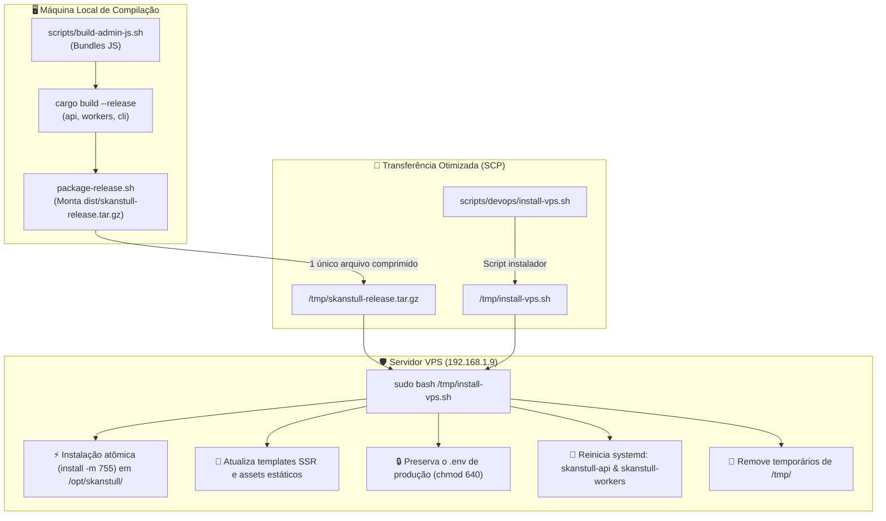

# 🚀 Guia Operacional: Deploy Automatizado via Pacote Único (Tarball Release) na VPS

Este guia padroniza o processo de compilação, empacotamento em artefato imutável (`.tar.gz`), transferência segura e instalação atômica da **Skanstull** no servidor remoto/VPS (`deploy@179.198.119.213`).

---

## 📌 1. Visão Geral da Arquitetura de Deploy

Em vez de transferir dezenas de arquivos e binários soltos via múltiplos comandos `scp` (o que gera lentidão, risco de corrupção por queda de rede e erro de `Text file busy`), adotamos o **Padrão Ouro de Engenharia de Software (Artifact-based Release)**:



### Principais Vantagens do Novo Fluxo:
1. **Velocidade Extrema:** A transferência de um único arquivo compactado é até **50x mais rápida** que centenas de arquivos soltos.
2. **Substituição Atômica (Zero Downtime):** O comando `install -m 755` aloca um novo *inode* no Linux, eliminando o erro de arquivo ocupado (*Text file busy*).
3. **Preservação de Dados:** A pasta `/opt/skanstull/uploads/` e o arquivo `/opt/skanstull/.env` de produção são **100% preservados**, sem risco de sobrescrita acidental.
4. **Instalação Desacoplada:** O upload ocorre na pasta `/tmp/` com o usuário comum (`peter`), e a instalação final é executada via `sudo` com propriedade para `www-data`.

---

## ⚙️ 2. Preparação Inicial da VPS (Executado Apenas na 1ª Vez)

Se o servidor VPS ainda não possui os diretórios e serviços configurados, execute estes comandos no servidor remoto:

1. Acesse o servidor remoto via SSH:
   ```bash
   ssh deploy@179.198.119.213
   ```

2. Crie a estrutura de diretórios em `/opt/skanstull/`:
   ```bash
   sudo mkdir -p /opt/skanstull/public
   sudo mkdir -p /opt/skanstull/templates
   sudo mkdir -p /opt/skanstull/uploads
   sudo mkdir -p /opt/skanstull/database/schemas
   sudo mkdir -p /opt/skanstull/database/seeds
   ```

3. Ajuste as permissões para o usuário de sistema `www-data` e adicione seu usuário ao grupo:
   ```bash
   sudo chown -R www-data:www-data /opt/skanstull
   sudo chmod -R 755 /opt/skanstull
   sudo chmod -R 775 /opt/skanstull/uploads
   sudo usermod -a -G www-data $USER
   ```

> [!TIP]
> Caso ainda não tenha registrado os daemons do Systemd na VPS, consulte o guia oficial:  
> 👉 [`create-service.md`](create-service.md)

---

## ⚡ 3. Opção A: Deploy Rápido em 1 Único Comando (Recomendado)

Na sua **máquina local de desenvolvimento**, você pode executar todo o ciclo (compilar JS, compilar Rust, empacotar, enviar via SCP e instalar na VPS) com um comando:

```bash
./scripts/devops/package-release.sh --upload deploy@179.198.119.213 --deploy
```

> [!NOTE]
> Se você já tiver compilado os binários Rust previamente e quiser apenas reenviar uma alteração rápida de templates/HTML/JS, adicione a flag `--skip-build`:
> ```bash
> ./scripts/devops/package-release.sh --skip-build --upload deploy@179.198.119.213 --deploy
> ```

---

## 🛠️ 4. Opção B: Deploy Manual Passo a Passo (Auditável)

Se preferir realizar cada etapa manualmente para inspecionar os passos:

### Passo 1: Gerar o Pacote de Release Local
Na máquina local, execute o script de empacotamento:
```bash
./scripts/devops/package-release.sh
```
*O script compilará os bundles JS, os binários `--release` e criará o arquivo `dist/skanstull-release.tar.gz`.*

---

### Passo 2: Enviar o Pacote e o Instalador para a VPS
Envie o tarball e o script de instalação para a pasta `/tmp/` do servidor remoto via SCP:
```bash
scp dist/skanstull-release.tar.gz scripts/devops/install-vps.sh deploy@179.198.119.213:/tmp/
```

---

### Passo 3: Executar a Instalação Remota via SSH
Dispare a instalação com privilégios de superusuário:
```bash
ssh -t deploy@179.198.119.213 "sudo bash /tmp/install-vps.sh"
```

---

## 🔍 5. O que o Script Remoto (`install-vps.sh`) Executa na VPS?

O script [`scripts/devops/install-vps.sh`](scripts/devops/install-vps.sh) opera as seguintes etapas de forma segura e idempotente:

1. **Extração Isolada:** Descompacta `/tmp/skanstull-release.tar.gz` em uma pasta temporária exclusiva (`/tmp/skanstull-extract-$$`).
2. **Troca Atômica de Inodes:** Executa `install -m 755` para os binários `/opt/skanstull/api`, `workers` e `cli`.
3. **Sincronização de Recursos:** Atualiza `/opt/skanstull/public/`, `/opt/skanstull/templates/` e `/opt/skanstull/database/`. *(Nota: os uploads reais dos clientes em `/opt/skanstull/uploads/` nunca são apagados)*.
4. **Preservação do `.env`:** Se o arquivo `/opt/skanstull/.env` já existir, ele é mantido 100% intacto. Se for a primeira instalação, cria uma cópia a partir de `.env.example`.
5. **Permissões Unix Defensivas:** Aplica `chown -R www-data:www-data`, permissão `755` geral, `775` em `uploads/` e trava o `.env` com permissão estrita `640`.
6. **Reconexão com Systemd:** Executa `systemctl daemon-reload && systemctl restart skanstull-api.service skanstull-workers.service`.
7. **Limpeza e Health Check:** Remove os arquivos temporários de `/tmp/` e valida se o processo da API está ativo via `systemctl is-active`.

---

## 🩺 6. Comandos Úteis de Diagnóstico na VPS

Após o deploy, você pode inspecionar a saúde da aplicação na VPS com os seguintes comandos:

### 1. Verificar Status dos Serviços
```bash
ssh deploy@179.198.119.213 "systemctl status skanstull-api.service skanstull-workers.service"
```

### 2. Acompanhar Logs da Aplicação em Tempo Real
```bash
ssh deploy@179.198.119.213 "journalctl -u skanstull-api.service -f"
```

### 3. Testar a Resposta HTTP Local da API (Porta 3001)
```bash
ssh deploy@179.198.119.213 "curl -I http://127.0.0.1:3001/"
```

### 4. Testar o Proxy Reverso Nginx com HTTPS (Porta 443)
```bash
curl -kI https://192.168.1.9/
```

### Copiar o executável para o servidor VPS
```bash
scp /var/www/html/Rust-e-commerce-Alpha/target/release/api deploy@179.198.119.213:/tmp/
sudo install -m 755 /tmp/api /opt/skanstull/api
sudo systemctl restart skanstull-api.service
```


*(A flag `-k` ignora avisos de autoridade certificadora local em ambiente de teste).*
